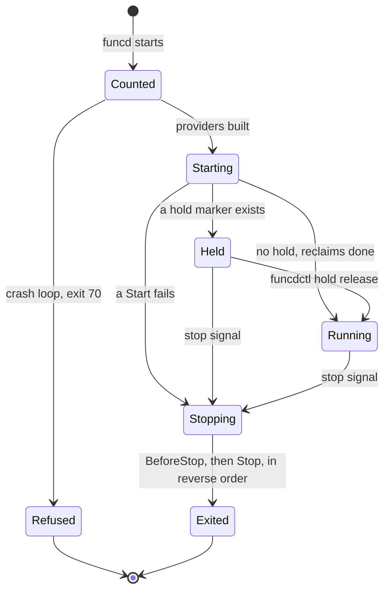
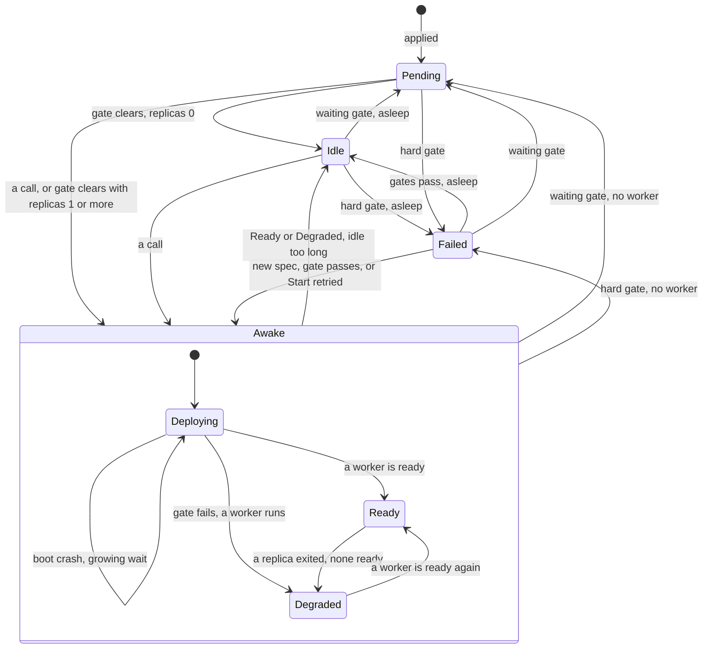
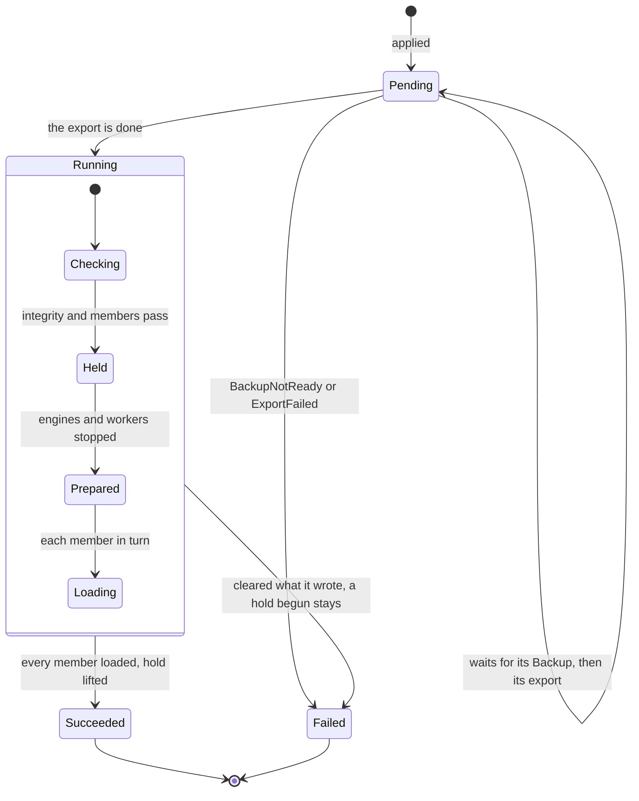

# Platform behavior

What the platform does, when, and who decided it. Read this before you call something a bug. If this file and an ADR
disagree, the ADR wins and this file is corrected. Numbers come from the code and the config: each chapter's folded block is
generated, and `just check-behavior` fails when a row no longer holds.

A row's status is `decided` (an ADR or the dated decider chose it), `accepted` (an ADR or the dated decider named it as a cost or
a risk), `deferred` (a board card or an open issue holds it) or `uncovered` (nothing speaks of it: a question for the decider, no
fix until answered). A row names only what someone could see and wonder about: a wait of about a second or more; a state, error or
refusal; a cost, risk or limit an ADR accepted.

## Platform lifecycle

Kinds: none of its own.

Providers start in list order, the Executor first: Executor, KV, blob, SQL, Lake, eventing, secrets, invoke. Details:
[start-stop](design/platform/start-stop.md).

| Where | What happens | Time | You see | Status | Source |
|---|---|---|---|---|---|
| Unclean starts in a row | At `recovery.safeMode.afterCrashes` 3 funcd starts held; at twice that it refuses to start | a start is clean after `recovery.safeMode.stableAfter` 10 min | exit 70, naming the restore | decided | ADR-0207, `TestBeginModes`, app-todo D15 |
| A provider's Start fails | funcd stops what started, then exits | none | an error naming the provider | decided | ADR-0305, `TestRun_AFailedStartNamesItsProvider`, `TestIssue489_RunShutsDownOnSetupError` |
| Held | No timer, blob source, Sensor, run, App rollout, retention sweep, backup or reclaim acts; ingress and workers still serve | until `funcdctl hold release` | `funcdctl hold status` | accepted | ADR-0206 Consequences, `TestEveryRunnerConsultsHold` |
| funcd restarts | No worker survives: the boot sweep removes them, and each one comes back through its reconcile | `killWait` 10 s per task, at most | a first call may be held | decided | ADR-0186, ADR-0262 Decision 8, app-todo B10 |
| funcd stops | Every worker gets SIGTERM, then SIGKILL after the grace | `runtime.containerd.stopGrace` 10 s, inside `server.shutdownTimeout` 15 s | `the stop failed` when the grace ends | decided | ADR-0277, ADR-0305, `TestScenarioOneGraceForBothStops`, `TestShutdown_ClosesLakeProxiesBeforeTheRuntime` |

<!-- generated values, do not edit: just behavior-values -->

Platform lifecycle: values

| Value | Default | From |
|---|---|---|
| `log.format` | json | config |
| `log.level` | info | config |
| `recovery.safeMode.afterCrashes` | 3 | config |
| `recovery.safeMode.stableAfter` | 10m | config |
| `storage.dataDir` | /var/lib/funcd | config |
| `storage.metastoreDir` | <dataDir>/store | config |
| `storage.minFreeSize` | 2GiB | config |
| `storage.mode` | file | config |
| `storage.quarantineRetention` | 168h | config |
| `telemetry.endpoint` | "" ⇒ telemetry disabled | config |
| `telemetry.insecure` | false | config |
| `maxTokenFileBytes` | 4096 | `cmd/funcd/credentials.go` |
| `maxStopGrace` | 10s | `cmd/funcd/main.go` |
| `minKeyRotationPeriod` | 1h | `cmd/funcd/main.go` |
| `minPositive` | 1ms | `cmd/funcd/main.go` |
| `minRetryBackoffMax` | 5ms | `cmd/funcd/main.go` |
| `pacing(): p.AppUpgradeTimeout` | 5m | `cmd/funcd/main.go` |
| `pacing(): p.DeliveryBackoffMax` | 10s | `cmd/funcd/main.go` |
| `telemetryCloseTimeout` | 1s | `cmd/funcd/main.go` |
| `spaceWait` | 10s | `cmd/funcd/space.go` |
| `storesOpenBytes` | 640MiB | `cmd/funcd/space.go` |
| `checkBackupTimes(): ceilDiv` | 24h | `internal/platform/config/backup.go` |
| `defaultBackupInterval` | 1h | `internal/platform/config/backup.go` |
| `defaultBackupRPO` | 2h | `internal/platform/config/backup.go` |
| `defaultBackupRetryInterval` | 5m | `internal/platform/config/backup.go` |
| `defaultBlobBackupInterval` | 1h | `internal/platform/config/blob.go` |
| `defaultBlobRebaseline` | 720h | `internal/platform/config/blob.go` |
| `defaultBlobRetention` | 720h | `internal/platform/config/blob.go` |
| `defaultKVBackupInterval` | 30s | `internal/platform/config/kvbackup.go` |
| `defaultKVRebaseline` | 24h | `internal/platform/config/kvbackup.go` |
| `defaultKVRebaselineRetry` | 1h | `internal/platform/config/kvbackup.go` |
| `kvChunkBytesMax` | 8MiB | `internal/platform/config/kvbackup.go` |
| `MaxLakeSaveInterval` | 1h | `internal/platform/config/lake.go` |
| `MinLakeSaveInterval` | 500ms | `internal/platform/config/lake.go` |
| `MinLakeScratchBytes` | 1GiB | `internal/platform/config/lake.go` |
| `lakeScratchMargin` | 512MiB | `internal/platform/config/lake.go` |
| `DefaultQuarantineRetention` | 168h | `internal/platform/config/quarantine.go` |
| `MinQuarantineRetention` | 1h | `internal/platform/config/quarantine.go` |
| `DefaultWorkloadBackupMaxCopyMembers` | 1024 | `internal/platform/config/workloadbackup.go` |
| `DefaultWorkloadBackupMaxListedKeys` | 1MiB | `internal/platform/config/workloadbackup.go` |
| `DrainLimit` | 4KiB | `internal/platform/httpx/httpx.go` |
| `NodeTransport(): KeepAlive` | 30s | `internal/platform/httpx/httpx.go` |
| `NodeTransport(): Timeout` | 30s | `internal/platform/httpx/httpx.go` |
| `NodeTransport(): tr.IdleConnTimeout` | 1m30s | `internal/platform/httpx/httpx.go` |
| `Transport(): IdleConnTimeout` | 1m30s | `internal/platform/httpx/httpx.go` |
| `Transport(): KeepAlive` | 30s | `internal/platform/httpx/httpx.go` |
| `Transport(): TLSHandshakeTimeout` | 10s | `internal/platform/httpx/httpx.go` |
| `Transport(): Timeout` | 30s | `internal/platform/httpx/httpx.go` |
| `build(): workerClient` | 30s | `pkg/funcd/binding_providers.go` |
| `openFeed(): time.After` | 50ms | `pkg/funcd/binding_providers.go` |
| `sqlFeedBootWait` | 30s | `pkg/funcd/binding_providers.go` |
| `buildControlPlane(): ReadHeaderTimeout` | 10s | `pkg/funcd/funcd.go` |
| `buildControlPlane(): ReadTimeout` | 10s | `pkg/funcd/funcd.go` |
| `closeMargin` | 2s | `pkg/funcd/funcd.go` |
| `defaultBucketsPerNamespace` | 100 | `pkg/funcd/funcd.go` |
| `defaultCloseGrace` | 3s | `pkg/funcd/funcd.go` |
| `defaultDeadletterMaxEntries` | 1000 | `pkg/funcd/funcd.go` |
| `defaultDeadletterRetention` | 720h | `pkg/funcd/funcd.go` |
| `defaultKVStoresPerNamespace` | 100 | `pkg/funcd/funcd.go` |
| `defaultNestedInFlightCap` | 10 | `pkg/funcd/funcd.go` |
| `defaultSQLDatabasesPerNamespace` | 20 | `pkg/funcd/funcd.go` |
| `defaultWorkflowMaxStepsInFlight` | 64 | `pkg/funcd/funcd.go` |
| `defaultWorkflowPayloadLimit` | 256KiB | `pkg/funcd/funcd.go` |
| `defaultWorkflowRetention` | 720h | `pkg/funcd/funcd.go` |
| `defaultWorkflowRetry` | 1 | `pkg/funcd/funcd.go` |
| `defaultWorkflowStepTimeout` | 5m | `pkg/funcd/funcd.go` |
| `minRecordBytes` | 1024 | `pkg/funcd/funcd.go` |
| `shutdownTimeout` | 15s | `pkg/funcd/funcd.go` |
| `defaultActivationTimeout` | 30s | `pkg/funcd/options.go` |
| `defaultBootTimeout` | 1m | `pkg/funcd/options.go` |
| `defaultDeliveryBackoffInitial` | 100ms | `pkg/funcd/options.go` |
| `defaultDeliveryBackoffMax` | 10s | `pkg/funcd/options.go` |
| `defaultDrainGrace` | 30s | `pkg/funcd/options.go` |
| `defaultHandOutSettle` | 2s | `pkg/funcd/options.go` |
| `defaultRetryBackoffMax` | 1s | `pkg/funcd/options.go` |
| `defaultStorageProbeInterval` | 10s | `pkg/funcd/options.go` |
| `defaultStorageProbeTimeout` | 2s | `pkg/funcd/options.go` |
| `defaultSupervisionPeriod` | 10s | `pkg/funcd/options.go` |
| `defaultWorkerSyncInterval` | 2s | `pkg/funcd/options.go` |
| `maxAppRevisionHistory` | 100 | `pkg/funcd/options.go` |
| `maxBaseDomain` | 189 | `pkg/funcd/options.go` |
| `maxDefaultRetryBackoff` | 1h | `pkg/funcd/options.go` |
| `minDefaultAppUpgradeTimeout` | 5m | `pkg/funcd/options.go` |
| `minDefaultLivenessTimeout` | 30s | `pkg/funcd/options.go` |
| `minRetryBackoffMax` | 5ms | `pkg/funcd/options.go` |
| `quarantineSweepEvery` | 1h | `pkg/funcd/quarantine.go` |
| `quarantineSweepFirst` | 5m | `pkg/funcd/quarantine.go` |

<!-- end of generated values -->
## Controller

Kinds: none of its own.

Not written yet.

<!-- generated values, do not edit: just behavior-values -->

Controller: values

| Value | Default | From |
|---|---|---|
| `controller.gcSweepInterval` | 5m | config |
| `controller.referentPollInterval` | 2s | config |
| `controller.retryBackoffMax` | 1s | config |
| `controller.routeResyncInterval` | 10s | config |
| `SupervisionPeriod` | 10s | `internal/controller/controller.go` |
| `baseBackoff` | 5ms | `internal/controller/controller.go` |
| `maxBackoff` | 1s | `internal/controller/controller.go` |
| `DefaultInterval` | 5m | `internal/gc/gc.go` |
| `rewatchBackoff` | 1s | `internal/gc/gc.go` |
| `Open(): gcInterval` | 5m | `internal/store/badger/badger.go` |
| `defaultRingCap` | 1024 | `internal/store/store.go` |
| `recv(): time.After` | 2s | `internal/store/storecontract/contract.go` |
| `testWatchStreams(): time.After` | 2s | `internal/store/storecontract/contract.go` |
| `timelineBytes` | 8 | `internal/store/version.go` |

<!-- end of generated values -->
## Admission

Kinds: Namespace, ResourceGroup.

Not written yet.

<!-- generated values, do not edit: just behavior-values -->

Admission: values

| Value | Default | From |
|---|---|---|
| `maxAppConfigMapNameLength` | 52 | `api/types/v1alpha1/app.go` |
| `maxAppNameLength` | 52 | `api/types/v1alpha1/app.go` |
| `maxAppRevisionNumber` | 9999999999 | `api/types/v1alpha1/apprevision.go` |
| `DefaultBackupTTL` | 720h | `api/types/v1alpha1/backup.go` |
| `maxBackupScheduleNameLength` | 54 | `api/types/v1alpha1/backup.go` |
| `maxRestoreNameLength` | 56 | `api/types/v1alpha1/backup.go` |
| `MaxDuration` | `Duration(math.MaxInt64 - math.MaxInt64%int64(time.Millisecond))` | `api/types/v1alpha1/duration.go` |
| `maxEgressDests` | 64 | `api/types/v1alpha1/egresspolicy.go` |
| `maxEgressPorts` | 32 | `api/types/v1alpha1/egresspolicy.go` |
| `maxEgressRules` | 64 | `api/types/v1alpha1/egresspolicy.go` |
| `DefaultInvokeTimeout` | 1m | `api/types/v1alpha1/function.go` |
| `MaxIdleTimeout` | 24h | `api/types/v1alpha1/function.go` |
| `MaxInvokeTimeout` | 1h | `api/types/v1alpha1/function.go` |
| `MaxLinkTimeout` | 5m | `api/types/v1alpha1/function.go` |
| `MaxRetryBackoff` | 1h | `api/types/v1alpha1/function.go` |
| `MaxStepTimeout` | 24h | `api/types/v1alpha1/function.go` |
| `MaxTimerInterval` | 24h | `api/types/v1alpha1/function.go` |
| `MaxWorkflowTimeout` | 168h | `api/types/v1alpha1/function.go` |
| `MinTimerInterval` | 100ms | `api/types/v1alpha1/function.go` |
| `DefaultMaxKeyBytes` | 1024 | `api/types/v1alpha1/kvstore.go` |
| `DefaultMaxValueBytes` | 1MiB | `api/types/v1alpha1/kvstore.go` |
| `MaxKeyBytesLimit` | 64000 | `api/types/v1alpha1/kvstore.go` |
| `MaxValueBytesLimit` | 1MiB | `api/types/v1alpha1/kvstore.go` |
| `nameSuffixHexBytes` | 4 | `api/types/v1alpha1/metadata.go` |
| `SiteRuntimeConfigMaxBytes` | 32KiB | `api/types/v1alpha1/site.go` |
| `maxListedMembers` | 5 | `internal/controlplane/admission/resourcegroup.go` |
| `ownReadAttempts` | 5 | `internal/controlplane/handlers.go` |

<!-- end of generated values -->
## Security

Kinds: Identity, Role, RolesAssignment, Policy, Grant, EgressPolicy, Secret.

Not written yet.

<!-- generated values, do not edit: just behavior-values -->

Security: values

| Value | Default | From |
|---|---|---|
| `auth.credentials` | none | config |
| `auth.namespaces` | [default] | config |
| `auth.token` | a built-in dev token | config |
| `secrets.encryptionKeyFile` | "" ⇒ Secret values | config |
| `Serve(): Timeout` | 5s | `internal/network/egress/forwarder.go` |
| `maxPairsPerSource` | 1024 | `internal/network/egress/forwarder.go` |
| `minSweep` | 1024 | `internal/network/egress/forwarder.go` |
| `peek(): time.Now().Add` | 500ms | `internal/network/egress/gateway_linux.go` |

<!-- end of generated values -->
## Workers

Kinds: WorkerNode, RuntimeClass.

Not written yet.

<!-- generated values, do not edit: just behavior-values -->

Workers: values

| Value | Default | From |
|---|---|---|
| `funclog.bucket` | funcd-system | config |
| `funclog.enabled` | true | config |
| `funclog.maxRecordBytes` | 65536 | config |
| `funclog.segmentMaxAge` | 10s | config |
| `funclog.segmentMaxBytes` | 8388608 | config |
| `funclog.traces` | true | config |
| `runtime.bootBackoffInitial` | 10s | config |
| `runtime.bootBackoffMax` | 5m | config |
| `runtime.bootTimeout` | 1m | config |
| `runtime.containerd.bridgeAddress` | "" ⇒ the subnet's network address + 1 | config |
| `runtime.containerd.cniBinDir` | /opt/cni/bin | config |
| `runtime.containerd.cniConfDir` | <dataDir>/cni | config |
| `runtime.containerd.imageOverride` | none | config |
| `runtime.containerd.imagePrefix` | funcd/runtime- | config |
| `runtime.containerd.root` | <dataDir>/containerd | config |
| `runtime.containerd.snapshotter` | overlayfs | config |
| `runtime.containerd.socket` | "" | config |
| `runtime.containerd.stateDir` | <dataDir>/run | config |
| `runtime.containerd.stopGrace` | 10s | config |
| `runtime.containerd.subnetCIDR` | 10.63.0.0/16 | config |
| `runtime.drainGrace` | 30s | config |
| `runtime.drainPollInterval` | 1s | config |
| `runtime.handOutSettle` | 2s | config |
| `runtime.livenessTimeout` | 30s, or three supervisionPeriod when larger | config |
| `runtime.mode` | process | config |
| `runtime.process.stopGrace` | 3s | config |
| `runtime.readinessTimeout` | 5s | config |
| `runtime.supervisionPeriod` | 10s | config |
| `volumes.capacity` | 0, volumes off | config |
| `volumes.capacityBytes` | 0 | config |
| `DefaultInterval` | 5m | `internal/funclog/compact/compact.go` |
| `DefaultRetention` | 720h | `internal/funclog/compact/compact.go` |
| `DefaultWindow` | 1h | `internal/funclog/compact/compact.go` |
| `DefaultLimit` | 1000 | `internal/funclog/logread/logread.go` |
| `MaxLimit` | 10000 | `internal/funclog/logread/logread.go` |
| `DefaultMaxRecordBytes` | 64KiB | `internal/funclog/reader.go` |
| `MaxLineBytes` | 1048576 | `internal/funclog/reader.go` |
| `dropWarnEvery` | 1m | `internal/funclog/route.go` |
| `defaultSegmentMaxAge` | 10s | `internal/funclog/sink.go` |
| `defaultSegmentMaxBytes` | 8MiB | `internal/funclog/sink.go` |
| `flushLoop(): interval` | 100ms | `internal/funclog/sink.go` |
| `flushLoop(): interval < 100*time.Millisecond` | 100ms | `internal/funclog/sink.go` |
| `maxKeyReplica` | 63 | `internal/funclog/sink.go` |
| `flushLoop(): interval` | 100ms | `internal/funclog/tracesink.go` |
| `flushLoop(): interval < 100*time.Millisecond` | 100ms | `internal/funclog/tracesink.go` |
| `DefaultStopGrace` | 10s | `internal/runtime/containerd/containerd_linux.go` |
| `acceptLogConns(): backoff` | 5ms | `internal/runtime/containerd/containerd_linux.go` |
| `bootDirBytes` | 1MiB | `internal/runtime/containerd/containerd_linux.go` |
| `killWait` | 10s | `internal/runtime/containerd/containerd_linux.go` |
| `outputWait` | 1s | `internal/runtime/containerd/containerd_linux.go` |
| `sandboxOpts(): period` | 100000 | `internal/runtime/containerd/containerd_linux.go` |
| `tmpDefaultBytes` | 512MiB | `internal/runtime/containerd/containerd_linux.go` |
| `DefaultStopGrace` | 10s | `internal/runtime/containerd/containerd_other.go` |
| `Close(): time.After` | 10s | `internal/runtime/ctrmanager/manager_linux.go` |
| `startContainerd(): time.After` | 100ms | `internal/runtime/ctrmanager/manager_linux.go` |
| `startTimeout` | 30s | `internal/runtime/ctrmanager/manager_linux.go` |
| `DefaultStopGrace` | 3s | `internal/runtime/process/process.go` |
| `outputWait` | 1s | `internal/runtime/process/process.go` |
| `pollInterval` | 20ms | `internal/runtime/procreg/procreg.go` |
| `maxAssetBytes` | 256MiB | `internal/runtime/provision/provision.go` |
| `MaxReportBytes` | 1024 | `internal/runtime/runtime.go` |
| `RunContract(): time.After` | 10s | `internal/runtime/runtimecontract/contract.go` |
| `RunContract(): time.Now().Add` | 5s | `internal/runtime/runtimecontract/contract.go` |
| `RunContract(): time.Sleep` | 10ms | `internal/runtime/runtimecontract/contract.go` |
| `RunContract(): time.Sleep` | 20ms | `internal/runtime/runtimecontract/contract.go` |
| `waitEnded(): time.Now().Add` | 5s | `internal/runtime/runtimecontract/contract.go` |
| `waitEnded(): time.Sleep` | 10ms | `internal/runtime/runtimecontract/contract.go` |
| `waitState(): time.Now().Add` | 5s | `internal/runtime/runtimecontract/contract.go` |
| `waitState(): time.Sleep` | 10ms | `internal/runtime/runtimecontract/contract.go` |
| `DefaultLineBytes` | 64KiB | `internal/runtime/workerpipe/workerpipe.go` |
| `DefaultQueueBytes` | 256KiB | `internal/runtime/workerpipe/workerpipe.go` |
| `DefaultTailBytes` | 64KiB | `internal/runtime/workerpipe/workerpipe.go` |
| `dropWarnEvery` | 1m | `internal/runtime/workerpipe/workerpipe.go` |
| `qifBlockSize` | 1024 | `internal/volume/quotafs/quotafs_linux.go` |
| `New(): o.MeasureInterval` | 30s | `internal/volume/volume.go` |
| `volumeOverhead` | 16KiB | `internal/volume/volume.go` |
| `maxBlobBytes` | 64MiB | `internal/workernode/local/blob.go` |
| `maxSignExpiry` | 168h | `internal/workernode/local/blob.go` |
| `minSignExpiry` | 1s | `internal/workernode/local/blob.go` |
| `DependencyCheckBudget` | 50ms | `internal/workernode/local/local.go` |
| `maxInvokeBytes` | 1MiB | `internal/workernode/local/local.go` |
| `newServer(): IdleTimeout` | 30s | `internal/workernode/local/local.go` |
| `newServer(): ReadHeaderTimeout` | 5s | `internal/workernode/local/local.go` |
| `defaultTimeout` | 30s | `internal/workernode/local/resolver.go` |
| `MaxSQLStatements` | 500 | `internal/workernode/local/sql.go` |
| `maxSQLBytes` | 1MiB | `internal/workernode/local/sql.go` |

<!-- end of generated values -->
## Functions

Kinds: Function, Revision, ConfigMap.

A waiting gate writes `Pending` and retries: `LakeNotReady`, `BucketNotFound`, `KVStoreNotFound`, `PoolFull`. A hard gate writes
`Failed`: `SecretResolveFailed`, `ConfigResolveFailed`, `ShapeInvalid`. A delete shows no phase: the object goes, and the next pass
stops its workers. Details: [scale-to-zero](design/function/scale-to-zero.md), [revision-drain](design/function/revision-drain.md).

| Where | What happens | Time | You see | Status | Source |
|---|---|---|---|---|---|
| A call in `Idle` | Wakes it, held until a worker is ready | a cold start | a slow first answer | decided | ADR-0016 C3, `TestScenarioColdStartBufferAndForward` |
| A call in `Deploying`, `Pending` or `Degraded` | Held, forwarded once `Ready`, else refused | `invoke.activationTimeout` 30 s | 503 `did not become ready within 30s` | decided | ADR-0161 Decision 4, `TestScenarioActivationTimeout` |
| A call in `Failed` | Refused at once | none | 503 `is Failed (<reason>)` | decided | ADR-0169 Decision 5, `TestIssue142_FailedFunctionIsAnsweredWithItsState` |
| A call while the reason cannot clear in time | Still held: answering at once is not built | 30 s | the same 503 | deferred | card "Answer calls fast while a Function cannot serve" |
| A waiting gate on a woken Function | The wake is turned back: `Deploying` to `Pending` | re-check `controller.referentPollInterval` 2 s | `Ready=False`, `LakeNotReady` | accepted | ADR-0185 Scope, ADR-0192 Scope and Risks |
| funcd restarts, the Function binds a Lake | `Ready` to `Pending` until the Lake's first pass | that pass | `Ready=False`, `LakeNotReady` | accepted | ADR-0162 Consequences, `TestIssue662_ConsumerWaitsForTheLiveLakeProxy` |
| The gate clears, `replicas: 0` | `Pending` to `Idle`, no worker until a call | the next pass | `Idle`, `NoReplicas` | decided | ADR-0185 Decision 2, `TestScenarioGateClearsToIdle` |
| The gate clears while a call is held, `replicas: 0` | No worker starts, the call waits out the hold | up to 30 s | 503 | **uncovered** | ADR-0192's risk names only `replicas ≥ 1`; no test |
| A worker crashes while booting | Retried after a growing wait | `runtime.bootBackoffInitial` 10 s, doubling to `runtime.bootBackoffMax` 5 min | `Deploying`, `CrashLoopBackOff` | decided | ADR-0160 Decision 5, `TestScenarioExitZeroBeforeListeningBacksOff` |
| A worker not ready in time | Stopped, counted as a boot crash | `runtime.bootTimeout` 1 min | `CrashLoopBackOff` | decided | ADR-0161 Decision 3, ADR-0163 |
| A worker silent on its liveness probe | Restarted | `runtime.livenessTimeout` 30 s + `runtime.supervisionPeriod` 10 s | `Degraded`, `Restarting` | decided | ADR-0215, `TestHungReplicaIsReplacedAtTheSameIndex` |
| No traffic | `Ready` or `Degraded` to `Idle` | `spec.scaling.idleTimeout`, read every `invoke.reclaimInterval` 30 s; unset means never | `Idle` | decided | ADR-0169 Decision 3, `TestScenarioIdleReclaim` |
| The first cold start after a restart | Imports the runtime image, once per namespace and runtime | 1-3 s per image (experiment 0012) | a slower first call | accepted | ADR-0186 Consequences |
| The blueprint's `Terminating` | No production code writes this phase | none | the object is gone | **uncovered** | ADR-0003 defines it, `blueprint.md` shows it, `TestScenarioDeleteReclaims` |

<!-- generated values, do not edit: just behavior-values -->

Functions: values

| Value | Default | From |
|---|---|---|
| `functions.defaultResources.cpu` | 1 | config |
| `functions.defaultResources.memory` | 512Mi | config |
| `registryResponseTimeout` | 10s | `internal/artifact/artifact.go` |
| `maxIdle` | 32 | `internal/contract/bounds.go` |
| `defaultMatchTimeout` | 100ms | `internal/contract/rules.go` |
| `CallBudget` | 1s | `internal/contractcheck/contractcheck.go` |
| `MaxCheckedBytes` | 1MiB | `internal/contractcheck/contractcheck.go` |
| `MaxDigits` | 1000 | `internal/contractcheck/contractcheck.go` |
| `defaultBootBackoffInitial` | 10s | `internal/function/bootbackoff.go` |
| `defaultBootBackoffMax` | 5m | `internal/function/bootbackoff.go` |
| `defaultBootTimeout` | 1m | `internal/function/function.go` |
| `defaultDrainGrace` | 30s | `internal/function/function.go` |
| `defaultDrainPollInterval` | 1s | `internal/function/function.go` |
| `defaultHandOutSettle` | 2s | `internal/function/function.go` |
| `defaultPoolLimit` | 16 | `internal/function/function.go` |
| `defaultReferentPoll` | 2s | `internal/function/function.go` |
| `maxRevisionName` | 63 | `internal/function/function.go` |
| `readinessPoll` | 200ms | `internal/function/function.go` |
| `defaultLivenessTimeout` | 30s | `internal/function/liveness.go` |
| `defaultReadinessTimeout` | 5s | `internal/function/readiness.go` |
| `minSnapshots` | 200 | `internal/snapshot/snapshotcontract/contract.go` |

<!-- end of generated values -->
## Calls

Kinds: Route, Site, Gateway, Service, NetDestination, Invocation.

Not written yet.

<!-- generated values, do not edit: just behavior-values -->

Calls: values

| Value | Default | From |
|---|---|---|
| `invoke.activationTimeout` | 30s | config |
| `invoke.defaultTimeout` | 60s | config |
| `invoke.maxNestedInFlight` | 10 | config |
| `invoke.reclaimInterval` | 30s | config |
| `server.auth.edge` | false | config |
| `server.baseDomain` | localhost | config |
| `server.dataPlaneAddr` | 127.0.0.1:0 | config |
| `server.limits.burst` | 0 ⇒ ratePerMin | config |
| `server.limits.key` | clientIP | config |
| `server.limits.maxBodyBytes` | 0 | config |
| `server.limits.maxInFlight` | 0 | config |
| `server.limits.maxKeys` | 4096 | config |
| `server.limits.ratePerMin` | 0 | config |
| `server.listenAddr` | 0.0.0.0:8080 | config |
| `server.network.dnsForwarderPort` | 0 | config |
| `server.network.dnsResolver` | "" | config |
| `server.network.egress` | false | config |
| `server.network.egressGatewayPort` | 0 | config |
| `server.network.internalAllow` | none | config |
| `server.network.workerSyncInterval` | 2s | config |
| `server.observability.accessLog` | false | config |
| `server.observability.metrics` | false | config |
| `server.observability.trace` | false | config |
| `server.shaping.compression` | false | config |
| `server.shaping.cors.allowHeaders` | none | config |
| `server.shaping.cors.allowMethods` | none | config |
| `server.shaping.cors.allowOrigins` | none | config |
| `server.shaping.cors.maxAgeSeconds` | 0 | config |
| `server.shaping.headers.remove` | none | config |
| `server.shaping.headers.set` | none | config |
| `server.shutdownTimeout` | 15s | config |
| `server.tls.caDir` | "" ⇒ Let's Encrypt | config |
| `server.tls.certFile` | "" | config |
| `server.tls.email` | "" | config |
| `server.tls.enabled` | false | config |
| `server.tls.hosts` | none | config |
| `server.tls.keyFile` | "" | config |
| `server.tls.mode` | selfsigned | config |
| `site.defaultIndex` | index.html | config |
| `defaultActivationTimeout` | 30s | `internal/activator/activator.go` |
| `defaultPollInterval` | 25ms | `internal/activator/activator.go` |
| `defaultReclaimInterval` | 30s | `internal/activator/activator.go` |
| `heldIdleTimeout` | 5m | `internal/activator/activator.go` |
| `idleRetention` | 1m | `internal/activator/calltracker.go` |
| `maxAttempts` | 5 | `internal/activator/storescaler/storescaler.go` |
| `tunnelIdleTimeout` | 5m | `internal/activator/tunnel.go` |
| `maxNormalizeBytes` | 1MiB | `internal/dataplane/normalize.go` |
| `defaultMaxKeys` | 4096 | `internal/edge/limit/limit.go` |
| `WriteStallTimeout` | 1m | `internal/gateway/writestall.go` |
| `clearAhead` | 876000h | `internal/gateway/writestall.go` |
| `stallChunk` | 32KiB | `internal/gateway/writestall.go` |
| `maxRouteName` | 63 | `internal/route/owned/owned.go` |
| `backendRequeue` | 2s | `internal/route/reconcile.go` |
| `resyncPeriod` | 10s | `internal/route/reconcile.go` |
| `routeRequeue` | 2s | `internal/site/reconcile.go` |

<!-- end of generated values -->
## Services

Kinds: KVStore, Bucket, SQLDatabase, Lake.

Not written yet.

<!-- generated values, do not edit: just behavior-values -->

Services: values

| Value | Default | From |
|---|---|---|
| `blob.allowUnversioned` | false | config |
| `blob.backup.interval` | 1h | config |
| `blob.backup.rebaseline` | 720h | config |
| `blob.backup.retention` | 720h | config |
| `blob.credentialsFile` | "" | config |
| `blob.dir` | <dataDir>/blob | config |
| `blob.target` | "" | config |
| `blob.versionRetention` | "" | config |
| `kvstore.backup.chunkBytes` | 8388608 | config |
| `kvstore.backup.credentialsFile` | "" | config |
| `kvstore.backup.enabled` | false | config |
| `kvstore.backup.encryption.none` | false | config |
| `kvstore.backup.encryption.recipients` | none | config |
| `kvstore.backup.interval` | 30s | config |
| `kvstore.backup.rebaseline` | 24h | config |
| `kvstore.backup.rebaselineRetry` | 1h | config |
| `kvstore.backup.retention.daily` | 30 | config |
| `kvstore.backup.retention.hourly` | 48 | config |
| `kvstore.backup.retention.weekly` | 12 | config |
| `kvstore.backup.singleWriter` | false | config |
| `kvstore.backup.target` | "" | config |
| `kvstore.cdc.enabled` | false | config |
| `kvstore.cdc.retention` | 24h | config |
| `kvstore.cdc.sink` | "" | config |
| `kvstore.dataDir` | <dataDir>/kv | config |
| `kvstore.engine` | memory | config |
| `kvstore.maxStoresPerNamespace` | 100 | config |
| `lake.catalogMaxSize` | 256MiB | config |
| `lake.enginePollInterval` | 2s | config |
| `lake.engineProbeTimeout` | 2s | config |
| `lake.saveInterval` | unset ⇒ every answer waits for a save that covers it | config |
| `lake.scratchSize` | the larger of 1GiB and that | config |
| `s3gateway.enabled` | false | config |
| `s3gateway.endpoint` | "" ⇒ http://<bridge address>:<port> under containerd when listenAddr binds the bridge or all hosts, else http://<listenAddr> | config |
| `s3gateway.keyRotationPeriod` | 24h | config |
| `s3gateway.listenAddr` | 127.0.0.1:9000 | config |
| `s3gateway.masterSecretFile` | "" ⇒ generated under <dataDir>/s3gateway | config |
| `s3gateway.maxUploadBytes` | 1073741824 | config |
| `sql.callTimeout` | 30s | config |
| `sql.changeFeedPort` | 7075 on the bridge address, a free port on loopback | config |
| `sql.maxDatabasesPerNamespace` | 20 | config |
| `listPageCharge` | 4KiB | `internal/blob/gocloud/answers.go` |
| `maxAnswerBytes` | 64KiB | `internal/blob/gocloud/answers.go` |
| `maxListBytes` | 16MiB | `internal/blob/gocloud/answers.go` |
| `passSetSize` | 65536 | `internal/blob/gocloud/file.go` |
| `conflictRetries` | 3 | `internal/blob/gocloud/gocloud.go` |
| `defaultExpiry` | 15m | `internal/blob/gocloud/gocloud.go` |
| `movePageSize` | 1000 | `internal/blob/gocloud/move.go` |
| `maxCopyBytes` | 5GiB | `internal/blob/gocloud/versioned.go` |
| `maxListXML` | 4032KiB | `internal/blob/s3gateway/backend.go` |
| `multipartIdleExpiry` | 1h | `internal/blob/s3gateway/multipart.go` |
| `defaultMaxUpload` | 1GiB | `internal/blob/s3gateway/s3gateway.go` |
| `maxInFlightRequests` | 4096 | `internal/blob/s3gateway/s3gateway.go` |
| `maxMultipartParts` | 10000 | `internal/blob/s3gateway/s3gateway.go` |
| `shutdownRetry` | 10ms | `internal/blob/s3gateway/s3gateway.go` |
| `RunBackup(): interval` | 30s | `internal/kvstore/badger/backup.go` |
| `RunBackup(): rebaseline` | 24h | `internal/kvstore/badger/backup.go` |
| `defaultChunkBytes` | 8MiB | `internal/kvstore/badger/backup.go` |
| `defaultRebaselineRetry` | 1h | `internal/kvstore/badger/backup.go` |
| `delChunkBytes` | 1MiB | `internal/kvstore/badger/backup.go` |
| `delEntryBytes` | 128 | `internal/kvstore/badger/backup.go` |
| `pruneRetries` | 3 | `internal/kvstore/badger/backup.go` |
| `newConfig(): gcInterval` | 5m | `internal/kvstore/badger/badger.go` |
| `NewCDC(): ret` | 24h | `internal/kvstore/badger/cdc.go` |
| `cdcPollInterval` | 200ms | `internal/kvstore/badger/cdc.go` |
| `cdcRetryDelay` | 1s | `internal/kvstore/badger/cdc.go` |
| `RunSnapshotPrefix(): require.Eventually` | 10s | `internal/kvstore/kvstorecontract/contract.go` |
| `maxLine` | 4096 | `internal/lake/devengine/devengine.go` |
| `reapGrace` | 3s | `internal/lake/devengine/devengine.go` |
| `serveTimeout` | 20s | `internal/lake/devengine/devengine.go` |
| `placeholderMaxBytes` | 4096 | `internal/lake/embedengine/embedengine.go` |
| `newProxyServer(): IdleTimeout` | 2m | `internal/lake/gateway/manager.go` |
| `newProxyServer(): ReadHeaderTimeout` | 10s | `internal/lake/gateway/manager.go` |
| `newProxyServer(): ReadTimeout` | 10s | `internal/lake/gateway/manager.go` |
| `defaultProbeTimeout` | 2s | `internal/provider/runtime.go` |
| `minSweepLen` | 64 | `internal/services/bindcache.go` |
| `defaultResolverTTL` | 5s | `internal/services/blob/resolver.go` |
| `defaultResolverTTL` | 5s | `internal/services/kv/resolver.go` |
| `defaultPollInterval` | 2s | `internal/services/lake/lake.go` |
| `HasTables(): context.WithTimeout` | 30s | `internal/services/sql/backup.go` |
| `ServeListener(): ReadHeaderTimeout` | 5s | `internal/services/sql/changefeed.go` |
| `maxChangeData` | 256KiB | `internal/services/sql/changefeed.go` |
| `maxEngineResponse` | 8MiB | `internal/services/sql/client.go` |
| `cdcTransmitTimeout` | 10s | `internal/services/sql/engineargs/engineargs.go` |
| `DefaultCallTimeout` | 30s | `internal/services/sql/facade.go` |
| `HasTables(): httpx.NodeClient` | 5s | `internal/services/sql/reconcile.go` |
| `NewReconciler(): httpx.NodeClient` | 5s | `internal/services/sql/reconcile.go` |
| `enginePoll` | 2s | `internal/services/sql/reconcile.go` |
| `resolverTTL` | 5s | `internal/services/sql/resolver.go` |
| `readyTimeout` | 30s | `internal/sql/devengine/devengine.go` |
| `reapGrace` | 3s | `internal/sql/devengine/devengine.go` |
| `waitReady(): time.After` | 100ms | `internal/sql/devengine/devengine.go` |
| `placeholderMaxBytes` | 4096 | `internal/sql/embedengine/embedengine.go` |

<!-- end of generated values -->
## Eventing

Kinds: EventSource, Sensor, Workflow, WorkflowRun.

Not written yet.

<!-- generated values, do not edit: just behavior-values -->

Eventing: values

| Value | Default | From |
|---|---|---|
| `eventing.blobPollInterval` | 15s | config |
| `eventing.bucketRecheckInterval` | 15s | config |
| `eventing.deadletter.maxEntries` | 1000 | config |
| `eventing.deadletter.retention` | 720h | config |
| `eventing.deliveryAttempts` | 3 | config |
| `eventing.deliveryBackoffInitial` | 100ms | config |
| `eventing.deliveryBackoffMax` | 10s | config |
| `eventing.eventstore.dataDir` | <dataDir>/eventstore | config |
| `eventing.maxDeliveriesInFlight` | 32 | config |
| `eventing.maxInFlightPerTarget` | 4 | config |
| `eventing.maxQueuedPerSensor` | 4096 | config |
| `workflow.artifactPollInterval` | 5s | config |
| `workflow.dataDir` | <dataDir>/workflow | config |
| `workflow.defaultRetry` | 1 | config |
| `workflow.defaultRetryBackoff` | 0s | config |
| `workflow.defaultStepTimeout` | 300s | config |
| `workflow.maxStepsInFlight` | 64 | config |
| `workflow.payloadLimit` | 262144 | config |
| `workflow.retention` | 720h | config |
| `quietWindow` | 250ms | `internal/bus/buscontract/contract.go` |
| `recvTimeout` | 3s | `internal/bus/buscontract/contract.go` |
| `readyTimeout` | 10s | `internal/bus/nats/nats.go` |
| `defaultBlobPollInterval` | 15s | `internal/eventing/blobwatch.go` |
| `bucketRecheckInterval` | 15s | `internal/eventing/eventing.go` |
| `runTick` | 25ms | `internal/eventing/eventing.go` |
| `gcInterval` | 5m | `internal/eventing/eventstore/eventstore.go` |
| `maxRecord` | 64MiB | `internal/eventing/eventstore/eventstore.go` |
| `partSize` | 512KiB | `internal/eventing/eventstore/eventstore.go` |
| `evalTimeout` | 100ms | `internal/expr/eval.go` |
| `maxStringLen` | 1MiB | `internal/expr/eval.go` |
| `resultMargin` | 1MiB | `internal/expr/eval.go` |
| `maxErrorBody` | 1KiB | `internal/sensor/invoker.go` |
| `retryBaseDelay` | 100ms | `internal/sensor/retry.go` |
| `retryMaxDelay` | 10s | `internal/sensor/retry.go` |
| `capMsg(): max` | 512 | `internal/sensor/sensor.go` |
| `defaultDeliveryAttempts` | 3 | `internal/sensor/sensor.go` |
| `defaultMaxDeliveriesInFlight` | 32 | `internal/sensor/sensor.go` |
| `defaultMaxInFlightPerTarget` | 4 | `internal/sensor/sensor.go` |
| `defaultMaxQueuedPerSensor` | 4096 | `internal/sensor/sensor.go` |
| `errBodyMax` | 256 | `internal/workflow/dispatch.go` |
| `maxStatusError` | 512 | `internal/workflow/engine.go` |
| `linkAttempts` | 5 | `internal/workflow/reconcile_run.go` |
| `waitRequeue` | 2s | `internal/workflow/reconcile_run.go` |
| `contractRequeue` | 5s | `internal/workflow/reconcile_workflow.go` |
| `stepIdleTimeout` | 5m | `internal/workflow/reconcile_workflow.go` |

<!-- end of generated values -->
## Apps

Kinds: App, AppRevision.

Not written yet.

<!-- generated values, do not edit: just behavior-values -->

Apps: values

| Value | Default | From |
|---|---|---|
| `app.revisionHistory` | 10 | config |
| `app.upgradeTimeout` | 5m, or twice runtime.bootTimeout when larger | config |
| `defaultRevisionHistory` | 10 | `internal/app/revision.go` |
| `defaultUpgradeTimeout` | 5m | `internal/app/revision.go` |

<!-- end of generated values -->
## Disaster recovery

Kinds: BackupSchedule, Backup, Restore.

An in-place Restore:

A Restore `as` another name takes no export and no hold. On the app-todo lane's small data, an in-place Restore took at most 0.13 s
for a KVStore or a Bucket, 2.2 s for a SQLDatabase with its export, and 10.9 s for a Lake, of which 10.1 s is its engine's stop
(2026-11-04). Details: [restore-stop](design/lake/restore-stop.md), [target-sync](design/backup/target-sync.md).

| Where | What happens | Time | You see | Status | Source |
|---|---|---|---|---|---|
| A call into a held namespace | Refused before the limiter and the activator | until the release | 503, `Retry-After: 30`, `namespace <ns> is held while Restore <name> loads it` | decided | ADR-0290 Decisions 1 and 2, `TestDataPlaneAsksTheNamespaceHold` |
| An S3 write into a held namespace | Refused, a Lake engine's catalog save too | until the release | 503 | decided | ADR-0290 Decision 6, `TestS3GatewayAsksTheNamespaceHold` |
| A Site's file in a held namespace | Served | none | the file | decided | ADR-0290 Decision 4 |
| A Lake in an in-place Restore | Its engine stops: its saves are refused until the grace ends, then it is killed | up to `runtime.containerd.stopGrace` 10 s per Lake | logs `the stop failed` | accepted | ADR-0312 Consequences, app-todo B10 |
| A Lake not being restored, same namespace | Its direct endpoint stays open: reads answer, saves are refused | until the release | a failed commit | decided | ADR-0312 Decision 9 |
| Right after the hold lifts | A query can fail while the Lake's new engine starts; `CatalogSaved` can read `False` until its first save | about 1-2 s on the lane | `LakeNotReady` | accepted | ADR-0312 Consequences, app-todo B10 |
| A failed load | Clears what it wrote; the hold stays | until `funcdctl hold release --namespace` | `Failed`, with `Integrity`, `NotEmpty` or `MemberNotFound` | decided | ADR-0228 Decision 1.3, ADR-0312 Decision 9, `TestIssue1384_AFailedLoadKeepsTheHoldAndBringsAnEngineBack`, app-todo B13 |
| funcd stops during a load | At its next start the Restore ends `Failed`; the hold stays | until the release | `Interrupted` | decided | ADR-0312 Decision 9, app-todo B12 |
| After a host loss | `funcd restore run` holds each namespace with a BackupSchedule, so its Functions refuse calls | until the owner's release | 503, `funcdctl hold status` | accepted | ADR-0222 Decision 8, ADR-0290 Consequences, app-todo D2 |
| A schedule after a platform restore | `TargetSynced` is False, `PlatformRestored`; it takes no slot until a sync succeeds | one sync per `runtime.supervisionPeriod` 10 s, at most | `TargetSynced` | decided | ADR-0287 Decisions 1, 2 and 6, `TestScenarioUnreachableTargetRetried` |
| A target over a limit | A listing fails, `ListFailed`; a scope over the members fails its Backup and writes no copy | `workloadBackup.maxListedKeys` 1048576, `workloadBackup.maxListedKeySize` 256MiB, `workloadBackup.maxCopyMembers` 1024 | the limit, in the message | decided | decider 2026-11-04, #1391, `TestListings_FollowTheirLimits` |
| Platform backup | One run per `backup.interval` 1 h, a retry after `backup.retryInterval` 5 min, a risk at `backup.objectives.rpo` 2 h | those | `funcdctl backup status` | decided | ADR-0205, `TestScenarioRunsOnInterval`, `TestScenarioRPORiskFollowsVerified` |

<!-- generated values, do not edit: just behavior-values -->

Disaster recovery: values

| Value | Default | From |
|---|---|---|
| `backup.credentialsFile` | "" | config |
| `backup.encryption.none` | false | config |
| `backup.encryption.recipients` | none | config |
| `backup.interval` | 1h | config |
| `backup.objectives.rpo` | 2h | config |
| `backup.retention.daily` | 30 | config |
| `backup.retention.hourly` | 48 | config |
| `backup.retention.preUpgrade` | 3 | config |
| `backup.retention.verified` | 2 | config |
| `backup.retention.weekly` | 12 | config |
| `backup.retryInterval` | 5m | config |
| `backup.singleWriter` | false | config |
| `backup.target` | "" | config |
| `workloadBackup.maxCopyMembers` | 1024 | config |
| `workloadBackup.maxListedKeySize` | 256MiB | config |
| `workloadBackup.maxListedKeys` | 1048576 | config |
| `maxRefreezes` | 3 | `internal/backup/blobmirror/freeze.go` |
| `LifecycleRule(): day` | 24h | `internal/backup/blobmirror/mirror.go` |
| `ClassFor(): at.Truncate` | 24h | `internal/backup/layout.go` |
| `ClassFor(): now.Truncate` | 24h | `internal/backup/layout.go` |
| `PartBytes` | 8MiB | `internal/backup/layout.go` |
| `Cron(): half >= 24*time.Hour` | 24h | `internal/backup/plan/derive.go` |
| `Ladder(): ceilUnits` | 168h | `internal/backup/plan/derive.go` |
| `Ladder(): ceilUnits` | 24h | `internal/backup/plan/derive.go` |
| `Ladder(): keep <= 48*time.Hour` | 48h | `internal/backup/plan/derive.go` |
| `Ladder(): keep <= 720*time.Hour` | 720h | `internal/backup/plan/derive.go` |
| `defaultKVRebaseline` | 24h | `internal/backup/plan/derive.go` |
| `kvHourlyFloor(): b / (24 * time.Hour)` | 24h | `internal/backup/plan/derive.go` |
| `defaultStep` | 2 | `internal/backup/plan/edit.go` |
| `MaxManifestBytes` | 16MiB | `internal/backup/workload/workload.go` |
| `lakeAttempts` | 3 | `internal/backup/workload/workload.go` |
| `sqlRecordBytes` | 8MiB | `internal/backup/workload/workload.go` |

<!-- end of generated values -->
## Health

Kinds: none of its own.

Not written yet.

<!-- generated values, do not edit: just behavior-values -->

Health: values

| Value | Default | From |
|---|---|---|
| `health.storageProbeInterval` | 10s | config |
| `health.storageProbeTimeout` | 2s | config |

<!-- end of generated values -->
## Limits

Kinds: none of its own.

Not written yet.

<!-- generated values, do not edit: just behavior-values -->

Limits: values

| Value | Default | From |
|---|---|---|
| `floorReadEvery` | 1s | `internal/quota/floor.go` |
| `idleAfter` | 10m | `internal/quota/quota.go` |
| `measureTimeout` | 2m | `internal/quota/quota.go` |
| `refreshInterval` | 1m | `internal/quota/quota.go` |

<!-- end of generated values -->
## funcdctl dev

Kinds: none of its own.

Not written yet.

<!-- generated values, do not edit: just behavior-values -->

funcdctl dev: values

| Value | Default | From |
|---|---|---|
| `deployPoll` | 1s | `cmd/funcdctl/app.go` |
| `devReloadPoll` | 300ms | `cmd/funcdctl/dev.go` |
| `devS3PortAttempts` | 3 | `cmd/funcdctl/dev.go` |
| `appRevision(): context.WithTimeout` | 2s | `cmd/funcdctl/dev_app.go` |
| `devFollowPoll` | 100ms | `cmd/funcdctl/dev_app.go` |
| `devBlobPollInterval` | 1s | `cmd/funcdctl/devconfig.go` |
| `devHandOutSettle` | 250ms | `cmd/funcdctl/devconfig.go` |
| `devSegmentMaxAge` | 1s | `cmd/funcdctl/devconfig.go` |
| `devVolumeMeasureInterval` | 30s | `cmd/funcdctl/devconfig.go` |
| `startLiveReload(): ReadHeaderTimeout` | 5s | `cmd/funcdctl/devlivereload.go` |
| `devWatchBuiltQuiet` | 1s | `cmd/funcdctl/devwatch.go` |
| `devWatchMaxDelay` | 30s | `cmd/funcdctl/devwatch.go` |
| `devWatchQuiet` | 3s | `cmd/funcdctl/devwatch.go` |
| `devWatchTail` | 64KiB | `cmd/funcdctl/devwatch.go` |
| `applyAttempts` | 5 | `cmd/funcdctl/workflow.go` |

<!-- end of generated values -->
