# Platform behavior

What the platform does, when, and who decided it. Read this before you call something a bug. If this file and an ADR
disagree, the ADR wins and this file is corrected. Numbers come from the code and the config: each chapter's folded block is
generated, and `just check-behavior` fails when a row no longer holds.

A row's status is `decided` (an ADR or the dated decider chose it), `accepted` (an ADR or the dated decider named it as a cost or
a risk), `deferred` (a board card, an ADR's open question or an open issue holds it) or `uncovered` (nothing speaks of it: a
question for the decider, no fix until answered). A row names only what someone could see and wonder about: a wait of about a second or more; a state, error or
refusal; a cost, risk or limit an ADR accepted.

## Platform lifecycle

Kinds: none of its own.

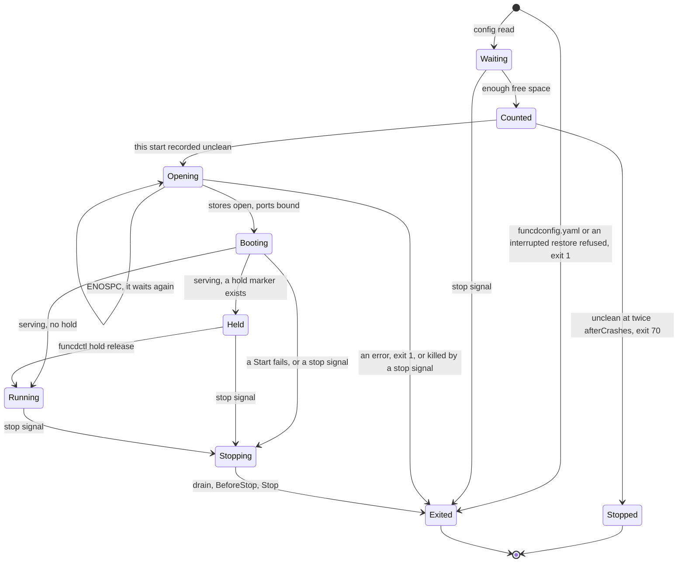

Providers start in list order, the Executor first: Executor, KV, blob, SQL, Lake, eventing, secrets, config, invoke; they stop in
reverse. SIGINT, SIGTERM and a hangup stop funcd; under `nohup` a hangup stays ignored. `storage.mode: memory` skips the wait, the
count and the floor. `log` and `telemetry` have no process of their own, and `cmd/funcd-rqlite` is the rqlite engine's entrypoint:
[Services](#services) holds it. [Workers](#workers) has a worker's stop, [Disaster recovery](#disaster-recovery) the hold after a
restore. Details: [start-stop](design/platform/start-stop.md). New words: Waiting, Counted, Opening, Booting, Stopping.

| Where | What happens | Time | You see | Status | Source |
|---|---|---|---|---|---|
| An interrupted restore | Refused before the count, so it never reaches exit 70; the unit keeps restarting it | 2 s (the unit) | `restore <command>, begun <time>, was interrupted (<file>): a partial load must not start` | **uncovered** | ADR-0206 Decision 2 refuses it, Decision 6 opens the hold after the count, `serve` in `cmd/funcd/main.go` before it; `TestScenarioRestoreCrashRefusesStart` |
| Less than 640 MiB free | The start waits before it counts and goes on by itself; a stop ends the wait and records no failed start | `spaceWait` 10 s between reads, until `storesOpenBytes` 640 MiB | `funcd: waiting for space on the data filesystem before opening the stores` | decided | ADR-0297 Decision 2, `TestScenarioStartWaitsForSpace` |
| A wait an earlier Lake engine holds up | Its scratch frees nothing until it stops, and the boot sweep comes after the wait, so an operator must free space or stop it | no end | the same line | accepted | ADR-0297 Consequences, `TestScenarioStartFreesLeftoverScratch` |
| Less than the floor free | The start still serves: reads and the control plane work, workload writes are refused until space is freed | `storage.minFreeSize` 2 GiB | 507 `the data filesystem is below storage.minFreeSize` | decided | ADR-0296 Decision 2, ADR-0297 Decision 2, `TestScenarioStartBelowFloor` |
| A store out of space | Badger's error reaches funcd as text until upstream releases its change: a write gets no 507, and a failed open is not retried, so the start fails and counts | until that release | the store's error | deferred | ADR-0297 Open questions and Temporary workarounds |
| A start that fails | Any failure after the count adds one, a taken port or a bad duration too; a config refused at load does not | 2 s between starts (the unit) | exit 1, the cause in the `funcd` log line's `error` | accepted | ADR-0207 Decision 3 and Consequences, `TestScenarioSafeModeStopsLoop` |
| Unclean starts in a row | After `afterCrashes` the next start is held; after twice that it exits 70, not restarted. `stableAfter`, or a clean stop, clears the count | `recovery.safeMode.afterCrashes` 3, `recovery.safeMode.stableAfter` 10 min | `safe mode: 6 unclean starts in a row, so funcd stops (exit status 70)` | decided | ADR-0207 Decisions 3 and 4, `TestBeginModes`, app-todo D15 |
| Exit 70's advice | It names a restore of the newest verified generation whatever the cause, which loses every write since; `funcd safe-mode reset` alone keeps them | none | `Restore the newest verified generation` | deferred | #1252 |
| Leaving exit 70 | `funcd safe-mode reset` sets the count to 0 and keeps the hold, so the next start is held until `funcdctl hold release` | until the release | `safe mode reset: the unclean-start count is 0; the platform stays held` | decided | ADR-0207 Decision 5, `TestScenarioLeaveSafeMode`, app-todo D15 |
| A stop signal while the stores open | No handler is set until `funcd.New` returns, so funcd dies at once: no clean-up, nothing logged, the start stays unclean | none | exit 143, `unclean` up by one | **uncovered** | ADR-0014 Decision 4 sets the order, ADR-0207 Decision 3 names a kill, ADR-0297 Decision 2 only the wait, ADR-0305 Decision 4 a cut Start; ran it, 10 of 10 |
| A call during a start | Refused until `funcd.New` binds the ports; then it connects and gets no answer until `Run` serves | until the boot ends | connection refused, then a wait | decided | ADR-0028 Decision 2 and Alternatives, `TestE2EAddrAvailableAfterNew` |
| A provider's Start fails | funcd stops what started, then exits, and the failure counts | none | exit 1, `start <provider>: <cause>` | decided | ADR-0305 Decision 4, `TestRun_AFailedStartNamesItsProvider` |
| Data no object names, at a start not held | Moved into the quarantine before funcd serves: a KV store key by key, a Bucket on S3 object by object | kept `storage.quarantineRetention` 168 h | `moved the data of a <kind> with no object into the quarantine` | accepted | ADR-0288 Consequences, `TestScenarioOrphanQuarantined` |
| Held | No timer, blob source, Sensor, run, App rollout, retention sweep, backup or reclaim acts; the API, the controllers and the data plane serve | until `funcdctl hold release` | `platform held`, and `funcdctl hold status` with its reason | decided | ADR-0206 Decision 6, `TestEveryRunnerConsultsHold` |
| funcd restarts | No worker survives: the boot sweep or reap ends them and the reconcile brings back those wanted; each first call is a cold start, with one image import per namespace and runtime | `killWait` 10 s per task, `runtime.process.stopGrace` 3 s | a slow first answer | accepted | ADR-0167 Consequences, ADR-0186 Consequences, `TestScenarioCrashRestartLeavesDesiredWorkers` |
| A call at a stop | New connections are refused; an open call keeps the drain, a cold one is released at once; past the drain it runs until its worker stops | `server.shutdownTimeout` 15 s | 503 `activator stopped before <ns>/<name> became ready`, 503 `upstream call failed` | decided | ADR-0028 Decision 3, `TestIssue144_RunStopReleasesHeldColdRequest` |
| funcd stops | The HTTP drain, then each worker's SIGTERM and SIGKILL after its grace, the log flush, the private containerd | `server.shutdownTimeout` 15 s + `runtime.containerd.stopGrace` 10 s + `closeMargin` 2 s + `containerdStopGrace` 10 s, 37 s at worst | `platform stopping`; the installed unit allows 45 s | decided | ADR-0277 Decisions 3 and 4, `TestScenarioDaemonStopKeepsItsFlush` |
| A second stop signal | Ignored: the handler stays set until the stop ends, so Ctrl-C twice changes nothing; SIGQUIT still dumps and exits | the stop's budget | nothing | **uncovered** | `serve` in `cmd/funcd/main.go`, `internal/platform/stopsignal`; no word in ADR-0014, ADR-0207, ADR-0277 or ADR-0305; searched issues for a second signal and Ctrl-C |
| `funcd upgrade` | Stops the unit, writes a pre-upgrade generation, swaps the binary keeping `<self>.previous` and starts the unit; a failure before the swap starts the old binary | the stop, a cut and an upload | `upgraded <self> from funcd <a> to funcd <b>` | decided | ADR-0207 Decision 1, `TestScenarioUpgradePinsOldState`, `TestScenarioWriteFailureKeepsOldBinary` |
| An upgrade refused | No `backup.target`, a held platform or an older binary: nothing stops; `--no-snapshot` passes the first two, with no way back | none | `a pre-upgrade generation needs the platform backup on`, `the platform is held` | decided | ADR-0207 Decision 1, ADR-0227 Decision 4.1, `TestScenarioSnapshotUnavailableStopsUpgrade`, `TestUpgradeWhileHeld` |
| A rollback | Loses every write after the pre-upgrade generation, which holds only the metastore, the run state and the event store: KV and blob data stay as they are | none | `<self>.previous restore run <timeline>/<n>` | accepted | ADR-0207 Consequences, `TestScenarioRollbackToPreUpgrade` |

<!-- generated values, do not edit: just behavior-values -->

Platform lifecycle: values

| Value | Default | From |
|---|---|---|
| `log.format` | json | config |
| `log.level` | info | config |
| `recovery.safeMode.afterCrashes` | 3 | config |
| `recovery.safeMode.stableAfter` | 10m | config |
| `storage.dataDir` | /var/lib/funcd | config |
| `storage.metastoreDir` | <dataDir>/store | config |
| `storage.minFreeSize` | 2GiB | config |
| `storage.mode` | file | config |
| `storage.quarantineRetention` | 168h | config |
| `telemetry.endpoint` | "" ⇒ telemetry disabled | config |
| `telemetry.insecure` | false | config |
| `maxTokenFileBytes` | 4096 | `cmd/funcd/credentials.go` |
| `maxStopGrace` | 10s | `cmd/funcd/main.go` |
| `minAppUpgradeTimeout` | 5m | `cmd/funcd/main.go` |
| `minDeliveryBackoffMax` | 10s | `cmd/funcd/main.go` |
| `minKeyRotationPeriod` | 1h | `cmd/funcd/main.go` |
| `minPositive` | 1ms | `cmd/funcd/main.go` |
| `minRetryBackoffMax` | 5ms | `cmd/funcd/main.go` |
| `telemetryCloseTimeout` | 1s | `cmd/funcd/main.go` |
| `spaceWait` | 10s | `cmd/funcd/space.go` |
| `storesOpenBytes` | 640MiB | `cmd/funcd/space.go` |
| `defaultBackupInterval` | 1h | `internal/platform/config/backup.go` |
| `defaultBackupRPO` | 2h | `internal/platform/config/backup.go` |
| `defaultBackupRetryInterval` | 5m | `internal/platform/config/backup.go` |
| `oneDay` | 24h | `internal/platform/config/backup.go` |
| `defaultBlobBackupInterval` | 1h | `internal/platform/config/blob.go` |
| `defaultBlobRebaseline` | 720h | `internal/platform/config/blob.go` |
| `defaultBlobRetention` | 720h | `internal/platform/config/blob.go` |
| `defaultS3MaxUpload` | 1GiB | `internal/platform/config/config.go` |
| `defaultWorkflowPayloadLimit` | 256KiB | `internal/platform/config/config.go` |
| `DefaultFunctionCPU` | 1 | `internal/platform/config/functions.go` |
| `DefaultFunctionMemory` | 512Mi | `internal/platform/config/functions.go` |
| `defaultKVBackupInterval` | 30s | `internal/platform/config/kvbackup.go` |
| `defaultKVRebaseline` | 24h | `internal/platform/config/kvbackup.go` |
| `defaultKVRebaselineRetry` | 1h | `internal/platform/config/kvbackup.go` |
| `kvChunkBytesMax` | 8MiB | `internal/platform/config/kvbackup.go` |
| `DefaultLakeCatalogMaxSize` | 256MiB | `internal/platform/config/lake.go` |
| `MaxLakeSaveInterval` | 1h | `internal/platform/config/lake.go` |
| `MinLakeSaveInterval` | 500ms | `internal/platform/config/lake.go` |
| `MinLakeScratchBytes` | 1GiB | `internal/platform/config/lake.go` |
| `lakeScratchMargin` | 512MiB | `internal/platform/config/lake.go` |
| `DefaultQuarantineRetention` | 168h | `internal/platform/config/quarantine.go` |
| `MinQuarantineRetention` | 1h | `internal/platform/config/quarantine.go` |
| `DefaultStorageMinFreeSize` | 2GiB | `internal/platform/config/storage.go` |
| `DefaultWorkloadBackupMaxCopyMembers` | 1024 | `internal/platform/config/workloadbackup.go` |
| `DefaultWorkloadBackupMaxListedKeySize` | 256MiB | `internal/platform/config/workloadbackup.go` |
| `DefaultWorkloadBackupMaxListedKeys` | 1MiB | `internal/platform/config/workloadbackup.go` |
| `DrainLimit` | 4KiB | `internal/platform/httpx/httpx.go` |
| `dialKeepAlive` | 30s | `internal/platform/httpx/httpx.go` |
| `dialTimeout` | 30s | `internal/platform/httpx/httpx.go` |
| `expectContinueTimeout` | 1s | `internal/platform/httpx/httpx.go` |
| `idleConnTimeout` | 1m30s | `internal/platform/httpx/httpx.go` |
| `tlsHandshakeTimeout` | 10s | `internal/platform/httpx/httpx.go` |
| `gibi` | 1GiB | `internal/platform/units/units.go` |
| `kibi` | 1KiB | `internal/platform/units/units.go` |
| `mebi` | 1MiB | `internal/platform/units/units.go` |
| `tebi` | 1TiB | `internal/platform/units/units.go` |
| `feedWaitPoll` | 50ms | `pkg/funcd/binding_providers.go` |
| `sensorDeliveryTimeout` | 30s | `pkg/funcd/binding_providers.go` |
| `sqlFeedBootWait` | 30s | `pkg/funcd/binding_providers.go` |
| `engineOutputBuf` | 64KiB | `pkg/funcd/engineoutput.go` |
| `closeMargin` | 2s | `pkg/funcd/funcd.go` |
| `defaultBucketsPerNamespace` | 100 | `pkg/funcd/funcd.go` |
| `defaultCloseGrace` | 3s | `pkg/funcd/funcd.go` |
| `defaultDeadletterMaxEntries` | 1000 | `pkg/funcd/funcd.go` |
| `defaultDeadletterRetention` | 720h | `pkg/funcd/funcd.go` |
| `defaultKVStoresPerNamespace` | 100 | `pkg/funcd/funcd.go` |
| `defaultNestedInFlightCap` | 10 | `pkg/funcd/funcd.go` |
| `defaultSQLDatabasesPerNamespace` | 20 | `pkg/funcd/funcd.go` |
| `defaultWorkflowMaxStepsInFlight` | 64 | `pkg/funcd/funcd.go` |
| `defaultWorkflowPayloadLimit` | 256KiB | `pkg/funcd/funcd.go` |
| `defaultWorkflowRetention` | 720h | `pkg/funcd/funcd.go` |
| `defaultWorkflowRetry` | 1 | `pkg/funcd/funcd.go` |
| `defaultWorkflowStepTimeout` | 5m | `pkg/funcd/funcd.go` |
| `maxRetentionSweep` | 1h | `pkg/funcd/funcd.go` |
| `minRecordBytes` | 1024 | `pkg/funcd/funcd.go` |
| `purgePage` | 1000 | `pkg/funcd/funcd.go` |
| `serverReadHeaderTimeout` | 10s | `pkg/funcd/funcd.go` |
| `serverReadTimeout` | 10s | `pkg/funcd/funcd.go` |
| `shutdownTimeout` | 15s | `pkg/funcd/funcd.go` |
| `defaultActivationTimeout` | 30s | `pkg/funcd/options.go` |
| `defaultBootTimeout` | 1m | `pkg/funcd/options.go` |
| `defaultDeliveryBackoffInitial` | 100ms | `pkg/funcd/options.go` |
| `defaultDeliveryBackoffMax` | 10s | `pkg/funcd/options.go` |
| `defaultDrainGrace` | 30s | `pkg/funcd/options.go` |
| `defaultHandOutSettle` | 2s | `pkg/funcd/options.go` |
| `defaultRetryBackoffMax` | 1s | `pkg/funcd/options.go` |
| `defaultStorageProbeInterval` | 10s | `pkg/funcd/options.go` |
| `defaultStorageProbeTimeout` | 2s | `pkg/funcd/options.go` |
| `defaultSupervisionPeriod` | 10s | `pkg/funcd/options.go` |
| `defaultWorkerSyncInterval` | 2s | `pkg/funcd/options.go` |
| `maxAppRevisionHistory` | 100 | `pkg/funcd/options.go` |
| `maxBaseDomain` | 189 | `pkg/funcd/options.go` |
| `maxDefaultRetryBackoff` | 1h | `pkg/funcd/options.go` |
| `minDefaultAppUpgradeTimeout` | 5m | `pkg/funcd/options.go` |
| `minDefaultLivenessTimeout` | 30s | `pkg/funcd/options.go` |
| `minRetryBackoffMax` | 5ms | `pkg/funcd/options.go` |
| `quarantineSweepEvery` | 1h | `pkg/funcd/quarantine.go` |
| `quarantineSweepFirst` | 5m | `pkg/funcd/quarantine.go` |
| `measurePage` | 1000 | `pkg/funcd/quota.go` |

<!-- end of generated values -->
## Controller

Kinds: none of its own.

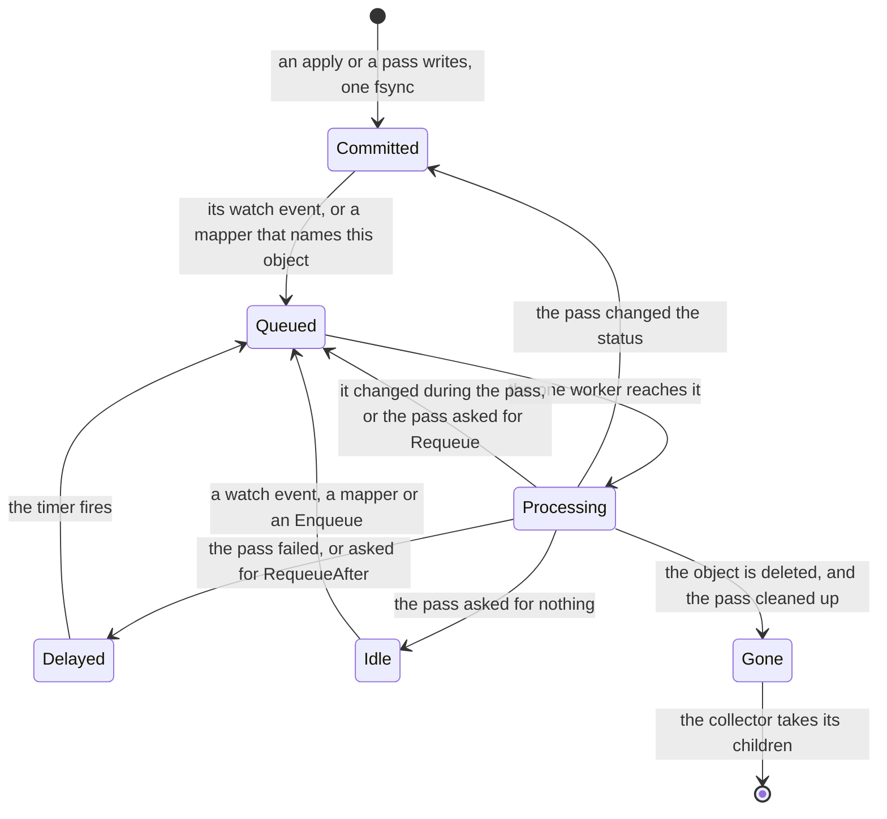

This is the queue's view of one object, not a phase: a kind's phases are in its own chapter, and these words stand for the queue's
`dirty`, `processing` and `pending`. The engine owns the watch, the queue and the retry. A kind brings only its `Reconcile`, and that
pass writes status itself, with a plain `store.Update` at the version it read. A pass that changed a status wakes itself once more;
that pass changes nothing, so a settled object goes quiet. The queue lives in memory. The collector runs beside the controller, not
in it. New words: Committed, Queued, Processing, Delayed, Idle, Gone.

| Where | What happens | Time | You see | Status | Source |
|---|---|---|---|---|---|
| A write | Commits whole or not at all, one writer at a time. A failed commit moves no version and sends no event | one fsync | the caller gets the error; a pass retries | decided | ADR-0065 Decision, ADR-0006 Contracts, `TestScenarioDurableMetastoreSurvivesRestart` |
| A change reaches the queue | It wakes the object's reconciler and the mappers on its kind. A queued key is not queued twice, and a key changed during its pass runs once more | none | `status.observedGeneration` behind `metadata.generation` | decided | ADR-0015 Decisions 2 and 3, ADR-0006 Decision 2, `TestScenarioWorkqueueDedup` |
| Passes at once | One: funcd runs one worker, and every kind shares its queue in order | none | an applied object's status waits its turn | decided | ADR-0146 Decision 8 and Scope, ADR-0028 Decision 2 |
| A slow pass | Holds up every other kind. A pass has no deadline of its own, so it lasts as long as its slowest step. Stopping a worker is the common wait | `runtime.containerd.stopGrace` 10 s per worker it stops | every status lags | accepted | ADR-0143 Consequences, #697, #1292 |
| A pass fails | Retried for ever, the wait doubling per failure until a success resets it. The engine never gives up or writes a status: only the kind's reconciler can | `baseBackoff` 5 ms, doubling to `controller.retryBackoffMax` 1 s | `reconcile failed, requeueing` in the log, per failure | decided | ADR-0015 Decisions 3 and 4, ADR-0163 Decision 1, `TestScenarioReconcileRetryBackoff` |
| A status write loses to another write | The store refuses it whole. Most kinds run again quietly; some, such as a Route, count it as a failed pass | `baseBackoff` 5 ms | `resourceVersion mismatch` in `reconcile failed, requeueing` | decided | ADR-0015 Decision 4, ADR-0146 Decision 4, `TestScenarioStatusSurvivesConcurrentSpecWrite` |
| Nothing changes | The engine has no resync: a pass that asked for nothing runs again only on a change. A kind that owns running instances asks for its own re-check | `runtime.supervisionPeriod` 10 s | a status stays as last written | decided | ADR-0142 Scope and Alternatives, ADR-0163 Decision 7, `TestScenarioRequeueDoesNotMultiply` |
| An object waits for a referent | Its pass asks to run again, so it moves within one interval of the referent's arrival | `controller.referentPollInterval` 2 s | its kind's reason, such as `SecretResolveFailed` | decided | ADR-0163 Decision 3, `TestScenarioControllerKeysPaceTheControlPlane` |
| A watcher falls behind | The store closes its stream so no writer stalls. It resumes from the changes kept in memory or re-lists; a re-list also runs what each object last drove, so a lost delete is seen | `watchChanBuf` 64, `defaultRingCap` 1024 | `store closed the watch, re-watching` | decided | ADR-0202 Decision 5, `TestIssue302_ReconcilesDeletesAfterWatchDrop` |
| You delete an object | It leaves the store at once, with no `deletionTimestamp` and no foreground delete. Its next pass finds it gone and cleans up | none | `404` at once, while its workers still stop | decided | ADR-0170 Scope and Alternatives, ADR-0015 Decision 2, `TestIssue302_ReconcilesDeletesAfterWatchDrop` |
| `metadata.finalizers` | Stored as you wrote them, and nothing reads them, so they hold up no delete | none | the field you set | deferred | card "Two-phase delete", ADR-0170 Scope |
| An owner is deleted | A watch on each owner kind records it, and the collector deletes each child whose controller reference names it. An owner of another UID counts as gone | none | `collected` in the log; the child answers until then | decided | ADR-0170 Decisions 1 and 2, `TestRunCollectsADeletedOwnersChildrenFromItsWatch` |
| The collector's sweep | One pass over every child kind, at start and then on a timer. It catches what a crash or a dropped watch missed | `controller.gcSweepInterval` 5 min | `collected` in the log | decided | ADR-0170 Decisions 2 and 3, `TestRunSweepsOnStartAndEveryInterval`, `TestScenarioCrashBeforeCollectionSwept` |
| A child that cannot go yet | It waits for a later sweep if it changed twice, a read or delete failed, an open run holds it, or an App's store has an outside user. No status says so | `controller.gcSweepInterval` 5 min | `garbage collection incomplete`, on a failure only | decided | ADR-0170 Decision 1, ADR-0190 Decision 7, ADR-0199 Decision 7, `TestHeldChildrenWaitForTheirRun` |
| A declared store when its owner goes | `deletion: delete` goes with it, data too: a Bucket's objects are purged. `retain`, the default, stays with its data | none | the store, with no live owner | decided | ADR-0248 Scenarios, ADR-0199 Decision 7, `TestScenarioStoreDeletion`, `TestDeleteBucket` |
| A declared store's name is taken, or its owner was re-created | Refused, never taken over: a marker names one UID, so a retained store needs `ref` | `controller.referentPollInterval` 2 s | `Pending`, `StoreNotOwned`, `bind it with ref`; a Workflow's `KVStoreNotOwned`, an App's `ChildNotOwned` | decided | ADR-0248 Decision 3 and Consequences, `TestScenarioRecreatedOwner` |
| A held platform | The collector asks no hold: it still deletes a dead-owned child and purges a dead-owned Bucket, where prune and the boot reclaims wait | `controller.gcSweepInterval` 5 min | `collected` during a hold | **uncovered** | read ADR-0206 Decision 6, ADR-0222 Decision 8, ADR-0170, ADR-0199; no issue or card; probe: a child deleted while held |
| funcd restarts | Each watch lists its kind as `Added`, so every object gets one pass, in no fixed order. Retries and timers are gone, and a status stays as written until its pass | one pass per object, on one worker | a stale `Ready` until then | decided | ADR-0015 Scope, ADR-0146 Decision 2, ADR-0006 Decision 3, `TestScenarioRestartResumesInFlightRun` |
| A record that does not decode, at start | The controller's first watch fails and it stops for good: funcd serves on, reconciling nothing, until a restart. A Secret's or a Route's ends the start instead | until a restart | `controller stopped` | **uncovered** | read ADR-0015, ADR-0028, ADR-0305 Decision 4; ADR-0170 Decision 2 names only the collector's; no issue; probe: `Run` returns the error |
| funcd stops during a pass | The pass's context ends and timers and retries are dropped. The stop waits for the pass to return, with no bound of its own | none | `platform stopping` | decided | ADR-0015 Decision 2, ADR-0028 Decision 3, `TestScenarioGracefulShutdown` |
| A pass panics | Nothing recovers it: funcd exits, the start counts as unclean, and the same pass runs again. A hold does not end such a loop; funcd refusing to start does | `recovery.safeMode.afterCrashes` 3, then twice that | exit 70, naming the restore | accepted | ADR-0207 Decisions 3 and 4 and Consequences, `TestBeginModes` |

<!-- generated values, do not edit: just behavior-values -->

Controller: values

| Value | Default | From |
|---|---|---|
| `controller.gcSweepInterval` | 5m | config |
| `controller.referentPollInterval` | 2s | config |
| `controller.retryBackoffMax` | 1s | config |
| `controller.routeResyncInterval` | 10s | config |
| `SupervisionPeriod` | 10s | `internal/controller/controller.go` |
| `baseBackoff` | 5ms | `internal/controller/controller.go` |
| `maxBackoff` | 1s | `internal/controller/controller.go` |
| `DefaultInterval` | 5m | `internal/gc/gc.go` |
| `rewatchBackoff` | 1s | `internal/gc/gc.go` |
| `baseTableSize` | 8MiB | `internal/store/badger/badger.go` |
| `blockCacheSize` | 32MiB | `internal/store/badger/badger.go` |
| `defaultGCInterval` | 5m | `internal/store/badger/badger.go` |
| `indexCacheSize` | 32MiB | `internal/store/badger/badger.go` |
| `memTableSize` | 16MiB | `internal/store/badger/badger.go` |
| `valueLogFileSize` | 64MiB | `internal/store/badger/badger.go` |
| `loadBatch` | 1024 | `internal/store/memory/memory.go` |
| `defaultRingCap` | 1024 | `internal/store/store.go` |
| `watchChanBuf` | 64 | `internal/store/store.go` |
| `timelineBytes` | 8 | `internal/store/version.go` |

<!-- end of generated values -->
## Admission

Kinds: Namespace, ResourceGroup.

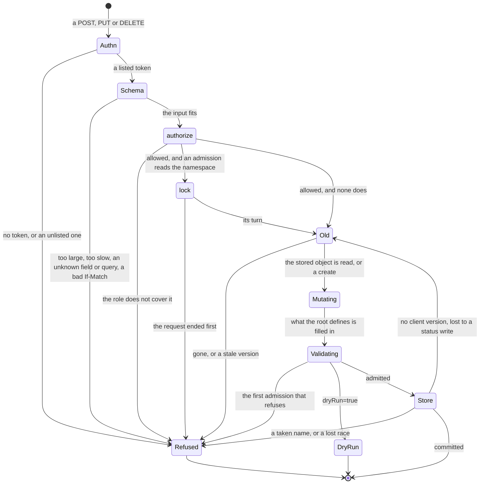

A create or a replace answers 200 with the stored object and a delete 204, before any reconciler acts: 200 means stored, not
running (ADR-0018 Purpose). A PUT never creates: a missing object answers 404 `Function "f" not found`, and `funcdctl apply` then
POSTs (ADR-0210 Decision 4). Revision and AppRevision are read-only: a write answers 405 `method POST is not allowed` with
`Allow: GET` (ADR-0172 Decision 1). During a platform hold a write is stored as usual: only the runners wait (ADR-0220 Decision 2).
New words: Schema, Refused, DryRun, Store.

| Where | What happens | Time | You see | Status | Source |
|---|---|---|---|---|---|
| The order of checks | The first refusal answers, so a caller with no right gets 422 for a bad body, not 403. A POST compares path and body before the 403, a PUT after it | none | 401; 413, 408, 422 or a bad `If-Match` 400; 403; 400 `body namespace "x" does not match path "y"`; 409; an admission's answer; the store's | decided | ADR-0210 Decision 2, ADR-0048 `schema-rejects-at-edge` |
| A caller the role does not cover | Refused before any admission runs; a dry run needs the same right. [Security](#security) holds who may write | none | 403 `create Function in "team-a" denied: viewer is read-only (verb "create")` | decided | ADR-0018 C3, ADR-0063 `authz-precedes-admission`, `TestScenarioAuthzPrecedesAdmission` |
| A rule in the body | What the schema can state, an unknown field too, is refused before the handler; a cross-field or required-by-scope rule by `Validate` in admission | none | 422 `validation failed: unexpected property (body.spec.x)`; 400 `resourceGroup is required for kind "Function"` | decided | ADR-0048 Decision 1, ADR-0005 Decision 6, `TestSchemaRejectsInvalidDTO` |
| `spec.resources` refused | A bad value, or `resources` with `pooling.worker`, is `Validate`'s, so it answers 400 where its ADR says 422 | none | 400 `spec.resources cannot be set with spec.pooling.worker: a pool's heap cap is pool-wide` | **uncovered** | ADR-0291 Decision 4 says 422; ADR-0148 Decision 1 gives `Invalid` status 400; `TestScenarioInvalidResourcesRefused` asserts `Invalid` |
| A body over the cap | Refused as it is read, a body of exactly the cap too | 1 MiB (huma's default) | 413 `request body is too large limit=1048576 bytes`, `urn:funcd:problem:payload-too-large` | decided | ADR-0148 Decision 4 and Scope, `TestScenarioControlPlaneBodyOverCap` |
| A client slow to send its body | The read is cut before `serverReadTimeout` 10 s, so a large manifest on a slow link fails | 5 s (huma's default) | 408 `request body read timeout` | **uncovered** | #300 chose `serverReadTimeout`, and its test sends no credential; ADR-0148 names only the size; a search of the ADRs, issues and cards finds no 5 s; a probe saw the 408 |
| Any refusal | One body on every route, and `api/fault` is the one map from a kind to a status | none | `application/problem+json`: `type`, `title`, `status`, `detail`; `type` is `urn:funcd:problem:<kind>`, or `about:blank` for huma's own 404, 405, 408 and 422 | decided | ADR-0005 Decision 4, `TestIssue166_ErrorsShareOneProblemShape` |
| `?dryRun=true` on a POST or PUT | Runs every check and the lock, stores nothing. A create shows no `uid` or `resourceVersion`, and a generated name is not reserved | none | 200 with the object as it would be stored, or the real write's refusal; an App's plan in `status.plan` | decided | ADR-0220 Decisions 2 and 3, `TestDryRunEveryWritableKind` |
| A dry run of a manifest | Each document is judged against the store as it is: one that needs an earlier document is refused, and a pass reserves nothing | none | 400 `spec.bindings.links[x].target "y" does not exist in namespace "ns"` | accepted | ADR-0220 Consequences |
| A PUT or DELETE naming a version | Takes effect only on that version; one from before a restore conflicts too. `If-Match` answers 409, not 412 | none | 409 `Function team-a/f has changed since resourceVersion "v1"; re-read it and apply the change again`, or `Function "f" resourceVersion mismatch` | decided | ADR-0210 Decision 2, `TestScenarioPreRestoreVersionConflicts` |
| A PUT or DELETE with no version, or `If-Match: *` | Unconditional: the last writer wins, over a change it never saw. If it loses to a status write, it reads and judges the object again by itself | `ownReadAttempts` 5 | 200 or 204; 409 `Function "f" resourceVersion mismatch` after the last attempt | decided | ADR-0210 Decision 3, #900, `TestIssue900_UnversionedWriteSurvivesStatusWrite` |
| A write that stores | `metadata.generation` moves only with `spec`, `resourceVersion` on any change; a byte-identical write moves neither and fires no event | none | the fields in the answer | decided | ADR-0047 Decision 1 and `real-write-still-events`, `TestApplyOfUnchangedManifestWritesNothing` |
| Server-owned fields in a body | Dropped with no complaint: `status`, `ownerReferences` and `deletionTimestamp` stay the stored ones, `uid` and `generation` the store's, `apiVersion` and `kind` the route's | none | the answer shows the server's values | decided | ADR-0048 `ObjectMeta` table, `TestIssue328_ApplyIgnoresClientOwnerAndDeletionMeta` |
| A change to a fixed field | Refused: a WorkflowRun's `workflow`, `input` and `replay`, a Backup's or a Restore's `spec`, a Site's prefix | none | 409 `WorkflowRun "r" already exists: a run's workflow, input and replay are fixed when it is created`; 400 `Backup spec is immutable: create another one` | decided | ADR-0222 Decision 1, `TestIssue125_RunSpecIsImmutableOnUpdate` |
| A write an admission reads the namespace for | Waits its turn in that namespace: most Function, Workflow, Lake and App writes, a store's create under a quota, a ResourceGroup delete | until the writes ahead end; only the request's end stops it | a slower answer; 503 `wait for the admission lock of namespace "team-a"` | decided | ADR-0147 Decision 1, `TestNSLocksCancelledWaitUnavailable` |
| A stored object that no longer validates (a restore, a tightened rule) | No status can be written: it keeps its last one while the reconcile errors and retries. Reads and deletes work; a valid apply clears it | the controller's backoff | a stale `status`; the error names the field | deferred | #1317, ADR-0291 Temporary workarounds, `TestScenarioPastAdmissionBlocked` |
| A write naming a Namespace or a group no object creates | Stored: neither has to exist. Only `metadata.resourceGroup` must be set, on a ResourceGroup too, which may name itself | none | 200; with none, 400 `resourceGroup is required for kind "ResourceGroup"` | decided | ADR-0028 `run-reconciles-function-to-ready`, `TestScenarioAbsentExposureServesByName` |
| A Namespace or a ResourceGroup once stored | Nothing reconciles either, so no phase ever shows, though ADR-0003 gives both one. A Namespace's `spec` is read where it is used | none | `"status":{}` | **uncovered** | ADR-0003 kinds table names `Phase`; ADR-0018, ADR-0028, ADR-0048 and ADR-0170 name no writer; no reconciler registers either kind; no issue or card |
| A Namespace delete | Removes that object alone: everything in it stays and runs, and writes into it still succeed. Only an admin can do it | none | 204 | accepted | ADR-0170 Scope, ADR-0186 Context and Alternatives |
| A ResourceGroup delete with members | Refused while an object of another namespaced kind names the group and no controller owns it, a platform record too | `maxListedMembers` 5 | 409 `ResourceGroup "g" still has 7 member(s): Function/a, ..., and 2 more; delete them first, or delete with force` | decided | ADR-0170 Decision 7, `TestResourceGroupDeleteNamesFiveMembersAndTheCount` |
| `?force=true` | Deletes the members pass by pass, Sensors first, each under its own rights and admissions, then the group. One still refused stops it, with no rollback; a re-run continues | until a pass deletes none; long with many Invocations | 204, or a 409 naming the member; 404 for a group no object creates | decided | ADR-0170 Decisions 3 and 8, `TestResourceGroupForceDeleteCascades` |

<!-- generated values, do not edit: just behavior-values -->

Admission: values

| Value | Default | From |
|---|---|---|
| `maxAppConfigMapNameLength` | 52 | `api/types/v1alpha1/app.go` |
| `maxAppNameLength` | 52 | `api/types/v1alpha1/app.go` |
| `maxAppRevisionNumber` | 9999999999 | `api/types/v1alpha1/apprevision.go` |
| `DefaultBackupTTL` | 720h | `api/types/v1alpha1/backup.go` |
| `maxBackupScheduleNameLength` | 54 | `api/types/v1alpha1/backup.go` |
| `maxRestoreNameLength` | 56 | `api/types/v1alpha1/backup.go` |
| `MaxDuration` | `Duration(math.MaxInt64 - math.MaxInt64%int64(time.Millisecond))` | `api/types/v1alpha1/duration.go` |
| `maxEgressDests` | 64 | `api/types/v1alpha1/egresspolicy.go` |
| `maxEgressPorts` | 32 | `api/types/v1alpha1/egresspolicy.go` |
| `maxEgressRules` | 64 | `api/types/v1alpha1/egresspolicy.go` |
| `DefaultInvokeTimeout` | 1m | `api/types/v1alpha1/function.go` |
| `MaxIdleTimeout` | 24h | `api/types/v1alpha1/function.go` |
| `MaxInvokeTimeout` | 1h | `api/types/v1alpha1/function.go` |
| `MaxLinkTimeout` | 5m | `api/types/v1alpha1/function.go` |
| `MaxRetryBackoff` | 1h | `api/types/v1alpha1/function.go` |
| `MaxStepTimeout` | 24h | `api/types/v1alpha1/function.go` |
| `MaxTimerInterval` | 24h | `api/types/v1alpha1/function.go` |
| `MaxWorkflowTimeout` | 168h | `api/types/v1alpha1/function.go` |
| `MinTimerInterval` | 100ms | `api/types/v1alpha1/function.go` |
| `DefaultMaxKeyBytes` | 1024 | `api/types/v1alpha1/kvstore.go` |
| `DefaultMaxValueBytes` | 1MiB | `api/types/v1alpha1/kvstore.go` |
| `MaxKeyBytesLimit` | 64000 | `api/types/v1alpha1/kvstore.go` |
| `MaxValueBytesLimit` | 1MiB | `api/types/v1alpha1/kvstore.go` |
| `nameSuffixHexBytes` | 4 | `api/types/v1alpha1/metadata.go` |
| `MinCPU` | `0.01` | `api/types/v1alpha1/resources.go` |
| `SiteRuntimeConfigMaxBytes` | 32KiB | `api/types/v1alpha1/site.go` |
| `maxListedMembers` | 5 | `internal/controlplane/admission/resourcegroup.go` |
| `ownReadAttempts` | 5 | `internal/controlplane/handlers.go` |

<!-- end of generated values -->
## Security

Kinds: Identity, Role, RolesAssignment, Policy, Grant, EgressPolicy, Secret.

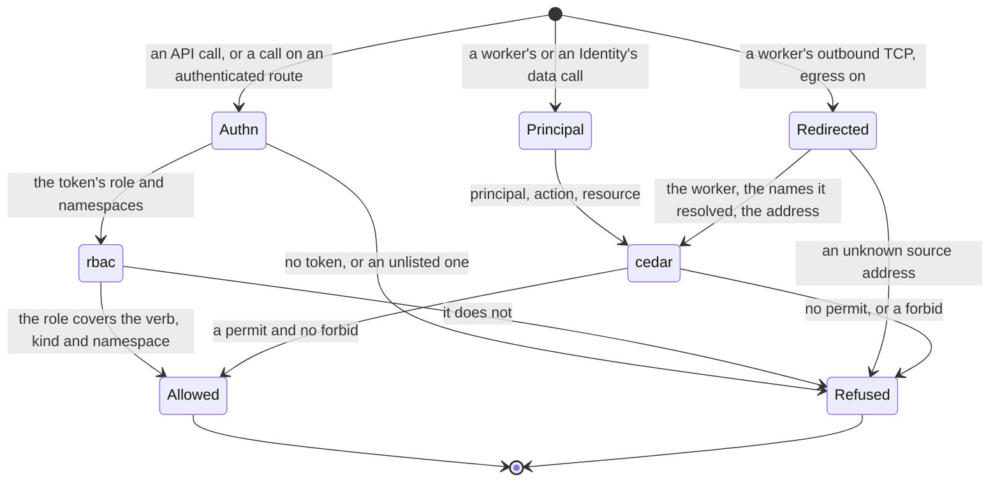

The API and the edge read one token list; `/openapi`, `/docs` and `/schemas/` need no token. A binding grants read, the owner or a
writer role grants write, and the built-in `Owner` covers KV and blob data only, not managing assignments (ADR-0136). An Identity's
credential authenticates and grants nothing until a RolesAssignment does. A Policy naming another namespace in its scope is refused at
apply (ADR-0177 Decision 3). With egress on, workers cannot reach each other and UDP other than DNS is dropped (ADR-0115 Decision,
ADR-0117 Consequences). New words: Redirected, Refused.

| Where | What happens | Time | You see | Status | Source |
|---|---|---|---|---|---|
| An API call | A missing or unlisted token is refused; then the token's role decides, and a viewer never reads a Secret | none | 401 `missing bearer token or API key`, 401 `invalid credential`, 403 `get Secret in "<ns>" denied: viewer may not act on kind "Secret"` | decided | ADR-0018 Decisions 2 and 3, ADR-0171 Decision 9, `TestScenarioViewerCannotReadSecrets` |
| A change to `auth.credentials` or a token file | Files are read once at startup, so a change takes effect at the next start | a restart | a new token gets 401 `invalid credential` until then | decided | ADR-0171 Decision 6 and Temporary workarounds |
| A call allowed on an `authenticated` route | The Function receives neither `Authorization` nor `X-Api-Key`; an `open` route forwards every header | none | the headers are absent in the handler | decided | ADR-0171 Decision 5, `TestScenarioEdgeDropsTheCredential` |
| A data call by a Function or an Identity | Denied unless a binding or a grant permits it and no forbid matches; a write takes the owner or a writer role | none | 403 ending `cedar default-deny: no permitting policy`, or `cedar: forbidden by policy <id>` such as `builtin/kv-single-writer` | decided | ADR-0136 Decision, ADR-0177 Decision 4, `TestIssue675_BuiltinDenyNamesStableID` |
| A request across namespaces | Only the built-in policies decide: no Policy, RolesAssignment or EgressPolicy reaches it | none | the reason ends `(cross-namespace request: built-in policies only)` | decided | ADR-0177 Decisions 1 and 2, `TestScenario_cross_namespace_built_ins_only` |
| A write to a Policy, Role, RolesAssignment or EgressPolicy | Applies at the next decision, with no restart | none | the next call's answer | decided | ADR-0177 Decision 2, ADR-0117 Decision 4a, `TestScenarioPolicyCacheAtomicSwap` |
| A grant changes what a pooled Function may do | It moves to a pool of its own access: its calls get 404, then 503 while the new pool loads it | a pool's cold start | `status.pool` changes | decided | ADR-0158 Decision 5, `TestScenarioPoolSplitsByGrant` |
| A RolesAssignment naming a missing Role or an unknown built-in | Applies with no complaint and grants nothing; nothing shows it | none | a normal apply, then the denial | **uncovered** | ADR-0136 wants it observable and built-in names checked (its scenario, its `Validate`); the kind has no status and no admission reads it; `TestScenarioNamespaceScopeAndMissingRole`; no issue |
| A Grant | Stored and listed; nothing reads it: a reserved placeholder | none | a normal apply, no effect | decided | ADR-0073 Decision 1 |
| `spec.rotate` raised on an Identity | A new secret replaces the old under the same access key id; the old one stops authenticating, with no overlap | the next pass | `status.observedRotate` follows | decided | ADR-0135 scenario `identity-credential-rotated`, `TestScenarioIdentityCredentialRotated` |
| `ctx.secret.get` or `list` | Asks funcd on each read, with no cache: a changed Secret shows at the next read, at a round trip per read | none | the new value, no restart | decided | ADR-0249 Decision 2 and Consequences, `TestScenarioSecretReadLive` |
| A bound Secret is missing | No worker starts; one already serving goes on, and `ctx.secret.get` reads nothing; a Secret applied later is found at the re-check | `controller.referentPollInterval` 2 s | `Failed` or `RevisionReady=False`, `SecretResolveFailed` | decided | ADR-0249 Decision 3, ADR-0221 Decision 3, `TestScenarioMissingSecretFails`, `TestIssue77_MissingBindingRecoversWhenApplied` |
| A bound Secret value that is not UTF-8 or holds a NUL | No worker starts; a corrected Secret does not clear it until the Function changes or funcd restarts | none | `Failed`, `SecretResolveFailed`, `is not valid UTF-8; env delivery cannot carry binary data` | **uncovered** | ADR-0306 and #77 re-check a missing binding only; ADR-0057 and ADR-0169 name no retry here; a probe shows no requeue |
| A Secret a Lake's engine binds changes | The engine holds it in its environment, so it is replaced with the new value | within `runtime.supervisionPeriod` 10 s | the engine restarts | accepted | ADR-0249 Scope, #1195, `TestIssue1195_ConvergeReplacesAnEngineOfAnotherSpec`; no lane rotates it |
| A `secrets.encryptionKeyFile` that does not match the stored Secrets | funcd does not start | none | `stored Secrets do not decrypt with secrets.encryptionKeyFile: they were written with a different key or with none` | accepted | #93, `TestIssue93_KeyMismatchFailsAtStartup` |
| `server.network.egress`, off by default | Off, or not Linux with containerd: workers reach anything and an EgressPolicy does nothing. On: a Function no EgressPolicy covers reaches nothing external | none | on, a refused connection | decided | ADR-0117 Decisions 3 and 6, `TestScenarioDisabledPassthrough`, egress `no-egresspolicy-denies-all` |
| A refused connection | It opens, then ends once the gateway has decided: an HTTP 403 on ports 80 and 8080, a plain close on any other | up to `peekTimeout` 500 ms | 403 `egress denied by funcd EgressPolicy`, or a closed socket | decided | ADR-0117 Decision 1, `TestScenarioDecideFlow`, egress `cidr-denies-unlisted-ip` |
| A domain rule | Counts only for a name this worker resolved through funcd, until that answer's TTL: a hard-coded address or a cache kept longer is refused | the answer's TTL, at least `minRecordTTL` 1 s | a refused connection | decided | ADR-0117 Decisions 1 and 2, `TestScenarioDomainsForCorrelationAndWildcard`, `TestScenarioEgressSNISpoofDenied` |
| A worker that just started | Its outbound connection is refused until the next sync finds the worker | up to `server.network.workerSyncInterval` 2 s | a refused connection, reason `unknown source worker <ip>` | accepted | ADR-0163 scenario `server-keys-pace-shutdown-and-egress-sync`, ADR-0117 Decision 1, `TestScenarioServerKeysPaceShutdownAndEgressSync` |
| A pooled Function named in an EgressPolicy's `appliesTo` | Refused: the gateway sees the pool worker, not the member, so only a whole-namespace policy covers it | none | a refused connection, `function=__pool__<...>` in the log | **uncovered** | ADR-0117 Decision 4 compiles `appliesTo` to Function names; ADR-0158 Decision 5 splits pools by it, names no egress principal; no test, issue or card |
| A connection's decision | Logged in funcd's own log, not yet in the function log channel the ADR names | none | `egress decision`, with `allowed=false` and the reason | deferred | ADR-0117 Open questions, egress `blocked-connection-audited` |
| A Lake or SQL engine's outbound TCP, on containerd | Reaches only its one internal endpoint, with `server.network.egress` on or off | none | a failed query; `GatewayEndpointNotAnAddress` if that endpoint is a hostname | decided | ADR-0269 Decisions 1 to 4, `TestScenarioLakeSetsEgressOnly` |
| A start, stop or crash, egress on | The rules go in before any worker runs and stay until the runtime closes; after a crash they stay, so external connections fail until the next start | none | `apply worker egress isolation` if they cannot go in | decided | ADR-0115 Decision, ADR-0117 Constraints, `TestRun_AppliesTheEgressFenceBeforeAnyLoop`, `TestShutdown_KeepsEgressFenceUntilRuntimeClosed` |

<!-- generated values, do not edit: just behavior-values -->

Security: values

| Value | Default | From |
|---|---|---|
| `auth.credentials` | none | config |
| `auth.namespaces` | [default] | config |
| `auth.token` | a built-in dev token | config |
| `secrets.encryptionKeyFile` | "" ⇒ Secret values | config |
| `dnsTimeout` | 5s | `internal/network/egress/forwarder.go` |
| `maxPairsPerSource` | 1024 | `internal/network/egress/forwarder.go` |
| `minRecordTTL` | 1s | `internal/network/egress/forwarder.go` |
| `minSweep` | 1024 | `internal/network/egress/forwarder.go` |
| `peekTimeout` | 500ms | `internal/network/egress/gateway_linux.go` |

<!-- end of generated values -->
## Workers

Kinds: WorkerNode, RuntimeClass.

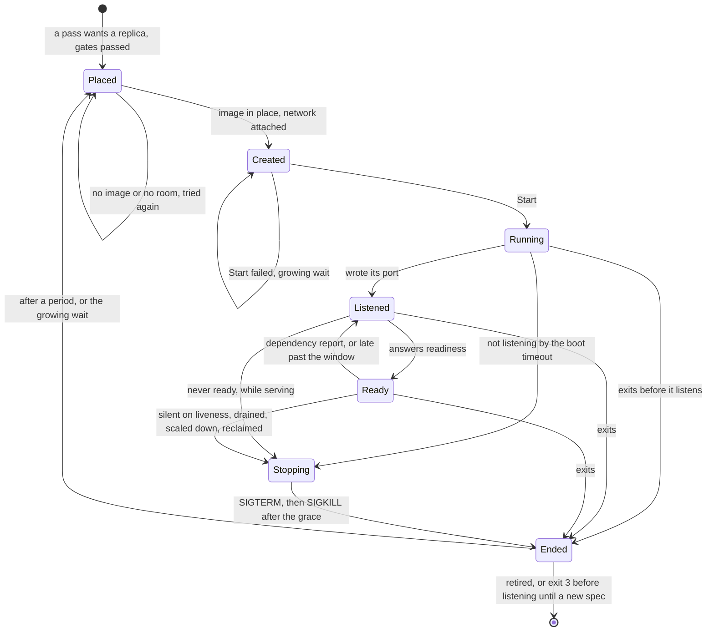

A worker is one replica of a Function's revision, or a pool worker, on one of two drivers. `process`, the default, runs it as a host
process with no isolation, no enforced limits and no volumes, and funcd says so at each start. `containerd` (Linux, root) runs it in
a crun sandbox with its own network. Pools run only on `process`, and a pool worker shares the boot-crash count. The count lives in
memory, so a funcd restart starts it at zero. Exit 3 before listening, in a pass not serving, is a handler that cannot load:
`Failed`, `ShapeInvalid`, never retried. Phases: [Functions](#functions). A held call: [Calls](#calls). Details:
[start-stop](design/platform/start-stop.md), [booking](design/volume/booking.md), [one-writer](design/volume/one-writer.md).
New words: Placed, Stopping, Ended.

| Where | What happens | Time | You see | Status | Source |
|---|---|---|---|---|---|
| Placement | Every replica goes to the one configured node, unless the artifact lists platforms and not the node's: then no worker is created | none | `Failed`, `NoMatchingPlatform`, `artifact provides [<list>]; node <name> runs <platform>` | decided | ADR-0145 Decisions 4 and 5, `TestScenarioFunctionNoMatchingPlatform` |
| A `WorkerNode` or `RuntimeClass` object | Stored and listed, and no reconciler reads it: placement knows one configured node, and `spec.runtime` picks the image | none | the object as you applied it | deferred | ADR-0017 Open questions, ADR-0149 Scope |
| A runtime with no image | On `containerd`, learned at the first `Create`, so a scale-to-zero Function learns it at its first wake. An image that appears recovers it | `runtime.supervisionPeriod` 10 s | `Failed`, `RuntimeUnavailable`, `is not embedded; set runtime.containerd.imageOverride` | decided | ADR-0149 Decisions 2 to 5, `TestADR0149_MissingImageScaleToZero` |
| The first worker of a runtime in a namespace | Imports and unpacks the image inside its reconcile, on the controller's one worker, so every other reconcile waits. Each start of a private containerd begins with no image | seconds per image (#1292) | a slower first call | deferred | #1292, ADR-0186 Decision 6 and Consequences |
| A worker that cannot start | A failed `Start` or worker spec, none running: `Failed`, retried after the growing wait. A failed `Create`: phase kept or `Degraded`, retried at the controller's backoff | `runtime.bootBackoffMax` 5 min; `controller.retryBackoffMax` 1 s | `StartFailed` | decided | ADR-0169 Decision 4, ADR-0161 Decision 1, `TestScenarioStartFailureRetriedWithGrowingWait` |
| A worker ends before it listens | Retried for ever after a growing wait, never `Failed` | `runtime.bootBackoffInitial` 10 s, doubling to `runtime.bootBackoffMax` 5 min | `CrashLoopBackOff`, `replica 0 exited with code 1 before it listened; boot crash 2 in a row, retried 20s after its last start` | decided | ADR-0160 Decision 3, ADR-0183 Decision 2, `TestScenarioExitZeroBeforeListeningBacksOff` |
| A worker does not listen in time | Stopped and counted as a boot crash; created again no sooner than the timeout after its last start | `runtime.bootTimeout` 1 min | `CrashLoopBackOff`, `replica 0 did not listen within 1m0s; boot crash 1 in a row, retried 1m0s after its last start` | decided | ADR-0161 Decision 3, ADR-0183 Decision 2, `TestScenarioFirstBootNeverListeningIsRetried` |
| A worker listens, never ready | First boot: `Failed`, no retry, and the worker runs on until a new spec. While serving: stopped once `Degraded` that long, then replaced | `runtime.bootTimeout` 1 min | `ShapeInvalid`, `the handler did not become ready within 1m0s` | decided | ADR-0161 Decision 2, ADR-0169 Decision 1, `TestScenarioLateStartUnreadyFailsAfterBootTimeout` |
| A binding check fails | The worker runs on, not ready, and is never restarted for it. Beside a ready replica the Function stays `Ready` | read again each `runtime.supervisionPeriod` 10 s | `DependencyNotReady`, `<kind> binding "<binding>": <message>` | decided | ADR-0215 Decision 5, `TestScenarioHealthServingDependencyLost` |
| A worker late on readiness | A late read counts by the last answer for the window, so a call can still reach it. Past the window, with every worker late, the Function is `Degraded` | `runtime.readinessTimeout` 5 s | `NotAnswering`, `a replica has not answered /health/readiness for 5s` | decided | ADR-0259 Decisions 1 to 3, `TestScenarioUnansweredPastWindow` |
| A worker exits after it listened | Any code or signal: replaced a period after its last start, with no growing wait however often it repeats | `runtime.supervisionPeriod` 10 s | `Degraded`, `Restarting`, `a replica exited and is being replaced`; before it served, `Deploying`, `ShimNotReady` | decided | ADR-0160 Decision 3, ADR-0183 Decision 4, `TestScenarioExitAfterServingIsReplaced` |
| A worker silent on its liveness | Stopped and created again at the same index, outside the boot backoff. Beside a ready replica the Function stays `Ready` | `runtime.livenessTimeout` 30 s + `runtime.supervisionPeriod` 10 s | `Restarting`, `a replica stopped answering /health/liveness and is being replaced` | decided | ADR-0215 Decisions 1 and 2, `TestHungReplicaIsReplacedAtTheSameIndex` |
| A worker killed for its memory | Reads as any SIGKILL. A boot crash names the signal; after it listened, no status or log of funcd names a cause | none | `was killed by signal 9`; `a replica exited and is being replaced` | deferred | card "Tell an out-of-memory kill from another SIGKILL in a worker's exit message (containerd OOM event)", ADR-0160 Constraints |
| A worker stops | SIGTERM, then SIGKILL after the grace, one value for every worker, and no call from the moment the stop begins | `runtime.containerd.stopGrace` 10 s, `runtime.process.stopGrace` 3 s | a key out of range refuses the start | decided | ADR-0277 Decisions 1 and 2, ADR-0167 Decision 6, `TestScenarioOneGraceForBothStops`, `TestScenarioStopGraceFromConfig` |
| A stop that waits out the grace | The shims exit on SIGTERM, unless a call blocks a Node shim's event loop. Such a worker holds the controller's one worker, so every other reconcile waits | `runtime.containerd.stopGrace` 10 s per stop | other Functions' passes and wakes run late | accepted | ADR-0143 Consequences, `TestScenarioDefaultGrace`, `exitOnSigterm` in the Node shim |
| funcd is killed | Its workers run on, unwatched, until the next start, and what they print is lost | until the next start | a worker with no funcd | deferred | card "Worker lifeline — a worker exits as soon as funcd dies (shim watches a pipe fd)", ADR-0167 Risks accepted, ADR-0168 Risks accepted |
| funcd starts | Leftovers go before any controller: `process` SIGTERM then SIGKILL, `containerd` SIGKILL. A private one also drops its images | `runtime.process.stopGrace` 3 s; `killWait` 10 s per task | a warning only: `could not clear everything an earlier run left in containerd` | decided | ADR-0167 Decisions 5 and 8, ADR-0186 Decision 3, `TestScenarioContainerdImagesClearedAtBoot` |
| The private containerd dies mid-run | Nothing restarts it. Workers read as ended though they may still run; each replacement fails until funcd restarts | 2 ms to 10 s a call (#961) | `Degraded`, `StartFailed`, `stop exited worker` | **uncovered** | `blueprint.md` says restarts, ADR-0054 Decision 3 supervises, ADR-0161 `runtime-outage-keeps-routes` expects a failed `List`; no test, issue, card |
| A volume that cannot be had | Apply refuses it when volumes are off, or a `local` one over capacity or budget. An `emptyDir` that does not fit leaves its worker uncreated | `volumes.capacity` 0 is off | `VolumesOff: spec.volumes: volumes are off on this daemon`; `VolumeCapacity`, `VolumeBudget` | decided | ADR-0262 Decisions 5 and 10, `TestScenarioVolumesOff` |
| A worker ends, with volumes | Its `emptyDir` goes with it, and a funcd start removes them all, at the release when held. A `local` volume keeps its files through a crash, a redeploy and a scale to zero | none | an empty `FUNCD_VOLUME_<NAME>` for the next worker | decided | ADR-0262 Decisions 5 and 8, `TestScenarioEmptyDirGoesWithWorker`, `TestScenarioLocalSurvives` |
| A redeploy with a `local` volume | The old and the new worker hold it at once until the old one stops, so the code must lock its files | until the old worker drains, `runtime.drainGrace` 30 s | nothing, unless writes collide | accepted | ADR-0262 Decision 6 and Consequences, `TestLocalVolumeSwitchEndsWithOneWriter` |
| A line a worker writes | `funcdctl logs` shows it once its segment is sealed, and a funcd crash loses the open segment | `funclog.segmentMaxAge` 10 s | no line yet | accepted | ADR-0081 Decision and Consequences, `TestScenarioPersistedViaBlob` |
| Output faster than funcd reads it | The worker never waits: a line its stream's half of the queue cannot hold is dropped and counted | `DefaultQueueBytes` 256 KiB | logs `worker output dropped: funclog did not keep up`, with `dropped` | accepted | ADR-0168 Decision 1 and Consequences, `TestWriteNeverBlocksAndCountsDrops` |

<!-- generated values, do not edit: just behavior-values -->

Workers: values

| Value | Default | From |
|---|---|---|
| `funclog.bucket` | funcd-system | config |
| `funclog.enabled` | true | config |
| `funclog.maxRecordBytes` | 65536 | config |
| `funclog.segmentMaxAge` | 10s | config |
| `funclog.segmentMaxBytes` | 8388608 | config |
| `funclog.traces` | true | config |
| `runtime.bootBackoffInitial` | 10s | config |
| `runtime.bootBackoffMax` | 5m | config |
| `runtime.bootTimeout` | 1m | config |
| `runtime.containerd.bridgeAddress` | "" ⇒ the subnet's network address + 1 | config |
| `runtime.containerd.cniBinDir` | /opt/cni/bin | config |
| `runtime.containerd.cniConfDir` | <dataDir>/cni | config |
| `runtime.containerd.imageOverride` | none | config |
| `runtime.containerd.imagePrefix` | funcd/runtime- | config |
| `runtime.containerd.root` | <dataDir>/containerd | config |
| `runtime.containerd.snapshotter` | overlayfs | config |
| `runtime.containerd.socket` | "" | config |
| `runtime.containerd.stateDir` | <dataDir>/run | config |
| `runtime.containerd.stopGrace` | 10s | config |
| `runtime.containerd.subnetCIDR` | 10.63.0.0/16 | config |
| `runtime.drainGrace` | 30s | config |
| `runtime.drainPollInterval` | 1s | config |
| `runtime.handOutSettle` | 2s | config |
| `runtime.livenessTimeout` | 30s, or three supervisionPeriod when larger | config |
| `runtime.mode` | process | config |
| `runtime.process.stopGrace` | 3s | config |
| `runtime.readinessTimeout` | 5s | config |
| `runtime.supervisionPeriod` | 10s | config |
| `volumes.capacity` | 0, volumes off | config |
| `volumes.capacityBytes` | 0 | config |
| `DefaultInterval` | 5m | `internal/funclog/compact/compact.go` |
| `DefaultRetention` | 720h | `internal/funclog/compact/compact.go` |
| `DefaultWindow` | 1h | `internal/funclog/compact/compact.go` |
| `DefaultLimit` | 1000 | `internal/funclog/logread/logread.go` |
| `MaxLimit` | 10000 | `internal/funclog/logread/logread.go` |
| `DefaultMaxRecordBytes` | 64KiB | `internal/funclog/reader.go` |
| `MaxLineBytes` | 1MiB | `internal/funclog/reader.go` |
| `lineReadBuf` | 64KiB | `internal/funclog/reader.go` |
| `dropWarnEvery` | 1m | `internal/funclog/route.go` |
| `defaultSegmentMaxAge` | 10s | `internal/funclog/sink.go` |
| `defaultSegmentMaxBytes` | 8MiB | `internal/funclog/sink.go` |
| `maxKeyReplica` | 63 | `internal/funclog/sink.go` |
| `minFlushInterval` | 100ms | `internal/funclog/sink.go` |
| `DefaultStopGrace` | 10s | `internal/runtime/containerd/containerd_linux.go` |
| `bootDirBytes` | 1MiB | `internal/runtime/containerd/containerd_linux.go` |
| `killWait` | 10s | `internal/runtime/containerd/containerd_linux.go` |
| `logAcceptBackoffMax` | 1s | `internal/runtime/containerd/containerd_linux.go` |
| `logAcceptBackoffMin` | 5ms | `internal/runtime/containerd/containerd_linux.go` |
| `outputWait` | 1s | `internal/runtime/containerd/containerd_linux.go` |
| `soloLogConns` | 4 | `internal/runtime/containerd/containerd_linux.go` |
| `tmpDefaultBytes` | 512MiB | `internal/runtime/containerd/containerd_linux.go` |
| `DefaultStopGrace` | 10s | `internal/runtime/containerd/containerd_other.go` |
| `containerdStopGrace` | 10s | `internal/runtime/ctrmanager/manager_linux.go` |
| `socketPollInterval` | 100ms | `internal/runtime/ctrmanager/manager_linux.go` |
| `startTimeout` | 30s | `internal/runtime/ctrmanager/manager_linux.go` |
| `DefaultStopGrace` | 3s | `internal/runtime/process/process.go` |
| `outputWait` | 1s | `internal/runtime/process/process.go` |
| `pollInterval` | 20ms | `internal/runtime/procreg/procreg.go` |
| `maxAssetBytes` | 256MiB | `internal/runtime/provision/provision.go` |
| `MaxReportBytes` | 1024 | `internal/runtime/runtime.go` |
| `DefaultLineBytes` | 64KiB | `internal/runtime/workerpipe/workerpipe.go` |
| `DefaultQueueBytes` | 256KiB | `internal/runtime/workerpipe/workerpipe.go` |
| `DefaultTailBytes` | 64KiB | `internal/runtime/workerpipe/workerpipe.go` |
| `drainBuf` | 32KiB | `internal/runtime/workerpipe/workerpipe.go` |
| `dropWarnEvery` | 1m | `internal/runtime/workerpipe/workerpipe.go` |
| `qifBlockSize` | 1024 | `internal/volume/quotafs/quotafs_linux.go` |
| `defaultBookingTTL` | 1m | `internal/volume/volume.go` |
| `defaultMeasureInterval` | 30s | `internal/volume/volume.go` |
| `volumeOverhead` | 16KiB | `internal/volume/volume.go` |
| `maxBlobBytes` | 64MiB | `internal/workernode/local/blob.go` |
| `maxSignExpiry` | 168h | `internal/workernode/local/blob.go` |
| `minSignExpiry` | 1s | `internal/workernode/local/blob.go` |
| `maxKVBytes` | `v1.MaxValueBytesLimit` | `internal/workernode/local/kv.go` |
| `DependencyCheckBudget` | 50ms | `internal/workernode/local/local.go` |
| `maxInvokeBytes` | 1MiB | `internal/workernode/local/local.go` |
| `serverHeaderTimeout` | 5s | `internal/workernode/local/local.go` |
| `serverIdleTimeout` | 30s | `internal/workernode/local/local.go` |
| `defaultTimeout` | 30s | `internal/workernode/local/resolver.go` |
| `MaxSQLStatements` | 500 | `internal/workernode/local/sql.go` |
| `maxSQLBytes` | 1MiB | `internal/workernode/local/sql.go` |

<!-- end of generated values -->
## Functions

Kinds: Function, Revision, ConfigMap.

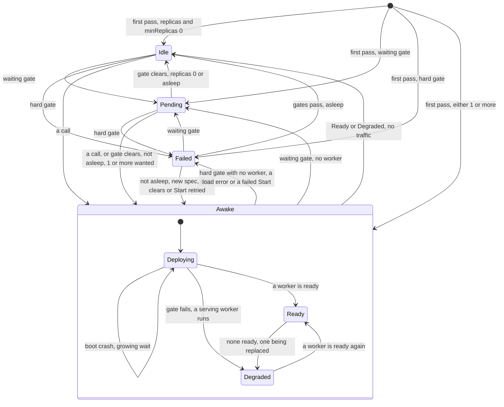

A new Function has no phase until its first pass. `Deploying` has not served since its last deploy, `Degraded` has. A waiting gate
writes `Pending` and is read again, as `LakeNotReady`, `BucketNotFound`, `KVStoreNotFound`, `SecretNotFound`, `StoreNotOwned`,
`PoolFull`. A hard gate writes `Failed`, as `ConfigResolveFailed`, `SecretResolveFailed`, `ArtifactUnresolved`, `NoMatchingPlatform`,
`RuntimeUnavailable`, `ContractMissing`, `ShapeInvalid`. `Asleep=True` marks a gate holding a Function that had gone `Idle`: only a call
ends the sleep (ADR-0192). A `Revision` is read-only, one per spec change, and stays until its Function goes (ADR-0172). A worker's boot:
[Workers](#workers). A call's path: [Calls](#calls). Details: [scale-to-zero](design/function/scale-to-zero.md),
[revision-drain](design/function/revision-drain.md), [key-renewal](design/function/key-renewal.md). New words: Awake.

| Where | What happens | Time | You see | Status | Source |
|---|---|---|---|---|---|
| A call with no ready worker, in any phase but `Failed` | Held, and `Idle` or `Pending` wakes first. Calls share one wake and its clock, so a late one gets less time. Forwarded once `Ready` | `invoke.activationTimeout` 30 s | 503 `function <ns>/<name> did not become ready within 30s` | decided | ADR-0161 Decision 4, ADR-0016 Decision 3, `TestScenarioCallHeldWhileNotReady` |
| A held call whose reason cannot clear in time | Still held to the end: answering at once is not built | `invoke.activationTimeout` 30 s | the same 503 | deferred | card "Answer calls fast while a Function cannot serve — no 30 s activator hold when Ready=False for a known reason" |
| A call in `Failed` | Refused at once, and a wake already holding ends at its next poll | none | 503 `function <ns>/<name> is Failed (<reason>)` | decided | ADR-0169 Decision 5, `TestIssue142_FailedFunctionIsAnsweredWithItsState` |
| A worker that will not come up | A boot crash keeps `Deploying`, so calls are held. A handler that cannot load, or a failed `Start` with none running, is `Failed`, so calls are refused | see Workers | `CrashLoopBackOff`; `ShapeInvalid`, `StartFailed` | decided | ADR-0161 Decision 3, ADR-0169 Decision 4, `TestScenarioFirstBootNeverListeningIsRetried` |
| A waiting gate on a woken Function | The call's wake is turned back, `Deploying` to `Pending`, once per call | read again each `controller.referentPollInterval` 2 s, `PoolFull` each `runtime.supervisionPeriod` 10 s | `Pending`, `Ready=False`, `LakeNotReady` | accepted | ADR-0185 Scope, ADR-0192 Risks accepted, `TestScenarioPooledCallWhileGatedGoesPending` |
| A waiting gate clears, `replicas: 0` or asleep | `Idle`, and no worker until a call, whatever `spec.replicas` says once asleep | the next pass | `Idle`, `NoReplicas` | decided | ADR-0185 Decision 2, ADR-0192 Decision 3, `TestScenarioGateClearsToIdle`, `TestScenarioDependencyReturnsStaysAsleep` |
| The gate clears under a held call, `replicas: 0` | No worker starts: the turned-back wake is not asked again, so the call waits out the hold. The next call wakes it | up to `invoke.activationTimeout` 30 s | 503 `did not become ready within 30s` | **uncovered** | ADR-0192 Risks accepted names only `replicas ≥ 1`, ADR-0185 Scope the turn-back; no test, issue or card; ran on a scratch test |
| A hard gate passes, not asleep | A worker boots with no call, even at `replicas: 0`, and goes only at idle reclaim | `controller.referentPollInterval` 2 s for a missing ConfigMap, `runtime.supervisionPeriod` 10 s for `ArtifactUnresolved`, else the next event | `Deploying`, then `Ready` | accepted | ADR-0169 Consequences, `TestIssue703_TransientResolveErrorIsRetried` |
| A binding goes while a worker serves | `Ready` stays, and a solo one shows a lost ConfigMap or Secret only at its next full pass. A worker that then dies is not replaced: with none left, the gate's phase | the next full pass | `RevisionReady=False`, `ConfigResolveFailed` | accepted | ADR-0221 Decision 3 and Scope, ADR-0143 Consequences, `TestScenarioReadyFunctionStaysReadyUnderGate` |
| No traffic | `Ready` or `Degraded` goes `Idle` and its workers stop; a call in flight spares it. Never with `minReplicas` above 0, no timeout, or from another phase | `spec.scaling.idleTimeout`, read every `invoke.reclaimInterval` 30 s | `Idle`, `NoReplicas` | decided | ADR-0016 Decision 4, ADR-0185 Decision 1, `TestScenarioIdleReclaim`, `TestScenarioIdleReclaimSkipsFailed` |
| `replicas` with `minReplicas: 0` | It counts only until the first sleep: `replicas: 1` boots with no call, then only a call wakes it. Given `replicas: 0`, a running Function keeps one worker until idle reclaim | none | `Idle` at `replicas: 1`, `Ready` at `replicas: 0` | decided | ADR-0192 Decision 3, ADR-0169 Decision 1, `TestAsleepDesiredReplicas` |
| `replicas` above 1 | Every call goes to the lowest listening replica, the others are spares, and nothing scales to `maxReplicas` | none | one busy worker | accepted | ADR-0161 Decision 2 and Scope, ADR-0016 Scope, `TestScenarioHungReplicaNeverHandedOut` |
| `spec.resources` left out | A solo worker gets the node's defaults; a pool worker has none, and `process` enforces none | `functions.defaultResources.cpu` 1, `functions.defaultResources.memory` 512Mi | killed past the memory on `containerd` | decided | ADR-0291 Decisions 1 and 3, Scope, `TestScenarioFunctionDefaultLimits` |
| funcd restarts, the Function binds a Lake | `Ready` to `Pending`, until the Lake is `Ready` in this run | the Lake's engine boot | `Pending`, `LakeNotReady` | accepted | ADR-0162 Decision 3 and Consequences, `TestIssue662_ConsumerWaitsForTheLiveLakeProxy` |
| Any spec change while serving | A new Revision boots beside the serving one, for `replicas` or `scaling` too, and calls move once every new replica is ready | its boot | `RevisionReady=False`, `Progressing` | decided | ADR-0143 Decisions 4.3, 4.4 and 9, `TestScenarioRedeploySwitchesToNewRevision`, `TestScenarioReplicasChangeSwitchesWithoutDropping` |
| After the switch | The old workers stop once idle, or at the grace with their calls cut; one an open run pinned stays until the run ends | `runtime.handOutSettle` 2 s to `runtime.drainGrace` 30 s, from the switch | `status.drainingRevision` | decided | ADR-0143 Decision 4.1, ADR-0190 Decision 7, `TestScenarioInFlightCallFinishesOnOldRevision` |
| A new revision that fails | The old one keeps the calls and the phase, with no deadline | none | `RevisionReady=False`, `the current revision could not load its handler; the serving revision keeps the calls` | decided | ADR-0143 Decisions 4.5 and 5, ADR-0224 Decision 1, `TestScenarioFailedRevisionKeepsOldServing` |
| A new spec while asleep | No worker boots, so a bad artifact shows only at the first call: `ShapeInvalid`, `ContractMissing`, `ContractInvalid`. Only a new spec clears those | a cold start | `RevisionReady` `Unknown`, `NotStarted` | decided | ADR-0174 Decision 5, ADR-0303 Decision 3, `TestScenarioIdleFunctionStartsNewRevisionOnWake`, `TestIssue1084_OCIArtifactWithoutContractDoesNotStart` |
| A tag that moved | Nothing changes: a re-apply with no spec change stamps nothing, and a stamped Revision keeps its digest | none | `status.currentRevision` unchanged | decided | ADR-0035 Decision 3, ADR-0172 Decision 3, `TestScenarioTagMoveDoesNotDrift` |
| A worker's artifact not yet cached | Pulled inside the pass, on the controller's one worker, so other reconciles wait. A registry silent that long fails the pass, which retries; a woken Function stays `Deploying` | `registryResponseTimeout` 10 s per wait | `StartFailed` | accepted | ADR-0161 Consequences, #697, `TestIssue697_StalledRegistryCallEnds` |
| A worker bound to a Bucket, at its key pair's age | Replaced after a drain, one replica at a time. A lone replica takes no call meanwhile, so calls are held | idle from half of `s3gateway.keyRotationPeriod` 24 h, else at 80% to 90% of it | `Degraded`, `Renewing`, `a replica is being replaced for a fresh S3 key pair` | decided | ADR-0270 Decision 6, `TestScenarioRenewalStatusSolo` |
| A ConfigMap's data changes | A bound one restarts nothing: workers keep the env they started with. One defined at the root gets a new hashed name, so a new revision | none | the old value until a worker is replaced | decided | ADR-0143 Consequences, ADR-0248 Decision 5, `TestScenarioFunctionConfigAndSecrets` |
| The pool's limit | The first by name are admitted, so an earlier name pushes the last member out; the rest wait with no worker and no route | `defaultPoolLimit` 16 | `Pending`, `PoolFull`, `pool <runtime>/<worker>/<access> is full (16); use another pooling.worker` | decided | ADR-0046 Decision 3, ADR-0193 Decision 4, `TestScenarioPoolFull` |
| A member changes, joins or leaves | A second pool worker boots, and all calls stay on the old one until every member that stays is ready. A slow member delays its siblings; one not loaded at the bound loses its old revision | `runtime.bootTimeout` 1 min, then the drain | `RevisionReady=False`, `Progressing` | accepted | ADR-0224 Decision 3 and Consequences, `TestScenarioSwitchAfterLoadTimeout` |
| A pool with an idle member | Any member that wants a worker, a `Failed` one too, keeps the pool and every sibling's memory up; it goes with the last | none | an idle member's memory stays | accepted | ADR-0046 Decision 6 and Consequences, ADR-0169 Consequences, `TestScenarioPoolWakeKeepsSiblings`, `TestScenarioPooledFailedMemberNeverIdle` |
| A delete | The object goes at once, with no phase. The next pass stops its workers with no drain, so calls in flight are cut, and drops its route and socket | the next pass | the object gone | decided | ADR-0020 Decision 2, `TestScenarioDeleteReclaims` |
| The blueprint's `Terminating` | No code writes this phase, though `blueprint.md` draws it: nothing holds a deleted object while its workers stop | none | never this phase | deferred | card "Two-phase delete: an object stays, marked deleting, until its controller has stopped its workers (#1231)", ADR-0169 Decision 3 |

<!-- generated values, do not edit: just behavior-values -->

Functions: values

| Value | Default | From |
|---|---|---|
| `functions.defaultResources.cpu` | 1 | config |
| `functions.defaultResources.memory` | 512Mi | config |
| `registryResponseTimeout` | 10s | `internal/artifact/artifact.go` |
| `maxIdle` | 32 | `internal/contract/bounds.go` |
| `maxInt32` | 2147483647 | `internal/contract/formats.go` |
| `maxSafeInteger` | 9007199254740991 | `internal/contract/formats.go` |
| `minInt32` | -2147483648 | `internal/contract/formats.go` |
| `defaultMatchTimeout` | 100ms | `internal/contract/rules.go` |
| `CallBudget` | 1s | `internal/contractcheck/contractcheck.go` |
| `MaxCheckedBytes` | 1MiB | `internal/contractcheck/contractcheck.go` |
| `MaxDigits` | 1000 | `internal/contractcheck/contractcheck.go` |
| `defaultBootBackoffInitial` | 10s | `internal/function/bootbackoff.go` |
| `defaultBootBackoffMax` | 5m | `internal/function/bootbackoff.go` |
| `defaultBootTimeout` | 1m | `internal/function/function.go` |
| `defaultDrainGrace` | 30s | `internal/function/function.go` |
| `defaultDrainPollInterval` | 1s | `internal/function/function.go` |
| `defaultHandOutSettle` | 2s | `internal/function/function.go` |
| `defaultPoolLimit` | 16 | `internal/function/function.go` |
| `defaultReferentPoll` | 2s | `internal/function/function.go` |
| `maxMembersReply` | 1MiB | `internal/function/function.go` |
| `maxRevisionName` | 63 | `internal/function/function.go` |
| `probeTimeout` | `readinessPoll / 2` | `internal/function/function.go` |
| `readinessPoll` | 200ms | `internal/function/function.go` |
| `defaultLivenessTimeout` | 30s | `internal/function/liveness.go` |
| `maxReadinessReply` | 64KiB | `internal/function/liveness.go` |
| `defaultReadinessTimeout` | 5s | `internal/function/readiness.go` |

<!-- end of generated values -->
## Calls

Kinds: Route, Site, Gateway, Service, NetDestination, Invocation.

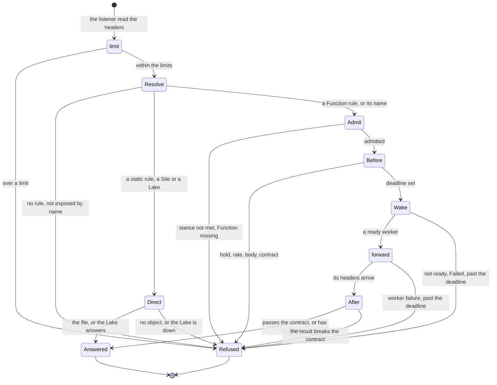

`Direct` is `serveStatic` or `serveUpstream`: no wake and no chain. A fn-to-fn call enters at `Admit`, past `limit` and `Resolve`;
of the chain only the hold and the contract apply to it. Calls to a cold Function share one wake and its clock: [Functions](#functions)
has the hold, [Disaster recovery](#disaster-recovery) a held namespace. A `Service` object only turns `Ready` (ADR-0019 Decision 3)
and no call reads it; `NetDestination` and `Invocation` are no step of a call. New words: Direct, Refused, Answered.

| Where | What happens | Time | You see | Status | Source |
|---|---|---|---|---|---|
| No rule, no by-name Function | Refused, nothing wakes | none | 404 `no route for "<path>"`, 404 `function <ns>/<name> is not exposed by name` | decided | ADR-0241 Decision 4, `TestScenario_exposure_function_off` |
| A rule with no host | In a namespace it answers only on `<ns>.<baseDomain>`; in `default`, on any host no namespace reserves | none | `status.host`, a 404 on another host | decided | ADR-0240 Decisions 3 and 4, `TestScenario_namespace_host_routes` |
| Two rules match | The longest path wins and a host only breaks a tie, so a `default` host-less rule at a longer path takes a host's shorter one | none | the other rule's backend | deferred | ADR-0176 Open questions, `TestScenarioMatchLongestPrefix` |
| A Route that cannot serve | It serves nothing, whichever rule is at fault | re-check `controller.routeResyncInterval` 10 s | `Pending`, `Ready=False`: `BackendNotFound`, `RouteConflict` | decided | ADR-0242 Decision 4, `TestScenarioRouteNotReadyMissingBackend` |
| `server.limits` | Over a limit, refused before any wake; off by default | `server.limits.ratePerMin` 0, `server.limits.maxInFlight` 0 | 429 `rate limit exceeded`, 503 `in-flight concurrency ceiling reached` | decided | ADR-0112 Decision 1, `TestScenarioOverRate429NoWake` |
| A body over the cap | Refused before any wake, since the edge reads it whole to build the CloudEvent | `maxNormalizeBytes` 1 MiB | 413 `request body exceeds 1048576 bytes` | decided | ADR-0134 Contracts, `TestScenarioUpgradeWithBodyStillCapped` |
| A call that breaks its contract | The input is refused before any wake; a bad result replaces the answer | `CallBudget` 1 s of patterns | 422 `event data does not match the input contract`, 500 `handler result does not match the output contract` | decided | ADR-0303 Decisions 4 and 5, `TestScenarioABadInputNeverReachesTheWorker` |
| An external call's deadline | It runs from receipt, through the wake, to the worker's headers | `invoke.defaultTimeout` 60 s, or `spec.timeout` | 504 `<ns>/<name> did not start its response within 1m0s (invoke.defaultTimeout)` | decided | ADR-0151 Decision 2, `TestScenarioColdWakeCutAtLimit` |
| A handler past its deadline | It goes on after the 504 until the shim stops it or it ends, so a retry can repeat its effects | 1 s past the deadline (the shim) | the 504 only | accepted | ADR-0151 Consequences, `TestIssue928_StuckPythonCallStops` |
| A client that stops reading | Its response is cut once it accepts no data; a slow live stream is not | `WriteStallTimeout` 60 s | the connection closes | decided | ADR-0191 Decision 1, `TestScenarioStalledReaderIsCut` |
| A client slow to send | The whole request must arrive in time, so a slow upload fails | `serverReadTimeout` 10 s | 400 `reading request body: <error>` | accepted | #90, `TestIssue90_SilentBodyReleasesInFlightSlot` |
| The worker fails during a call | funcd does not retry it; only a workflow step or a Sensor does | none | 503 `upstream call failed`; past the headers, a cut connection | accepted | ADR-0155 Risks accepted, `TestWorkerFailureProblemHidesWorkerAddress` |
| A link's timeout | A nested call keeps its own bound, wake included, not its caller's deadline | `defaultTimeout` 30 s, or the link's `timeout` | 503 `upstream call failed` | decided | ADR-0064 Decision 4, `TestScenarioLinkKeepsOwnLimit` |
| Nested calls to one Function | Over the cap the next call is refused at once, whoever calls | `invoke.maxNestedInFlight` 10 | 429 `<ns>/<name> has 10 nested calls in flight, the cap set by invoke.maxNestedInFlight` | decided | ADR-0147 Decision 3, `TestScenarioInflightFanoutOverCap` |
| A Site's deploy | The last good build serves until the new index is written and the Route moves | none | `Ready=False`, `IndexMissing` or `ArtifactNotFound` | decided | ADR-0139 Decision 3, `TestScenarioRedeploySwapsAtomically` |
| A GET or another path on a cloudevent Function | Unless its contract refuses the input, it wakes the worker, whose shim answers only `POST /` | a cold start | the shim's 404 | **uncovered** | ADR-0243 Context names the 404, not the wake; read `internal/dataplane/plugins.go`, the pinned shims |
| A `Gateway` object | Stored and listed; nothing acts on it | none | no status | accepted | ADR-0003 Consequences, `TestScenario_KindRegistryRoundtripsEveryKind` |

<!-- generated values, do not edit: just behavior-values -->

Calls: values

| Value | Default | From |
|---|---|---|
| `invoke.activationTimeout` | 30s | config |
| `invoke.defaultTimeout` | 60s | config |
| `invoke.maxNestedInFlight` | 10 | config |
| `invoke.reclaimInterval` | 30s | config |
| `server.auth.edge` | false | config |
| `server.baseDomain` | localhost | config |
| `server.dataPlaneAddr` | 127.0.0.1:0 | config |
| `server.limits.burst` | 0 ⇒ ratePerMin | config |
| `server.limits.key` | clientIP | config |
| `server.limits.maxBodyBytes` | 0 | config |
| `server.limits.maxInFlight` | 0 | config |
| `server.limits.maxKeys` | 4096 | config |
| `server.limits.ratePerMin` | 0 | config |
| `server.listenAddr` | 0.0.0.0:8080 | config |
| `server.network.dnsForwarderPort` | 0 | config |
| `server.network.dnsResolver` | "" | config |
| `server.network.egress` | false | config |
| `server.network.egressGatewayPort` | 0 | config |
| `server.network.internalAllow` | none | config |
| `server.network.workerSyncInterval` | 2s | config |
| `server.observability.accessLog` | false | config |
| `server.observability.metrics` | false | config |
| `server.observability.trace` | false | config |
| `server.shaping.compression` | false | config |
| `server.shaping.cors.allowHeaders` | none | config |
| `server.shaping.cors.allowMethods` | none | config |
| `server.shaping.cors.allowOrigins` | none | config |
| `server.shaping.cors.maxAgeSeconds` | 0 | config |
| `server.shaping.headers.remove` | none | config |
| `server.shaping.headers.set` | none | config |
| `server.shutdownTimeout` | 15s | config |
| `server.tls.caDir` | "" ⇒ Let's Encrypt | config |
| `server.tls.certFile` | "" | config |
| `server.tls.email` | "" | config |
| `server.tls.enabled` | false | config |
| `server.tls.hosts` | none | config |
| `server.tls.keyFile` | "" | config |
| `server.tls.mode` | selfsigned | config |
| `site.defaultIndex` | index.html | config |
| `defaultActivationTimeout` | 30s | `internal/activator/activator.go` |
| `defaultPollInterval` | 25ms | `internal/activator/activator.go` |
| `defaultReclaimInterval` | 30s | `internal/activator/activator.go` |
| `heldIdleTimeout` | 5m | `internal/activator/activator.go` |
| `idleRetention` | 1m | `internal/activator/calltracker.go` |
| `maxAttempts` | 5 | `internal/activator/storescaler/storescaler.go` |
| `tunnelIdleTimeout` | 5m | `internal/activator/tunnel.go` |
| `heldRetryAfter` | 30 | `internal/dataplane/dataplane.go` |
| `maxNormalizeBytes` | 1MiB | `internal/dataplane/normalize.go` |
| `defaultMaxKeys` | 4096 | `internal/edge/limit/limit.go` |
| `WriteStallTimeout` | 1m | `internal/gateway/writestall.go` |
| `clearAhead` | 876000h | `internal/gateway/writestall.go` |
| `stallChunk` | 32KiB | `internal/gateway/writestall.go` |
| `maxRouteName` | 63 | `internal/route/owned/owned.go` |
| `backendRequeue` | 2s | `internal/route/reconcile.go` |
| `resyncPeriod` | 10s | `internal/route/reconcile.go` |
| `routeRequeue` | 2s | `internal/site/reconcile.go` |

<!-- end of generated values -->
## Services

Kinds: KVStore, Bucket, SQLDatabase, Lake.

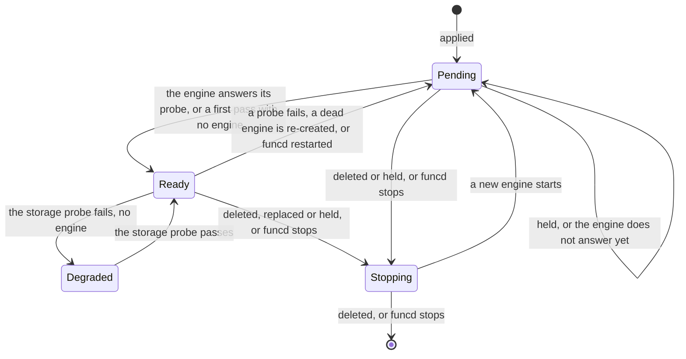

A KVStore or a Bucket runs no engine: the platform's KV or blob store serves it, and a table removed from a KVStore's spec loses its
data at its next pass. A Lake and a SQLDatabase each run one pinned engine, never scaled to zero. `Stopping` is no phase: a status keeps
its last one until the pass ends. New words: Stopping. A held Lake also shows `BindingResolveFailed`, `StoreNotOwned`, `SecretNotFound`,
`ScratchSpaceLacking` or `GatewayEndpointNotAnAddress`. An exposed Lake that is not Ready has no edge entry: `IngressReady=False`,
`LakeNotReady`. The S3 gateway opens with the blob provider, a taken `s3gateway.listenAddr` fails funcd's start (#497), and it closes after
the workers (#1232).
Details: [stop](design/lake/stop.md), [commit-save](design/lake/commit-save.md), [quarantine](design/storage/quarantine.md).

| Where | What happens | Time | You see | Status | Source |
|---|---|---|---|---|---|
| A Lake or a SQLDatabase applied | Its engine starts, and the object stays `Pending` until the engine answers its probe | `lake.enginePollInterval` 2 s, `enginePoll` 2 s, per try | `Pending`, `EngineNotReady` | decided | ADR-0087 Decision, ADR-0232 Decision 2, `TestReconcileStartingThenReady` |
| A Lake's Bucket, prefix or binding is missing, or another owns its prefix | It is held: no engine starts, and a running one stops | `controller.referentPollInterval` 2 s | `Pending`, `BucketNotFound`, `PrefixNotOwned` | decided | ADR-0121 Decision 2, ADR-0312 Decision 7, `TestScenarioLakeOffItsOwnPrefixIsHeld` |
| A Lake with `s3gateway.enabled` false, the default | Its engine gets no S3 endpoint or key pair and exits at start; nothing refuses the Lake | `lake.enginePollInterval` 2 s, per try | `Pending`, `EngineNotReady`; the log's `AWS_ENDPOINT_URL is required` | **uncovered** | read ADR-0080, ADR-0085 Scenarios, ADR-0087, ADR-0088: none says; no issue or card; traced, not run |
| An engine that exits at start, on a refused `DUCKDB_*` key say | Re-created at every pass, with no growing wait | `lake.enginePollInterval` 2 s | `Pending`, `EngineNotReady`; the cause only in the daemon log, `engine output` | accepted | ADR-0265 Consequences, ADR-0276 Decision 4, `TestConverge_supervision_recreates_and_adopts` |
| A worker's query while the Lake is not Ready or is deleted | Its proxy refuses it on the URL the worker holds; a deleted Lake's URL closes once no Function binds it | until the Lake is Ready | 503 `lake not ready` | decided | ADR-0162 Decisions 1 and 4, `TestScenarioMissingLakeShowsNotReady` |
| A SQLDatabase's engine is not Ready | Unlike a Lake it gates no Function: the worker runs, its readiness fails, and a `context.sql` call is refused | none | 503 `the engine of SQLDatabase "<name>" is not Ready`; `DependencyNotReady` | decided | ADR-0233 Decisions 1, 4 and 8, `TestScenarioEngineNotReadyUnavailable` |
| An answer after a commit, `lake.saveInterval` unset | Held until a save covers the commit: a copy and upload of the whole catalog, shared by the commits that wait together; a read waits behind them too | one save, which grows with the catalog | a slow commit | accepted | ADR-0279 Consequences, `TestBarrierHoldsTheLastBytes` |
| A save fails | The answer fails, and so does every request after the unsaved commit; the next good save keeps the commit unless the engine dies first | none | 503 `lake catalog not saved`, or a broken connection once headers went out | decided | ADR-0279 Decisions 3 and 4, `TestScenarioRefusedSaveIsAnError` |
| The catalog store hangs | Every answer waits out the S3 client, or the caller's own deadline | up to 60 s to connect and to read (botocore), with retries | a late failure | accepted | ADR-0279 Consequences |
| Saves keep failing, as past `lake.catalogMaxSize` 256 MiB | The phase stays `Ready`, the engine retries unasked, and a condition shows it | 1 s (the shim); seen by `runtime.supervisionPeriod` 10 s | `CatalogSaved=False`, `SavesFailing` | decided | ADR-0276 Decision 3, ADR-0289 Decision 1, ADR-0293 Decision 3, `TestScenarioFailingSavesShowOnTheLake` |
| `lake.saveInterval` set | Answers go out at once, and a crash loses at most what was answered in one interval and the two saves around it | that interval | a lost commit | accepted | ADR-0274 Decision 5, ADR-0279 Decision 1, `TestScenarioIntervalIsTheOptIn` |
| A derived S3 key pair past two periods, or from before a restart | The gateway refuses it | `s3gateway.keyRotationPeriod` 24 h | 403 InvalidAccessKeyId | decided | ADR-0270 Decisions 2 and 4, `TestScenarioPairExpires`, `TestScenarioRestartRotates` |
| A Ready engine fails a probe, or hangs | `Ready` to `Pending` at once, and only a good probe brings it back: a failed probe replaces nothing | a probe each `runtime.supervisionPeriod` 10 s, bound `lake.engineProbeTimeout` 2 s | `EngineNotReady`; 503 `lake not ready` | accepted | ADR-0087 Decision, ADR-0215 Scope, `TestIssue716_NotReadyEngineStopsServing` |
| An engine dies | Seen at the next pass, then re-created; until then calls fail | `runtime.supervisionPeriod` 10 s, then its boot | 503 `lake engine unavailable`, `the database's engine does not answer` | accepted | ADR-0142 Decisions 8 and 9, Consequences, `TestScenarioCrashedLakeEngineRestarts` |
| An engine is replaced: a changed spec, a Lake's bound Secret, or its key pair at 80% to 90% of `s3gateway.keyRotationPeriod` 24 h | It stops, then `Pending` for a few seconds; connections drop | the next pass | `Pending`, `EngineNotReady`; 503 `lake not ready` | accepted | ADR-0270 Decision 6, Consequences, #1195, `TestScenarioEngineReplacedAtMaxAge` |
| A Lake engine stops | Queries drain while saves go on, then what still runs is cancelled and the catalog is saved a last time | 5 s (the shim), inside `runtime.containerd.stopGrace` 10 s | the client's `INTERRUPT Error: Interrupted: query was cancelled` | decided | ADR-0273 Decision 3, `test_a_commit_acknowledged_during_the_wait_survives_and_the_long_query_is_cancelled` |
| funcd restarts | Each engine comes back on its data; a Lake rebinds its recorded port, or a new one if taken, which its consumers get | until its probe passes | `Pending`, `EngineNotReady`; logs `lake proxy port is taken; bound a new one, so its consumers' URL changes` | decided | ADR-0162 Decisions 2 and 3, `TestScenarioRestartKeepsLakePort`, `TestScenarioTakenPortMovesConsumers` |
| A SQLDatabase that was Ready comes back with no directory | It starts empty and `Ready`, and says so until a Restore into it succeeds | none | `DataMissing=True`, `NoDirectory` | decided | ADR-0234 Decision 6, `TestScenarioMissingDataReported` |
| A Lake that was Ready finds no catalog | Its engine starts an empty catalog beside its files, and no condition says so | none | `Ready`, no `DataMissing` | **uncovered** | ADR-0276 Decision 2 names the fresh start, ADR-0234 Decision 6 only a SQLDatabase, ADR-0293 Decision 7 only an old catalog; no issue or card; `test_a_fresh_catalog_is_not_saved` |
| funcd restarts, `kvstore.engine` memory, the default | Every key is gone, and the KVStore stays `Ready` | none | empty reads | decided | ADR-0066 Decision |
| A delete of a bound or non-empty KVStore, Bucket or SQLDatabase | Refused, also while a database's engine cannot answer; a Lake has no such check | none | 409 `still holds keys; drain it first`, `retry once its engine is Ready` | decided | ADR-0073 Decision 6, ADR-0232 Decision 7, ADR-0233 Decision 7, `TestScenarioDeleteRefusedWhileHoldingData` |
| A delete that a crash cut | At the next start its data moves aside, so a new store of that name starts empty; it goes after the retention | `storage.quarantineRetention` 168 h | `moved the data of a KVStore with no object into the quarantine`, `funcdctl hold status` | decided | ADR-0288 Decisions 1, 4 and 5, `TestScenarioOrphanQuarantined` |

<!-- generated values, do not edit: just behavior-values -->

Services: values

| Value | Default | From |
|---|---|---|
| `blob.allowUnversioned` | false | config |
| `blob.backup.interval` | 1h | config |
| `blob.backup.rebaseline` | 720h | config |
| `blob.backup.retention` | 720h | config |
| `blob.credentialsFile` | "" | config |
| `blob.dir` | <dataDir>/blob | config |
| `blob.target` | "" | config |
| `blob.versionRetention` | "" | config |
| `kvstore.backup.chunkBytes` | 8388608 | config |
| `kvstore.backup.credentialsFile` | "" | config |
| `kvstore.backup.enabled` | false | config |
| `kvstore.backup.encryption.none` | false | config |
| `kvstore.backup.encryption.recipients` | none | config |
| `kvstore.backup.interval` | 30s | config |
| `kvstore.backup.rebaseline` | 24h | config |
| `kvstore.backup.rebaselineRetry` | 1h | config |
| `kvstore.backup.retention.daily` | 30 | config |
| `kvstore.backup.retention.hourly` | 48 | config |
| `kvstore.backup.retention.weekly` | 12 | config |
| `kvstore.backup.singleWriter` | false | config |
| `kvstore.backup.target` | "" | config |
| `kvstore.cdc.enabled` | false | config |
| `kvstore.cdc.retention` | 24h | config |
| `kvstore.cdc.sink` | "" | config |
| `kvstore.dataDir` | <dataDir>/kv | config |
| `kvstore.engine` | memory | config |
| `kvstore.maxStoresPerNamespace` | 100 | config |
| `lake.catalogMaxSize` | 256MiB | config |
| `lake.enginePollInterval` | 2s | config |
| `lake.engineProbeTimeout` | 2s | config |
| `lake.saveInterval` | unset ⇒ every answer waits for a save that covers it | config |
| `lake.scratchSize` | the larger of 1GiB and that | config |
| `s3gateway.enabled` | false | config |
| `s3gateway.endpoint` | "" ⇒ http://<bridge address>:<port> under containerd when listenAddr binds the bridge or all hosts, else http://<listenAddr> | config |
| `s3gateway.keyRotationPeriod` | 24h | config |
| `s3gateway.listenAddr` | 127.0.0.1:9000 | config |
| `s3gateway.masterSecretFile` | "" ⇒ generated under <dataDir>/s3gateway | config |
| `s3gateway.maxUploadBytes` | 1073741824 | config |
| `sql.callTimeout` | 30s | config |
| `sql.changeFeedPort` | 7075 on the bridge address, a free port on loopback | config |
| `sql.maxDatabasesPerNamespace` | 20 | config |
| `listPageCharge` | 4KiB | `internal/blob/gocloud/answers.go` |
| `maxAnswerBytes` | 64KiB | `internal/blob/gocloud/answers.go` |
| `maxListBytes` | 16MiB | `internal/blob/gocloud/answers.go` |
| `passSetSize` | 65536 | `internal/blob/gocloud/file.go` |
| `conflictRetries` | 3 | `internal/blob/gocloud/gocloud.go` |
| `defaultExpiry` | 15m | `internal/blob/gocloud/gocloud.go` |
| `movePageSize` | 1000 | `internal/blob/gocloud/move.go` |
| `maxCopyBytes` | 5GiB | `internal/blob/gocloud/versioned.go` |
| `maxListXML` | 4032KiB | `internal/blob/s3gateway/backend.go` |
| `multipartIdleExpiry` | 1h | `internal/blob/s3gateway/multipart.go` |
| `defaultMaxUpload` | 1GiB | `internal/blob/s3gateway/s3gateway.go` |
| `maxInFlightRequests` | 4096 | `internal/blob/s3gateway/s3gateway.go` |
| `maxMultipartParts` | 10000 | `internal/blob/s3gateway/s3gateway.go` |
| `shutdownRetry` | 10ms | `internal/blob/s3gateway/s3gateway.go` |
| `defaultBackupInterval` | 30s | `internal/kvstore/badger/backup.go` |
| `defaultBackupRebaseline` | 24h | `internal/kvstore/badger/backup.go` |
| `defaultChunkBytes` | 8MiB | `internal/kvstore/badger/backup.go` |
| `defaultRebaselineRetry` | 1h | `internal/kvstore/badger/backup.go` |
| `delChunkBytes` | 1MiB | `internal/kvstore/badger/backup.go` |
| `delEntryBytes` | 128 | `internal/kvstore/badger/backup.go` |
| `pruneRetries` | 3 | `internal/kvstore/badger/backup.go` |
| `baseTableSize` | 8MiB | `internal/kvstore/badger/badger.go` |
| `blockCacheSize` | 32MiB | `internal/kvstore/badger/badger.go` |
| `defaultGCInterval` | 5m | `internal/kvstore/badger/badger.go` |
| `dropConcurrency` | 64 | `internal/kvstore/badger/badger.go` |
| `indexCacheSize` | 32MiB | `internal/kvstore/badger/badger.go` |
| `memTableSize` | 16MiB | `internal/kvstore/badger/badger.go` |
| `valueLogFileSize` | 64MiB | `internal/kvstore/badger/badger.go` |
| `cdcPollInterval` | 200ms | `internal/kvstore/badger/cdc.go` |
| `cdcRetryDelay` | 1s | `internal/kvstore/badger/cdc.go` |
| `defaultCDCRetention` | 24h | `internal/kvstore/badger/cdc.go` |
| `maxLine` | 4096 | `internal/lake/devengine/devengine.go` |
| `reapGrace` | 3s | `internal/lake/devengine/devengine.go` |
| `serveTimeout` | 20s | `internal/lake/devengine/devengine.go` |
| `placeholderMaxBytes` | 4096 | `internal/lake/embedengine/embedengine.go` |
| `maxBarrierReply` | 4KiB | `internal/lake/gateway/barrier.go` |
| `proxyIdleTimeout` | 2m | `internal/lake/gateway/manager.go` |
| `proxyReadHeaderTimeout` | 10s | `internal/lake/gateway/manager.go` |
| `proxyReadTimeout` | 10s | `internal/lake/gateway/manager.go` |
| `handshakeHeadMax` | `preambleLen + tokenHdrLen + binary.MaxVarintLen64 + 4<<10` | `internal/lake/gateway/proxy.go` |
| `defaultProbeTimeout` | 2s | `internal/provider/runtime.go` |
| `minSweepLen` | 64 | `internal/services/bindcache.go` |
| `defaultResolverTTL` | 5s | `internal/services/blob/resolver.go` |
| `defaultResolverTTL` | 5s | `internal/services/kv/resolver.go` |
| `defaultPollInterval` | 2s | `internal/services/lake/lake.go` |
| `hasTablesTimeout` | 30s | `internal/services/sql/backup.go` |
| `feedHeaderTimeout` | 5s | `internal/services/sql/changefeed.go` |
| `feedListenRetry` | 1s | `internal/services/sql/changefeed.go` |
| `maxChangeData` | 256KiB | `internal/services/sql/changefeed.go` |
| `maxEngineResponse` | 8MiB | `internal/services/sql/client.go` |
| `cdcMaxBatch` | 100 | `internal/services/sql/engineargs/engineargs.go` |
| `cdcTransmitTimeout` | 10s | `internal/services/sql/engineargs/engineargs.go` |
| `DefaultCallTimeout` | 30s | `internal/services/sql/facade.go` |
| `defaultMemory` | 256Mi | `internal/services/sql/reconcile.go` |
| `enginePoll` | 2s | `internal/services/sql/reconcile.go` |
| `engineProbeTimeout` | 5s | `internal/services/sql/reconcile.go` |
| `resolverTTL` | 5s | `internal/services/sql/resolver.go` |
| `readyPollInterval` | 100ms | `internal/sql/devengine/devengine.go` |
| `readyProbeTimeout` | 1s | `internal/sql/devengine/devengine.go` |
| `readyTimeout` | 30s | `internal/sql/devengine/devengine.go` |
| `reapGrace` | 3s | `internal/sql/devengine/devengine.go` |
| `placeholderMaxBytes` | 4096 | `internal/sql/embedengine/embedengine.go` |

<!-- end of generated values -->
## Eventing

Kinds: EventSource, Sensor, Workflow, WorkflowRun.

A WorkflowRun:

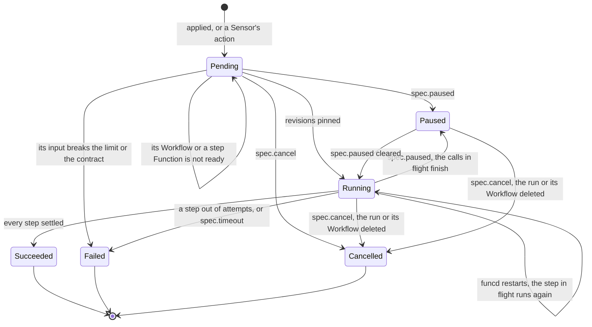

An event takes one path: a source fires, the in-process fan-out hands it to each subscribed Sensor, each action queues one delivery,
and a worker makes it and records one `Invocation`, which no sweep reclaims (ADR-0156 Consequences). A failed step ends the run
fail-fast: running siblings return to `Pending`, descendants are `Skipped`, and `onFailure` runs once and never changes the phase. A pin
holds code, not bindings: a step reads its current bindings, and a paused run with no `spec.timeout` holds its revisions until cancelled
(ADR-0190). `storage.mode: memory` forgets seen lists and dead letters at a restart. A hold's lifecycle: [Disaster recovery](#disaster-recovery).

| Where | What happens | Time | You see | Status | Source |
|---|---|---|---|---|---|
| A timer due while funcd is down | Skipped: the next fire is the next grid point or cron slot, and a start on one does not fire | none | nothing reports it | accepted | ADR-0182 Decision 3 and Consequences, ADR-0211 Decision 6, `TestScenarioMissedFireSkipped`, `TestScenarioCronNoCatchUp` |
| An event no Sensor is subscribed to | Gone, with no Invocation. A blob object then counts as seen, so a Sensor applied later does not get it | none | nothing reports it | accepted | ADR-0108 Decision 2 and Temporary workarounds, ADR-0157 Decision 6, `TestFanoutRoutesByKey` |
| A new or rewritten object | Fires at the next poll of the whole prefix: a key unseen, or with another ModTime or Size. After a restart the rest stay silent | `eventing.blobPollInterval` 15 s | `data.version` in the event | decided | ADR-0157 Decisions 2 and 6, `TestScenarioRewrittenObjectFiresAgain`, `TestScenarioRestartKeepsEventingState` |
| A source under a hold | A timer fires at most once after the release. Blob objects replay then, unless a platform release names the source in `--advance`. A `sql` change is answered 503, and its engine retries | until the release | `funcdctl hold status` | decided | ADR-0206 Decisions 6 and 8, ADR-0222 Decision 8, ADR-0235 Decision 4, `TestScenarioBlobReplayOrAdvance` |
| A delivery fails | Any failure, a 4xx too, retries, then parks a dead letter and one `Failed` Invocation | `eventing.deliveryAttempts` 3, `eventing.deliveryBackoffInitial` 100 ms doubling to `eventing.deliveryBackoffMax` 10 s; each `invoke.activationTimeout` 30 s + `sensorDeliveryTimeout` 30 s | `funcdctl eventing dlq list` | decided | ADR-0156 Decision 2, `TestActionFailsThenDeadLettered` |
| A `workflow:` action | It succeeds once the run is created: the Invocation reads `Ready`, and a run that later fails or waits reaches no dead letter | none | the run's own phase | decided | ADR-0109 Decision 3, `TestEventStartsWorkflow` |
| A timer faster than its run | Each firing starts its own run: nothing limits their overlap, and a missing Workflow leaves one `Pending` run per firing | none | a growing list of runs | deferred | ADR-0109 Open questions, ADR-0094 Scope, `TestStatelessIndependentFirings` |
| A slow target | It holds only its own slots, so other targets go on, in no promised order. A firing past the Sensor's bound is parked with no attempt | `eventing.maxInFlightPerTarget` 4, `eventing.maxDeliveriesInFlight` 32, `eventing.maxQueuedPerSensor` 4096 | `delivery queue of sensor <ns>/<name> is full` | decided | ADR-0156 Decisions 4, 5 and 9, `TestScenarioFullSensorQueueDeadLetters` |
| A Sensor edited or deleted with deliveries queued | Those whose action changed become dead letters with no further attempt; one in flight that fails is not retried | none | `sensor <ns>/<name> changed with the delivery still queued` | decided | ADR-0156 Decision 8, `TestScenarioSensorEditReleasesBacklog` |
| A dead letter | Nothing redelivers it. A replay is one attempt on the live spec; a sweep evicts it past the retention or as the oldest over the cap, another Sensor's too | `eventing.deadletter.retention` 720 h, `eventing.deadletter.maxEntries` 1000 per namespace | `funcdctl eventing dlq replay <id>` | decided | ADR-0118 Decisions 3 and 5, ADR-0156 Consequences, `TestRetentionEvicts` |
| funcd stops with deliveries queued | Those queued become dead letters, which nothing redelivers at the next start; past the bound the rest are dropped with one log line | `server.shutdownTimeout` 15 s | `daemon shut down with the delivery still queued` | decided | ADR-0156 Decision 7, `TestScenarioShutdownParksQueued`, `TestScenarioShutdownPastBoundDropsWithCount` |
| funcd crashes with deliveries queued | Lost, with no Invocation; a blob object already marked seen does not fire again | none | nothing reports it | deferred | card "Durable Sensor delivery", ADR-0156 Decision 6 and Temporary workarounds |
| A delivery under a hold | One already queued is retried, then parked in under a second, not kept for the release; a replay is refused | `eventing.deliveryAttempts` 3 | `the platform or the namespace is held` | decided | ADR-0206 Decision 6, ADR-0222 Decision 8, `TestEveryRunnerConsultsHoldInNamespace` |
| Before a run starts | `Pending` with no limit, until its Workflow, any child and each step Function's revision are ready; then it pins them | `controller.referentPollInterval` 2 s | `Ready=False`: `WorkflowNotFound`, `WorkflowNotReady` | decided | ADR-0146 Decision 1, ADR-0190 Decision 2, `TestIssue123_RunOfMissingWorkflowWaits`, `TestScenarioStartWaitsForStepCode` |
| A run's input | Over the limit or off the contract, an apply is refused; a run admitted before its Workflow was Ready, or made by a Sensor, ends `Failed` at its start, `onFailure` included | `workflow.payloadLimit` 262144 | `PayloadLimitExceeded`, `InputSchemaMismatch` | decided | ADR-0094 Input model, ADR-0109 Decision 3, `TestIssue181_RunStartGateCapsInput`, `TestRunInputMismatchFailsRun` |
| A step's attempt | Its wake counts. A 5xx, a timeout or a transport error retries; a 4xx or an oversized output fails at once | `workflow.defaultStepTimeout` 300 s, `workflow.defaultRetry` 1, `workflow.defaultRetryBackoff` 0 s, `workflow.maxStepsInFlight` 64 | `returned 503`, `rejected the step (422)` | decided | ADR-0094 Execution, ADR-0146 Decision 7, `TestPerStepTimeoutIsStepFailure` |
| `spec.timeout` | Runs from the run's start, paused time excluded and funcd's downtime not: a resume past it fails at once. It ends the run and fires `onFailure` | `spec.timeout`; unset means none | `Failed`, `RunTimedOut` | decided | ADR-0096 Decision, ADR-0094 Failure, `TestRunTimeoutFails`, `TestIssue177_PausedTimeExcludedFromRunTimeout` |
| `spec.timeout` across a hold | A hold does not stop the clock: a run with a record, resumed after it, can fail at once, with no step called and `onFailure` fired | none | `RunTimedOut` | **uncovered** | ADR-0096's formula subtracts paused time only; ADR-0206 Decision 6 restarts an App's deadline at a release and names no run's; read ADR-0094, ADR-0146, ADR-0222, #177; no test |
| `spec.cancel` | Closes the calls in flight and ends the run with no retry and no `onFailure`; a late answer is discarded, and a cancelled call may have done its work | the next pass | `cancelled while running (spec.cancel); the step's call may have completed` | decided | ADR-0146 Decision 3 and Consequences, `TestIssue27_CancelAbandonsInFlightStep` |
| The Workflow is edited mid-run | The run keeps the spec, children and step revisions it pinned at its start, a removed step's Function too; a new run takes the new ones. An old revision boots a solo worker | `stepIdleTimeout` 5 min idle | `status.pins` | decided | ADR-0190 Decisions 1, 6 and 7, `TestIssue776_EditMidRunKeepsOldCode`, `TestScenarioRemovedStepStillRuns` |
| The Workflow is deleted or re-created | A started run is cancelled and one not started stays `Pending`. A deleted `function.ref` target fails its step, with no fallback | `controller.referentPollInterval` 2 s | `Cancelled`, `pinned revision <pin> of run "<run>" is gone` | decided | ADR-0190 Decisions 4 and 10, `TestScenarioWorkflowDeleteCancelsRuns`, `TestScenarioRefStepBound` |
| funcd stops or crashes mid-run | The run stays `Running`. A stop lets calls finish until the bound; a cut call runs again at its next attempt, even past `maxAttempts`; a `wait` restarts from zero, an inline child from its start | `server.shutdownTimeout` 15 s | a higher `X-Funcd-Attempt` | decided | ADR-0146 Decisions 6 and 8, `TestScenarioRestartResumesInFlightRun` |
| A run funcd is not driving, under a hold | Nothing starts, resumes or replays, the status stays and a `spec.cancel` waits; a run created meanwhile starts after the release. A platform restore brings each open run back `Paused` | until the release | `funcdctl workflow resume` | decided | ADR-0206 Decisions 6 and 7, ADR-0222 Decision 8, `TestScenarioRunsHeldAsEvidence` |
| A run funcd is driving when a hold begins | It is not stopped: its next step is still dispatched, and its record can reach `Succeeded` during the hold | until it ends | `Running` until the release | **uncovered** | ADR-0290 Decision 1 says dispatch waits, citing `reconcile_run.go`, which gates only a pass; ran a probe; no issue or card |
| A closed run | Its record and its object go past the retention, and an open run never does; a deleted run's record ends `Cancelled` first | `workflow.retention` 720 h, swept at most `maxRetentionSweep` 1 h apart | gone from `funcdctl workflow runs` | decided | ADR-0094 Execution, `TestIssue67_RetentionSweepsWorkflowRuns`, `TestIssue726_SweepCancelsRecordOfDeletedRun` |

<!-- generated values, do not edit: just behavior-values -->

Eventing: values

| Value | Default | From |
|---|---|---|
| `eventing.blobPollInterval` | 15s | config |
| `eventing.bucketRecheckInterval` | 15s | config |
| `eventing.deadletter.maxEntries` | 1000 | config |
| `eventing.deadletter.retention` | 720h | config |
| `eventing.deliveryAttempts` | 3 | config |
| `eventing.deliveryBackoffInitial` | 100ms | config |
| `eventing.deliveryBackoffMax` | 10s | config |
| `eventing.eventstore.dataDir` | <dataDir>/eventstore | config |
| `eventing.maxDeliveriesInFlight` | 32 | config |
| `eventing.maxInFlightPerTarget` | 4 | config |
| `eventing.maxQueuedPerSensor` | 4096 | config |
| `workflow.artifactPollInterval` | 5s | config |
| `workflow.dataDir` | <dataDir>/workflow | config |
| `workflow.defaultRetry` | 1 | config |
| `workflow.defaultRetryBackoff` | 0s | config |
| `workflow.defaultStepTimeout` | 300s | config |
| `workflow.maxStepsInFlight` | 64 | config |
| `workflow.payloadLimit` | 262144 | config |
| `workflow.retention` | 720h | config |
| `readyTimeout` | 10s | `internal/bus/nats/nats.go` |
| `defaultBlobPollInterval` | 15s | `internal/eventing/blobwatch.go` |
| `blockCacheSize` | 16MiB | `internal/eventing/deadletter/badger/badger.go` |
| `indexCacheSize` | 16MiB | `internal/eventing/deadletter/badger/badger.go` |
| `memTableSize` | 16MiB | `internal/eventing/deadletter/badger/badger.go` |
| `valueLogFileSize` | 64MiB | `internal/eventing/deadletter/badger/badger.go` |
| `bucketRecheckInterval` | 15s | `internal/eventing/eventing.go` |
| `runTick` | 25ms | `internal/eventing/eventing.go` |
| `gcInterval` | 5m | `internal/eventing/eventstore/eventstore.go` |
| `maxRecord` | 64MiB | `internal/eventing/eventstore/eventstore.go` |
| `partSize` | 512KiB | `internal/eventing/eventstore/eventstore.go` |
| `evalTimeout` | 100ms | `internal/expr/eval.go` |
| `maxStringLen` | 1MiB | `internal/expr/eval.go` |
| `resultMargin` | 1MiB | `internal/expr/eval.go` |
| `maxErrorBody` | 1KiB | `internal/sensor/invoker.go` |
| `retryBaseDelay` | 100ms | `internal/sensor/retry.go` |
| `retryMaxDelay` | 10s | `internal/sensor/retry.go` |
| `defaultDeliveryAttempts` | 3 | `internal/sensor/sensor.go` |
| `defaultMaxDeliveriesInFlight` | 32 | `internal/sensor/sensor.go` |
| `defaultMaxInFlightPerTarget` | 4 | `internal/sensor/sensor.go` |
| `defaultMaxQueuedPerSensor` | 4096 | `internal/sensor/sensor.go` |
| `errBodyMax` | 256 | `internal/workflow/dispatch.go` |
| `maxRetryBackoff` | `time.Duration(v1.MaxRetryBackoff)` | `internal/workflow/engine.go` |
| `maxStatusError` | 512 | `internal/workflow/engine.go` |
| `linkAttempts` | 5 | `internal/workflow/reconcile_run.go` |
| `waitRequeue` | 2s | `internal/workflow/reconcile_run.go` |
| `contractRequeue` | 5s | `internal/workflow/reconcile_workflow.go` |
| `stepIdleTimeout` | 5m | `internal/workflow/reconcile_workflow.go` |
| `blockCacheSize` | 16MiB | `internal/workflow/runstate/badger/badger.go` |
| `indexCacheSize` | 16MiB | `internal/workflow/runstate/badger/badger.go` |
| `memTableSize` | 16MiB | `internal/workflow/runstate/badger/badger.go` |
| `valueLogFileSize` | 64MiB | `internal/workflow/runstate/badger/badger.go` |

<!-- end of generated values -->
## Apps

Kinds: App, AppRevision.

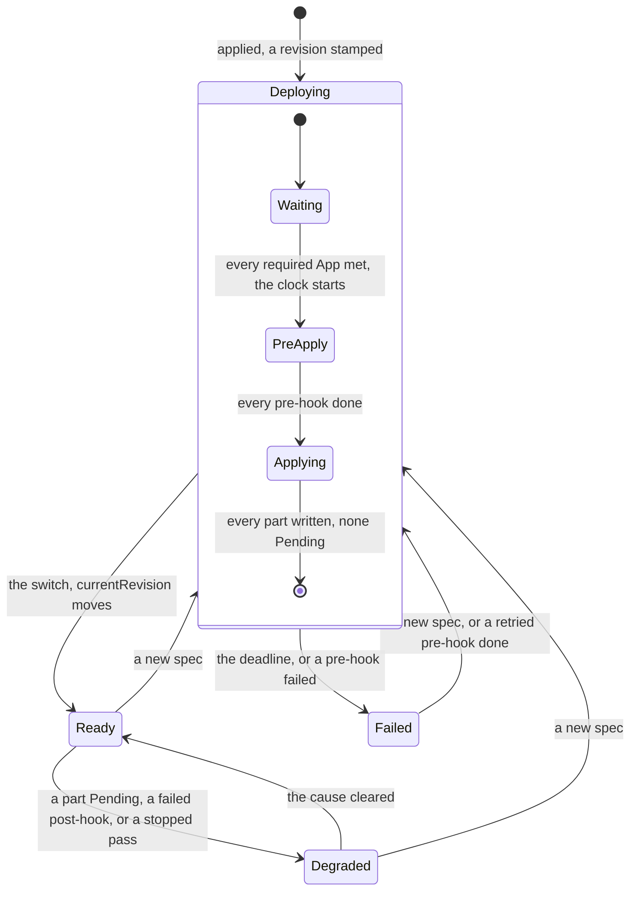

An AppRevision freezes one spec, `Deploying` then `Ready` or `Failed`; only the reconciler writes it, and any other write answers 405.
A second apply mid-rollout turns the older revision `Failed`, `Superseded`. A part's reconciler makes its children, and a refusal there
shows as the part's Pending reason. A refusal at apply names `spec.<section>[i]` and stores nothing (ADR-0252 Decision 1, ADR-0219
Decision 7). A template renders on the client, so a bad value applies nothing (ADR-0217 Decision 7). A pause or a hold freezes whatever
phase it finds; a hook call running then finishes and records nothing, so it is due again (ADR-0214 Decision 8). Neighbors:
[Functions](#functions), [Disaster recovery](#disaster-recovery), [Services](#services). New words: Waiting, Applying.

| Where | What happens | Time | You see | Status | Source |
|---|---|---|---|---|---|
| A part's name another object holds, or a declared Secret or key missing | The pass stops and writes no part, a write-back included: `Deploying`, or `Degraded` once Ready | re-check `runtime.supervisionPeriod` 10 s | `ChildNotOwned`, `SecretNotFound`, `SecretKeyMissing` | decided | ADR-0199 Decision 4, ADR-0213 Decision 8, `TestScenarioAppChildNotOwned`, `TestScenarioAppSecretDeclared` |
| The same App applied after its delete | A kept store carries the old App's marker, so naming it in `kv`, `buckets` or `sql` stops the pass; a `ref` entry takes it back, or a delete of the store | none | `KVStore/<name>: exists and is not owned by App/<app>` | accepted | ADR-0199 Decision 7 and Consequences, `TestScenarioAppChildNotOwned`, `TestScenarioAppRefKeptStore` |
| A required App missing, off range or not Ready | The revision waits with no limit: no clock, no hook, no part written, a write-back included | re-check `runtime.supervisionPeriod` 10 s, at once when that App changes | `RequirementNotMet`, `App/<app> does not exist; <dependent> needs <range>` | decided | ADR-0219 Decision 3 and Consequences, `TestScenarioAppRequiresWaits` |
| Pre-hooks | Only what a pre-hook binds and its Function are written, while the old revision serves; then one call at a time, which wakes it | each `spec.timeout`, else `invoke.defaultTimeout` 60 s, a wake included | `Deploying`, `Progressing`, `pre-hook Function/<name>` | decided | ADR-0214 Decisions 4 and 5, `TestScenarioAppPreHookMigrates`, `TestAppHookTimeoutCoversWake` |
| A pre-hook fails, or its Function or database is not ready by the deadline | The revision turns `Failed` and the current one serves | `app.upgradeTimeout` 5 min | `HookFailed`, `Function/<fn>: Invocation/<inv>: <error>`, `SQLDatabase/<name>: <reason>` | decided | ADR-0214 Decision 4, ADR-0236 Decision 3, `TestScenarioAppPreHookFailsThenRetry`, `TestScenarioDatabaseNotReadyFailsRollout` |
| `funcdctl app retry` | Calls the failed hook at once and returns; the passes carry on. A revision `Failed` by its deadline has nothing to retry | none | `retrying the failed hook of <app>`, 409 `app <app> has no failed hook`, 503 `funcd is held: app <app> calls no hook` | decided | ADR-0214 Decision 7, `TestAppRetryRefusals`, `TestAppDeadlineFailedRevisionCallsNoHook` |
| `funcdctl app retry` after `SQLDatabase/<name>: <reason>` | Taken as any `HookFailed`: it calls the hook with the database still not Ready, and a good call reopens the revision | none | `Deploying` | **uncovered** | ADR-0236 Decision 3 says no retry fixes this path; ADR-0214 Decision 7 reopens `HookFailed`; `Retry` in `internal/app/hooks.go` does not tell them apart; no issue; ran it |
| funcd stops while a hook runs | The call is not recorded, so the next start calls it again, and a hook must be safe to repeat; a cut retry leaves the hook failed | none | a second call, one line in `status.hooks` | accepted | ADR-0214 Decisions 6 and 7, Risks, `TestScenarioAppHookRepeatsAfterRestart` |
| Post-hooks | Called after the switch with no App deadline, the App `Ready` meanwhile. One that fails keeps the revision current and holds the later hooks and prune until a retry | each `spec.timeout`, else `invoke.defaultTimeout` 60 s | `Degraded`, `HookFailed`; a dropped part `Pruning`, no reason | decided | ADR-0214 Decision 4, `TestScenarioAppPostHookFails` |
| `funcdctl app deploy` at the switch | Exits 0 once `currentRevision` names its revision, with a post-hook due, running or failed | none | exit 0 | **uncovered** | ADR-0217 Decision 8 and its checklist wait for the post-hooks and exit 1 on a failed one; `waitDeployEvery` in `cmd/funcdctl/app.go` reads no hook; read ADR-0214, ADR-0253; no issue; ran it |
| A changed scale-to-zero part | Not running, it counts as settled: the revision goes current unbooted, and a broken image shows only at the first call | none | `Ready=Unknown`, `NotStarted`, later `Degraded` | accepted | ADR-0200 Decision 6 and Risks, ADR-0215 Decision 8, `TestScenarioAppScaleToZeroNotStarted` |
| A part Pending at the deadline, a missing `ref` target too | The revision turns `Failed`, and a changed Function's old Revision serves. It is final: a part Ready later changes nothing, and the same spec stamps nothing | `app.upgradeTimeout` 5 min | `Failed`, `ChildNotReady`, `Function/<name>: <reason>` | decided | ADR-0200 Decision 6, `TestScenarioAppFailedUpgradeKeepsServing` |
| The parts after a failure | They stay at the new spec: a Route, Site, Sensor or EventSource runs it at once, even pointing at a Function that does not serve, and a late Function still switches, so `currentRevision` names the last complete rollout, not what runs | until a fix or a rollback | the App `Failed`, those calls failing | accepted | ADR-0200 Decision 4 and Consequences |
| A part edited or deleted by hand | Written back at the next pass, which its watch brings; its status is never touched | none | `self-healed` in the log, `status.lastSelfHeal` | decided | ADR-0212 Decisions 1 and 2, `TestScenarioAppDriftSelfHealed` |
| `spec.paused` | A pass writes only `Paused`: no stamp, part, prune, hook or `Failed`, so the phase and children go stale. A resume gives a running rollout a full timeout | `app.upgradeTimeout` 5 min from the resume | `Paused=True`, `SpecPaused` | decided | ADR-0212 Decisions 4 to 6, `TestScenarioAppPausedRolloutFullTimeout`, `TestScenarioAppPausedKeepsHotfix` |
| A plain apply of a paused App | A manifest without `paused` resumes it and overwrites a hot fix; `app deploy` and `app rollback` keep the pause | none | `Paused=False`, `Resumed` | accepted | ADR-0212 Decision 9 and Risks, `TestScenarioAppApplyWithoutPausedResumes` |
| A dropped part | Stays until its revision is current and its post-hooks are done, longer while a run holds or anything uses it. A `deletion: delete` store then goes with its data, unprobed; a `retain` store stays | `runtime.supervisionPeriod` 10 s | `Pruning`: `NotCurrent`, `RunHeld`, `InUse: Function/<name>` | decided | ADR-0199 Decision 6, ADR-0200 Decision 7, `TestScenarioAppStoreInUseKept` |
| `funcdctl app rollback <app> <n>` | Applies that revision's spec as a new number and returns. Keys, objects and the schema stay as they are, and a `deletion: delete` store pruned since comes back empty | none | `applied App <app> with the spec of <rev>` | accepted | ADR-0200 Decision 9 and Consequences, ADR-0236 Consequences, `TestScenarioAppRollback` |
| An App deleted | The GC takes its parts, their children and its AppRevisions, and a `deletion: delete` store with its data. A `retain` store, a `ref` object, a Secret and a Backup stay | level by level | `deleted <Kind>/<name>`, `kept KVStore/<name>` | decided | ADR-0199 Decision 7, ADR-0222 Decision 3, `TestScenarioAppDeleteCollectsTree`, `TestScenarioBackupOutlivesApp` |
| A store something outside binds, or a Function an open run holds | Stays with no limit, judged again at each sweep, so it goes up to one sweep after the last binding | `controller.gcSweepInterval` 5 min | `waiting KVStore/<name>` | accepted | ADR-0199 Decision 7, ADR-0217 Consequences, `TestAppStoreInUseWaitsForALaterSweep`, `TestHeldChildrenWaitForTheirRun` |
| A `deletion: delete` SQLDatabase an outside Function binds | The GC takes it and its data at once, where a KVStore or a Bucket waits | none | `deleted SQLDatabase/<name>` | **uncovered** | ADR-0236 Decision 2 and Scope name the GC's use check; `usedElsewhere` in `internal/gc/gc.go` skips the kind; `TestScenarioPruningKeepsBoundDatabase` is prune only; no issue; ran it |
| An App's Lake | Its engine stops and the Lake goes. A retained Bucket keeps its files and catalog, which a Lake re-created there finds; a purged Bucket takes both | the next pass | `kept Bucket/<name>` | decided | ADR-0293 Constraints and Decisions 5 and 6, `TestScenarioPurgeRemovesCatalogs` |
| funcd restarts mid-rollout | The deadline is read again from the revision, so downtime counts: one past it fails at the first pass, unless a pre-hook call starts | `app.upgradeTimeout` 5 min | `Failed`, `ChildNotReady` | accepted | ADR-0200 Decision 6 and Risks, `TestAppRevisionDeadlineSurvivesRestart` |
| A hold, the platform's or its namespace's | A pass returns at once: no stamp, part, prune, switch, `Failed` or hook, and the status stays. The release gives a `Deploying` revision a full timeout | until the release, then `app.upgradeTimeout` 5 min | `funcdctl hold status` | decided | ADR-0206 Decision 6, ADR-0222 Decision 8, ADR-0212 Decision 6, `TestScenarioHeldRolloutDeadline` |
| `funcdctl app deploy` or `app delete` waiting | No client timeout: under a hold, a pause, an unmet requirement, a slow purge or a used store it waits without bound, printing only what changes; an interrupt stops the wait, not the rollout | no end | no new line | accepted | ADR-0217 Decision 8 and Consequences, `TestCLIAppDeployWaitsForStamp` |

<!-- generated values, do not edit: just behavior-values -->

Apps: values

| Value | Default | From |
|---|---|---|
| `app.revisionHistory` | 10 | config |
| `app.upgradeTimeout` | 5m, or twice runtime.bootTimeout when larger | config |
| `defaultRevisionHistory` | 10 | `internal/app/revision.go` |
| `defaultUpgradeTimeout` | 5m | `internal/app/revision.go` |

<!-- end of generated values -->
## Disaster recovery

Kinds: BackupSchedule, Backup, Restore.

An in-place Restore:

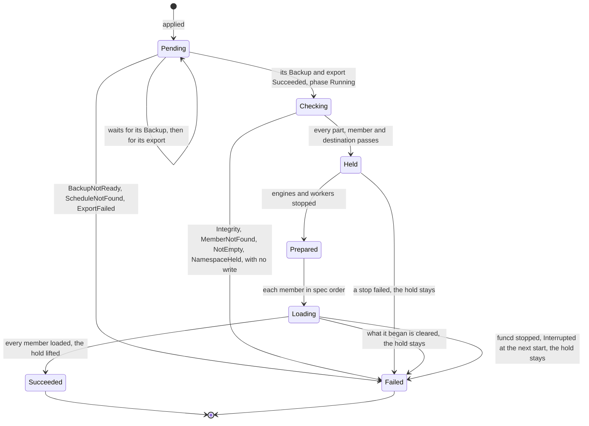

`Checking` to `Loading` are the phase `Running`. A Restore with no member `inPlace` takes no export and no hold, going from `Checking`
to `Prepared`. A namespace hold has two writers: an in-place Restore (reason `restore`), whose completed load lifts it, and
`funcd restore run` (reason `data`). Only `funcdctl hold release --namespace` lifts the rest. While one stands, the namespace's timers,
blob sources, Sensors, runs, App and slots wait, its Functions refuse calls and its Sites keep serving their files (ADR-0290 Decision 4).
Details: [restore-stop](design/lake/restore-stop.md), [bucket-lake-members](design/backup/bucket-lake-members.md),
[target-sync](design/backup/target-sync.md). New words: Checking, Prepared, Loading.

| Where | What happens | Time | You see | Status | Source |
|---|---|---|---|---|---|
| A platform run | On with `backup.target` and `storage.mode` file. One at a time: a failure leaves the daemon serving and the next attempt sooner, and a late run's successor starts at its end | `backup.interval` 1 h, `backup.retryInterval` 5 min | `enabled: false` when off; `backup run failed` | decided | ADR-0205 Decisions 1 and 2, `TestScenarioFailedRunRetries`, `TestScenarioOverrunNoOverlap` |
| `rpoRisk` of the platform backup | It reads the newest verified generation, so it stays on from a fresh install until someone runs `funcdctl backup verify`, off the box | `backup.objectives.rpo` 2 h | `backup rpo at risk`, once per that time | accepted | ADR-0205 Decision 5 and Consequences, `TestScenarioRPORiskFollowsVerified` |
| A backup past its retention | funcd deletes nothing on a target: the operator's lifecycle rules expire platform generations. A workload Backup's record goes at its ttl, and its objects wait for the owner's rule | `spec.ttl`, unset is 720 h | `backup target: set one lifecycle expiry per prefix (days)` | accepted | ADR-0203 Consequences, ADR-0222 Consequences, `TestScenarioBackupOutlivesApp` |
| Two funcds on one `backup.target` | A run that meets another writer's keys writes nothing and, with a generation of its own, stops that writer too: a restore released onto its live source's target stops both | until the operator acts | `is another writer's; no generation is written until the operator stops that writer` | accepted | ADR-0203 Consequences, `TestScenarioSecondPlatformRefused` |
| A target that never answers | A run waits with no deadline, so nothing fails and no next run starts, on the KV ship and the blob mirror too, which have no `rpoRisk`. `funcdctl backup status` waits, or answers 503 on a failed listing | no limit | only `backup rpo at risk` | deferred | #1287, #1288, ADR-0205 Decision 4 |
| A schedule's slot | It takes the newest due slot, so downtime, a pause or a hold collapses into one catch-up. A slot while one of its Backups is `Pending` or `Running` is taken and never caught up | at the slot; a release is seen within `runtime.supervisionPeriod` 10 s | `lastScheduleTime` | decided | ADR-0228 Decision 2.1, `TestScenarioCatchUpOnceNoOverlap` |
| A Backup fails | One attempt, no retry: the next slot is the next try. `rpoRisk` comes on, also under a hold, not under a pause | none | `Failed`, `MemberNotFound`, `EngineNotReady`; `workload backup rpo at risk` | decided | ADR-0222 Decisions 4 and 9, `TestScenarioRPORisk` |
| A busy Lake | A copy that misses a file the Lake deleted tries again, then fails its Backup, a Bucket-only one too, and with it an in-place Restore's export, until the next try | `lakeAttempts` 3 | `LakeUnstable`, `ExportFailed` | accepted | ADR-0312 Consequences, `TestABusyLakeFailsABucketSchedule` |
| funcd stops during a Backup | It stays `Running`. At the next start its copy whole on the target makes it `Succeeded`; else it ends `Failed` | the next start | `FoundOnTarget`, `Interrupted` | decided | ADR-0287 Decision 5, `TestScenarioFinishedRunKept`, `TestScenarioRunInterrupted` |
| A target over a limit | A sync's listing fails, and a scope over the members fails its Backup with no copy written | `workloadBackup.maxListedKeys` 1048576, `workloadBackup.maxListedKeySize` 256 MiB, `workloadBackup.maxCopyMembers` 1024 | `ListFailed`, `it holds more than <n> keys or <n> bytes of keys` | decided | decider 2026-11-04, #1391, `TestListings_FollowTheirLimits` |
| An in-place Restore at apply | It needs `update` on the Namespace: an admin. One per namespace: a second, or a delete of one not ended, is refused, so only deleting its Backup ends a stuck `Pending` one. A failed load's marker refuses one | none | 403, 409 `has not ended`, 409 `whose load did not complete` | decided | ADR-0228 Decision 2.4, Open questions, `TestRestoreInPlaceOnePerNamespace` |
| An in-place Restore's export | Backup `<restore>-before` runs first, under a platform hold too. If it fails nothing is written, and a new Restore is the next try | one full copy | `ExportFailed`, `ScheduleNotFound` | decided | ADR-0222 Decision 7, `TestScenarioRestoreInPlace`, app-todo D8 |
| `Checking` | It reads every part of the whole copy, not only the named members, then each member and destination, while the namespace serves; a failure takes no hold. A destination `as` must exist and be empty | one read of the copy | `Integrity`, `MemberNotFound`, `NotEmpty` | decided | ADR-0222 Decision 7, ADR-0311 Decision 3, `TestRestoreReason_MemberNotFound`, `TestScenarioRestoreNewName` |
| A Bucket's Restore | It leaves the Lakes on its prefixes, `as` too; to roll one back, name it as well. So a whole copy elsewhere takes one member per Lake, and nothing warns | none | a Backup's `status.members` lists them | accepted | ADR-0312 Decision 4 and Consequences, `TestScenarioBucketRestoreLeavesItsLakes` |
| An in-place Lake | Under the hold its engine's saves are refused, so its stop runs out the grace and is killed. After the lift a query can fail while the new engine starts | `runtime.containerd.stopGrace` 10 s per Lake | `Restoring`, `the stop failed`, `LakeNotReady` | accepted | ADR-0312 Consequences, card "A Lake engine's stop skips its saves when a Restore will replace them", app-todo B10 |
| A load fails | It clears what each load began and ends `Failed`, and the hold stays; engines and workers come back under it, a Lake's saves getting 503 | until `funcdctl hold release --namespace` | `Failed`; `funcdctl hold status` names the Restore | decided | ADR-0228 Decision 1.3, ADR-0312 Decision 9, `TestIssue1384_AFailedLoadKeepsTheHoldAndBringsAnEngineBack`, app-todo B13 |
| funcd stops or crashes during a load | What it wrote can stay: the next start ends it `Failed` and clears nothing, and the hold stays, so the owner checks the store before the release | until the release | `Interrupted` | decided | ADR-0228 Decision 1.3 and Open questions, `TestRestoreStopKeepsNamespaceHeld`, app-todo B12 |
| A call into a held namespace | Refused after the listener's limits and authentication, before the per-Function rate and any wake | until the release | 503, `Retry-After: 30`, `namespace <ns> is held for its data since <since>`, `namespace <ns> is held while Restore <name> loads it since <since>` | decided | ADR-0290 Decisions 1 and 2, ADR-0302 Decision 4, `TestScenarioDataHoldRefusesCalls` |
| A nested call, namespace held | `context.invoke` throws on the 503, with no `Retry-After`; `context.fetch` gets the 503 and the header | until the release | `context.invoke("<alias>") failed: 503 <problem>` | **uncovered** | ADR-0290 Decision 2 and #1297 name the header, its scenario only the 503; ADR-0302 Decision 4 lists fn-to-fn; ADR-0064 Decision 4 passes the status; no test, issue or card |
| A write through the S3 gateway | Refused in a held namespace after the PEP allows it, a Lake engine's catalog save too, which retries. Reads and an upload's abort are served | until the release | `ServiceUnavailable` (503), no `Retry-After` | decided | ADR-0290 Decision 6 and Consequences, `TestScenarioGatewayWriteRefused` |
| A Lake not being restored, namespace held | Its Route answers 503 and names no hold. Its direct endpoint stays open: queries reach the engine, each save is refused, so with `lake.saveInterval` unset a commit's answer fails | until the release | `edge upstream unavailable`, `lake catalog not saved` | decided | ADR-0290 Decision 2, ADR-0312 Decision 9, `TestScenarioLakeUpstreamRefused` |
| A call in flight when the hold begins | Nothing cuts it, so what it writes can land during the load | its own deadline | nothing reports it | accepted | ADR-0290 Scope, app-todo B10 |
| `funcdctl hold release --namespace` | It needs `update` on the Namespace, and lifts both reasons. Refused while the Restore its marker names is `Pending` or `Running` | none | 409 `namespace "<ns>" is held by Restore <name>, which is Running: release it once the Restore ends` | decided | ADR-0228 Decision 5.2, `TestReleaseNamespaceWaitsForRestore` |
| A hold nobody releases | Nothing ends it by itself, so its Functions stay down, reads too. Nothing checks the data is back either: after an early release a write lands, and the owner's restore erases it | no limit | `funcdctl hold status` lists it | accepted | ADR-0290 Context and Consequences, ADR-0287 Constraints |
| `funcd restore run` | A store directory that is not empty, memory mode or a newer minor's generation refuses it with nothing written. Killed midway, it refuses funcd's start until the directories are emptied and it runs again | until then | `is not empty: a restore loads into empty directories`; `was interrupted` | decided | ADR-0206 Decisions 2 and 4, `TestScenarioRestoreCrashRefusesStart` |
| After a host loss | `funcd restore run` holds each namespace with a BackupSchedule for its data, so its Functions refuse calls from the first start, past the platform's release | until the owner's release | `held namespaces with a BackupSchedule, whose data this restore does not bring back` | decided | ADR-0222 Decision 8, ADR-0290 Decision 1, `TestScenarioPlatformRestoreHoldsNamespace` |
| A namespace with no BackupSchedule, after a host loss | No marker: its Functions answer from the first start, the platform held or not, on whatever `funcd restore kv` and `funcd restore blob` brought back | none | nothing says so | accepted | ADR-0222 Decision 8, ADR-0206 Consequences, `TestScenarioPlatformHoldUnchanged` |
| A schedule after a platform restore | It records each whole newer copy on its target as a `Succeeded` Backup, and takes no slot until a sync succeeds, whatever the holds. The owner waits for it before a Restore | `runtime.supervisionPeriod` 10 s apart | `Ready`, `TargetSynced` False: `PlatformRestored`, `ListFailed` | decided | ADR-0287 Decisions 2 and 4, `TestScenarioRestoreFindsNewerBackups` |
| Copies a sync leaves out | Backups by hand, exports and copies of schedules the restored platform lacks get no record, so no Restore can name them | until the lifecycle rule | nothing reports them | accepted | ADR-0287 Consequences, `TestScenarioOnlyOwnSlots` |

<!-- generated values, do not edit: just behavior-values -->

Disaster recovery: values

| Value | Default | From |
|---|---|---|
| `backup.credentialsFile` | "" | config |
| `backup.encryption.none` | false | config |
| `backup.encryption.recipients` | none | config |
| `backup.interval` | 1h | config |
| `backup.objectives.rpo` | 2h | config |
| `backup.retention.daily` | 30 | config |
| `backup.retention.hourly` | 48 | config |
| `backup.retention.preUpgrade` | 3 | config |
| `backup.retention.verified` | 2 | config |
| `backup.retention.weekly` | 12 | config |
| `backup.retryInterval` | 5m | config |
| `backup.singleWriter` | false | config |
| `backup.target` | "" | config |
| `workloadBackup.maxCopyMembers` | 1024 | config |
| `workloadBackup.maxListedKeySize` | 256MiB | config |
| `workloadBackup.maxListedKeys` | 1048576 | config |
| `maxRefreezes` | 3 | `internal/backup/blobmirror/freeze.go` |
| `oneDay` | 24h | `internal/backup/blobmirror/mirror.go` |
| `PartBytes` | 8MiB | `internal/backup/layout.go` |
| `oneDay` | 24h | `internal/backup/layout.go` |
| `defaultKVRebaseline` | 24h | `internal/backup/plan/derive.go` |
| `hourlyOnlyUpTo` | 48h | `internal/backup/plan/derive.go` |
| `minCronStep` | 1m | `internal/backup/plan/derive.go` |
| `noWeeklyUpTo` | 720h | `internal/backup/plan/derive.go` |
| `oneDay` | 24h | `internal/backup/plan/derive.go` |
| `oneWeek` | 168h | `internal/backup/plan/derive.go` |
| `defaultStep` | 2 | `internal/backup/plan/edit.go` |
| `MaxManifestBytes` | 16MiB | `internal/backup/workload/workload.go` |
| `lakeAttempts` | 3 | `internal/backup/workload/workload.go` |
| `listPage` | 1000 | `internal/backup/workload/workload.go` |
| `sealedWriteBuf` | 64KiB | `internal/backup/workload/workload.go` |
| `sqlRecordBytes` | 8MiB | `internal/backup/workload/workload.go` |
| `sealedWriteBuf` | 64KiB | `internal/backup/write.go` |

<!-- end of generated values -->
## Health

Kinds: none of its own.

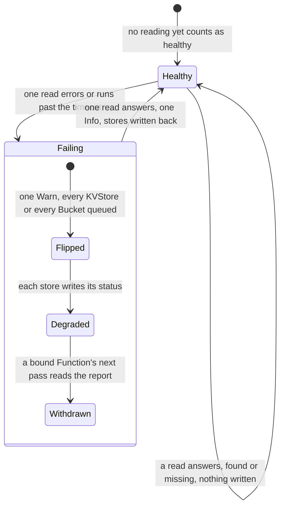

The machine is one storage target, `kv` or `blob`, kept in memory: funcd has no health state of its own, and a restart reads
again. A store's `Degraded` refuses nothing by itself; a bound worker's check is what acts on the result. The metastore, the run
state and the event store have no probe. A worker's liveness: [Workers](#workers). An engine's probe: [Services](#services). The
floor: [Limits](#limits). New words: Failing, Flipped, Withdrawn.

| Where | What happens | Time | You see | Status | Source |
|---|---|---|---|---|---|
| Is funcd well? | Nothing says: no health route on either port and no watchdog in the unit, so a hung funcd runs on unnoticed | none | `/healthz` 401 `missing bearer token or API key`, with a token 404; data plane 404 | **uncovered** | ADR-0018 Decision 3 says public health endpoints, `isPublic` has none; ADR-0215 Scope; issues, cards searched; ran it |
| A view of the whole | No `funcdctl status` and no `get all`: a state is read one kind and one namespace at a time, so nothing lists what is unwell | none | `unknown command "status" for "funcdctl"`; `kind "KVStore" is namespaced; a namespace is required` | deferred | ADR-0024 Open questions |
| The storage probes | The KV engine and the blob store are each read for `.funcd-health`, a key nobody writes: found or missing is healthy. On an S3 target each read is a request | `health.storageProbeInterval` 10 s, each bound by `health.storageProbeTimeout` 2 s | `.funcd-health` in the target's access log | decided | ADR-0215 Decision 6, `TestStorageProbesReadTheSentinelKey` |
| A probe errors or runs late | Every KVStore, or every Bucket, goes `Degraded` with the read's error; the other target's stay. One Warn per flip | `health.storageProbeInterval` 10 s + `health.storageProbeTimeout` 2 s | `StorageUnreachable`, `the probe did not answer within 2s`; logs `storage probe failing` | decided | ADR-0215 Decisions 6 and 7, `TestScenarioHealthStorageDown` |
| One late read | Misses are not counted: one read past the timeout flips the target, so a stall of a few seconds can take every bound Function out for a pass. A worker's late read has a window, this has none | `health.storageProbeTimeout` 2 s | `Degraded`, then `Ready` | accepted | ADR-0215 Decision 6, ADR-0259 Scope, #1156, `TestProberTimeout` |
| A call during the outage | A bound Function goes `Degraded` at its next pass and a cold one never readies, so every call is held, one that needs no store too, then fails | `runtime.supervisionPeriod` 10 s, then `invoke.activationTimeout` 30 s | 503 `function <ns>/<name> did not become ready within 30s` | accepted | ADR-0215 Decision 5 and Consequences, `TestScenarioHealthServingDependencyLost` |
| The store answers again | One good read and its stores go `Ready`, with no restart; a bound Function at its next pass, so a call held that long is served | `health.storageProbeInterval` 10 s + `runtime.supervisionPeriod` 10 s | logs `storage probe recovered` | decided | ADR-0215 Decisions 5 and 6, `TestScenarioHealthStorageDown`, `TestScenarioHealthDependencyRecovers` |
| A data directory moved away | The probes stay healthy: the KV engine answers from its open files and a missing blob key counts as healthy, so every store stays `Ready` and nothing is logged. A locked blob directory does flip | none | `Ready` | **uncovered** | ADR-0215 Decision 6 says missing is healthy, names no lost directory; ADRs and issues searched; ran both, 25 s each |
| Reads answer, writes fail | A full or read-only disk passes both probes, which only read: stores and Functions stay `Ready` while each write gets its own error | none | `Ready` | deferred | ADR-0215 Open questions and Risks accepted, `TestStorageProbesReadTheSentinelKey` |
| The metastore errors | No probe reads it, no status records it: the API and the data plane answer 500, every worker's check fails, and a pass logs and retries | none | 500 `Internal Server Error`; report `socket`, `Unreachable`; logs `reconcile failed, requeueing` | **uncovered** | ADR-0215 Decision 6 and Scope, ADR-0296 Decision 6, ADR-0015 Decision 4; issues searched; ran a failing store |
| A metastore read that hangs | Nothing bounds it: `funcdctl`, whose client sets no deadline, and the calls wait; only the public paths still answer. Ran on a store that hangs, not on a real disk | no end | no answer after 45 s | **uncovered** | ADR-0215 Decision 6 bounds only the probes, ADR-0024 Contracts `http.DefaultClient`; issues searched for a hung store or disk |
| A start with a store down | The probes run once before the reconcilers, a hung one costing its timeout, and the start goes on: its stores read `Degraded` at their first pass | `health.storageProbeTimeout` 2 s per target | logs `storage probe failing` | decided | ADR-0215 Decision 6, `TestProberProbesBeforeStartReturns`, `TestProberTimeout` |
| A worker's dependency check | It stops at the first failure, so a second broken binding shows only once the first is fixed. It reads memory and the metastore, and wakes no target | `DependencyCheckBudget` 50 ms | `<kind> binding "<binding>": <message>`; reason `Timeout` past the budget | decided | ADR-0215 Decision 3, `TestCheckerStopsAtTheFirstFailureInOrder` |
| What passes the check | A link target passes unless `Failed`, so a `Degraded` or `Idle` one reads as fine; a Lake binding is not checked, its gate holds it | none | `link target <ns>/<name> is Failed` | accepted | ADR-0215 Decision 3 and Risks accepted, `TestCheckerLinks` |
| During a rollout | The serving revision's reports are not judged, since the check reads the new spec: a store lost meanwhile leaves it `Ready`, taking calls | until the switch | `Ready` | accepted | ADR-0215 Decision 5 and Risks accepted, `TestScenarioAppDependencyCheck` |
| While held | The probes and the store statuses go on, and a hung replica is still replaced: nothing here asks the hold | `health.storageProbeInterval` 10 s | a store's real phase before the release | decided | ADR-0215 Decision 10 |

<!-- generated values, do not edit: just behavior-values -->

Health: values

| Value | Default | From |
|---|---|---|
| `health.storageProbeInterval` | 10s | config |
| `health.storageProbeTimeout` | 2s | config |

<!-- end of generated values -->
## Limits

Kinds: none of its own.

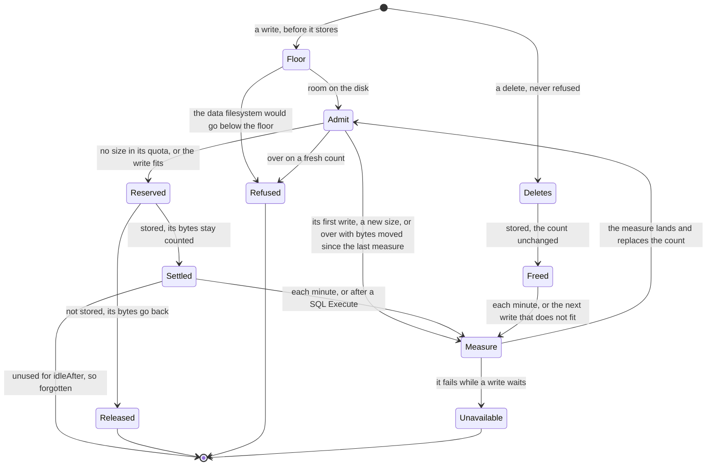

One check, `quota.Checker`, answers every capped write: the floor, then the store's quota (ADR-0292, ADR-0296). Reads never ask. The
count is the last measure plus the bytes settled and reserved since: a Bucket's or a prefix's listed sizes, a KVStore's keys and
values, a SQLDatabase's pages in use. A store with no size is never measured; near a cap each refusal can cost a whole measure, one at
a time (ADR-0292 Consequences). No status shows a store's usage (ADR-0292 Open questions). A Lake has no quota of its own: its prefix's
caps its files, `lake.catalogMaxSize` its catalog ([Services](#services)). A presigned PUT under a cap gets 403. The floor is off at
`"0"` and in `storage.mode: memory`; a small disk needs a smaller setting (ADR-0296 Consequences). An engine takes no
`functions.defaultResources`: a Lake has no bound unless its `spec.resources` sets one, a SQLDatabase 256Mi of memory and no CPU bound.
In Time, a name with a dot is a config key and one without is fixed in the code. Other limits sit with their process:
[Calls](#calls), [Eventing](#eventing), [Workers](#workers), [Functions](#functions), [Admission](#admission),
[Disaster recovery](#disaster-recovery). New words: Refused, Reserved, Released, Settled, Freed.

| Where | What happens | Time | You see | Status | Source |
|---|---|---|---|---|---|
| A write past `spec.quota` | Refused before it stores; reads and deletes go on. A Bucket, a prefix, a KVStore and a SQLDatabase each take `maxSize` or `maxBytes`; neither is no cap | none | 507 `<subject> holds <n> of its <limit> bytes (spec.quota): a write of <m> bytes would pass it`; S3 `QuotaExceeded` | decided | ADR-0292 Decisions 4 and 6, `TestScenarioBucketTotalRefused` |
| A capped store's first write since a start, or after it idled | Waits for a whole measure, since no count exists yet; while that fails, each write fails | `idleAfter` 10 min, `measureTimeout` 2 min | a slow write; 503 `read the quota of <subject>` | decided | ADR-0292 Decision 3, `TestFirstRefreshFailureIs503`, `TestIdleSubjectDropped` |
| A write that does not fit | If bytes were stored or deleted since the last measure, it waits on one shared measure, the size it overwrites credited, and is refused only if still over. So a delete makes room at once | `measureTimeout` 2 min | a slow write; 503 `could not measure <subject>; retry` | decided | ADR-0292 Decision 4, `TestScenarioOverwriteNotRefused`, `TestDeleteMakesRoomAtOnce` |
| A change from outside a store's writes: `spec.quota`, a Restore's load, the purger | Counts from the next refresh, though a Bucket's cap added or removed applies at its next write. A Restore can leave a store past its cap, and then only deletes run | `refreshInterval` 1 min | 507 while the old count holds | accepted | ADR-0292 Consequences, `TestNewlyCappedSubjectMeasuredFirst` |
| A SQLDatabase's Execute | Its size is known only after it ran: it needs room left, then starts a measure. Executes admitted before that measure lands can pass the cap | one measure | a database over its cap, then 507 `<subject> holds <n> of its <limit> bytes (spec.quota): delete to make room` | accepted | ADR-0292 Consequences, `TestUnknownSizeWriteMeasuredSoon` |
| A SQLDatabase at its cap | Only one `DELETE` or `DROP` per statement text runs. A `WITH` before it, or an `INSERT` beside it in one call, is a write; the next measure counts the freed pages | none | 507 | decided | ADR-0292 Decision 4, `TestScenarioSQLDeleteAtCap` |
| A Lake at its prefix's cap | A commit that needs a Parquet file fails. Queries, drops and catalog saves go on, since the catalog lives outside the prefix | none | the commit's error holds 507 | decided | ADR-0292 Decision 6, `TestScenarioLakeTotalRefused`, `TestScenarioCatalogOutsideBucket`, duckdb `lake-at-cap-drops` |
| A Site's build refused for space | `Ready=False`, by a Bucket's cap or the floor alike, and no retry: freed room does nothing until the Site or its Bucket changes, or funcd restarts | none | `QuotaExceeded`, with the refusal's message | accepted | ADR-0292 Decision 5, `TestSite_BucketAtQuotaIsNotReadyQuotaExceeded` |
| A `spec.quota` refused at apply | Both forms, or a size that does not parse, answer 400 where the ADR says 422 | none | 400 `spec.quota: set maxSize or maxBytes, not both` | **uncovered** | ADR-0292 Decision 6 and its review say 422, ADR-0148 Decision 1 gives 400; `TestSizeQuota` asserts only the kind; a probe saw 400; no issue or card |
| Below the floor | A workload write, or one that would take it there, is refused until space is freed, then admitted within a second. Reads, deletes and the platform's own stores go on | `storage.minFreeSize` 2 GiB, `floorReadEvery` 1 s | 507 `the data filesystem is below storage.minFreeSize, or this write would take it there` | decided | ADR-0296 Decisions 2 and 6, `TestScenarioFloorLifts` |
| A function's log below the floor | New records are dropped and lost; the first record admitted again logs how many | `floorReadEvery` 1 s | `funclog: dropped records while the data filesystem was below storage.minFreeSize`, with `records` | accepted | ADR-0296 Decision 5 and Consequences, `TestScenarioFunclogDropsBelowFloor` |
| What the floor reads | Only `storage.dataDir`'s filesystem: with `blob.target` set, Bucket writes and logs stop at a low local disk they do not use, and a store moved by `kvstore.dataDir` has no floor | none | a 507 for a remote write | **uncovered** | ADR-0296 Context says all lands there, Decision 6 names the S3 store only for presigned PUTs; ADR-0208; no issue or card; traced, not run |
| What a Function may ask | Any `cpu` from 0.01 up and any positive `memory`: nothing compares them with the node or adds them up, so workers can promise more than it has | at least 0.01 (`MinCPU`) | 200 at apply; a probe stored `900Ti` | decided | ADR-0291 Decision 2 and Constraints, `TestScenarioInvalidResourcesRefused` |
| A Node pool member past its heap | Its thread dies and restarts after a growing wait; its calls in flight fail, siblings go on. A cap on the heap, not on all memory, with no CPU cap and no key | 64 MiB (the shim) | 503 `function <name> worker faulted` | decided | ADR-0044 scenario `pool-quota` and Temporary workarounds, ADR-0291 Scope |
| A worker's own writes, on `containerd` | The root is read-only and `HOME` is `/tmp`, a tmpfs of its memory limit whose pages count as its memory; it also has its volumes and a small boot directory | `tmpDefaultBytes` 512 MiB with no limit, `bootDirBytes` 1 MiB | `read-only file system`, `no space left on device` | decided | ADR-0294 Decisions 1 to 4, `TestScenarioTmpCountsInMemory` |
| A Lake engine's start | Its scratch is preallocated, so the floor is asked for its whole size first; refused, the Lake waits. Each running Lake holds that disk | `MinLakeScratchBytes` 1 GiB or `lake.scratchSize`; `lake.enginePollInterval` 2 s | `Pending`, `ScratchSpaceLacking` | decided | ADR-0294 Decision 6 and Consequences, `TestScenarioLakeScratchRefusedBelowFloor` |
| A volume past its size or its inodes | The kernel refuses the write or the create in the worker; other volumes go on. Inodes follow the size, so many small files can run out first: the remedy is a larger size | its `size` | `disk quota exceeded` | accepted | ADR-0295 Decision 1 and Consequences, `TestScenarioInodeLimitApplied` |
| Stores in a namespace | An API create at the cap is refused, an App's new parts counted together. In a key, 0 is the default and a negative value no cap | `kvstore.maxStoresPerNamespace` 100, `sql.maxDatabasesPerNamespace` 20, `defaultBucketsPerNamespace` 100 | 400 `namespace "<ns>" already holds the maximum 100 KVStores` | decided | ADR-0147 Decisions 1 and 4, `TestScenarioQuotaRaceRejected` |
| A namespace's budget | None for CPU, memory or store bytes, so one namespace can crowd out the others; only volumes have one, `spec.volumeBudget` | none | nothing refuses it | deferred | ADR-0296 Open questions, ADR-0291 Scope, F208 |
| One value, key or object over its cap | Refused whole. `spec.quota` sets each cap, a key's up to `MaxKeyBytesLimit` 64000 | `DefaultMaxValueBytes` 1 MiB, `DefaultMaxKeyBytes` 1024, `s3gateway.maxUploadBytes` 1073741824 | 413 `value (<n> bytes) exceeds the store cap (<cap> bytes)`; S3 `EntityTooLarge`, status 400 | decided | ADR-0148 Decisions 2 and 5, `TestScenarioKVValueOverStoreCap` |
| A worker's `ctx` call | Each body is read whole under a cap no key changes, and so are `ctx.invoke`'s and `ctx.sql`'s answers | `maxBlobBytes` 64 MiB, `maxInvokeBytes` 1 MiB, `maxSQLBytes` 1 MiB, `MaxSQLStatements` 500, `maxEngineResponse` 8 MiB | 413 `request body exceeds <n> bytes` | decided | ADR-0148 Contracts, ADR-0233 Decisions 3 and 4, `TestIssue172_OverCapBodyIs413` |
| S3 multipart parts | They wait in funcd's memory. A principal past its share, or a node past its budget, is told to retry, so parallel large uploads fail in a client that does not | `s3gateway.maxUploadBytes` 1073741824 a principal; `multipartIdleExpiry` 1 h | 503 SlowDown | decided | ADR-0188 Decisions 3 and 4, Consequences, `TestScenarioMultipartSharePerPrincipal` |

<!-- generated values, do not edit: just behavior-values -->

Limits: values

| Value | Default | From |
|---|---|---|
| `floorReadEvery` | 1s | `internal/quota/floor.go` |
| `idleAfter` | 10m | `internal/quota/quota.go` |
| `measureTimeout` | 2m | `internal/quota/quota.go` |
| `refreshInterval` | 1m | `internal/quota/quota.go` |

<!-- end of generated values -->
## funcdctl dev

Kinds: none of its own.

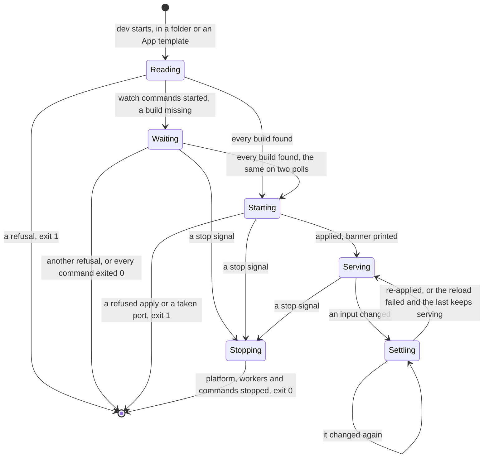

`funcdctl dev` is the real platform on `funcd.InMemory()` and the [process driver](#workers), on loopback (ADR-0254). A folder of
resource files runs as ADR-0247 says; a directory with `app.yaml` beside `resources/` runs as an App (ADR-0253), and only there do
`dev.watch` and `dev.liveReload` work. The banner prints once the objects are applied, not once they serve (ADR-0253 Decisions 8 and 11).
Phases: [Functions](#functions). New words: Reading, Waiting, Starting, Serving, Settling, Stopping.

| Where | What happens | Time | You see | Status | Source |
|---|---|---|---|---|---|
| A second dev in one project | Refused before the platform starts: a project has one process registry. Without `--persist` it sits in the user cache dir, keyed by the project's path | none | `registry <dir>/workers.json is held by another process` | accepted | ADR-0167 Decisions 2 and 3, Consequences, `TestRegistryLockIsExclusive` |
| A build a watch command has not written | Dev waits with no bound while a command runs. Any other refusal stops it once it holds on two polls, and so does a miss once every command exited 0 | no bound, read each `devReloadPoll` 300 ms | `waiting for images.web: web/dist is absent`, once per miss | decided | ADR-0255 Decision 2, `TestScenarioDevWatchWaits` |
| A watch command exits non-zero | Started again for ever, what remains of its group killed first. A run of 30 s or more resets the delay. An exit 0 is final | `devWatchFirstDelay` 1 s, doubling to `devWatchMaxDelay` 30 s | `web exited 3; restarting in 1s`, then its last 20 lines as `web \| <line>`; `web finished` | decided | ADR-0255 Decision 3, `TestDevRestartDelay` |
| What a watch command prints | Goes to its log file, emptied when dev starts. A burst reaches the terminal only when no build the command owns was written during it | a burst ends after `devWatchQuiet` 3 s, or `devWatchBuiltQuiet` 1 s once a build was written | `web \| build error: broken` | decided | ADR-0256 Decisions 1 and 3, `TestScenarioDevWatchBursts` |
| An error a burst hides | A command that writes at least every 3 s never ends a burst, and a failure within 1 s of a build's last line joins that build's burst, so nothing prints | none | only the log file the banner names | accepted | ADR-0256 Consequences, `TestDevBurst` |
| A save | Once an input changed and reads the same on two polls, dev applies again, and a rebuild rolls a new revision | `devReloadPoll` 300 ms, twice | folder mode: only the new worker's `funcd-shim: listening on`; App: `pushed images.api as <repo>:<tag>@<digest> in <d>`, `reloaded in <d>` | decided | ADR-0247 Decision 8, ADR-0253 Decision 9, `TestIssue1118_FolderDevWaitsForABuildToSettle` |
| A saved build that cannot load | The old revision keeps the calls and the phase, and the new one is not tried again until the next save. With none serving yet: `Failed`, and calls get 503 | none | `funcd-shim: shape error: <message>`; `RevisionReady=False` | decided | ADR-0143 Decisions 4.5 and 5, `TestScenarioFailedRevisionKeepsOldServing` |
| That build in an App part with a worker | The revision waits and the last one serves; a new save replaces it at once | `app.upgradeTimeout` 5 min before the line | `Function/<part> Pending ShapeInvalid`, then `the new revision did not become current; save a fix, or run funcdctl app retry` | decided | ADR-0253 Decision 8 and Contracts, `TestScenarioAppDevFailedRevision` |
| An App part with no worker | Dev changes no replica, so a part sleeps until its first call. A save boots nothing, so `reloaded` prints even for a build that cannot load | a cold start | `Function/<part> NotStarted NotStarted`; 503 `function default/<part> is Failed (ShapeInvalid)` | decided | ADR-0253 Decision 4, ADR-0143 Scenarios, `TestScenarioIdleFunctionStartsNewRevisionOnWake` |
| An input that does not load | Printed once and tried again at the next change, and the last state keeps serving | none | `reload failed`; App: `reload failed; the last App keeps running` | decided | ADR-0253 Decision 9, `TestAppDevFailedReloadKeepsServing`, `TestDevReloadSeesANewFileFixedAfterAFailedLoad` |
| A Site build that cannot be pushed | In a reload, its last pushed image stays, the other parts reload and no page reloads | none | `images.web: web/dist is empty; keeping its last build` | decided | ADR-0257 Decisions 1 and 2, `TestScenarioDevSiteLastBuild` |
| A build deleted in folder mode | No reload and no line, and the last revision keeps serving until a build is back or another file changes | until then | nothing | **uncovered** | `changed` in `cmd/funcdctl/dev_reload.go` skips a fingerprint it cannot read; ADR-0247 Decision 8 and #1118 name a changed build only, ADR-0257 Scope leaves folder mode out; no test, card; ran it |
| A contract outside the funcd profile | Folder mode delivers it and serves; App mode and `funcdctl push` refuse it | none | `the contract file's input is outside the funcd profile` | **uncovered** | ADR-0247 Constraints gate at push, its Decisions 4 to 6 name no gate in dev, ADR-0253 Decision 3 pushes, ADR-0125 Decision 3; no issue; ran both |
| No isolation | Workers run as your user on the host, with no sandbox, no egress control and no enforced limit | none | `⚠ egress is NOT isolated in dev — this is not where you validate confidentiality` | accepted | ADR-0125 Scope and Consequences, `TestScenarioDevEgressNotIsolated` |
| Folder mode's write grant | Each Function gets a write-only Role on the namespace, which a deploy does not give it. An App gets none | none | a write that works here can get 403 once deployed | decided | ADR-0128 Decision 2, ADR-0253 Decision 4, `TestScenarioDevWriterGrant` |
| An App's hooks | Dropped unless `--hooks`, so a migration a hook runs does not run | none | no hook line, and no table the hook makes | decided | ADR-0253 Decision 4, `TestScenarioAppDevHooksOptIn` |
| A Lake | Served by the embedded DuckDB CLI, not the production shim and its saves. A build without it logs and stays not ready | none | `lake engine not embedded in this dev build — lake unavailable` | deferred | ADR-0125 Decision 5, card "Dev catalog engine: converge on the prod duckdb shim.py vs the embedded CLI+SQL devengine?", `TestConvergeNotBundledReportsUnavailable` |
| A stop | SIGINT, SIGTERM or SIGHUP: the HTTP drain, each worker's SIGTERM then SIGKILL, then each watch command's. A call in flight holds it, then gets a 503 | `server.shutdownTimeout` 15 s, then `runtime.process.stopGrace` 3 s for workers and commands | `platform stopping`, exit 0 | decided | ADR-0255 Decision 3, `TestScenarioDevWatchStop`, `TestIssue700_DevHangupStopsWorkers` |
| A second Ctrl-C | Ignored: the handler stays set until the stop ends, so only a kill cuts a 15 s drain short | the stop's budget | nothing | **uncovered** | `RunE` in `cmd/funcdctl/dev.go`; no word in ADR-0125, 0126, 0167 or 0255; the question of [Platform lifecycle](#platform-lifecycle)'s row; searched issues; ran three SIGINTs, exit at 15 s |
| Dev is killed | Its workers and watch commands run on until the next start, which stops them before anything else | until the next start; `runtime.process.stopGrace` 3 s | processes with no dev | accepted | ADR-0167 Decisions 2 and 5, Risks accepted, ADR-0255 Decision 3, `TestDevRestartWithoutPersistReaps`, `TestScenarioDevWatchCrashReap` |
| A control command's wait | No limit: the client has no timeout, so a server that accepts and never answers holds the command until you interrupt it | no limit | nothing | **uncovered** | `http.DefaultClient` in `pkg/sdk/sdk.go`; ADR-0024 Decision 1 and Contracts name it, not the wait; ADR-0042 is silent; ADR-0217 Decision 8 speaks only of `app deploy`; no issue, card; ran `get`, killed at 6 s |
| A refusal | One line on standard error and exit 1, or 3 when `backup plan` finds an RTO impossible; the server's message comes back under `sdk` | none | `funcdctl: sdk: store.Get: Function "nope" not found` | decided | ADR-0024 Decision 2, ADR-0223 Decision 6, `TestScenarioCLIDelete`, `TestScenarioRTOImpossible` |

<!-- generated values, do not edit: just behavior-values -->

funcdctl dev: values

| Value | Default | From |
|---|---|---|
| `deployPoll` | 1s | `cmd/funcdctl/app.go` |
| `devReloadPoll` | 300ms | `cmd/funcdctl/dev.go` |
| `devS3PortAttempts` | 3 | `cmd/funcdctl/dev.go` |
| `appRevisionTimeout` | 2s | `cmd/funcdctl/dev_app.go` |
| `devFollowPoll` | 100ms | `cmd/funcdctl/dev_app.go` |
| `devBlobPollInterval` | 1s | `cmd/funcdctl/devconfig.go` |
| `devHandOutSettle` | 250ms | `cmd/funcdctl/devconfig.go` |
| `devSegmentMaxAge` | 1s | `cmd/funcdctl/devconfig.go` |
| `devVolumeMeasureInterval` | 30s | `cmd/funcdctl/devconfig.go` |
| `liveReloadHeaderTimeout` | 5s | `cmd/funcdctl/devlivereload.go` |
| `devWatchBuiltQuiet` | 1s | `cmd/funcdctl/devwatch.go` |
| `devWatchFirstDelay` | 1s | `cmd/funcdctl/devwatch.go` |
| `devWatchGrace` | `process.DefaultStopGrace` | `cmd/funcdctl/devwatch.go` |
| `devWatchMaxDelay` | 30s | `cmd/funcdctl/devwatch.go` |
| `devWatchQuiet` | 3s | `cmd/funcdctl/devwatch.go` |
| `devWatchTail` | 64KiB | `cmd/funcdctl/devwatch.go` |
| `applyAttempts` | 5 | `cmd/funcdctl/workflow.go` |

<!-- end of generated values -->
