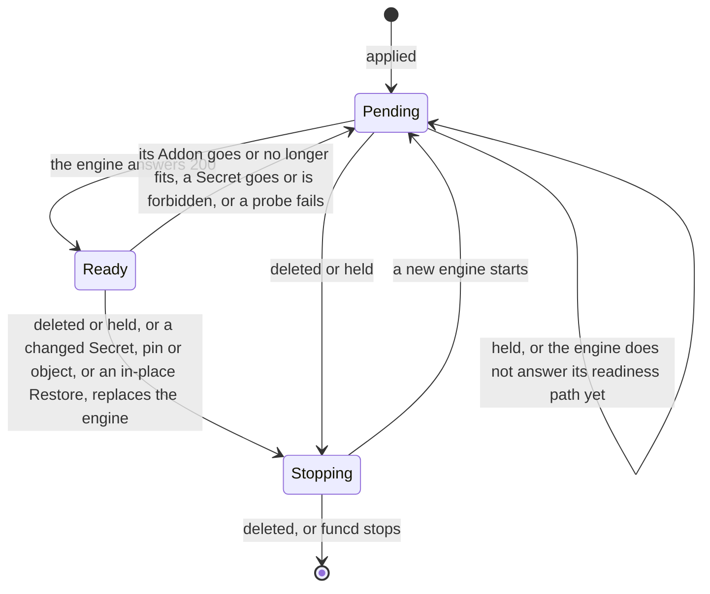

# Addons

Status words and how to read this: [the index](README.md).

Kinds: Addon, AddonObject, AddonRevision.

An admin's Addon ships runtimes, each an image pinned by digest and the workloads it serves: Functions and Jobs name one in
`spec.runtime`, and at most one entry, `Engine` or `Engineless`, runs the Addon's kind. Each object of an `Engine` kind runs one
engine of the entry's image on the add-on runtime, as a Lake's does, and is stored as an AddonObject; an `Engineless` kind's objects
run none: [Engineless kinds](engineless-kinds.md), and a settings kind's neither: [Settings kinds](settings-kinds.md). A held object has no engine and no edge entry. `Stopping` is no phase: a
status keeps its last one until the pass ends. An in-place Restore's two engine starts:
[restore-start](../design/addon/restore-start.md). New words: Stopping.

| Where | What happens | Time | You see | Status | Source |
|---|---|---|---|---|---|
| An Addon's kind | Only an admin reads or writes an Addon. Each kind it adds, its settings kinds too, is refused when funcd's, served by funcd or another Addon's, without case, on a create or an update | none | 403; 400 `is a kind of funcd's own`, `cannot change`; 409 | **differs** | ADR-0332 Decision 1 says 422 for a kept kind; ADR-0340 Decision 2; `TestScenarioSettingsKindRefused` |
| A kind gained | An Addon gains a kind once and keeps it: a replace that changes or drops it is refused | none | 400 `cannot change`, `cannot go` | decided | ADR-0344 Decision 10, `TestScenarioAddonRuntimesOnly` |
| A kind's workload | A replace that moves the kind between `Engine` and `Engineless` is refused, and so is a create for a kind whose object's mark says it ran the other way | none | 400 `cannot change between Engine and Engineless`; 409 `ran an engine` | decided | the decider's delegation, 2026-11-24: ADR-0344 Decision 10, ADR-0345 Decision 1; `TestEngineKindKeepsItsWorkloadAcrossDeletion` |
| An Addon's images | Each image is pinned by digest, from a registry `addons.registries` lists; the empty default refuses every Addon. A tag fails the schema | none | 422 at `body.spec.runtimes[0].image`; 400 `does not come from a registry that addons.registries lists` | **differs** | the scenario addon-image-pinned says 422 for both, ADR-0148 Decision 1 400; `TestScenarioAddonImagePinned` |
| An Addon's config and env | An Engine entry's schema passes the contract profile and compiles; each env value is a literal or one `${{ }}` expression over config that the schema types | none | 400 naming `spec.runtimes[<i>].attributes.config` or the env key | **differs** | ADR-0332 Decisions 1 and 4 say 422; `Invalid` is 400 by ADR-0148 Decision 1; `TestScenarioAddonEnvChecked` |
| An Addon's images and constraints | Stored as it is; its pass reads its kinds' images, once before it names a revision current and again while one is unread, and checks its constraints against their contracts | `runtime.supervisionPeriod` 10 s | `Ready`; `ArtifactNotReady`, `SettingsInvalid` | decided | ADR-0358 Decision 4, `TestScenarioAddonImageUnread`, `TestScenarioAddonConstraintUnfit` |
| An Addon's runtimes | An entry has a name, workloads and an image: `Function` and `Job`, or `Engine` alone; `Engineless`, alone, has no image. At most one entry runs a kind; an Addon running none adds no kind, and may gain one once | none | 400 naming the field | decided | ADR-0344 Decisions 1, 2 and 10, ADR-0345 Decision 1, `TestScenarioAddonShapeRefused`, `TestScenarioAddonRuntimesOnly` |
| An entry's attributes | An Engine entry's are its kind, config, settings and engine fields, `port` and `readiness` required; an Engineless entry's its kind, `function`, required, and `resync`; a Function or Job entry takes none | none | 400 naming the attribute | decided | ADR-0344 Decision 3, ADR-0345 Decision 1, `TestScenarioAddonShapeRefused`, `TestAddonEnginelessRefusals` |
| A kind's `function` refused | It names one of `image`, by digest from a listed registry, its kind at most 40 characters, and `ref`, whose kind takes no rules; a replace keeps a settings kind's `target` | none | 400 naming the field | decided | ADR-0358 Decisions 1, 4 and 5, `TestScenarioAddonFunctionRefused` |
| A runtime's name | Refused when it is funcd's (`nodejs22`, `python314`, `duckdb`, `rqlite`), starts with `node` or `python`, is a key of `runtime.containerd.imageOverride` or repeats an entry, and when another Addon ships it, under the cluster-scoped lock | none | 400 naming the name; 409 `ships the runtime` | decided | ADR-0344 Decision 4, `TestScenarioAddonRuntimeNameRefused` |
| An Addon changed or deleted | An update takes the cluster-scoped lock and checks no object: it stamps a revision and replaces no engine, and an engine kind's new schema applies to the next writes; its objects outlive it | the next pass | `status.currentRevision` | decided | ADR-0332 Decisions 1 and 3, ADR-0339 Decision 1, `TestScenarioAddonRevisionNoMove`, `TestScenarioAddonRemoved` |
| An Addon's change of a settings kind | Its image, contract, constraints and resync reach a target once the target's pin moves | the target's move | the target's `status.addonRevision` | decided | ADR-0358 Decision 5, `TestScenarioAddonFunctionFollowsThePin` |
| The Functions and Jobs on an Addon's runtimes | Its change requeues each one whose runtime is none of funcd's own: an update moves no Revision's image, and a delete fails them at their next pass | the next pass | `RuntimeUnavailable`, `the Addon that shipped it is gone` | decided | ADR-0344 Decisions 7 and 8, `TestScenarioAddonRuntimePinned`, `TestScenarioAddonRuntimeGone` |
| Which revision an object runs | The one it pins: a standalone object pins the current revision at its first pass and each new generation, an App's part its App revision's record once applied, forward only | none | `status.addonRevision`; a gone pin `AddonRevisionNotFound` | decided | ADR-0339 Decisions 2 and 3, `TestScenarioAddonRevisionNoMove`, `TestScenarioAddonRevisionSuperseded` |
| A part whose App revision records no revision | Its App was stamped while the Addon had none: the part pins the Addon's current revision once it has one, then stays on it | none | `status.addonRevision` | accepted | ADR-0339 Decision 3, `TestIssue1536_PartTakesTheAddonsFirstRevision` |
| An unused revision | Removed once no object pins it and no AppRevision records it; the current one stays. An AddonRevision is read-only, for an admin | `runtime.supervisionPeriod` 10 s | 405 with `Allow: GET` | decided | ADR-0339 Decisions 1 and 6, `TestScenarioAddonRevisionRetired`, `TestScenarioAddonRevisionReadOnly` |
| An object of an add-on's kind | At its kind's plural, a namespaced kind's verbs; one name is one object per namespace, whatever its kind. With no Addon of the kind, create and replace are 404; list, get and delete serve what is stored | none | 404; 409 for a name of another kind | decided | ADR-0332 Decision 2, `TestScenarioAddonKindUnregistered`, `TestScenarioAddonSecondKind` |
| An object's config | Checked when it is written: an engine kind's against its Addon's schema, another kind's against its image's contract | none | 422 naming the property under `body.spec.config` | decided | ADR-0332 Decision 2, ADR-0358 Decision 3, `TestScenarioAddonConfigSchema` |
| An object that cannot run | Pending, with no engine or edge entry, while its Addon is gone or does not fit, its env fails, or a Secret is missing or forbidden | a lifted forbid, `controller.referentPollInterval` 2 s | `AddonNotFound`, `ConfigInvalid`, `EnvInvalid`, `SecretNotFound`, `BindingResolveFailed` | decided | ADR-0332 Decisions 3 and 4, `TestAddonSecretForbidden` |
| An object on a process server | Its engine is an image, and a process server's provider runtime is the process driver's, which runs none; under funcdctl dev the add-on runtime runs it on Docker or nerdctl | none | `Pending`, `RuntimeUnavailable`, naming the process driver | decided | ADR-0344 Decision 9, `TestScenarioAddonEngineProcessServer` |
| An object's engine | One replica of its pinned revision's kind entry: its image, port, probe and storage, with the object's resources | until its readiness path answers 200 | `Ready`; else `Pending`, `EngineNotReady`, or `EngineConvergeFailed` | decided | ADR-0332 Decision 3, ADR-0344 Decision 3, `TestScenarioAddonEngineUnchanged`, `TestReconcileFindsTheAddonByPlural` |
| What an engine reaches | Egress on, it has no output fence and its egress passes the gateway under the EgressPolicies that name its object; egress off, it is fenced with no endpoint | none | a refused or failed connection | decided | ADR-0352 Decision 2, `TestScenarioEgressOffKeepsTheFence`, egress `engine-egress-named` |
| Who reaches an engine | funcd, and a Function that binds the object through it: the fence admits loopback and the bridge address, and the egress gateway refuses an engine's address whatever rule permits it, before it starts | none | a refused connection | decided | ADR-0332 Decision 3, ADR-0338 Decision 7, `TestDecideRefusesAnAddonEngine`, `TestAddonRuntimeIndexesEachEngineBeforeItStarts` |
| An object's environment | Its pinned revision's env over its config, a non-string as its JSON, and only the `secretKeys` of its bound Secrets, read by Cedar as the object; a changed Secret, pin or object replaces the engine | the next pass | the engine's environment | decided | ADR-0332 Decision 4, ADR-0339 Decision 2, `TestScenarioAddonSecretKeys` |
| An object's edge entry | On `ingress.host` under its Addon's basePath, kept, ranked after a Lake's; its stance is its own `ingress.auth`, open when unset, never the namespace's default. A path or the authenticated mode is refused | once Ready | `IngressReady`; 400 | **differs** | ADR-0332 Decision 5 says 422 for authenticated; `Invalid` is 400 by ADR-0148 Decision 1; `TestAddonEntryStance` |
| An object behind an `oidc` stance | Its own `ingress.auth` signs callers in through an OIDCProvider of its namespace, with `ingress.host` in `default`; while the provider is missing, the entry keeps its claim, refused | until the provider exists | `IngressReady=False`, `ProviderNotFound`; 503 | decided | ADR-0335 Decision 10, `TestAddonObjectProviderNotFound` |
| An Addon's basePath at or under `/.auth` | Refused, since the edge answers `/.auth/` on every host | none | 400 naming `spec.runtimes[<i>].attributes.basePath` | decided | ADR-0335 Decision 3 (amended 2026-11-21), `TestAddonValidate` |
| A private path at the edge | 404 however it is spelled, and so is a path with a `..` segment or whose cleaned form leaves basePath; funcd reaches a private path at the engine's own address | none | 404 | decided | ADR-0332 Decision 5, `TestScenarioAddonPrivatePath` |
| Deleting an add-on object | Once its engine is gone, `deletion: delete` removes its storage, and `retain`, the default, moves it into the quarantine, from which it comes back by hand with funcd stopped; neither while held | `storage.quarantineRetention` 168 h | `funcdctl hold status` lists the entry | decided | ADR-0333 Decision 5, `TestScenarioAddonDeletion` |
| A start | Not held, it quarantines the storage of each add-on object no longer stored, whatever its deletion, so a new one of that name starts empty; held, it lists them | the start | `moved the data of an AddonObject with no object into the quarantine`; `addonOrphans` | decided | ADR-0333 Decision 5, ADR-0231 Decision 4, `TestEveryReclaimHasHoldEvidence` |
| A crash before a restore start | hiqlite cannot remove its crash marker, so the engine never starts with `restore.env`: the Restore times out, and its clear restarts the engine without it | `restore.timeout` | `RestoreTimedOut`; the namespace stays held | accepted | ADR-0333 Consequences, `TestScenarioAddonRestoreTimeout` |
| A registry taken out of `addons.registries` | Stops no engine: the reconciler reads no registry list, and the Addon's next change is refused | none | 400 on the next change | decided | ADR-0332 Decision 6, `TestAddonRegistryRemovedStopsNoEngine` |

<!-- generated values, do not edit: just behavior-values -->

Addons: values

| Value | Default | From |
|---|---|---|
| `addons.callPayloadLimit` | 1MiB | config |
| `addons.callTimeout` | 10s | config |
| `addons.maxObjectsPerNamespace` | 20 | config |
| `addons.maxSettingsPerNamespace` | 200 | config |
| `addons.registries` | [] | config |
| `addons.settingsTimeout` | 30s | config |
| `defaultPollInterval` | 2s | `internal/services/addon/addon.go` |
| `imageReadTimeout` | 10s | `internal/services/addon/functions.go` |
| `DefaultSettingsTimeout` | 30s | `internal/services/addon/settings.go` |
| `maxSettingsBackoff` | 5m | `internal/services/addon/settings.go` |

<!-- end of generated values -->
