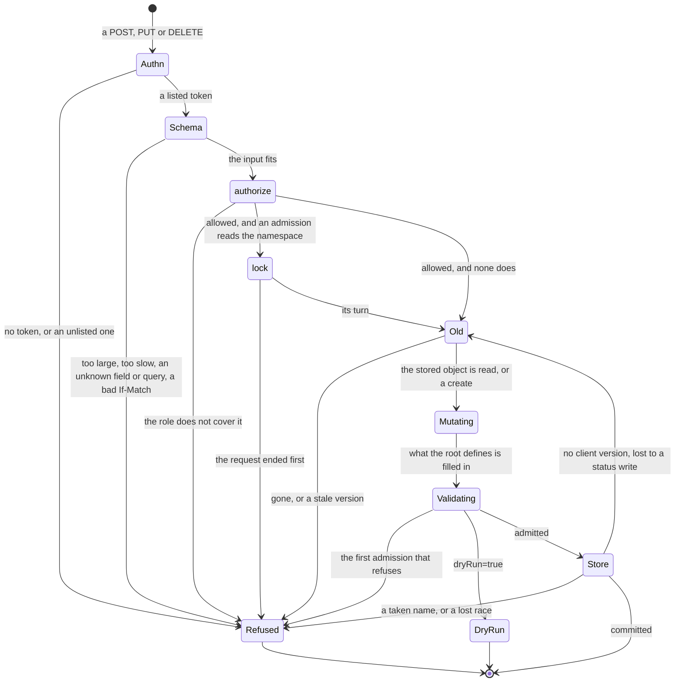

# Admission

Status words and how to read this: [the index](README.md).

Kinds: Namespace, ResourceGroup.

A create or a replace answers 200 with the stored object and a delete 204, before any reconciler acts: 200 means stored, not
running (ADR-0018 Purpose). A PUT never creates: a missing object answers 404 `Function "f" not found`, and `funcdctl apply` then
POSTs (ADR-0210 Decision 4). Revision and AppRevision are read-only: a write answers 405 `method POST is not allowed` with
`Allow: GET` (ADR-0172 Decision 1). During a platform hold a write is stored as usual: only the runners wait (ADR-0220 Decision 2).
New words: Schema, Refused, DryRun, Store.

| Where | What happens | Time | You see | Status | Source |
|---|---|---|---|---|---|
| The order of checks | The first refusal answers, so a caller with no right gets 422 for a bad body, not 403. A POST compares path and body before the 403, a PUT after it | none | 401; 413, 408, 422 or a bad `If-Match` 400; 403; 400 `body namespace "x" does not match path "y"`; 409; an admission's answer; the store's | decided | ADR-0210 Decision 2, ADR-0048 `schema-rejects-at-edge` |
| A caller the role does not cover | Refused before any admission runs; a dry run needs the same right. [Security](security.md) holds who may write | none | 403 `create Function in "team-a" denied: viewer is read-only (verb "create")` | decided | ADR-0018 C3, ADR-0063 `authz-precedes-admission`, `TestScenarioAuthzPrecedesAdmission` |
| A rule in the body | What the schema can state, an unknown field too, is refused before the handler; a cross-field or required-by-scope rule by `Validate` in admission | none | 422 `validation failed: unexpected property (body.spec.x)`; 400 `resourceGroup is required for kind "Function"` | decided | ADR-0048 Decision 1, ADR-0005 Decision 6, `TestSchemaRejectsInvalidDTO` |
| `spec.resources` refused | A bad value, or `resources` with `pooling.worker`, is `Validate`'s, so it answers 400 where its ADR says 422 | none | 400 `spec.resources cannot be set with spec.pooling.worker: a pool's heap cap is pool-wide` | **differs** | ADR-0291 Decision 4 says 422; `Invalid` is 400 by ADR-0148 Decision 1; `TestScenarioInvalidResourcesRefused`; ran it |
| A body over the cap | Refused as it is read, past the cap | 1 MiB (huma's default) | 413 `request body is too large limit=1048576 bytes`, `urn:funcd:problem:payload-too-large` | decided | ADR-0148 Decision 4 and Scope, `TestScenarioControlPlaneBodyOverCap` |
| A client slow to send its body | The read is cut before `serverReadTimeout` 10 s, so a large manifest on a slow link fails | 5 s (huma's default) | 408 `request body read timeout` | **uncovered** | #300 chose `serverReadTimeout`, and its test sends no credential; ADR-0148 names only the size; a search of the ADRs, issues and cards finds no 5 s; a probe saw the 408 |
| Any refusal | One body on every route, and `api/fault` is the one map from a kind to a status | none | `application/problem+json`: `type`, `title`, `status`, `detail`; `type` is `urn:funcd:problem:<kind>`, or `about:blank` for huma's own 404, 405, 408 and 422 | decided | ADR-0005 Decision 4, `TestIssue166_ErrorsShareOneProblemShape` |
| A 5xx's `detail` | A 500 holds the operation and its message; a 503, 504 or 507 also the faults of its kind beneath it. A 4xx keeps its whole text. Any other cause goes to the log, once | none | `internal error: the cause is in funcd's log` with no message; logs `request failed` | decided | ADR-0002 Decision 3, ADR-0169 Decision 5, `TestServerFaultDetailHoldsNoCause` |
| `?dryRun=true` on a POST or PUT | Runs every check and the lock, stores nothing. A create shows no `uid` or `resourceVersion`, and a generated name is not reserved | none | 200 with the object as it would be stored, or the real write's refusal; an App's plan in `status.plan` | decided | ADR-0220 Decisions 2 and 3, `TestDryRunEveryWritableKind` |
| A dry run of a manifest | Each document is judged against the store as it is: one that needs an earlier document is refused, and a pass reserves nothing | none | 400 `spec.bindings.links[x].target "y" does not exist in namespace "ns"` | accepted | ADR-0220 Consequences |
| A PUT or DELETE naming a version | Takes effect only on that version; one from before a restore conflicts too. `If-Match` answers 409, not 412 | none | 409 `Function team-a/f has changed since resourceVersion "v1"; re-read it and apply the change again`, or `Function "f" resourceVersion mismatch` | decided | ADR-0210 Decision 2, `TestScenarioPreRestoreVersionConflicts` |
| A PUT or DELETE with no version, or `If-Match: *` | Unconditional: the last writer wins, over a change it never saw. If it loses to a status write, it reads and judges the object again by itself | `ownReadAttempts` 5 | 200 or 204; 409 `Function "f" resourceVersion mismatch` after the last attempt | decided | ADR-0210 Decision 3, #900, `TestIssue900_UnversionedWriteSurvivesStatusWrite` |
| A write that stores | `metadata.generation` moves only with `spec`, `resourceVersion` on any change; a byte-identical write moves neither and fires no event | none | the fields in the answer | decided | ADR-0047 Decision 1 and `real-write-still-events`, `TestApplyOfUnchangedManifestWritesNothing` |
| A `resourceVersion`'s number | One store-wide counter numbers every write of every namespace, so a caller that reads its own objects' versions sees how many writes the control plane made, not which. Kubernetes' versions work the same way | none | `metadata.resourceVersion` | accepted | ADR-0202 Decision 3; the decider, 2026-11-10 |
| Server-owned fields in a body | Dropped with no complaint: `status`, `ownerReferences` and `deletionTimestamp` stay the stored ones, `uid` and `generation` the store's, `apiVersion` and `kind` the route's | none | the answer shows the server's values | decided | ADR-0048 `ObjectMeta` table, `TestIssue328_ApplyIgnoresClientOwnerAndDeletionMeta` |
| A change to a fixed field | Refused: a WorkflowRun's `workflow`, `input` and `replay`, a Backup's or a Restore's `spec`, a Site's prefix | none | 409 `WorkflowRun "r" already exists: a run's workflow, input and replay are fixed when it is created`; 400 `Backup spec is immutable: create another one` | decided | ADR-0222 Decision 1, `TestIssue125_RunSpecIsImmutableOnUpdate` |
| A write an admission reads the namespace for | Waits its turn in that namespace: most Function, Workflow, Lake and App writes, a store's create under a quota, a ResourceGroup delete | until the writes ahead end; only the request's end stops it | a slower answer; 503 `wait for the admission lock of namespace "team-a"` | decided | ADR-0147 Decision 1, `TestNSLocksCancelledWaitUnavailable` |
| A stored object that no longer validates (a restore, a tightened rule) | No status can be written: it keeps its last one while the reconcile errors and retries. Reads and deletes work; a valid apply clears it | the controller's backoff | a stale `status`; the error names the field | deferred | #1317, ADR-0291 Temporary workarounds, `TestScenarioPastAdmissionBlocked` |
| A write naming a Namespace or a group no object creates | Stored: neither has to exist. Only `metadata.resourceGroup` must be set, on a ResourceGroup too, which may name itself | none | 200; with none, 400 `resourceGroup is required for kind "ResourceGroup"` | decided | ADR-0028 `run-reconciles-function-to-ready`, `TestScenarioAbsentExposureServesByName` |
| A Namespace or a ResourceGroup once stored | Nothing reconciles either, so no phase ever shows, though ADR-0003 gives both one. A Namespace's `spec` is read where it is used | none | `"status":{}` | **uncovered** | ADR-0003 kinds table names `Phase`; ADR-0018, ADR-0028, ADR-0048 and ADR-0170 name no writer; no reconciler registers either kind; no issue or card |
| A Namespace delete | Removes that object alone: everything in it stays and runs, and writes into it still succeed. Only an admin can do it | none | 204 | accepted | ADR-0170 Scope, ADR-0186 Context and Alternatives |
| A ResourceGroup delete with members | Refused while an object of another namespaced kind names the group and no controller owns it, a platform record too | `maxListedMembers` 5 | 409 `ResourceGroup "g" still has 7 member(s): Function/a, ..., and 2 more; delete them first, or delete with force` | decided | ADR-0170 Decision 7, `TestResourceGroupDeleteNamesFiveMembersAndTheCount` |
| `?force=true` | Deletes the members pass by pass, Sensors first, each under its own rights and admissions, then the group. One still refused stops it, with no rollback; a re-run continues | until a pass deletes none; long with many Invocations | 204, or a 409 naming the member; 404 for a group no object creates | decided | ADR-0170 Decisions 3 and 8, `TestResourceGroupForceDeleteCascades` |

<!-- generated values, do not edit: just behavior-values -->

Admission: values

| Value | Default | From |
|---|---|---|
| `maxAppConfigMapNameLength` | 52 | `api/types/v1alpha1/app.go` |
| `maxAppNameLength` | 52 | `api/types/v1alpha1/app.go` |
| `maxAppRevisionNumber` | 9999999999 | `api/types/v1alpha1/apprevision.go` |
| `DefaultBackupTTL` | 720h | `api/types/v1alpha1/backup.go` |
| `maxBackupScheduleNameLength` | 54 | `api/types/v1alpha1/backup.go` |
| `maxRestoreNameLength` | 56 | `api/types/v1alpha1/backup.go` |
| `MaxDuration` | `Duration(math.MaxInt64 - math.MaxInt64%int64(time.Millisecond))` | `api/types/v1alpha1/duration.go` |
| `maxEgressDests` | 64 | `api/types/v1alpha1/egresspolicy.go` |
| `maxEgressPorts` | 32 | `api/types/v1alpha1/egresspolicy.go` |
| `maxEgressRules` | 64 | `api/types/v1alpha1/egresspolicy.go` |
| `DefaultInvokeTimeout` | 1m | `api/types/v1alpha1/function.go` |
| `MaxIdleTimeout` | 24h | `api/types/v1alpha1/function.go` |
| `MaxInvokeTimeout` | 1h | `api/types/v1alpha1/function.go` |
| `MaxLinkTimeout` | 5m | `api/types/v1alpha1/function.go` |
| `MaxRetryBackoff` | 1h | `api/types/v1alpha1/function.go` |
| `MaxStepTimeout` | 24h | `api/types/v1alpha1/function.go` |
| `MaxTimerInterval` | 24h | `api/types/v1alpha1/function.go` |
| `MaxWorkflowTimeout` | 168h | `api/types/v1alpha1/function.go` |
| `MinTimerInterval` | 100ms | `api/types/v1alpha1/function.go` |
| `DefaultMaxKeyBytes` | 1024 | `api/types/v1alpha1/kvstore.go` |
| `DefaultMaxValueBytes` | 1MiB | `api/types/v1alpha1/kvstore.go` |
| `MaxKeyBytesLimit` | 64000 | `api/types/v1alpha1/kvstore.go` |
| `MaxValueBytesLimit` | 1MiB | `api/types/v1alpha1/kvstore.go` |
| `nameSuffixHexBytes` | 4 | `api/types/v1alpha1/metadata.go` |
| `MinCPU` | `0.01` | `api/types/v1alpha1/resources.go` |
| `SiteRuntimeConfigMaxBytes` | 32KiB | `api/types/v1alpha1/site.go` |
| `maxListedMembers` | 5 | `internal/controlplane/admission/resourcegroup.go` |
| `ownReadAttempts` | 5 | `internal/controlplane/handlers.go` |

<!-- end of generated values -->
