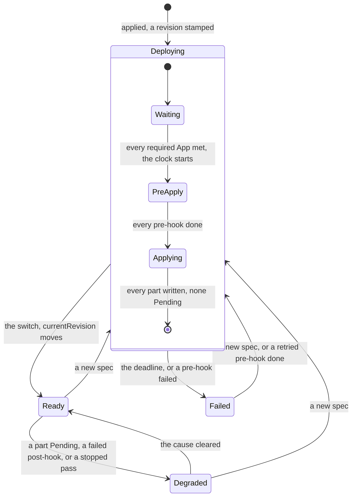

# Apps

Status words and how to read this: [the index](README.md).

Kinds: App, AppRevision.

An AppRevision freezes one spec, `Deploying` then `Ready` or `Failed`; only the reconciler writes it, and any other write answers 405.
A second apply mid-rollout turns the older revision `Failed`, `Superseded`. A part's reconciler makes its children, and a refusal there
shows as the part's Pending reason. A refusal at apply names `spec.<section>[i]` and stores nothing (ADR-0252 Decision 1, ADR-0219
Decision 7). A template renders on the client, so a bad value applies nothing (ADR-0217 Decision 7). A pause or a hold freezes whatever
phase it finds; a hook call running then finishes and records nothing, so it is due again (ADR-0214 Decision 8). Neighbors:
[Functions](functions.md), [Disaster recovery](disaster-recovery.md), [Services](services.md). New words: Waiting, Applying.

| Where | What happens | Time | You see | Status | Source |
|---|---|---|---|---|---|
| A part's name another object holds, or a declared Secret or key missing | The pass stops and writes no part, a write-back included: `Deploying`, or `Degraded` once Ready | re-check `runtime.supervisionPeriod` 10 s | `ChildNotOwned`, `SecretNotFound`, `SecretKeyMissing` | decided | ADR-0199 Decision 4, ADR-0213 Decision 8, `TestScenarioAppChildNotOwned`, `TestScenarioAppSecretDeclared` |
| The same App applied after its delete | A kept store carries the old App's marker, so naming it in `kv`, `buckets` or `sql` stops the pass; a `ref` entry takes it back, or a delete of the store | none | `KVStore/<name>: exists and is not owned by App/<app>` | accepted | ADR-0199 Decision 7 and Consequences, `TestScenarioAppChildNotOwned`, `TestScenarioAppRefKeptStore` |
| A required App missing, off range or not Ready | The revision waits with no limit: no clock, no hook, no part written, a write-back included | re-check `runtime.supervisionPeriod` 10 s, at once when that App changes | `RequirementNotMet`, `App/<app> does not exist; <dependent> needs <range>` | decided | ADR-0219 Decision 3 and Consequences, `TestScenarioAppRequiresWaits` |
| Pre-hooks | Only what a pre-hook binds and its Function are written, while the old revision serves; then one call at a time, which wakes it | each `spec.timeout`, else `invoke.defaultTimeout` 60 s, a wake included | `Deploying`, `Progressing`, `pre-hook Function/<name>` | decided | ADR-0214 Decisions 4 and 5, `TestScenarioAppPreHookMigrates`, `TestAppHookTimeoutCoversWake` |
| A pre-hook fails, or its Function or database is not ready by the deadline | The revision turns `Failed` and the current one serves | `app.upgradeTimeout` 5 min | `HookFailed`, `Function/<fn>: Invocation/<inv>: <error>`, `SQLDatabase/<name>: <reason>` | decided | ADR-0214 Decision 4, ADR-0236 Decision 3, `TestScenarioAppPreHookFailsThenRetry`, `TestScenarioDatabaseNotReadyFailsRollout` |
| `funcdctl app retry` | Calls the failed hook at once and returns; the passes carry on. A revision `Failed` by its deadline has nothing to retry | none | `retrying the failed hook of <app>`, 409 `app <app> has no failed hook`, 503 `funcd is held: app <app> calls no hook` | decided | ADR-0214 Decision 7, `TestAppRetryRefusals`, `TestAppDeadlineFailedRevisionCallsNoHook` |
| `funcdctl app retry` after `SQLDatabase/<name>: <reason>` | Taken as any `HookFailed`: it calls the hook with the database still not Ready, and a good call reopens the revision | none | `Deploying` | **differs** | ADR-0236 Decision 3 says no retry fixes this path; ADR-0214 Decision 7 reopens `HookFailed`; `Retry` in `internal/app/hooks.go` does not tell them apart; no issue; ran it |
| funcd stops while a hook runs | The call is not recorded, so the next start calls it again, and a hook must be safe to repeat; a cut retry leaves the hook failed | none | a second call, one line in `status.hooks` | accepted | ADR-0214 Decisions 6 and 7, Risks, `TestScenarioAppHookRepeatsAfterRestart` |
| Post-hooks | Called after the switch with no App deadline, the App `Ready` meanwhile. One that fails keeps the revision current and holds the later hooks and prune until a retry | each `spec.timeout`, else `invoke.defaultTimeout` 60 s | `Degraded`, `HookFailed`; a dropped part `Pruning`, no reason | decided | ADR-0214 Decision 4, `TestScenarioAppPostHookFails` |
| `funcdctl app deploy` at the switch | Exits 0 once `currentRevision` names its revision, with a post-hook due, running or failed | none | exit 0 | **differs** | ADR-0217 Decision 8 and its checklist wait for the post-hooks and exit 1 on a failed one; `waitDeployEvery` in `cmd/funcdctl/app.go` reads no hook; read ADR-0214, ADR-0253; no issue; ran it |
| A changed scale-to-zero part | Not running, it counts as settled: the revision goes current unbooted, and a broken image shows only at the first call | none | `Ready=Unknown`, `NotStarted`, later `Degraded` | accepted | ADR-0200 Decision 6 and Risks, ADR-0215 Decision 8, `TestScenarioAppScaleToZeroNotStarted` |
| A part Pending at the deadline, a missing `ref` target too | The revision turns `Failed`, and a changed Function's old Revision serves. It is final: a part Ready later changes nothing, and the same spec stamps nothing | `app.upgradeTimeout` 5 min | `Failed`, `ChildNotReady`, `Function/<name>: <reason>` | decided | ADR-0200 Decision 6, `TestScenarioAppFailedUpgradeKeepsServing` |
| The parts after a failure | They stay at the new spec: a Route, Site, Sensor or EventSource runs it at once, even pointing at a Function that does not serve, and a late Function still switches, so `currentRevision` names the last complete rollout, not what runs | until a fix or a rollback | the App `Failed`, those calls failing | accepted | ADR-0200 Decision 4 and Consequences |
| A part edited or deleted by hand | Written back at the next pass, which its watch brings; its status is never touched | none | `self-healed` in the log, `status.lastSelfHeal` | decided | ADR-0212 Decisions 1 and 2, `TestScenarioAppDriftSelfHealed` |
| `spec.paused` | A pass writes only `Paused`: no stamp, part, prune, hook or `Failed`, so the phase and children go stale. A resume gives a running rollout a full timeout | `app.upgradeTimeout` 5 min from the resume | `Paused=True`, `SpecPaused` | decided | ADR-0212 Decisions 4 to 6, `TestScenarioAppPausedRolloutFullTimeout`, `TestScenarioAppPausedKeepsHotfix` |
| A plain apply of a paused App | A manifest without `paused` resumes it and overwrites a hot fix; `app deploy` and `app rollback` keep the pause | none | `Paused=False`, `Resumed` | accepted | ADR-0212 Decision 9 and Risks, `TestScenarioAppApplyWithoutPausedResumes` |
| A dropped part | Stays until its revision is current and its post-hooks are done, longer while a run holds or anything uses it. A `deletion: delete` store then goes with its data, unprobed; a `retain` store stays | `runtime.supervisionPeriod` 10 s | `Pruning`: `NotCurrent`, `RunHeld`, `InUse: Function/<name>` | decided | ADR-0199 Decision 6, ADR-0200 Decision 7, `TestScenarioAppStoreInUseKept` |
| `funcdctl app rollback <app> <n>` | Applies that revision's spec as a new number and returns. Keys, objects and the schema stay as they are, and a `deletion: delete` store pruned since comes back empty | none | `applied App <app> with the spec of <rev>` | accepted | ADR-0200 Decision 9 and Consequences, ADR-0236 Consequences, `TestScenarioAppRollback` |
| An App deleted | The GC takes its parts, their children and its AppRevisions, and a `deletion: delete` store with its data. A `retain` store, a `ref` object, a Secret and a Backup stay | level by level | `deleted <Kind>/<name>`, `kept KVStore/<name>` | decided | ADR-0199 Decision 7, ADR-0222 Decision 3, `TestScenarioAppDeleteCollectsTree`, `TestScenarioBackupOutlivesApp` |
| A store something outside binds, or a Function an open run holds | Stays with no limit, judged again at each sweep, so it goes up to one sweep after the last binding | `controller.gcSweepInterval` 5 min | `waiting KVStore/<name>` | accepted | ADR-0199 Decision 7, ADR-0217 Consequences, `TestAppStoreInUseWaitsForALaterSweep`, `TestHeldChildrenWaitForTheirRun` |
| A `deletion: delete` SQLDatabase an outside Function binds | The GC takes it and its data at once, where a KVStore or a Bucket waits | none | `deleted SQLDatabase/<name>` | **differs** | ADR-0236 Decision 2 and Scope name the GC's use check; `usedElsewhere` in `internal/gc/gc.go` skips the kind; `TestScenarioPruningKeepsBoundDatabase` is prune only; no issue; ran it |
| An App's Lake | Its engine stops and the Lake goes. A retained Bucket keeps its files and catalog, which a Lake re-created there finds; a purged Bucket takes both | the next pass | `kept Bucket/<name>` | decided | ADR-0293 Constraints and Decisions 5 and 6, `TestScenarioPurgeRemovesCatalogs` |
| funcd restarts mid-rollout | The deadline is read again from the revision, so downtime counts: one past it fails at the first pass, unless a pre-hook call starts | `app.upgradeTimeout` 5 min | `Failed`, `ChildNotReady` | accepted | ADR-0200 Decision 6 and Risks, `TestAppRevisionDeadlineSurvivesRestart` |
| A hold, the platform's or its namespace's | A pass returns at once: no stamp, part, prune, switch, `Failed` or hook, and the status stays. The release gives a `Deploying` revision a full timeout | until the release, then `app.upgradeTimeout` 5 min | `funcdctl hold status` | decided | ADR-0206 Decision 6, ADR-0222 Decision 8, ADR-0212 Decision 6, `TestScenarioHeldRolloutDeadline` |
| `funcdctl app deploy` or `app delete` waiting | No client timeout: under a hold, a pause, an unmet requirement, a slow purge or a used store it waits without bound, printing only what changes; an interrupt stops the wait, not the rollout | no end | no new line | accepted | ADR-0217 Decision 8 and Consequences, `TestCLIAppDeployWaitsForStamp` |

<!-- generated values, do not edit: just behavior-values -->

Apps: values

| Value | Default | From |
|---|---|---|
| `app.revisionHistory` | 10 | config |
| `app.upgradeTimeout` | 5m, or twice runtime.bootTimeout when larger | config |
| `defaultRevisionHistory` | 10 | `internal/app/revision.go` |
| `defaultUpgradeTimeout` | 5m | `internal/app/revision.go` |

<!-- end of generated values -->
