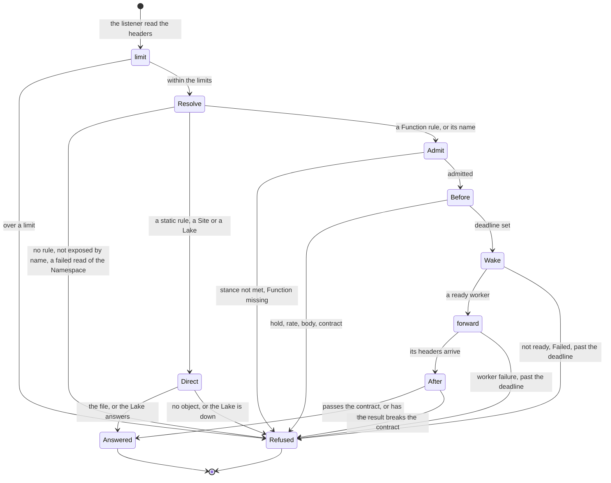

# Calls

Status words and how to read this: [the index](README.md).

Kinds: Route, Site, Gateway, Service, NetDestination, Invocation.

`Direct` is `serveStatic` or `serveUpstream`: no wake and no chain. A fn-to-fn call enters at `Admit`, past `limit` and `Resolve`;
of the chain only the hold and the contract apply to it. Calls to a cold Function share one wake and its clock: [Functions](functions.md)
has the hold, [Disaster recovery](disaster-recovery.md) a held namespace. A `Service` object only turns `Ready` (ADR-0019 Decision 3)
and no call reads it; `NetDestination` and `Invocation` are no step of a call. New words: Direct, Refused, Answered.

| Where | What happens | Time | You see | Status | Source |
|---|---|---|---|---|---|
| A fresh funcd | The API answers on loopback, the data plane on loopback at an ephemeral port | none | connection refused at another address | decided | ADR-0314 Decision 1, `TestScenarioFreshConfigBindsLoopback` |
| An address with no port, with the built-in dev token | This refusal, not a bind error | none | `is off loopback` | accepted | ADR-0314 Consequences, `TestIsLoopbackAddr` |
| An explicit empty `server.listenAddr` with a real credential | It reaches the `Production()` default, `0.0.0.0:8080`, as before | none | `platform starting` | accepted | ADR-0314 Consequences, `TestScenarioRealCredentialBindsAnywhere` |
| No rule, no by-name Function | Refused, nothing wakes | none | 404 `no route for "<path>"`, 404 `function <ns>/<name> is not exposed by name` | decided | ADR-0241 Decision 4, `TestScenario_exposure_function_off` |
| A failed read of a Namespace | A call that needs it is refused before anything is served; only an absent Namespace reads as unset, implicit and open | none | 503 `edge settings unavailable` | accepted | ADR-0176 Decision 2 for the aggregator, `TestNamespaceRead_FailedReadRefusesTheCall` |
| A rule with no host | In a namespace it answers only on `<ns>.<baseDomain>`; in `default`, on any host no namespace reserves | none | `status.host`, a 404 on another host | decided | ADR-0240 Decisions 3 and 4, `TestScenario_namespace_host_routes` |
| Two rules match | The longest path wins and a host only breaks a tie, so a `default` host-less rule at a longer path takes a host's shorter one | none | the other rule's backend | deferred | ADR-0176 Open questions, `TestScenarioMatchLongestPrefix` |
| A Route that cannot serve | It serves nothing, whichever rule is at fault | re-check `controller.routeResyncInterval` 10 s | `Pending`, `Ready=False`: `BackendNotFound`, `RouteConflict` | decided | ADR-0242 Decision 4, `TestScenarioRouteNotReadyMissingBackend` |
| `server.limits` | Over a limit, refused before any wake; off by default | `server.limits.ratePerMin` 0, `server.limits.maxInFlight` 0 | 429 `rate limit exceeded`, 503 `in-flight concurrency ceiling reached` | decided | ADR-0112 Decision 1, `TestScenarioOverRate429NoWake` |
| A body over the cap | Refused before any wake, since the edge reads it whole to build the CloudEvent | `maxNormalizeBytes` 1 MiB | 413 `request body exceeds 1048576 bytes` | decided | ADR-0134 Contracts, `TestScenarioUpgradeWithBodyStillCapped` |
| A call that breaks its contract | The input is refused before any wake; a bad result replaces the answer | `CallBudget` 1 s of patterns | 422 `event data does not match the input contract`, 500 `handler result does not match the output contract` | decided | ADR-0303 Decisions 4 and 5, `TestScenarioABadInputNeverReachesTheWorker` |
| An external call's deadline | It runs from receipt, through the wake, to the worker's headers | `invoke.defaultTimeout` 60 s, or `spec.timeout` | 504 `<ns>/<name> did not start its response within 1m0s (invoke.defaultTimeout)` | decided | ADR-0151 Decision 2, `TestScenarioColdWakeCutAtLimit` |
| A handler past its deadline | It goes on after the 504 until the shim stops it or it ends, so a retry can repeat its effects | 1 s past the deadline (the shim) | the 504 only | accepted | ADR-0151 Consequences, `TestIssue928_StuckPythonCallStops` |
| A client that stops reading | Its response is cut once it accepts no data; a slow live stream is not | `WriteStallTimeout` 60 s | the connection closes | decided | ADR-0191 Decision 1, `TestScenarioStalledReaderIsCut` |
| A client slow to send | The whole request must arrive in time, so a slow upload fails | `serverReadTimeout` 10 s | 400 `reading request body: <error>` | accepted | #90, `TestIssue90_SilentBodyReleasesInFlightSlot` |
| The worker fails during a call | funcd does not retry it; only a workflow step or a Sensor does | none | 503 `upstream call failed`; past the headers, a cut connection | accepted | ADR-0155 Risks accepted, `TestWorkerFailureProblemHidesWorkerAddress` |
| A link's timeout | A nested call keeps its own bound, wake included, not its caller's deadline | `defaultTimeout` 30 s, or the link's `timeout` | 503 `upstream call failed` | decided | ADR-0064 Decision 4, `TestScenarioLinkKeepsOwnLimit` |
| Nested calls to one Function | Over the cap the next call is refused at once, whoever calls | `invoke.maxNestedInFlight` 10 | 429 `<ns>/<name> has 10 nested calls in flight, the cap set by invoke.maxNestedInFlight` | decided | ADR-0147 Decision 3, `TestScenarioInflightFanoutOverCap` |
| A Site's deploy | The last good build serves until the new index is written and the Route moves | none | `Ready=False`, `IndexMissing` or `ArtifactNotFound` | decided | ADR-0139 Decision 3, `TestScenarioRedeploySwapsAtomically` |
| A GET or another path on a cloudevent Function | Unless its contract refuses the input, it wakes the worker, whose shim answers only `POST /` | a cold start | the shim's 404 | decided | ADR-0134 Contracts Wiring, ADR-0016 Decision 3, ADR-0243 Context |
| A `Gateway` object | Stored and listed; nothing acts on it | none | no status | accepted | ADR-0003 Consequences, `TestScenario_KindRegistryRoundtripsEveryKind` |

<!-- generated values, do not edit: just behavior-values -->

Calls: values

| Value | Default | From |
|---|---|---|
| `invoke.activationTimeout` | 30s | config |
| `invoke.defaultTimeout` | 60s | config |
| `invoke.maxNestedInFlight` | 10 | config |
| `invoke.reclaimInterval` | 30s | config |
| `server.auth.edge` | false | config |
| `server.baseDomain` | localhost | config |
| `server.dataPlaneAddr` | 127.0.0.1:0 | config |
| `server.limits.burst` | 0 ⇒ ratePerMin | config |
| `server.limits.key` | clientIP | config |
| `server.limits.maxBodyBytes` | 0 | config |
| `server.limits.maxInFlight` | 0 | config |
| `server.limits.maxKeys` | 4096 | config |
| `server.limits.ratePerMin` | 0 | config |
| `server.listenAddr` | 127.0.0.1:8080 | config |
| `server.network.dnsForwarderPort` | 0 | config |
| `server.network.dnsResolver` | "" | config |
| `server.network.egress` | false | config |
| `server.network.egressGatewayPort` | 0 | config |
| `server.network.internalAllow` | none | config |
| `server.network.workerSyncInterval` | 2s | config |
| `server.observability.accessLog` | false | config |
| `server.observability.metrics` | false | config |
| `server.observability.trace` | false | config |
| `server.shaping.compression` | false | config |
| `server.shaping.cors.allowHeaders` | none | config |
| `server.shaping.cors.allowMethods` | none | config |
| `server.shaping.cors.allowOrigins` | none | config |
| `server.shaping.cors.maxAgeSeconds` | 0 | config |
| `server.shaping.headers.remove` | none | config |
| `server.shaping.headers.set` | none | config |
| `server.shutdownTimeout` | 15s | config |
| `server.tls.caDir` | "" ⇒ Let's Encrypt | config |
| `server.tls.certFile` | "" | config |
| `server.tls.email` | "" | config |
| `server.tls.enabled` | false | config |
| `server.tls.hosts` | none | config |
| `server.tls.keyFile` | "" | config |
| `server.tls.mode` | selfsigned | config |
| `site.defaultIndex` | index.html | config |
| `defaultActivationTimeout` | 30s | `internal/activator/activator.go` |
| `defaultPollInterval` | 25ms | `internal/activator/activator.go` |
| `defaultReclaimInterval` | 30s | `internal/activator/activator.go` |
| `heldIdleTimeout` | 5m | `internal/activator/activator.go` |
| `idleRetention` | 1m | `internal/activator/calltracker.go` |
| `maxAttempts` | 5 | `internal/activator/storescaler/storescaler.go` |
| `tunnelIdleTimeout` | 5m | `internal/activator/tunnel.go` |
| `heldRetryAfter` | 30 | `internal/dataplane/dataplane.go` |
| `maxNormalizeBytes` | 1MiB | `internal/dataplane/normalize.go` |
| `defaultMaxKeys` | 4096 | `internal/edge/limit/limit.go` |
| `WriteStallTimeout` | 1m | `internal/gateway/writestall.go` |
| `clearAhead` | 876000h | `internal/gateway/writestall.go` |
| `stallChunk` | 32KiB | `internal/gateway/writestall.go` |
| `maxRouteName` | 63 | `internal/route/owned/owned.go` |
| `backendRequeue` | 2s | `internal/route/reconcile.go` |
| `resyncPeriod` | 10s | `internal/route/reconcile.go` |
| `routeRequeue` | 2s | `internal/site/reconcile.go` |

<!-- end of generated values -->
