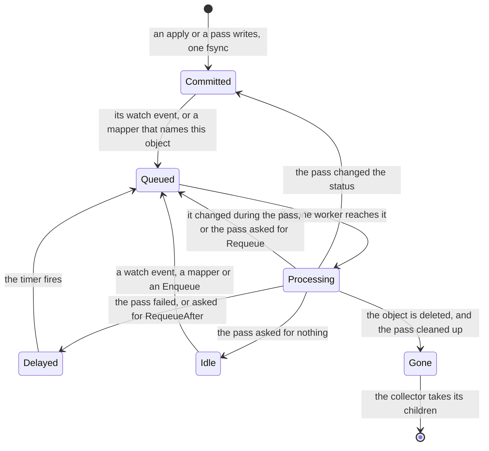

# Controller

Status words and how to read this: [the index](README.md).

Kinds: none of its own.

This is the queue's view of one object, not a phase: a kind's phases are in its own chapter, and these words stand for the queue's
`dirty`, `processing` and `pending`. The engine owns the watch, the queue and the retry. A kind brings only its `Reconcile`, and that
pass writes status itself, with a plain `store.Update` at the version it read. A pass that changed a status wakes itself once more;
that pass changes nothing, so a settled object goes quiet. The queue lives in memory. The collector runs beside the controller, not
in it. New words: Committed, Queued, Processing, Delayed, Idle, Gone.

| Where | What happens | Time | You see | Status | Source |
|---|---|---|---|---|---|
| A write | Commits whole or not at all, one writer at a time. A failed commit moves no version and sends no event | one fsync | the caller gets the error; a pass retries | decided | ADR-0065 Decision, ADR-0006 Contracts, `TestScenarioDurableMetastoreSurvivesRestart` |
| A change reaches the queue | It wakes the object's reconciler and the mappers on its kind. A queued key is not queued twice, and a key changed during its pass runs once more | none | `status.observedGeneration` behind `metadata.generation` | decided | ADR-0015 Decisions 2 and 3, ADR-0006 Decision 2, `TestScenarioWorkqueueDedup` |
| Passes at once | One: funcd runs one worker, and every kind shares its queue in order | none | an applied object's status waits its turn | decided | ADR-0146 Decision 8 and Scope, ADR-0028 Decision 2 |
| A slow pass | Holds up every other kind. A pass has no deadline of its own, so it lasts as long as its slowest step. Stopping a worker is the common wait | `runtime.containerd.stopGrace` 10 s per worker it stops | every status lags | accepted | ADR-0143 Consequences, #697, #1292 |
| A pass fails | Retried for ever, the wait doubling per failure until a success resets it. The engine never gives up or writes a status: only the kind's reconciler can | `baseBackoff` 5 ms, doubling to `controller.retryBackoffMax` 1 s | `reconcile failed, requeueing` in the log, per failure | decided | ADR-0015 Decisions 3 and 4, ADR-0163 Decision 1, `TestScenarioReconcileRetryBackoff` |
| A status write loses to another write | The store refuses it whole. Most kinds run again quietly; some, such as a Route, count it as a failed pass | `baseBackoff` 5 ms | `resourceVersion mismatch` in `reconcile failed, requeueing` | decided | ADR-0015 Decision 4, ADR-0146 Decision 4, `TestScenarioStatusSurvivesConcurrentSpecWrite` |
| Nothing changes | The engine has no resync: a pass that asked for nothing runs again only on a change. A kind that owns running instances asks for its own re-check | `runtime.supervisionPeriod` 10 s | a status stays as last written | decided | ADR-0142 Scope and Alternatives, ADR-0163 Decision 7, `TestScenarioRequeueDoesNotMultiply` |
| An object waits for a referent | Its pass asks to run again, so it moves within one interval of the referent's arrival | `controller.referentPollInterval` 2 s | its kind's reason, such as `SecretResolveFailed` | decided | ADR-0163 Decision 3, `TestScenarioControllerKeysPaceTheControlPlane` |
| A watcher falls behind | The store closes its stream so no writer stalls. It resumes from the changes kept in memory or re-lists; a re-list also runs what each object last drove, so a lost delete is seen | `watchChanBuf` 64, `defaultRingCap` 1024 | `store closed the watch, re-watching` | decided | ADR-0202 Decision 5, `TestIssue302_ReconcilesDeletesAfterWatchDrop` |
| You delete an object | It leaves the store at once, with no `deletionTimestamp` and no foreground delete. Its next pass finds it gone and cleans up | none | `404` at once, while its workers still stop | decided | ADR-0170 Scope and Alternatives, ADR-0015 Decision 2, `TestIssue302_ReconcilesDeletesAfterWatchDrop` |
| `metadata.finalizers` | Stored as you wrote them, and nothing reads them, so they hold up no delete | none | the field you set | deferred | card "Two-phase delete", ADR-0170 Scope |
| An owner is deleted | A watch on each owner kind records it, and the collector deletes each child whose controller reference names it. An owner of another UID counts as gone | none | `collected` in the log; the child answers until then | decided | ADR-0170 Decisions 1 and 2, `TestRunCollectsADeletedOwnersChildrenFromItsWatch` |
| The collector's sweep | One pass over every child kind, at start and then on a timer. It catches what a crash or a dropped watch missed | `controller.gcSweepInterval` 5 min | `collected` in the log | decided | ADR-0170 Decisions 2 and 3, `TestRunSweepsOnStartAndEveryInterval`, `TestScenarioCrashBeforeCollectionSwept` |
| A child that cannot go yet | It waits for a later sweep if it changed twice, a read or delete failed, an open run holds it, or an App's store has an outside user. No status says so | `controller.gcSweepInterval` 5 min | `garbage collection incomplete`, on a failure only | decided | ADR-0170 Decision 1, ADR-0190 Decision 7, ADR-0199 Decision 7, `TestHeldChildrenWaitForTheirRun` |
| A declared store when its owner goes | `deletion: delete` goes with it, data too: a Bucket's objects are purged. `retain`, the default, stays with its data | none | the store, with no live owner | decided | ADR-0248 Scenarios, ADR-0199 Decision 7, `TestScenarioStoreDeletion`, `TestDeleteBucket` |
| A declared store's name is taken, or its owner was re-created | Refused, never taken over: a marker names one UID, so a retained store needs `ref` | `controller.referentPollInterval` 2 s | `Pending`, `StoreNotOwned`, `bind it with ref`; a Workflow's `KVStoreNotOwned`, an App's `ChildNotOwned` | decided | ADR-0248 Decision 3 and Consequences, `TestScenarioRecreatedOwner` |
| A held platform | The collector asks no hold: it still deletes a dead-owned child and purges a dead-owned Bucket, where prune and the boot reclaims wait | `controller.gcSweepInterval` 5 min | `collected` during a hold | **differs** | ADR-0288 Constraints read ADR-0206 Decision 6 as nothing deleting data while held; `Run` starts the collector ungated; a probe |
| funcd restarts | Each watch lists its kind as `Added`, so every object gets one pass, in no fixed order. Retries and timers are gone, and a status stays as written until its pass | one pass per object, on one worker | a stale `Ready` until then | decided | ADR-0015 Scope, ADR-0146 Decision 2, ADR-0006 Decision 3, `TestScenarioRestartResumesInFlightRun` |
| A record that does not decode, at start | The controller's first watch fails and it stops for good: funcd serves on, reconciling nothing, until a restart. A Secret's or a Route's ends the start instead | until a restart | `controller stopped` | **uncovered** | read ADR-0015, ADR-0028, ADR-0305 Decision 4; ADR-0170 Decision 2 names only the collector's; no issue; probe: `Run` returns the error |
| funcd stops during a pass | The pass's context ends and timers and retries are dropped. The stop waits for the pass to return, with no bound of its own | none | `platform stopping` | decided | ADR-0015 Decision 2, ADR-0028 Decision 3, `TestScenarioGracefulShutdown` |
| A pass panics | Nothing recovers it: funcd exits, the start counts as unclean, and the same pass runs again. A hold does not end such a loop; funcd refusing to start does | `recovery.safeMode.afterCrashes` 3, then twice that | exit 70, naming the restore | accepted | ADR-0207 Decisions 3 and 4 and Consequences, `TestBeginModes` |

<!-- generated values, do not edit: just behavior-values -->

Controller: values

| Value | Default | From |
|---|---|---|
| `controller.gcSweepInterval` | 5m | config |
| `controller.referentPollInterval` | 2s | config |
| `controller.retryBackoffMax` | 1s | config |
| `controller.routeResyncInterval` | 10s | config |
| `SupervisionPeriod` | 10s | `internal/controller/controller.go` |
| `baseBackoff` | 5ms | `internal/controller/controller.go` |
| `maxBackoff` | 1s | `internal/controller/controller.go` |
| `DefaultInterval` | 5m | `internal/gc/gc.go` |
| `rewatchBackoff` | 1s | `internal/gc/gc.go` |
| `baseTableSize` | 8MiB | `internal/store/badger/badger.go` |
| `blockCacheSize` | 32MiB | `internal/store/badger/badger.go` |
| `defaultGCInterval` | 5m | `internal/store/badger/badger.go` |
| `indexCacheSize` | 32MiB | `internal/store/badger/badger.go` |
| `memTableSize` | 16MiB | `internal/store/badger/badger.go` |
| `valueLogFileSize` | 64MiB | `internal/store/badger/badger.go` |
| `loadBatch` | 1024 | `internal/store/memory/memory.go` |
| `defaultRingCap` | 1024 | `internal/store/store.go` |
| `watchChanBuf` | 64 | `internal/store/store.go` |
| `timelineBytes` | 8 | `internal/store/version.go` |

<!-- end of generated values -->
