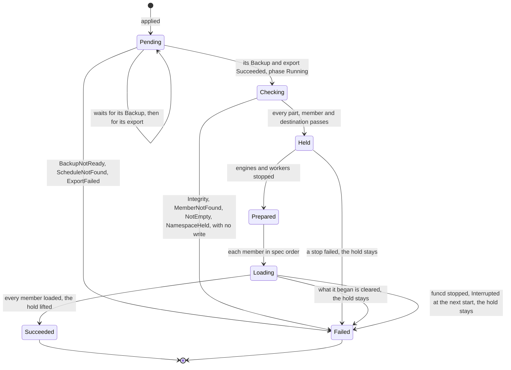

# Disaster recovery

Status words and how to read this: [the index](README.md).

Kinds: BackupSchedule, Backup, Restore.

An in-place Restore:

`Checking` to `Loading` are the phase `Running`. A Restore with no member `inPlace` takes no export and no hold, going from `Checking`
to `Prepared`. A namespace hold has two writers: an in-place Restore (reason `restore`), whose completed load lifts it, and
`funcd restore run` (reason `data`). Only `funcdctl hold release --namespace` lifts the rest. While one stands, the namespace's timers,
blob sources, Sensors, runs, App and slots wait, its Functions refuse calls and its Sites keep serving their files (ADR-0290 Decision 4).
Details: [restore-stop](../design/lake/restore-stop.md), [bucket-lake-members](../design/backup/bucket-lake-members.md),
[target-sync](../design/backup/target-sync.md). New words: Checking, Prepared, Loading.

| Where | What happens | Time | You see | Status | Source |
|---|---|---|---|---|---|
| A platform run | On with `backup.target` and `storage.mode` file. One at a time: a failure leaves the daemon serving and the next attempt sooner, and a late run's successor starts at its end | `backup.interval` 1 h, `backup.retryInterval` 5 min | `enabled: false` when off; `backup run failed` | decided | ADR-0205 Decisions 1 and 2, `TestScenarioFailedRunRetries`, `TestScenarioOverrunNoOverlap` |
| `rpoRisk` of the platform backup | It reads the newest verified generation, so it stays on from a fresh install until someone runs `funcdctl backup verify`, off the box | `backup.objectives.rpo` 2 h | `backup rpo at risk`, once per that time | accepted | ADR-0205 Decision 5 and Consequences, `TestScenarioRPORiskFollowsVerified` |
| A backup past its retention | funcd deletes nothing on a target: the operator's lifecycle rules expire platform generations. A workload Backup's record goes at its ttl, and its objects wait for the owner's rule | `spec.ttl`, unset is 720 h | `backup target: set one lifecycle expiry per prefix (days)` | accepted | ADR-0203 Consequences, ADR-0222 Consequences, `TestScenarioBackupOutlivesApp` |
| Two funcds on one `backup.target` | A run that meets another writer's keys writes nothing and, with a generation of its own, stops that writer too: a restore released onto its live source's target stops both | until the operator acts | `is another writer's; no generation is written until the operator stops that writer` | accepted | ADR-0203 Consequences, `TestScenarioSecondPlatformRefused` |
| A target that never answers | A run waits with no deadline, so nothing fails and no next run starts, on the KV ship and the blob mirror too, which have no `rpoRisk` | no limit | only `backup rpo at risk` | deferred | #1287 |
| `funcdctl backup status`, target down | It waits, or answers 503 on a failed listing | none | 503; a 404 adds `the bucket does not exist or the target URL is wrong`, any other cause goes to the log | accepted | ADR-0205 Decision 4, #1288, `TestStatus_FailedListingNamesOnlyAMissingBucket` |
| A schedule's slot | It takes the newest due slot, so downtime, a pause or a hold collapses into one catch-up. A slot while one of its Backups is `Pending` or `Running` is taken and never caught up | at the slot; a release is seen within `runtime.supervisionPeriod` 10 s | `lastScheduleTime` | decided | ADR-0228 Decision 2.1, `TestScenarioCatchUpOnceNoOverlap` |
| A Backup fails | One attempt, no retry: the next slot is the next try. `rpoRisk` comes on, also under a hold, not under a pause | none | `Failed`, `MemberNotFound`, `EngineNotReady`; `workload backup rpo at risk` | decided | ADR-0222 Decisions 4 and 9, `TestScenarioRPORisk` |
| A busy Lake | A copy that misses a file the Lake deleted tries again, then fails its Backup, a Bucket-only one too, and with it an in-place Restore's export, until the next try | `lakeAttempts` 3 | `LakeUnstable`, `ExportFailed` | accepted | ADR-0312 Consequences, `TestABusyLakeFailsABucketSchedule` |
| funcd stops during a Backup | It stays `Running`. At the next start its copy whole on the target makes it `Succeeded`; else it ends `Failed` | the next start | `FoundOnTarget`, `Interrupted` | decided | ADR-0287 Decision 5, `TestScenarioFinishedRunKept`, `TestScenarioRunInterrupted` |
| A target over a limit | A sync's listing fails, and a scope over the members fails its Backup with no copy written | `workloadBackup.maxListedKeys` 1048576, `workloadBackup.maxListedKeySize` 256 MiB, `workloadBackup.maxCopyMembers` 1024 | `ListFailed`, `it holds more than <n> keys or <n> bytes of keys` | decided | decider 2026-11-04, #1391, `TestListings_FollowTheirLimits` |
| An in-place Restore at apply | It needs `update` on the Namespace: an admin. One per namespace: a second, or a delete of one not ended, is refused, so only deleting its Backup ends a stuck `Pending` one. A failed load's marker refuses one | none | 403, 409 `has not ended`, 409 `whose load did not complete` | decided | ADR-0228 Decision 2.4, Open questions, `TestRestoreInPlaceOnePerNamespace` |
| An in-place Restore's export | Backup `<restore>-before` runs first, under a platform hold too. If it fails nothing is written, and a new Restore is the next try | one full copy | `ExportFailed`, `ScheduleNotFound` | decided | ADR-0222 Decision 7, `TestScenarioRestoreInPlace`, app-todo D8 |
| `Checking` | It reads every part of the whole copy, not only the named members, then each member and destination, while the namespace serves; a failure takes no hold. A destination `as` must exist and be empty | one read of the copy | `Integrity`, `MemberNotFound`, `NotEmpty` | decided | ADR-0222 Decision 7, ADR-0311 Decision 3, `TestRestoreReason_MemberNotFound`, `TestScenarioRestoreNewName` |
| A Bucket's Restore | It leaves the Lakes on its prefixes, `as` too; to roll one back, name it as well. So a whole copy elsewhere takes one member per Lake, and nothing warns | none | a Backup's `status.members` lists them | accepted | ADR-0312 Decision 4 and Consequences, `TestScenarioBucketRestoreLeavesItsLakes` |
| An in-place Lake | Under the hold its engine's saves are refused, so its stop runs out the grace and is killed. After the lift a query can fail while the new engine starts | `runtime.containerd.stopGrace` 10 s per Lake | `Restoring`, `the stop failed`, `LakeNotReady` | accepted | ADR-0312 Consequences, card "A Lake engine's stop skips its saves when a Restore will replace them", app-todo B10 |
| A load fails | It clears what each load began and ends `Failed`, and the hold stays; engines and workers come back under it, a Lake's saves getting 503 | until `funcdctl hold release --namespace` | `Failed`; `funcdctl hold status` names the Restore | decided | ADR-0228 Decision 1.3, ADR-0312 Decision 9, `TestIssue1384_AFailedLoadKeepsTheHoldAndBringsAnEngineBack`, app-todo B13 |
| funcd stops or crashes during a load | What it wrote can stay: the next start ends it `Failed` and clears nothing, and the hold stays, so the owner checks the store before the release | until the release | `Interrupted` | decided | ADR-0228 Decision 1.3 and Open questions, `TestRestoreStopKeepsNamespaceHeld`, app-todo B12 |
| A call into a held namespace | Refused after the listener's limits and authentication, before the per-Function rate and any wake | until the release | 503, `Retry-After: 30`, `namespace <ns> is held for its data since <since>`, `namespace <ns> is held while Restore <name> loads it since <since>` | decided | ADR-0290 Decisions 1 and 2, ADR-0302 Decision 4, `TestScenarioDataHoldRefusesCalls` |
| A nested call, namespace held | `context.invoke` throws on the 503, with no `Retry-After`; `context.fetch` gets the 503 and the header | until the release | `context.invoke("<alias>") failed: 503 <problem>` | **uncovered** | ADR-0290 Decision 2 and #1297 name the header, its scenario only the 503; ADR-0302 Decision 4 lists fn-to-fn; ADR-0064 Decision 4 passes the status; no test, issue or card |
| A write through the S3 gateway | Refused in a held namespace after the PEP allows it, a Lake engine's catalog save too, which retries. Reads and an upload's abort are served | until the release | `ServiceUnavailable` (503), no `Retry-After` | decided | ADR-0290 Decision 6 and Consequences, `TestScenarioGatewayWriteRefused` |
| A Lake not being restored, namespace held | Its Route answers 503 and names no hold. Its direct endpoint stays open: queries reach the engine, each save is refused, so with `lake.saveInterval` unset a commit's answer fails | until the release | `edge upstream unavailable`, `lake catalog not saved` | decided | ADR-0290 Decision 2, ADR-0312 Decision 9, `TestScenarioLakeUpstreamRefused` |
| A call in flight when the hold begins | Nothing cuts it, so what it writes can land during the load | its own deadline | nothing reports it | accepted | ADR-0290 Scope, app-todo B10 |
| `funcdctl hold release --namespace` | It needs `update` on the Namespace, and lifts both reasons. Refused while the Restore its marker names is `Pending` or `Running` | none | 409 `namespace "<ns>" is held by Restore <name>, which is Running: release it once the Restore ends` | decided | ADR-0228 Decision 5.2, `TestReleaseNamespaceWaitsForRestore` |
| A hold nobody releases | Nothing ends it by itself, so its Functions stay down, reads too. Nothing checks the data is back either: after an early release a write lands, and the owner's restore erases it | no limit | `funcdctl hold status` lists it | accepted | ADR-0290 Context and Consequences, ADR-0287 Constraints |
| `funcd restore run` | A store directory that is not empty, memory mode or a newer minor's generation refuses it with nothing written. Killed midway, it refuses funcd's start until the directories are emptied and it runs again | until then | `is not empty: a restore loads into empty directories`; `was interrupted` | decided | ADR-0206 Decisions 2 and 4, `TestScenarioRestoreCrashRefusesStart` |
| After a host loss | `funcd restore run` holds each namespace with a BackupSchedule for its data, so its Functions refuse calls from the first start, past the platform's release | until the owner's release | `held namespaces with a BackupSchedule, whose data this restore does not bring back` | decided | ADR-0222 Decision 8, ADR-0290 Decision 1, `TestScenarioPlatformRestoreHoldsNamespace` |
| A namespace with no BackupSchedule, after a host loss | No marker: its Functions answer from the first start, the platform held or not, on whatever `funcd restore kv` and `funcd restore blob` brought back | none | nothing says so | accepted | ADR-0222 Decision 8, ADR-0206 Consequences, `TestScenarioPlatformHoldUnchanged` |
| A schedule after a platform restore | It records each whole newer copy on its target as a `Succeeded` Backup, and takes no slot until a sync succeeds, whatever the holds. The owner waits for it before a Restore | `runtime.supervisionPeriod` 10 s apart | `Ready`, `TargetSynced` False: `PlatformRestored`, `ListFailed` | decided | ADR-0287 Decisions 2 and 4, `TestScenarioRestoreFindsNewerBackups` |
| Copies a sync leaves out | Backups by hand, exports and copies of schedules the restored platform lacks get no record, so no Restore can name them | until the lifecycle rule | nothing reports them | accepted | ADR-0287 Consequences, `TestScenarioOnlyOwnSlots` |

<!-- generated values, do not edit: just behavior-values -->

Disaster recovery: values

| Value | Default | From |
|---|---|---|
| `backup.credentialsFile` | "" | config |
| `backup.encryption.none` | false | config |
| `backup.encryption.recipients` | none | config |
| `backup.interval` | 1h | config |
| `backup.objectives.rpo` | 2h | config |
| `backup.retention.daily` | 30 | config |
| `backup.retention.hourly` | 48 | config |
| `backup.retention.preUpgrade` | 3 | config |
| `backup.retention.verified` | 2 | config |
| `backup.retention.weekly` | 12 | config |
| `backup.retryInterval` | 5m | config |
| `backup.singleWriter` | false | config |
| `backup.target` | "" | config |
| `workloadBackup.maxCopyMembers` | 1024 | config |
| `workloadBackup.maxListedKeySize` | 256MiB | config |
| `workloadBackup.maxListedKeys` | 1048576 | config |
| `maxRefreezes` | 3 | `internal/backup/blobmirror/freeze.go` |
| `oneDay` | 24h | `internal/backup/blobmirror/mirror.go` |
| `PartBytes` | 8MiB | `internal/backup/layout.go` |
| `oneDay` | 24h | `internal/backup/layout.go` |
| `defaultKVRebaseline` | 24h | `internal/backup/plan/derive.go` |
| `hourlyOnlyUpTo` | 48h | `internal/backup/plan/derive.go` |
| `minCronStep` | 1m | `internal/backup/plan/derive.go` |
| `noWeeklyUpTo` | 720h | `internal/backup/plan/derive.go` |
| `oneDay` | 24h | `internal/backup/plan/derive.go` |
| `oneWeek` | 168h | `internal/backup/plan/derive.go` |
| `defaultStep` | 2 | `internal/backup/plan/edit.go` |
| `MaxManifestBytes` | 16MiB | `internal/backup/workload/workload.go` |
| `lakeAttempts` | 3 | `internal/backup/workload/workload.go` |
| `listPage` | 1000 | `internal/backup/workload/workload.go` |
| `sealedWriteBuf` | 64KiB | `internal/backup/workload/workload.go` |
| `sqlRecordBytes` | 8MiB | `internal/backup/workload/workload.go` |
| `sealedWriteBuf` | 64KiB | `internal/backup/write.go` |

<!-- end of generated values -->
