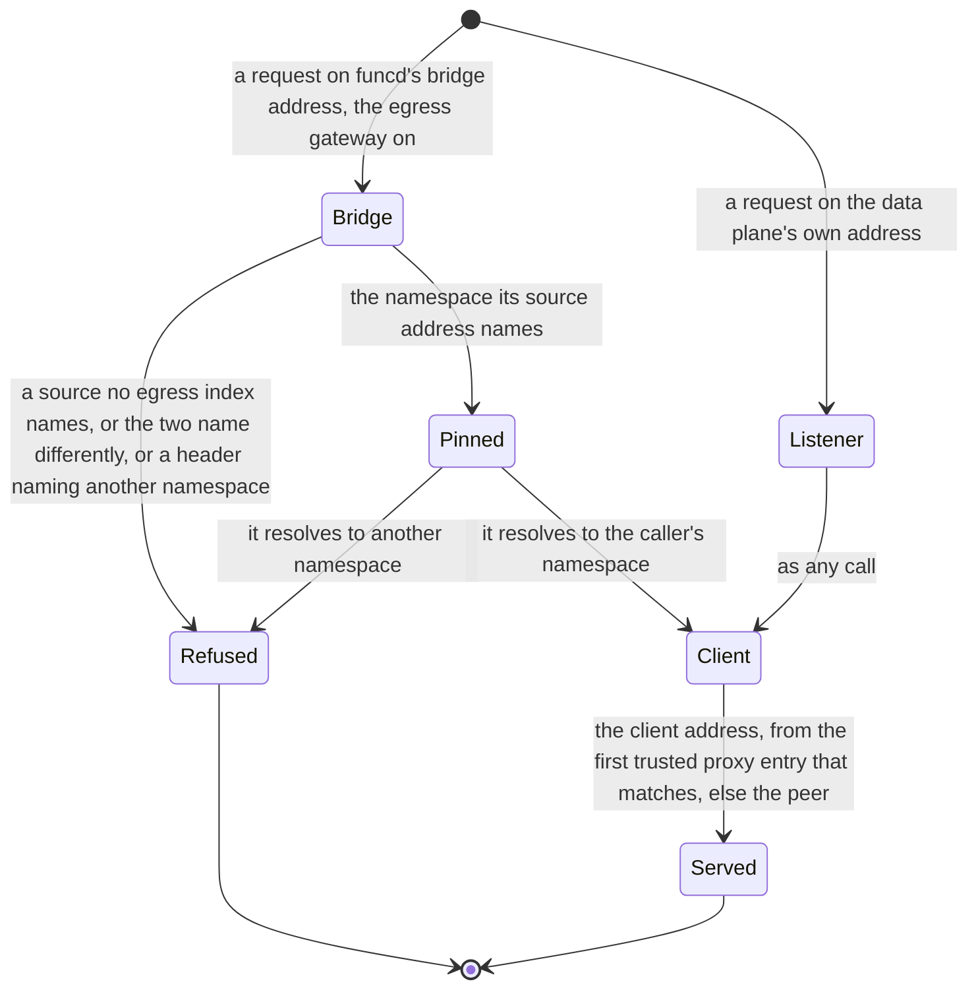

# Edge behind a tunnel

Status words and how to read this: [the index](README.md).

Kinds: none of its own.

A tunnel's connector, an add-on engine, hands each visitor's request to the edge on funcd's bridge address, where every
caller is pinned to its own namespace (ADR-0353), and the edge takes the visitor's address from a proxy it trusts
(ADR-0354). The rest of a call: [Calls](calls.md); an engine's own egress: [Egress](egress.md). New words: Bridge,
Listener, Pinned, Client, Served.

| Where | What happens | Time | You see | Status | Source |
|---|---|---|---|---|---|
| A caller on the bridge address, egress gateway on | Served only what resolves to the namespace its source address names: the entry it matches, else its by-name path, or a callback whose state names that namespace's provider | none | 403 `outside the caller's namespace`, naming none | decided | ADR-0353 Decisions 3 and 4, `TestPinServesTheCallersNamespaceOnly`, `TestScenarioSignInPinned` |
| X-Funcd-Namespace from a caller on the bridge address | Refused on any host unless it names the caller's own namespace | none | 403 `outside the caller's namespace` | decided | ADR-0353 Decision 4, `TestScenarioAWorkerIsPinnedToo` |
| A caller on the bridge address that no egress index names, or that the two name differently | Refused on every path before anything is served | none | 403 `the caller on funcd's bridge address is no workload funcd knows` | decided | ADR-0353 Decision 3, `TestScenarioUnknownCallerRefused` |
| The edge's listener on the bridge address | Only where the egress gateway runs, at the data plane's bound port, with its TLS: a wildcard bind's, else its own, retried until the bridge exists | `bridgeBindRetry` 1 s | `the edge cannot listen on the bridge address yet` | decided | ADR-0353 Decision 1, `TestTheEdgeListensOnTheBridgeWhereTheGatewayRuns`, egress `tunnel-reaches-its-hosts` |
| A call to the public listener | Unchanged by the pin: every namespace's hosts, and X-Funcd-Namespace off a namespace host | none | as any call | decided | ADR-0353 Scenarios, `TestScenarioThePublicListenerIsUnchanged` |
| A workload reaching funcd's edge through a hop outside funcd, such as a public NAT or a CDN | Served as any visitor, unpinned, when its EgressPolicy allows that public name | none | as any call | accepted | ADR-0353 Consequences |
| A call's client address | The peer, unless the first `server.trustedProxies` entry matching it names another: its header when one IP address, else the right-hand `X-Forwarded-For` hop no `cidrs` entry trusts; the rate key and the access log take it | none | `client` in `edge request` | decided | ADR-0354 Decisions 2 and 4, `TestProxiesClient`, `TestRateKeyIsTheClientAddress` |
| What a trusted proxy entry matches | A `cidrs` entry never matches a worker-subnet address; an `addonKinds` entry only an engine of those kinds, spelled the same | none | the peer as the client | decided | ADR-0354 Decision 3, `TestScenarioAFunctionCannotForge`, `TestProxiesClient` |
| The `X-Forwarded-For` a backend gets | The client address alone, for a Function worker and an upstream entry; the caller's own `X-Forwarded-For`, `Forwarded` and `X-Real-IP` reach no worker; a fn-to-fn call is unchanged | none | the header in the handler | decided | ADR-0354 Decision 4, `TestBackendsGetTheClientAddress`, `TestScenarioTunnelClientFromHeader` |
| `X-Forwarded-Proto` and `X-Forwarded-Host` of a call | Reach a worker as the caller sent them; funcd reads neither, so the edge's scheme stays `server.edgePublicScheme` and the host the request's own | none | the sign-in's callback URL | decided | ADR-0354 Decisions 4 and 5, `TestScenarioSchemeNeverFromHeader` |
| An `addonKinds` entry where no engine index exists | Matches nothing: the process runtime, or containerd without the egress gateway | none | a warning at start, `server.trustedProxies: an addonKinds entry matches nothing here` | decided | ADR-0354 Decision 3, `TestAnAddonKindsEntryWithNoEngineIndexWarns` |
| A trusted kind's engine | Trusted to set the header, and so is every hop before it: a tunnel server that takes connections from beyond its CDN lets a visitor pick its own address | none | the visitor's chosen address | accepted | ADR-0354 Consequences |

<!-- generated values, do not edit: just behavior-values -->

Edge behind a tunnel: values

| Value | Default | From |
|---|---|---|

<!-- end of generated values -->
