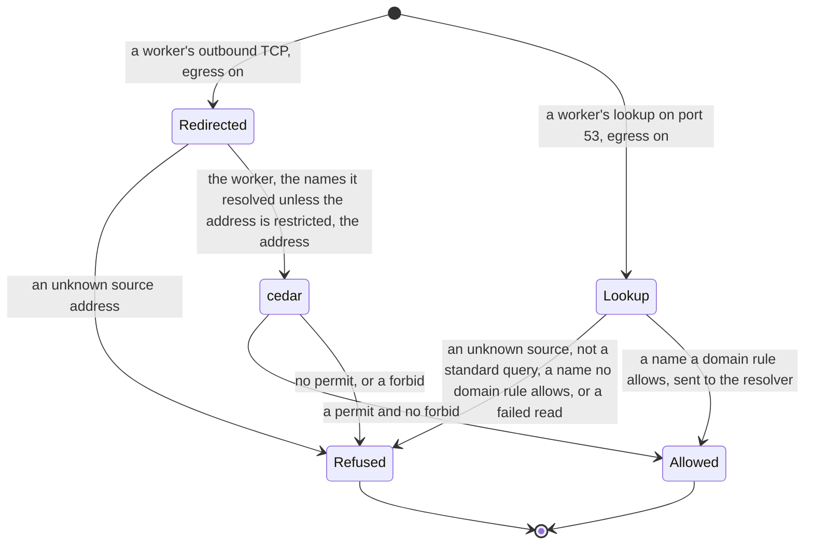

# Egress

Status words and how to read this: [the index](README.md).

Kinds: EgressPolicy.

No worker holds `CAP_NET_RAW`, egress on or off. With egress on, a worker's `eth0` has no IPv6, workers cannot reach each other by
unicast, limited broadcast or multicast, UDP other than DNS is dropped, and a worker's traffic to the node stops at the input
chain (ADR-0115 Scope and Decision, ADR-0117 Consequences, ADR-0318). A domain rule reaches globally reachable addresses only: any
other address, or one on the node, takes a `cidrs` rule that names it, and a name needs a domain rule (ADR-0315, ADR-0317). Who
may act, and Secrets: [Security](security.md). New words: Redirected, Refused, Lookup.

| Where | What happens | Time | You see | Status | Source |
|---|---|---|---|---|---|
| `server.network.egress`, off by default | Off, or not Linux with containerd: workers reach anything and an EgressPolicy does nothing. On: a Function no EgressPolicy covers reaches nothing external | none | on, a refused connection | decided | ADR-0117 Decisions 3 and 6, `TestScenarioDisabledPassthrough`, egress `no-egresspolicy-denies-all` |
| A worker's traffic to the node, egress on | Stops at the input chain, except its replies, the gateway, the forwarder and `server.network.internalAllow`; the node's other traffic is untouched | none | no answer | decided | ADR-0115 Scope, `TestInputChainStopsAWorkersTraffic`, egress `worker-udp-to-the-node-gets-no-answer` |
| A worker's `eth0`, egress on | No IPv6, set before its task starts, and its loopback keeps `::1`. A worker whose setting cannot be written does not start; a kernel with no IPv6 has nothing to write | none | `attach netns for` in the failed Create | decided | ADR-0318 Decision D, `TestScenarioWorkerEth0HasNoIPv6`, `TestScenarioIPv6SettingFailureStopsTheWorker`, egress `worker-eth0-has-no-ipv6` |
| A worker's capabilities | containerd's default list but `CAP_NET_RAW`, egress on or off, for a Function and an engine: a tool that opens a raw socket, such as `ping`, gets a permission error | none | bit 13 clear in the effective set of `/proc/<pid>/status` | decided | ADR-0318 Decision E, `TestScenarioNoWorkerHoldsNetRaw`, egress `worker-lacks-cap-net-raw` |
| A worker's limited broadcast or multicast, egress on | Reaches no sibling, as `funcd_lateral` drops it, and not the node, as the input chain does; a worker's ARP passes | none | no reception | decided | ADR-0318 Decision A, `TestScenarioWorkerTrafficReachesNoSibling`, egress `worker-traffic-reaches-no-sibling` |
| A Function's call to another, egress on | One worker cannot connect to another directly; a Function calls another through `context.invoke` over its local API, for a declared link only | none | a connect times out; with no link, the invoke's 403 | decided | ADR-0115 Decision A, ADR-0064 Decisions 3 and 4, egress `worker-traffic-reaches-no-sibling`, the fn-to-fn run in the ADR-0318 review |
| IPv6 and other bridges' traffic on the node, egress on | Each rule that reads an address matches IPv4 first: another host's IPv6 reaches the node's service, and `funcd_lateral` passes a frame whose IPv4 source is off the worker subnet | none | the service answers | decided | ADR-0318 Decisions A and C, `TestScenarioOtherTrafficStaysUntouched`, `TestEveryAddressRuleMatchesIPv4First` |
| What the node routes, egress on | Takes the forward chain's drop policy, whoever sent it, IPv4 or IPv6; where `br_netfilter` is loaded, so does a frame any bridge of the node switches | none | no answer | accepted | ADR-0115 Decision B, ADR-0318 Consequences, `TestScenarioRulesetProgrammed` |
| A refused connection | It opens, then ends once the gateway has decided: an HTTP 403 on ports 80 and 8080, a plain close on any other | up to `peekTimeout` 500 ms | 403 `egress denied by funcd EgressPolicy`, or a closed socket | decided | ADR-0117 Decision 1, `TestScenarioDecideFlow`, egress `cidr-denies-unlisted-ip` |
| A domain rule | Counts only for a name this worker looked up through funcd, also through a CNAME, until that answer's TTL: a hard-coded address or a cache kept longer is refused | the answer's TTL, at least `minRecordTTL` 1 s | a refused connection | decided | ADR-0117 Decisions 1 and 2, ADR-0315 Decision 2, `TestScenarioDomainsForCorrelationAndWildcard`, `TestScenarioRuleFiresThroughACNAME` |
| A worker that just started | Its connections and lookups are refused until the next sync finds the worker | up to `server.network.workerSyncInterval` 2 s | a refused connection, `unknown source worker <ip>` in the audit record; REFUSED | decided | ADR-0163 scenario `server-keys-pace-shutdown-and-egress-sync`, ADR-0315 Consequences, `TestScenarioServerKeysPaceShutdownAndEgressSync` |
| A domain rule at an address that is not globally reachable | Permits nothing there, whatever the lookup answered: in ADR-0317's table or on the node. A `cidrs` rule that holds it still does, on its ports | none | a refused connection, no `domain` in the audit record | decided | ADR-0317 Decision 1, `TestScenarioDomainRuleGloballyReachableOnly`, `TestScenarioCIDRRuleNamesATableAddress` |
| A registry row marked globally reachable inside an entry of that table, such as `192.0.0.9` or `2001:3::/32` | Counts as its entry does: it takes a `cidrs` rule | none | a refused connection | accepted | ADR-0317 Decision 1, `TestScenarioDomainRuleGloballyReachableOnly` |
| A registry row added after 2026-11-05 | Counts as globally reachable until an amendment adds it to the table | none | an allowed connection | accepted | ADR-0317 Consequences, `TestNotGlobalIsTheDecidedTable` |
| A worker's lookup, egress on | Goes to the resolver only for a name a domain rule applying to the worker allows, exact or `*.`, in host-name characters | none | REFUSED, which libraries report as a temporary name-resolution error | decided | ADR-0315 Decision 2, `TestScenarioLookupAllowedName`, `TestScenarioLookupRefusals` |
| A lookup of a name outside host-name characters | Refused, under a wildcard too: a name holds only letters, digits, `-`, `_` and the dots between labels | none | REFUSED | decided | ADR-0315 Decision 2, `TestScenarioLookupNameOutsideHostCharacters` |
| A lookup from a source that is no worker, or when the EgressPolicies cannot be read | Refused, and nothing goes upstream | none | REFUSED | decided | ADR-0315 Decision 2, `TestScenarioLookupRefusals` |
| A host reached by name under a CIDR rule | Its name needs a domain rule too; by address it needs nothing more | none | REFUSED | accepted | ADR-0315 Consequences, `TestScenarioCIDRRuleNameRefused` |
| A name funcd hands a worker, such as a hostname in `s3gateway.endpoint` | Needs a domain rule like any other name; a worker holds no `/etc/hosts`, so `localhost` needs one too | none | REFUSED | accepted | ADR-0315 Consequences |
| An operator's Cedar `Policy` by domain | Its name needs an EgressPolicy domain rule, as the forwarder reads only those, and it reaches globally reachable addresses only; a `forbid` stops the connection, not the lookup | none | REFUSED | accepted | ADR-0315 Consequences, ADR-0317 Decision 1 |
| The DNS forwarder's listener | Binds the bridge address on UDP and TCP, retried until that address exists, so a lookup before the first worker's bridge fails | `bindRetry` 1 s | `the egress dns forwarder cannot listen yet; retrying each second`, once | decided | ADR-0315 Decision 2, ADR-0238 Decision 3, `TestBuildEgressBindsTheBridgeAddress`, `TestScenarioForwarderWaitsForTheBridge` |
| `runtime.containerd.bridgeAddress` is not the bridge's first address | The kernel's redirect picks that first address, so no lookup reaches the forwarder | none | a failed lookup | accepted | ADR-0315 Consequences |
| A refused lookup's log line | At most one per worker per interval, naming the first name, the reason and how many were held back; sources that are no worker share one | `refusedLookupLogInterval` 10 s | `egress lookup refused` | decided | ADR-0315 Decision 2, `TestScenarioRefusedLookupAudited` |
| `server.network.egress` on and `server.network.dnsForwarderPort` 0 | No forwarder and no gateway run, and a worker's DNS has no rule: nothing goes out, and `server.network.dnsResolver` is not read | none | a failed lookup, a refused connection | decided | ADR-0315 Decision B, `TestScenarioNoForwarderNothingOut` |
| A connection's decision | Logged in funcd's own log, not yet in the function log channel the ADR names | none | `egress decision`, with `allowed=false` and the reason | deferred | ADR-0117 Open questions, egress `blocked-connection-audited` |
| A Lake or SQL engine's outbound TCP, on containerd | Reaches only its one internal endpoint, with `server.network.egress` on or off | none | a failed query; `GatewayEndpointNotAnAddress` if that endpoint is a hostname | decided | ADR-0269 Decisions 1 to 4, `TestScenarioLakeSetsEgressOnly` |
| A start, stop or crash, egress on | The rules go in before any worker runs and stay until the runtime closes; after a crash they stay, so external connections fail until the next start | none | `apply worker egress isolation` if they cannot go in | decided | ADR-0115 Decision, ADR-0117 Constraints, `TestRun_AppliesTheEgressFenceBeforeAnyLoop`, `TestShutdown_KeepsEgressFenceUntilRuntimeClosed` |

<!-- generated values, do not edit: just behavior-values -->

Egress: values

| Value | Default | From |
|---|---|---|
| `bindRetry` | 1s | `internal/network/egress/forwarder.go` |
| `dnsTimeout` | 5s | `internal/network/egress/forwarder.go` |
| `maxPairsPerSource` | 1024 | `internal/network/egress/forwarder.go` |
| `minRecordTTL` | 1s | `internal/network/egress/forwarder.go` |
| `minSweep` | 1024 | `internal/network/egress/forwarder.go` |
| `refusedLookupLogInterval` | 10s | `internal/network/egress/forwarder.go` |
| `peekTimeout` | 500ms | `internal/network/egress/gateway_linux.go` |

<!-- end of generated values -->
