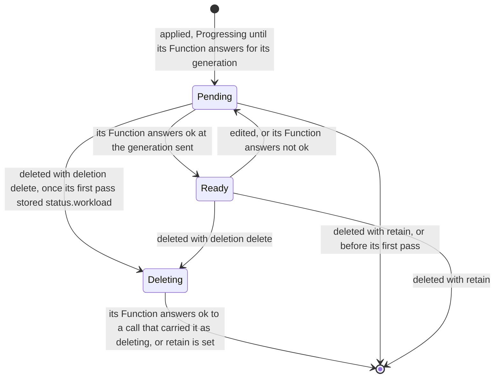

# Engineless kinds

Status words and how to read this: [the index](README.md).

Kinds: none of its own.

An Addon whose kind entry serves `Engineless` adds a kind whose objects run no engine and no image: a Function of each
object's namespace reconciles them, called with its group's list as a settings kind's Function is, and an object with
`deletion: delete` stays at its deletion until that Function has destroyed what it holds (ADR-0345). Such an object is an
AddonObject, served at its kind's plural as any add-on object is ([Addons](addons.md)). `Deleting` is a reason of the
phase Pending, not a phase. The hold's design model: [engineless-delete](../design/addon/engineless-delete.md).

| Where | What happens | Time | You see | Status | Source |
|---|---|---|---|---|---|
| An engineless kind's call | One per group, its namespace, kind and Function, at a time, with the group's full list, deleting objects too, on a goroutine of its own; no pass waits on it | `addons.settingsTimeout` 30 s | a CloudEvent `funcd.addon.objects`, cause `start`, `change` or `retry` | decided | ADR-0345 Decision 2, `TestScenarioEnginelessApply`, `TestScenarioEnginelessGroups` |
| An engineless kind's list sent again | At the kind's `resync`, and at once when a JobRun of the namespace ends, or when the group's call in flight ends | `resync`, `DefaultAddonResync` 10 min | a call with cause `resync` or `run` | decided | ADR-0345 Decisions 1, 2 and 4, `TestScenarioEnginelessResync`, `TestScenarioEnginelessRunEnds` |
| An engineless object's Function | `spec.functions`' entry for the object's own kind, else the kind's `function.ref`: a Function of its namespace, which funcd neither creates nor changes and which binds no object; an http one fails the call | none | `ReconcileFailed` | decided | ADR-0345 Decisions 2 and 3, `TestScenarioEnginelessGroups`, `TestScenarioEnginelessShapeRefused` |
| An engineless object's status | Its first pass stores `status.workload: Engineless` before any call carries it; then `ok` is Ready at the generation sent, else the result's reason, `NoResult` if left out, `ReconcileFailed` for a failed call | none | `Ready`; `Pending`, `Progressing` until the answer, or the Function's reason | decided | ADR-0345 Decisions 1 and 5, `TestScenarioEnginelessApply` |
| An engineless object that cannot be called | Pending, and no call carries it, while its Addon, its pinned revision or its Function is missing | none | `AddonNotFound`, `AddonRevisionNotFound`, `FunctionNotFound` | decided | ADR-0345 Decision 5, `TestScenarioEnginelessWaits` |
| An engineless object deleted | With `deletion: delete` and `status.workload` stored, it is held, `deletionTimestamp` set; lists carry it `deleting: true`, and only its Function's ok to such a call, at its uid, removes it | until that ok | 202; `Deleting`, then the Function's reason | decided | ADR-0345 Decision 6, `TestScenarioEnginelessDeleteHeld`, `TestScenarioEnginelessDeleteInFlight` |
| A deleting object, written or deleted again | A write is stored and keeps `deletionTimestamp`; a DELETE answers 202 with the object again | none | 200; 202 | decided | ADR-0345 Decision 6, `TestEnginelessDeleteAnswersHeld` |
| An engineless object retained | With `retain`, the default, or before its first pass stored `status.workload`, it goes at its deletion, leaves the next list, and its Function forgets it. `retain` set on a deleting one removes it at its next pass, with no call | the next pass | 204 | decided | ADR-0345 Decisions 6 and 7, `TestScenarioEnginelessRetain` |
| A deleting object whose Addon or Function is gone | It waits with that reason until they are back or `retain` is set: a hold has no deadline | none | `AddonNotFound`, `FunctionNotFound` | decided | ADR-0345 Decision 7, `TestScenarioEnginelessWaits` |
| An engineless kind after funcd starts | The calls' state lives in memory: each group's first pass sends its list, deleting objects included, and a hold goes on | the first pass | a call with cause `start` | decided | ADR-0345 Decisions 2 and 6, `TestScenarioEnginelessRestart` |

<!-- generated values, do not edit: just behavior-values -->

Engineless kinds: values

| Value | Default | From |
|---|---|---|

<!-- end of generated values -->
