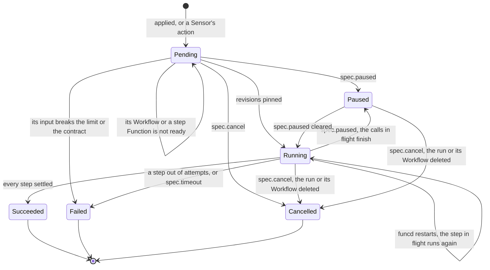

# Eventing

Status words and how to read this: [the index](README.md).

Kinds: EventSource, Sensor, Workflow, WorkflowRun.

A WorkflowRun:

An event takes one path: a source fires, the in-process fan-out hands it to each subscribed Sensor, each action queues one delivery,
and a worker makes it and records one `Invocation`, which no sweep reclaims (ADR-0156 Consequences). A failed step ends the run
fail-fast: running siblings return to `Pending`, descendants are `Skipped`, and `onFailure` runs once and never changes the phase. A pin
holds code, not bindings: a step reads its current bindings, and a paused run with no `spec.timeout` holds its revisions until cancelled
(ADR-0190). `storage.mode: memory` forgets seen lists and dead letters at a restart. A hold's lifecycle: [Disaster recovery](disaster-recovery.md).

| Where | What happens | Time | You see | Status | Source |
|---|---|---|---|---|---|
| A timer due while funcd is down | Skipped: the next fire is the next grid point or cron slot, and a start on one does not fire | none | nothing reports it | accepted | ADR-0182 Decision 3 and Consequences, ADR-0211 Decision 6, `TestScenarioMissedFireSkipped`, `TestScenarioCronNoCatchUp` |
| An event no Sensor is subscribed to | Gone, with no Invocation. A blob object then counts as seen, so a Sensor applied later does not get it | none | nothing reports it | accepted | ADR-0108 Decision 2 and Temporary workarounds, ADR-0157 Decision 6, `TestFanoutRoutesByKey` |
| A new or rewritten object | Fires at the next poll of the whole prefix: a key unseen, or with another ModTime or Size. After a restart the rest stay silent | `eventing.blobPollInterval` 15 s | `data.version` in the event | decided | ADR-0157 Decisions 2 and 6, `TestScenarioRewrittenObjectFiresAgain`, `TestScenarioRestartKeepsEventingState` |
| A source under a hold | A timer fires at most once after the release. Blob objects replay then, unless a platform release names the source in `--advance`. A `sql` change is answered 503, and its engine retries | until the release | `funcdctl hold status` | decided | ADR-0206 Decisions 6 and 8, ADR-0222 Decision 8, ADR-0235 Decision 4, `TestScenarioBlobReplayOrAdvance` |
| A delivery fails | Any failure, a 4xx too, retries, then parks a dead letter and one `Failed` Invocation | `eventing.deliveryAttempts` 3, `eventing.deliveryBackoffInitial` 100 ms doubling to `eventing.deliveryBackoffMax` 10 s; each `invoke.activationTimeout` 30 s + `sensorDeliveryTimeout` 30 s | `funcdctl eventing dlq list` | decided | ADR-0156 Decision 2, `TestActionFailsThenDeadLettered` |
| A `workflow:` action | It succeeds once the run is created: the Invocation reads `Ready`, and a run that later fails or waits reaches no dead letter | none | the run's own phase | decided | ADR-0109 Decision 3, `TestEventStartsWorkflow` |
| A timer faster than its run | Each firing starts its own run: nothing limits their overlap, and a missing Workflow leaves one `Pending` run per firing | none | a growing list of runs | deferred | ADR-0109 Open questions, ADR-0094 Scope, `TestStatelessIndependentFirings` |
| A slow target | It holds only its own slots, so other targets go on, in no promised order. A firing past the Sensor's bound is parked with no attempt | `eventing.maxInFlightPerTarget` 4, `eventing.maxDeliveriesInFlight` 32, `eventing.maxQueuedPerSensor` 4096 | `delivery queue of sensor <ns>/<name> is full` | decided | ADR-0156 Decisions 4, 5 and 9, `TestScenarioFullSensorQueueDeadLetters` |
| A Sensor edited or deleted with deliveries queued | Those whose action changed become dead letters with no further attempt; one in flight that fails is not retried | none | `sensor <ns>/<name> changed with the delivery still queued` | decided | ADR-0156 Decision 8, `TestScenarioSensorEditReleasesBacklog` |
| A dead letter | Nothing redelivers it. A replay is one attempt on the live spec; a sweep evicts it past the retention or as the oldest over the cap, another Sensor's too | `eventing.deadletter.retention` 720 h, `eventing.deadletter.maxEntries` 1000 per namespace | `funcdctl eventing dlq replay <id>` | decided | ADR-0118 Decisions 3 and 5, ADR-0156 Consequences, `TestRetentionEvicts` |
| funcd stops with deliveries queued | Those queued become dead letters, which nothing redelivers at the next start; past the bound the rest are dropped with one log line | `server.shutdownTimeout` 15 s | `daemon shut down with the delivery still queued` | decided | ADR-0156 Decision 7, `TestScenarioShutdownParksQueued`, `TestScenarioShutdownPastBoundDropsWithCount` |
| funcd crashes with deliveries queued | Lost, with no Invocation; a blob object already marked seen does not fire again | none | nothing reports it | deferred | card "Durable Sensor delivery", ADR-0156 Decision 6 and Temporary workarounds |
| A delivery under a hold | One already queued is retried, then parked in under a second, not kept for the release; a replay is refused | `eventing.deliveryAttempts` 3 | `the platform or the namespace is held` | decided | ADR-0206 Decision 6, ADR-0222 Decision 8, `TestEveryRunnerConsultsHoldInNamespace` |
| Before a run starts | `Pending` with no limit, until its Workflow, any child and each step Function's current revision are stamped; then it pins them, no step worker running yet | `controller.referentPollInterval` 2 s | `Ready=False`: `WorkflowNotFound`, `WorkflowNotReady` | decided | ADR-0146 Decision 1, ADR-0190 Decision 2, `TestScenarioStartWaitsForStepCode` |
| A run's input | Over the limit or off the contract, an apply is refused; a run admitted before its Workflow was Ready, or made by a Sensor, ends `Failed` at its start, `onFailure` included | `workflow.payloadLimit` 262144 | `PayloadLimitExceeded`, `InputSchemaMismatch` | decided | ADR-0094 Input model, ADR-0109 Decision 3, `TestIssue181_RunStartGateCapsInput`, `TestRunInputMismatchFailsRun` |
| A step's attempt | Its wake counts. A 5xx, a timeout or a transport error retries; a 4xx or an oversized output fails at once | `workflow.defaultStepTimeout` 300 s, `workflow.defaultRetry` 1, `workflow.defaultRetryBackoff` 0 s, `workflow.maxStepsInFlight` 64 | `returned 503`, `rejected the step (422)` | decided | ADR-0094 Execution, ADR-0146 Decision 7, `TestPerStepTimeoutIsStepFailure` |
| `spec.timeout` | Runs from the run's start, paused time excluded and funcd's downtime not: a resume past it fails at once. It ends the run and fires `onFailure` | `spec.timeout`; unset means none | `Failed`, `RunTimedOut` | decided | ADR-0096 Decision, ADR-0094 Failure, `TestRunTimeoutFails`, `TestIssue177_PausedTimeExcludedFromRunTimeout` |
| `spec.timeout` across a hold | A hold does not stop the clock: a run with a record, resumed after it, can fail at once, with no step called and `onFailure` fired | none | `RunTimedOut` | **uncovered** | ADR-0096's formula subtracts paused time only; ADR-0206 Decision 6 restarts an App's deadline at a release and names no run's; read ADR-0094, ADR-0146, ADR-0222, #177; no test |
| `spec.cancel` | Closes the calls in flight and ends the run with no retry and no `onFailure`; a late answer is discarded, and a cancelled call may have done its work | the next pass | `cancelled while running (spec.cancel); the step's call may have completed` | decided | ADR-0146 Decision 3 and Consequences, `TestIssue27_CancelAbandonsInFlightStep` |
| The Workflow is edited mid-run | The run keeps the spec, children and step revisions it pinned at its start, a removed step's Function too; a new run takes the new ones. An old revision boots a solo worker | `stepIdleTimeout` 5 min idle | `status.pins` | decided | ADR-0190 Decisions 1, 6 and 7, `TestIssue776_EditMidRunKeepsOldCode`, `TestScenarioRemovedStepStillRuns` |
| The Workflow is deleted or re-created | A started run is cancelled and one not started stays `Pending`. A deleted `function.ref` target fails its step, with no fallback | `controller.referentPollInterval` 2 s | `Cancelled`; the step: `pinned revision "<rev>" of function <ns>/<name>` | decided | ADR-0190 Decisions 4 and 10, `TestScenarioWorkflowDeleteCancelsRuns`, `TestScenarioRefStepBound` |
| funcd stops or crashes mid-run | The run stays `Running`. A stop lets calls finish until the bound; a cut call runs again at its next attempt, even past `maxAttempts`; a `wait` restarts from zero, an inline child from its start | `server.shutdownTimeout` 15 s | a higher `X-Funcd-Attempt` | decided | ADR-0146 Decisions 6 and 8, `TestScenarioRestartResumesInFlightRun` |
| A run funcd is not driving, under a hold | Nothing starts, resumes or replays, the status stays and a `spec.cancel` waits; a run created meanwhile starts after the release. A platform restore brings each open run back `Paused` | until the release | `funcdctl workflow resume` | decided | ADR-0206 Decisions 6 and 7, ADR-0222 Decision 8, `TestScenarioRunsHeldAsEvidence` |
| A run funcd is driving when a hold begins | It is not stopped: its next step is still dispatched, and its record can reach `Succeeded` during the hold | until it ends | `Running` until the release | **differs** | ADR-0290 Decision 1 says dispatch waits, citing `reconcile_run.go`, which gates only a pass; ran a probe; no issue or card |
| A closed run | Its record and its object go past the retention, and an open run never does; a deleted run's record ends `Cancelled` first | `workflow.retention` 720 h, swept at most `maxRetentionSweep` 1 h apart | gone from `funcdctl workflow runs` | decided | ADR-0094 Execution, `TestIssue67_RetentionSweepsWorkflowRuns`, `TestIssue726_SweepCancelsRecordOfDeletedRun` |

<!-- generated values, do not edit: just behavior-values -->

Eventing: values

| Value | Default | From |
|---|---|---|
| `eventing.blobPollInterval` | 15s | config |
| `eventing.bucketRecheckInterval` | 15s | config |
| `eventing.deadletter.maxEntries` | 1000 | config |
| `eventing.deadletter.retention` | 720h | config |
| `eventing.deliveryAttempts` | 3 | config |
| `eventing.deliveryBackoffInitial` | 100ms | config |
| `eventing.deliveryBackoffMax` | 10s | config |
| `eventing.eventstore.dataDir` | <dataDir>/eventstore | config |
| `eventing.maxDeliveriesInFlight` | 32 | config |
| `eventing.maxInFlightPerTarget` | 4 | config |
| `eventing.maxQueuedPerSensor` | 4096 | config |
| `workflow.artifactPollInterval` | 5s | config |
| `workflow.dataDir` | <dataDir>/workflow | config |
| `workflow.defaultRetry` | 1 | config |
| `workflow.defaultRetryBackoff` | 0s | config |
| `workflow.defaultStepTimeout` | 300s | config |
| `workflow.maxStepsInFlight` | 64 | config |
| `workflow.payloadLimit` | 262144 | config |
| `workflow.retention` | 720h | config |
| `readyTimeout` | 10s | `internal/bus/nats/nats.go` |
| `defaultBlobPollInterval` | 15s | `internal/eventing/blobwatch.go` |
| `blockCacheSize` | 16MiB | `internal/eventing/deadletter/badger/badger.go` |
| `indexCacheSize` | 16MiB | `internal/eventing/deadletter/badger/badger.go` |
| `memTableSize` | 16MiB | `internal/eventing/deadletter/badger/badger.go` |
| `valueLogFileSize` | 64MiB | `internal/eventing/deadletter/badger/badger.go` |
| `bucketRecheckInterval` | 15s | `internal/eventing/eventing.go` |
| `runTick` | 25ms | `internal/eventing/eventing.go` |
| `gcInterval` | 5m | `internal/eventing/eventstore/eventstore.go` |
| `maxRecord` | 64MiB | `internal/eventing/eventstore/eventstore.go` |
| `partSize` | 512KiB | `internal/eventing/eventstore/eventstore.go` |
| `evalTimeout` | 100ms | `internal/expr/eval.go` |
| `maxStringLen` | 1MiB | `internal/expr/eval.go` |
| `resultMargin` | 1MiB | `internal/expr/eval.go` |
| `maxErrorBody` | 1KiB | `internal/sensor/invoker.go` |
| `retryBaseDelay` | 100ms | `internal/sensor/retry.go` |
| `retryMaxDelay` | 10s | `internal/sensor/retry.go` |
| `defaultDeliveryAttempts` | 3 | `internal/sensor/sensor.go` |
| `defaultMaxDeliveriesInFlight` | 32 | `internal/sensor/sensor.go` |
| `defaultMaxInFlightPerTarget` | 4 | `internal/sensor/sensor.go` |
| `defaultMaxQueuedPerSensor` | 4096 | `internal/sensor/sensor.go` |
| `errBodyMax` | 256 | `internal/workflow/dispatch.go` |
| `maxRetryBackoff` | `time.Duration(v1.MaxRetryBackoff)` | `internal/workflow/engine.go` |
| `maxStatusError` | 512 | `internal/workflow/engine.go` |
| `linkAttempts` | 5 | `internal/workflow/reconcile_run.go` |
| `waitRequeue` | 2s | `internal/workflow/reconcile_run.go` |
| `contractRequeue` | 5s | `internal/workflow/reconcile_workflow.go` |
| `stepIdleTimeout` | 5m | `internal/workflow/reconcile_workflow.go` |
| `blockCacheSize` | 16MiB | `internal/workflow/runstate/badger/badger.go` |
| `indexCacheSize` | 16MiB | `internal/workflow/runstate/badger/badger.go` |
| `memTableSize` | 16MiB | `internal/workflow/runstate/badger/badger.go` |
| `valueLogFileSize` | 64MiB | `internal/workflow/runstate/badger/badger.go` |

<!-- end of generated values -->
