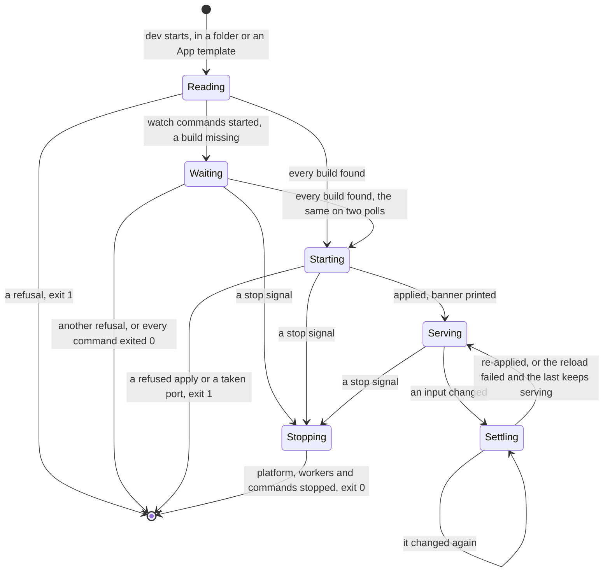

# funcdctl dev

Status words and how to read this: [the index](README.md).

Kinds: none of its own.

`funcdctl dev` is the real platform on `funcd.InMemory()` and the [process driver](workers.md), on loopback (ADR-0254). A folder of
resource files runs as ADR-0247 says; a directory with `app.yaml` beside `resources/` runs as an App (ADR-0253), and only there do
`dev.watch` and `dev.liveReload` work. The banner prints once the objects are applied, not once they serve (ADR-0253 Decisions 8 and 11).
Phases: [Functions](functions.md). New words: Reading, Waiting, Starting, Serving, Settling, Stopping.

| Where | What happens | Time | You see | Status | Source |
|---|---|---|---|---|---|
| A second dev in one project | Refused before the platform starts: a project has one process registry. Without `--persist` it sits in the user cache dir, keyed by the project's path | none | `registry <dir>/workers.json is held by another process` | accepted | ADR-0167 Decisions 2 and 3, Consequences, `TestRegistryLockIsExclusive` |
| A build a watch command has not written | Dev waits with no bound while a command runs. Any other refusal stops it once it holds on two polls, and so does a miss once every command exited 0 | no bound, read each `devReloadPoll` 300 ms | `waiting for images.web: web/dist is absent`, once per miss | decided | ADR-0255 Decision 2, `TestScenarioDevWatchWaits` |
| A watch command exits non-zero | Started again for ever, what remains of its group killed first. A run of 30 s or more resets the delay. An exit 0 is final | `devWatchFirstDelay` 1 s, doubling to `devWatchMaxDelay` 30 s | `web exited 3; restarting in 1s`, then its last 20 lines as `web \| <line>`; `web finished` | decided | ADR-0255 Decision 3, `TestDevRestartDelay` |
| What a watch command prints | Goes to its log file, emptied when dev starts. A burst reaches the terminal only when no build the command owns was written during it | a burst ends after `devWatchQuiet` 3 s, or `devWatchBuiltQuiet` 1 s once a build was written | `web \| build error: broken` | decided | ADR-0256 Decisions 1 and 3, `TestScenarioDevWatchBursts` |
| An error a burst hides | A command that writes at least every 3 s never ends a burst, and a failure within 1 s of a build's last line joins that build's burst, so nothing prints | none | only the log file the banner names | accepted | ADR-0256 Consequences, `TestDevBurst` |
| A save | Once an input changed and reads the same on two polls, dev applies again, and a rebuild rolls a new revision | `devReloadPoll` 300 ms, twice | folder mode: only the new worker's `funcd-shim: listening on`; App: `pushed images.api as <repo>:<tag>@<digest> in <d>`, `reloaded in <d>` | decided | ADR-0247 Decision 8, ADR-0253 Decision 9, `TestIssue1118_FolderDevWaitsForABuildToSettle` |
| A saved build that cannot load | The old revision keeps the calls and the phase, and the new one is not tried again until the next save. With none serving yet: `Failed`, and calls get 503 | none | `funcd-shim: shape error: <message>`; `RevisionReady=False` | decided | ADR-0143 Decisions 4.5 and 5, `TestScenarioFailedRevisionKeepsOldServing` |
| That build in an App part with a worker | The revision waits and the last one serves; a new save replaces it at once | `app.upgradeTimeout` 5 min before the line | `Function/<part> Pending ShapeInvalid`, then `the new revision did not become current; save a fix, or run funcdctl app retry` | decided | ADR-0253 Decision 8 and Contracts, `TestScenarioAppDevFailedRevision` |
| An App part with no worker | Dev changes no replica, so a part sleeps until its first call. A save boots nothing, so `reloaded` prints even for a build that cannot load | a cold start | `Function/<part> NotStarted NotStarted`; 503 `function default/<part> is Failed (ShapeInvalid)` | decided | ADR-0253 Decision 4, ADR-0143 Scenarios, `TestScenarioIdleFunctionStartsNewRevisionOnWake` |
| An input that does not load | Printed once and tried again at the next change, and the last state keeps serving | none | `reload failed`; App: `reload failed; the last App keeps running` | decided | ADR-0253 Decision 9, `TestAppDevFailedReloadKeepsServing`, `TestDevReloadSeesANewFileFixedAfterAFailedLoad` |
| A Site build that cannot be pushed | In a reload, its last pushed image stays, the other parts reload and no page reloads | none | `images.web: web/dist is empty; keeping its last build` | decided | ADR-0257 Decisions 1 and 2, `TestScenarioDevSiteLastBuild` |
| A build deleted in folder mode | Its entry file alone gone: no reload, no line. `dist/` gone, or the entry and its contract: `reload failed` each poll. The last revision serves | until a build is back; `devReloadPoll` 300 ms | nothing, or `reload failed` | **uncovered** | ADR-0247 Decision 8 and #1118 name a changed build only, ADR-0257 Scope leaves folder mode out; no test or card; ran it |
| A contract outside the funcd profile | Folder mode delivers it and serves; App mode and `funcdctl push` refuse it | none | `the contract file's input is outside the funcd profile` | **uncovered** | ADR-0247 Constraints gate at push, its Decisions 4 to 6 name no gate in dev, ADR-0253 Decision 3 pushes, ADR-0125 Decision 3; no issue; ran both |
| No isolation | Workers run as your user on the host, with no sandbox, no egress control and no enforced limit | none | `⚠ egress is NOT isolated in dev — this is not where you validate confidentiality` | accepted | ADR-0125 Scope and Consequences, `TestScenarioDevEgressNotIsolated` |
| Folder mode's write grant | Each Function gets a write-only Role on the namespace, which a deploy does not give it. An App gets none | none | a write that works here can get 403 once deployed | decided | ADR-0128 Decision 2, ADR-0253 Decision 4, `TestScenarioDevWriterGrant` |
| An App's hooks | Dropped unless `--hooks`, so a migration a hook runs does not run | none | no hook line, and no table the hook makes | decided | ADR-0253 Decision 4, `TestScenarioAppDevHooksOptIn` |
| A Lake | Served by the embedded DuckDB CLI, not the production shim and its saves. A build without it logs and stays not ready | none | `lake engine not embedded in this dev build — lake unavailable` | deferred | ADR-0125 Decision 5, card "Dev catalog engine: converge on the prod duckdb shim.py vs the embedded CLI+SQL devengine?", `TestConvergeNotBundledReportsUnavailable` |
| A stop | SIGINT, SIGTERM or SIGHUP: the HTTP drain, each worker's SIGTERM then SIGKILL, then each watch command's. A call in flight holds it, then gets a 503 | `server.shutdownTimeout` 15 s, then `runtime.process.stopGrace` 3 s for workers and commands | `platform stopping`, exit 0 | decided | ADR-0255 Decision 3, `TestScenarioDevWatchStop`, `TestIssue700_DevHangupStopsWorkers` |
| A second Ctrl-C | Ignored: the handler stays set until the stop ends, so only a kill cuts a 15 s drain short | the stop's budget | nothing | **uncovered** | `RunE` in `cmd/funcdctl/dev.go`; no word in ADR-0125, 0126, 0167 or 0255; the question of [Platform lifecycle](platform-lifecycle.md)'s row; searched issues; ran three SIGINTs, exit at 15 s |
| Dev is killed | Its workers and watch commands run on until the next start, which stops them before anything else | until the next start; `runtime.process.stopGrace` 3 s | processes with no dev | accepted | ADR-0167 Decisions 2 and 5, Risks accepted, ADR-0255 Decision 3, `TestDevRestartWithoutPersistReaps`, `TestScenarioDevWatchCrashReap` |
| A control command's wait | No limit: the client has no timeout, so a server that accepts and never answers holds the command until you interrupt it | no limit | nothing | **uncovered** | `http.DefaultClient` in `pkg/sdk/sdk.go`; ADR-0024 Decision 1 and Contracts name it, not the wait; ADR-0042 is silent; ADR-0217 Decision 8 speaks only of `app deploy`; no issue, card; ran `get`, killed at 6 s |
| A refusal | One line on standard error and exit 1, or 3 when `backup plan` finds an RTO impossible; the server's message comes back under `sdk` | none | `funcdctl: sdk: store.Get: Function "nope" not found` | decided | ADR-0024 Decision 2, ADR-0223 Decision 6, `TestScenarioCLIDelete`, `TestScenarioRTOImpossible` |

<!-- generated values, do not edit: just behavior-values -->

funcdctl dev: values

| Value | Default | From |
|---|---|---|
| `deployPoll` | 1s | `cmd/funcdctl/app.go` |
| `devReloadPoll` | 300ms | `cmd/funcdctl/dev.go` |
| `devS3PortAttempts` | 3 | `cmd/funcdctl/dev.go` |
| `appRevisionTimeout` | 2s | `cmd/funcdctl/dev_app.go` |
| `devFollowPoll` | 100ms | `cmd/funcdctl/dev_app.go` |
| `devBlobPollInterval` | 1s | `cmd/funcdctl/devconfig.go` |
| `devHandOutSettle` | 250ms | `cmd/funcdctl/devconfig.go` |
| `devSegmentMaxAge` | 1s | `cmd/funcdctl/devconfig.go` |
| `devVolumeMeasureInterval` | 30s | `cmd/funcdctl/devconfig.go` |
| `liveReloadHeaderTimeout` | 5s | `cmd/funcdctl/devlivereload.go` |
| `devWatchBuiltQuiet` | 1s | `cmd/funcdctl/devwatch.go` |
| `devWatchFirstDelay` | 1s | `cmd/funcdctl/devwatch.go` |
| `devWatchGrace` | `process.DefaultStopGrace` | `cmd/funcdctl/devwatch.go` |
| `devWatchMaxDelay` | 30s | `cmd/funcdctl/devwatch.go` |
| `devWatchQuiet` | 3s | `cmd/funcdctl/devwatch.go` |
| `devWatchTail` | 64KiB | `cmd/funcdctl/devwatch.go` |
| `maxDevWatchLastLines` | 20 | `cmd/funcdctl/devwatch.go` |
| `applyAttempts` | 5 | `cmd/funcdctl/workflow.go` |

<!-- end of generated values -->
