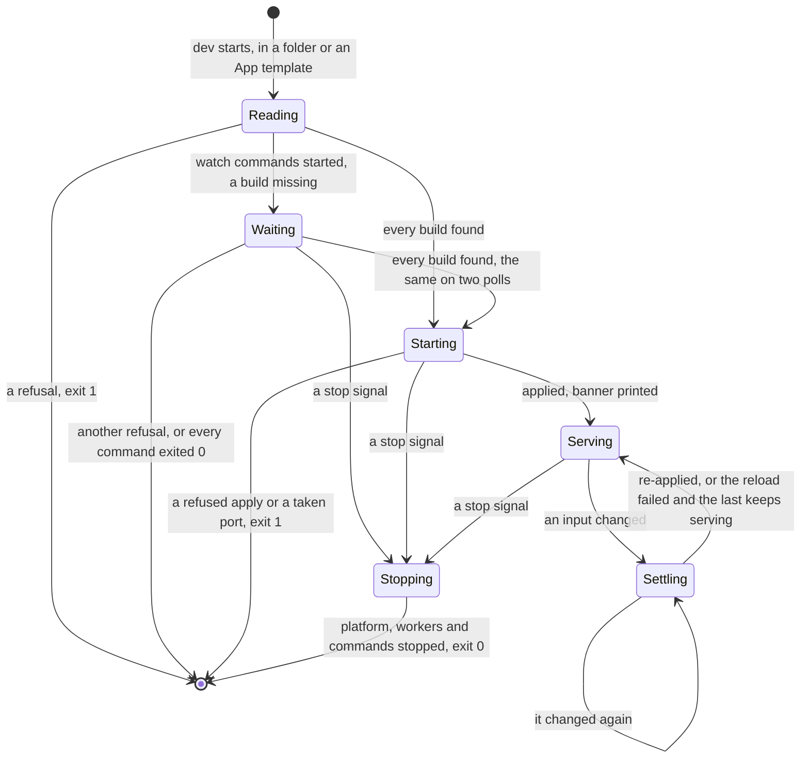

# funcdctl dev

Status words and how to read this: [the index](README.md).

Kinds: none of its own.

`funcdctl dev` is the real platform on `funcd.InMemory()` and the [process driver](workers.md), on loopback (ADR-0254). A folder of
resource files runs as ADR-0247 says; a directory with `app.yaml` beside `resources/` runs as an App (ADR-0253), and only there do
`dev.watch` and `dev.liveReload` work. The banner prints once the objects are applied, not once they serve (ADR-0253 Decisions 8 and 11).
Phases: [Functions](functions.md). New words: Reading, Waiting, Starting, Serving, Settling, Stopping.

| Where | What happens | Time | You see | Status | Source |
|---|---|---|---|---|---|
| A second dev in one project | Refused before the platform starts: a project has one process registry. Without `--persist` it sits in the user cache dir, keyed by the project's path | none | `registry <dir>/workers.json is held by another process` | accepted | ADR-0167 Decisions 2 and 3, Consequences, `TestRegistryLockIsExclusive` |
| A build a watch command has not written | Dev waits with no bound while a command runs. Any other refusal stops it once it holds on two polls, and so does a miss once every command exited 0 | no bound, read each `devReloadPoll` 300 ms | `waiting for images.web: web/dist is absent`, once per miss | decided | ADR-0255 Decision 2, `TestScenarioDevWatchWaits` |
| A watch command exits non-zero | Started again for ever, what remains of its group killed first. A run of 30 s or more resets the delay. An exit 0 is final | `devWatchFirstDelay` 1 s, doubling to `devWatchMaxDelay` 30 s | `web exited 3; restarting in 1s`, then its last 20 lines as `web \| <line>`; `web finished` | decided | ADR-0255 Decision 3, `TestDevRestartDelay` |
| What a watch command prints | Goes to its log file, emptied when dev starts. A burst reaches the terminal only when no build the command owns was written during it | a burst ends after `devWatchQuiet` 3 s, or `devWatchBuiltQuiet` 1 s once a build was written | `web \| build error: broken` | decided | ADR-0256 Decisions 1 and 3, `TestScenarioDevWatchBursts` |
| An error a burst hides | A command that writes at least every 3 s never ends a burst, and a failure within 1 s of a build's last line joins that build's burst, so nothing prints | none | only the log file the banner names | accepted | ADR-0256 Consequences, `TestDevBurst` |
| What an add-on engine prints | Goes to its log file, `logs/<namespace>/<plural>.<name>.log`, and to dev's store; the terminal shows none of it, only the file's path once, and lines written while dev stops are lost | none | `engine echoservice/echo: <file>` | decided | ADR-0342 Decision 5, `TestScenarioEngineLogsDev` |
| What dev's Lake and SQL engines print | Each line goes to dev's store, read with `funcdctl logs lake/<name>` or `sqldatabase/<name>`; the terminal shows none, a SQL engine's lines are kept as stderr, and lines written while dev stops are lost | none | `funcdctl logs sqldatabase/todo-db` | decided | ADR-0343 Decision 5, `TestScenarioEngineLogsDevLakeSQL` |
| A save | Once an input changed and reads the same on two polls, dev applies again, and a rebuild rolls a new revision | `devReloadPoll` 300 ms, twice | folder mode: only the new worker's `funcd-shim: listening on`; App: `pushed images.api as <repo>:<tag>@<digest> in <d>`, `reloaded in <d>` | decided | ADR-0247 Decision 8, ADR-0253 Decision 9, `TestIssue1118_FolderDevWaitsForABuildToSettle` |
| A saved build that cannot load | The old revision keeps the calls and the phase, and the new one is not tried again until the next save. With none serving yet: `Failed`, and calls get 503 | none | `funcd-shim: shape error: <message>`; `RevisionReady=False` | decided | ADR-0143 Decisions 4.5 and 5, `TestScenarioFailedRevisionKeepsOldServing` |
| That build in an App part with a worker | The revision waits and the last one serves; a new save replaces it at once | `app.upgradeTimeout` 5 min before the line | `Function/<part> Pending ShapeInvalid`, then `the new revision did not become current; save a fix, or run funcdctl app retry` | decided | ADR-0253 Decision 8 and Contracts, `TestScenarioAppDevFailedRevision` |
| An App part with no worker | Dev changes no replica, so a part sleeps until its first call. A save boots nothing, so `reloaded` prints even for a build that cannot load | a cold start | `Function/<part> NotStarted NotStarted`; 503 `function default/<part> is Failed (ShapeInvalid)` | decided | ADR-0253 Decision 4, ADR-0143 Scenarios, `TestScenarioIdleFunctionStartsNewRevisionOnWake` |
| An input that does not load | Printed once and tried again at the next change, and the last state keeps serving | none | `reload failed`; App: `reload failed; the last App keeps running` | decided | ADR-0253 Decision 9, `TestAppDevFailedReloadKeepsServing`, `TestDevReloadSeesANewFileFixedAfterAFailedLoad` |
| A Site build that cannot be pushed | In a reload, its last pushed image stays, the other parts reload and no page reloads | none | `images.web: web/dist is empty; keeping its last build` | decided | ADR-0257 Decisions 1 and 2, `TestScenarioDevSiteLastBuild` |
| A build deleted in folder mode | Its entry file alone gone: no reload, no line. `dist/` gone, or the entry and its contract: `reload failed` each poll. The last revision serves | until a build is back; `devReloadPoll` 300 ms | nothing, or `reload failed` | **uncovered** | ADR-0247 Decision 8 and #1118 name a changed build only, ADR-0257 Scope leaves folder mode out; no test or card; ran it |
| A contract outside the funcd profile | Folder mode delivers it and serves; App mode and `funcdctl push` refuse it | none | `the contract file's input is outside the funcd profile` | **uncovered** | ADR-0247 Constraints gate at push, its Decisions 4 to 6 name no gate in dev, ADR-0253 Decision 3 pushes, ADR-0125 Decision 3; no issue; ran both |
| No isolation | Workers run as your user on the host, with no sandbox, no egress control and no enforced limit | none | `⚠ egress is NOT isolated in dev — this is not where you validate confidentiality` | accepted | ADR-0125 Scope and Consequences, `TestScenarioDevEgressNotIsolated` |
| An add-on object under dev | No ADR-0269 fence: its loopback port serves every path, `privatePaths` included, to any local process; `resources` set no limit; the Docker driver pulls with no credentials, so a private image is pulled first with `docker pull` | none | `the runtime does not enforce these CPU and memory limits`, once per object | accepted | ADR-0334 Decision 2, ADR-0291 Decision 1 |
| An engine's environment under nerdctl | Sent in an env file on nerdctl's standard input, which holds no line break, so a value with one, a Secret's included, goes on its command line, in the process list while the engine starts; Docker gets each value in its API request | none | the value in `ps` | accepted | ADR-0334 Decision 1, the decider's choice of 2026-11-21 |
| The add-on runtime under dev | Docker on the first socket that answers, else nerdctl unless `dev.addons.runtime` names one. It runs the add-on engines and the workers on an Addon's runtime | none | `funcd-dev-addon-<key>-…` and `funcd-dev-worker-<key>-…` in `docker ps` | decided | ADR-0334 Decision 1, ADR-0346 Decision 4, `TestScenarioDevAddonRuntimeChoice`, `TestScenarioDevAddonWorker` |
| Neither engine under dev | An add-on object waits `RuntimeUnavailable` | none | `no container engine runs add-on engines: <what dev tried>` | decided | ADR-0334 Decision 1, `TestScenarioDevAddonRuntimeChoice` |
| Two projects' add-on engines | An engine and a volume per object and project: each project's dev runs its own, and stopping one leaves the other serving | none | a `funcd-dev-addon-<key>-…` container per project | decided | ADR-0334 Decision 6, `TestScenarioDevAddonTwoProjects` |
| Registering an Addon under dev | Dev's admin token applies the folder's or `--apply`'s Addons first, with no namespace, and deletes them after their objects; any registry is allowed. `funcdctl --token funcd-dev-admin-token` registers one | none | 403 `may not act on cluster-scoped kind` with dev's developer token | decided | ADR-0334 Decision 5, `TestScenarioDevAddonRegister` |
| An add-on kind's image under dev | Its contract is read from its registry and its Function's bundle pulled from there, in a folder and in an App template, as on a server; a folder's own builds run from their paths | a pull | the Function `<object>-<kind>` `Ready` | decided | ADR-0358 Decision 4, `TestScenarioAddonFunctionDev` |
| A template's `addon.yaml` under dev | Applied with dev's admin token before the App, again at a reload that changes it, and deleted once the file goes; one that adds no kind is refused | none | the Addon's spec; exit 1 `adds no kind` | decided | ADR-0337 Decision 2, ADR-0344 Decision 10, `TestScenarioAddonTemplateDev`, `TestScenarioAddonTemplateNeedsKind` |
| A worker on an Addon's runtime | Runs its Revision's image on dev's container engine, its bundle copied into a read-only volume of its own; every other worker runs on the process driver | a container start and a bundle copy | `funcd-dev-worker-<key>-<hash>` in `docker ps` | decided | ADR-0346 Decisions 2 to 4 and 8, `TestScenarioDevAddonWorker` |
| Such a worker's bundle | The one for its engine's platform, on a Mac too | none | `node local runs linux/arm64` | decided | ADR-0145 Decision 6, `TestScenarioDevAddonWorkerPlatform` |
| Such a worker's network | On a Linux host, that host's, on its loopback; in a VM its port is published on 127.0.0.1 and funcd is `funcd.host`. A rootless engine runs none | none | `its host network is not this host's` | decided | ADR-0346 Decision 5, `TestScenarioDevAddonWorkerLinux`, `TestWorkersReachTheHostOfTheirVM`, `TestWorkersRefuseAnEngineWithoutTheHostsNetwork` |
| What such a worker prints | Its records arrive as stdout lines, without their fields; an exit code above 128 reads as a signal | none | `funcdctl job logs <run>` | accepted | ADR-0346 Decision 4 and Consequences, `TestScenarioDevAddonWorkerOutput` |
| A dev container worker's local API | A listener of its own on 127.0.0.1 at `FUNCD_INVOKE_URL`; each request carries `FUNCD_INVOKE_TOKEN` in `X-Funcd-Invoke-Token`, checked and stripped. Any local user, and on colima any container in the VM, reaches the port | none | 403 with another token or none | accepted | ADR-0346 Decision 6 and Consequences, `TestScenarioDevAddonWorkerBindings` |
| A dev container worker's environment | No host path: `DUCKDB_EXTENSION_DIRECTORY` holding dev's DuckDB extension folder, which a Lake's process worker gets, is left out, as on containerd; a bound config key of that name stays (ADR-0306 Decision 3) | none | no dev folder in `docker inspect` | decided | ADR-0346 Decision 2, decided by delegation 2026-11-24, `TestDevAddonWorkerSpec` |
| An engineless object under dev | Held at its deletion as on a server while dev runs, and with `--persist` across its restarts; without it, it goes with dev's store and what its Function manages stays, as with `retain` | while dev runs | `Deleting` | decided | ADR-0345 Consequences |
| An Addon's change under dev | Every add-on object follows the current revision, an App's part too, so a changed `addon.yaml` runs at the next reload, with no hook around it | the next pass | `status.addonRevision` | decided | ADR-0339 Decision 7, `TestScenarioAddonTemplateDev` |
| Folder mode's write grant | Each Function gets a write-only Role on the namespace, which a deploy does not give it. An App gets none | none | a write that works here can get 403 once deployed | decided | ADR-0128 Decision 2, ADR-0253 Decision 4, `TestScenarioDevWriterGrant` |
| An App's hooks | Dropped unless `--hooks`, so a migration a hook runs does not run | none | no hook line, and no table the hook makes | decided | ADR-0253 Decision 4, `TestScenarioAppDevHooksOptIn` |
| A Lake | Served by the embedded DuckDB CLI, not the production shim and its saves. A build without it logs and stays not ready | none | `lake engine not embedded in this dev build — lake unavailable` | deferred | ADR-0125 Decision 5, card "Dev catalog engine: converge on the prod duckdb shim.py vs the embedded CLI+SQL devengine?", `TestConvergeNotBundledReportsUnavailable` |
| A Lake write that needs a Parquet file | The engine's S3 secret holds its issued key pair, so the file goes through dev's S3 gateway to the Lake's prefix. A small write stays in the catalog | none | the file in dev's blob store | decided | ADR-0130 Decision 3 and scenario `dev-catalog-query-writes-gold`, ADR-0270 Decision 5, `TestIssue1414_DevEngineCreatesItsS3SecretFromTheIssuedKeyPair` |
| A stop | SIGINT, SIGTERM or SIGHUP: the HTTP drain, each worker's SIGTERM then SIGKILL, each watch command's and add-on engine's. A call in flight holds it, then gets a 503 | `server.shutdownTimeout` 15 s, then `runtime.process.stopGrace` 3 s for workers and commands | `platform stopping`, exit 0 | decided | ADR-0255 Decision 3, `TestScenarioDevWatchStop`, `TestIssue700_DevHangupStopsWorkers` |
| An add-on engine at a stop | Once the platform has stopped, every engine at once, then each container removed, and its volume too unless `--persist` | `stopGrace` 10 s | no container or volume of the session's key | decided | ADR-0334 Decision 7, `TestScenarioDevAddonData` |
| A second Ctrl-C | Ignored: the handler stays set until the stop ends, so only a kill cuts a 15 s drain short | the stop's budget | nothing | **uncovered** | `RunE` in `cmd/funcdctl/dev.go`; no word in ADR-0125, 0126, 0167 or 0255; the question of [Platform lifecycle](platform-lifecycle.md)'s row; searched issues; ran three SIGINTs, exit at 15 s |
| Dev is killed | Its workers, watch commands and add-on engines run on until the next start, which stops them before anything else | until the next start; `runtime.process.stopGrace` 3 s | processes with no dev | accepted | ADR-0167 Decisions 2 and 5, Risks accepted, ADR-0255 Decision 3, `TestDevRestartWithoutPersistReaps`, `TestScenarioDevWatchCrashReap` |
| An add-on engine after a kill | The next start removes the key's containers, helpers included, before anything converges, and without `--persist` its volumes, quarantine entries included | until the next start | no container of the killed run | decided | ADR-0334 Decision 7, `TestScenarioDevAddonCrashReaped` |
| Leftover dev workers | The next start removes the killed run's worker containers and volumes, under `--persist` too, which keeps the engines' volumes only; a stop removes them | until the next start | no `funcd-dev-worker-<key>-…` of the killed run | decided | ADR-0346 Decision 7, `TestScenarioDevAddonWorkerReap`, `TestWorkersReapOnlyTheirRole` |
| A control command's wait | No limit: the client has no timeout, so a server that accepts and never answers holds the command until you interrupt it | no limit | nothing | **uncovered** | `http.DefaultClient` in `pkg/sdk/sdk.go`; ADR-0024 Decision 1 and Contracts name it, not the wait; ADR-0042 is silent; ADR-0217 Decision 8 speaks only of `app deploy`; no issue, card; ran `get`, killed at 6 s |
| A refusal | One line on standard error and exit 1, or 3 when `backup plan` finds an RTO impossible; the server's message comes back under `sdk` | none | `funcdctl: sdk: store.Get: Function "nope" not found` | decided | ADR-0024 Decision 2, ADR-0223 Decision 6, `TestScenarioCLIDelete`, `TestScenarioRTOImpossible` |

<!-- generated values, do not edit: just behavior-values -->

funcdctl dev: values

| Value | Default | From |
|---|---|---|
| `addonPoll` | 200ms | `cmd/funcdctl/app.go` |
| `deployPoll` | 1s | `cmd/funcdctl/app.go` |
| `devReloadPoll` | 300ms | `cmd/funcdctl/dev.go` |
| `devS3PortAttempts` | 3 | `cmd/funcdctl/dev.go` |
| `appRevisionTimeout` | 2s | `cmd/funcdctl/dev_app.go` |
| `devFollowPoll` | 100ms | `cmd/funcdctl/dev_app.go` |
| `devBlobPollInterval` | 1s | `cmd/funcdctl/devconfig.go` |
| `devHandOutSettle` | 250ms | `cmd/funcdctl/devconfig.go` |
| `devSegmentMaxAge` | 1s | `cmd/funcdctl/devconfig.go` |
| `devVolumeMeasureInterval` | 30s | `cmd/funcdctl/devconfig.go` |
| `liveReloadHeaderTimeout` | 5s | `cmd/funcdctl/devlivereload.go` |
| `devWatchBuiltQuiet` | 1s | `cmd/funcdctl/devwatch.go` |
| `devWatchFirstDelay` | 1s | `cmd/funcdctl/devwatch.go` |
| `devWatchGrace` | `process.DefaultStopGrace` | `cmd/funcdctl/devwatch.go` |
| `devWatchMaxDelay` | 30s | `cmd/funcdctl/devwatch.go` |
| `devWatchQuiet` | 3s | `cmd/funcdctl/devwatch.go` |
| `devWatchTail` | 64KiB | `cmd/funcdctl/devwatch.go` |
| `maxDevWatchLastLines` | 20 | `cmd/funcdctl/devwatch.go` |
| `applyAttempts` | 5 | `cmd/funcdctl/workflow.go` |
| `helperTimeout` | 10m | `internal/provider/docker/docker.go` |
| `maxAPIVersion` | 1.47 | `internal/provider/docker/docker.go` |
| `maxReplyBytes` | 8MiB | `internal/provider/docker/docker.go` |
| `pingTimeout` | 2s | `internal/provider/docker/docker.go` |
| `probeTimeout` | 2s | `internal/provider/docker/docker.go` |
| `pullTimeout` | 10m | `internal/provider/docker/docker.go` |
| `requestTimeout` | 30s | `internal/provider/docker/docker.go` |
| `stopGrace` | 10s | `internal/provider/docker/docker.go` |
| `maxPortFileBytes` | 32 | `internal/provider/docker/workers.go` |
| `workerOutputWait` | 1s | `internal/provider/docker/workers.go` |
| `workerProbeTimeout` | 1s | `internal/provider/docker/workers.go` |
| `maxOutputBytes` | 8MiB | `internal/provider/nerdctl/nerdctl.go` |

<!-- end of generated values -->
