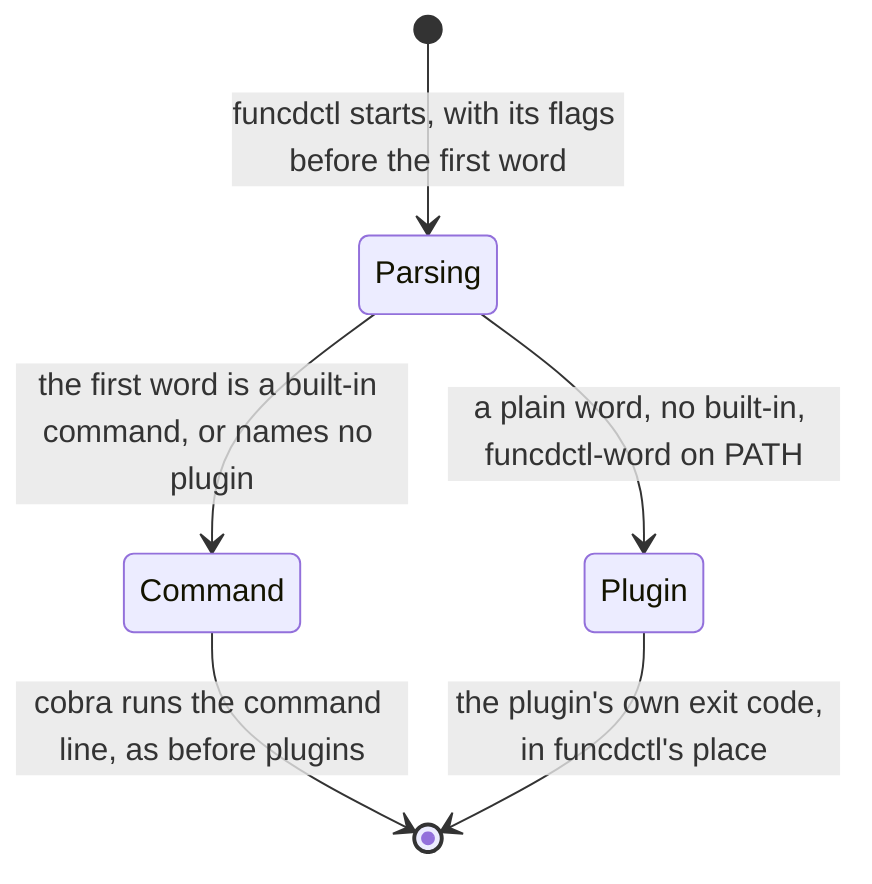

# funcdctl

Status words and how to read this: [the index](README.md).

Kinds: none of its own.

funcdctl runs an App's own CLI as a plugin, kubectl-style: an executable on PATH, not an invoke plugin of the call
chain (ADR-0319). funcdctl's own commands are in the funcdctl dev chapter and in the ADRs they cite, but for an App
template that carries an Addon, the last rows (ADR-0337).
New words: Parsing, Command, Plugin.

| Where | What happens | Time | You see | Status | Source |
|---|---|---|---|---|---|
| A word that is no command | funcdctl runs `funcdctl-<word>` from PATH in its place, with the words after it unchanged. Only the first word names the plugin. A word with no plugin stays an unknown command | none | `hello from funcdctl-hello` | decided | ADR-0319 Decisions 1 and 5, `TestPlugin_RunsTheExecutableNamedByTheFirstWord`, `TestPlugin_AWordWithNoPluginIsAnUnknownCommand` |
| A plugin named like a built-in command | Never runs: funcdctl's own command does, cobra's help and completion included, and `funcdctl plugin list` warns about it | none | `is a built-in command` | decided | ADR-0319 Decision 2, `TestPlugin_BuiltInCommandsWin` |
| A plugin name that is no plain word | Never runs and never lists, as a versioned `funcdctl-v0.39.3`, and nothing runs from the working directory. A filesystem that ignores case still runs `funcdctl-Hello` as `funcdctl hello` | none | `unknown command` | decided | ADR-0319 Decisions 1 and 6, `TestPlugin_OnlyAPlainWordNamesAPlugin`, `TestPlugin_NothingRunsFromTheWorkingDirectory` |
| Flags before a plugin's name | funcdctl's own: `--server` and `--token` set what the plugin is handed, and an unknown flag fails as funcdctl's error. The words after the name reach the plugin unchanged | none | `unknown flag: --bogus` | decided | ADR-0319 Decision 3, `TestPlugin_FlagsBeforeTheNameAreFuncdctls` |
| What a plugin is handed | funcdctl's environment with `FUNCDCTL`, the calling binary, `FUNCDCTL_VERSION`, and `FUNCD_SERVER` and `FUNCD_TOKEN` as funcdctl resolved them. An empty token is not handed on | none | `FUNCD_TOKEN` | decided | ADR-0319 Decision 4, `TestPlugin_EnvNamesTheCallingFuncdctlAndWhatItResolved`, `TestPlugin_CallsBackThroughFuncdctlWithTheResolvedToken` |
| A plugin's process | It replaces funcdctl's and keeps the PID, so the exit code, the stdio and the signals are its own. A failed exec is funcdctl's own error, exit 1 | none | `exec format error` | decided | ADR-0319 Decision 5, `TestPlugin_ReplacesTheFuncdctlProcess` |
| `funcdctl plugin list` | A NAME and PATH table of the plain-word plugins of the absolute PATH entries, in PATH order, and a warning on stderr for each one that never runs. It exits 0 | none | `no plugins on PATH` | decided | ADR-0319 Decision 7, `TestPluginList_NamesEachPluginAndWarnsAboutTheOnesThatNeverRun` |
| A template whose `addon.yaml` adds no kind | Refused when the template loads, since `app deploy` finds the template's Addon by its kind; nothing is applied | none | exit 1 `addon.yaml: its Addon adds no kind` | decided | ADR-0344 Decision 10, `TestScenarioAddonTemplateNeedsKind` |
| An admin's `app deploy` of a template with an Addon | Takes the Addon of the template's kind under any name: creates it, updates one that differs under its own name, or leaves one that agrees, then waits for its revision, `--no-wait` too; a refusal applies no App | none | `created Addon/<name>`, `updated`, `unchanged` | decided | ADR-0337 Decision 2, `TestAddonDeployWaitsForTheRevision` |
| A developer's `app deploy` of a template with an Addon | Only checks that the kind is served in the namespace, and applies nothing when it is not | none | exit 1 `Addon <name> is not registered` | decided | ADR-0337 Decision 2, `TestScenarioAddonTemplateDeveloperUnregistered` |
| `app deploy --dry-run` of a template with an Addon | Sends the Addon's write as a dry run, and the App's only once the kind is served | none | `the App's dry run needs Addon/<name> registered`, exit 0 | decided | ADR-0337 Decision 2, `TestScenarioAddonTemplateDryRun` |
| `app render` of a template with an Addon | Prints the App alone: `addon.yaml` is never evaluated, so its `${{ }}` reach the Addon's admission as written | none | the App's YAML | decided | ADR-0337 Decision 1, `TestScenarioAddonYAMLAsWritten` |
| `funcdctl job run <job> [run-name]` | Creates a JobRun with `--input`, inline JSON or @file, and prints its name, `<job>-<id>` from the server without one | none | `hello-x1y2z` | decided | ADR-0347 Decision 10, `TestCLIJobVerbs` |
| `funcdctl job runs`, `describe`, `logs`, `cancel` | runs lists a Job's runs newest first, `--phase` and `-o json`; describe shows the phase, reason, revision, digest, startedBy, times and result; logs reads the run's lines; cancel sets spec.cancel | none | `cancel requested for <run>` | decided | ADR-0347 Decision 10, `TestCLIJobVerbs` |
| `funcdctl types` beside a Job | A Job document named after the contract file gives JobInput, JobOutput, its binding types and a JobContext whose run is a RunInfo | none | the JobInput and JobContext types | decided | ADR-0347 Decision 9, `TestScenarioTypesFromContract`, `TestGenerateJobTypes` |
| `funcdctl logs <kind>/<name>` | Reads a Lake's, a SQLDatabase's or an add-on object's engine; a bare name or `function/<name>` is a Function; another kind of funcd's is refused before any call, and a plural of no engine kind, a settings kind's included, is 404 | none | `a Bucket runs no engine`; 404 | decided | ADR-0342 Decisions 3 and 4, `TestLogsTargetForms`, `TestScenarioEngineLogsNoEngine` |

<!-- generated values, do not edit: just behavior-values -->

funcdctl: values

| Value | Default | From |
|---|---|---|

<!-- end of generated values -->
