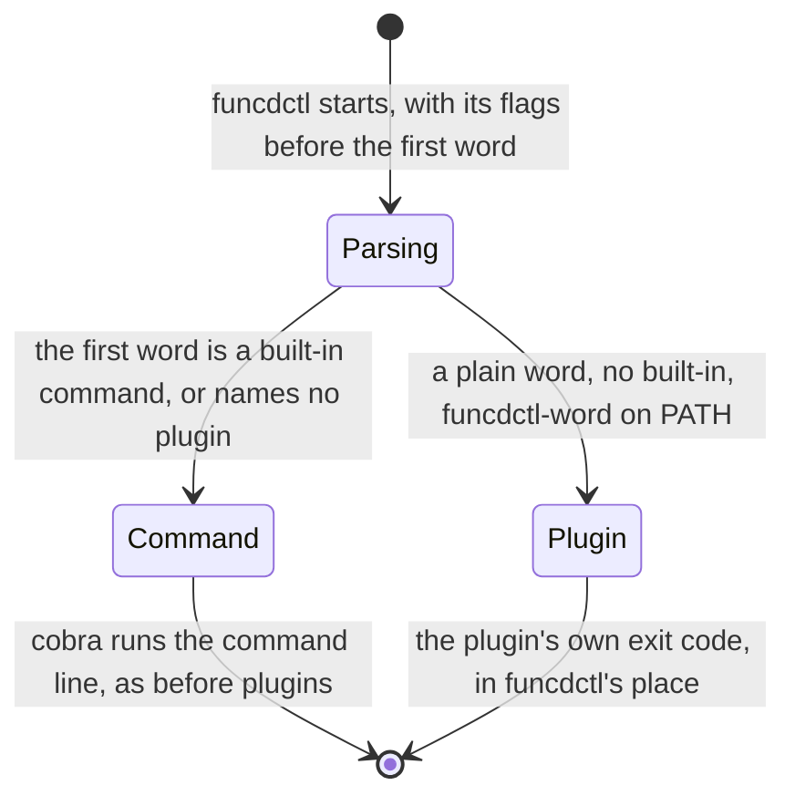

# funcdctl

Status words and how to read this: [the index](README.md).

Kinds: none of its own.

funcdctl runs an App's own CLI as a plugin, kubectl-style: an executable on PATH, not an invoke plugin of the call
chain (ADR-0319). funcdctl's own commands are in the funcdctl dev chapter and in the ADRs they cite.
New words: Parsing, Command, Plugin.

| Where | What happens | Time | You see | Status | Source |
|---|---|---|---|---|---|
| A word that is no command | funcdctl runs `funcdctl-<word>` from PATH in its place, with the words after it unchanged. Only the first word names the plugin. A word with no plugin stays an unknown command | none | `hello from funcdctl-hello` | decided | ADR-0319 Decisions 1 and 5, `TestPlugin_RunsTheExecutableNamedByTheFirstWord`, `TestPlugin_AWordWithNoPluginIsAnUnknownCommand` |
| A plugin named like a built-in command | Never runs: funcdctl's own command does, cobra's help and completion included, and `funcdctl plugin list` warns about it | none | `is a built-in command` | decided | ADR-0319 Decision 2, `TestPlugin_BuiltInCommandsWin` |
| A plugin name that is no plain word | Never runs and never lists, as a versioned `funcdctl-v0.39.3`, and nothing runs from the working directory. A filesystem that ignores case still runs `funcdctl-Hello` as `funcdctl hello` | none | `unknown command` | decided | ADR-0319 Decisions 1 and 6, `TestPlugin_OnlyAPlainWordNamesAPlugin`, `TestPlugin_NothingRunsFromTheWorkingDirectory` |
| Flags before a plugin's name | funcdctl's own: `--server` and `--token` set what the plugin is handed, and an unknown flag fails as funcdctl's error. The words after the name reach the plugin unchanged | none | `unknown flag: --bogus` | decided | ADR-0319 Decision 3, `TestPlugin_FlagsBeforeTheNameAreFuncdctls` |
| What a plugin is handed | funcdctl's environment with `FUNCDCTL`, the calling binary, `FUNCDCTL_VERSION`, and `FUNCD_SERVER` and `FUNCD_TOKEN` as funcdctl resolved them. An empty token is not handed on | none | `FUNCD_TOKEN` | decided | ADR-0319 Decision 4, `TestPlugin_EnvNamesTheCallingFuncdctlAndWhatItResolved`, `TestPlugin_CallsBackThroughFuncdctlWithTheResolvedToken` |
| A plugin's process | It replaces funcdctl's and keeps the PID, so the exit code, the stdio and the signals are its own. A failed exec is funcdctl's own error, exit 1 | none | `exec format error` | decided | ADR-0319 Decision 5, `TestPlugin_ReplacesTheFuncdctlProcess` |
| `funcdctl plugin list` | A NAME and PATH table of the plain-word plugins of the absolute PATH entries, in PATH order, and a warning on stderr for each one that never runs. It exits 0 | none | `no plugins on PATH` | decided | ADR-0319 Decision 7, `TestPluginList_NamesEachPluginAndWarnsAboutTheOnesThatNeverRun` |

<!-- generated values, do not edit: just behavior-values -->

funcdctl: values

| Value | Default | From |
|---|---|---|

<!-- end of generated values -->
