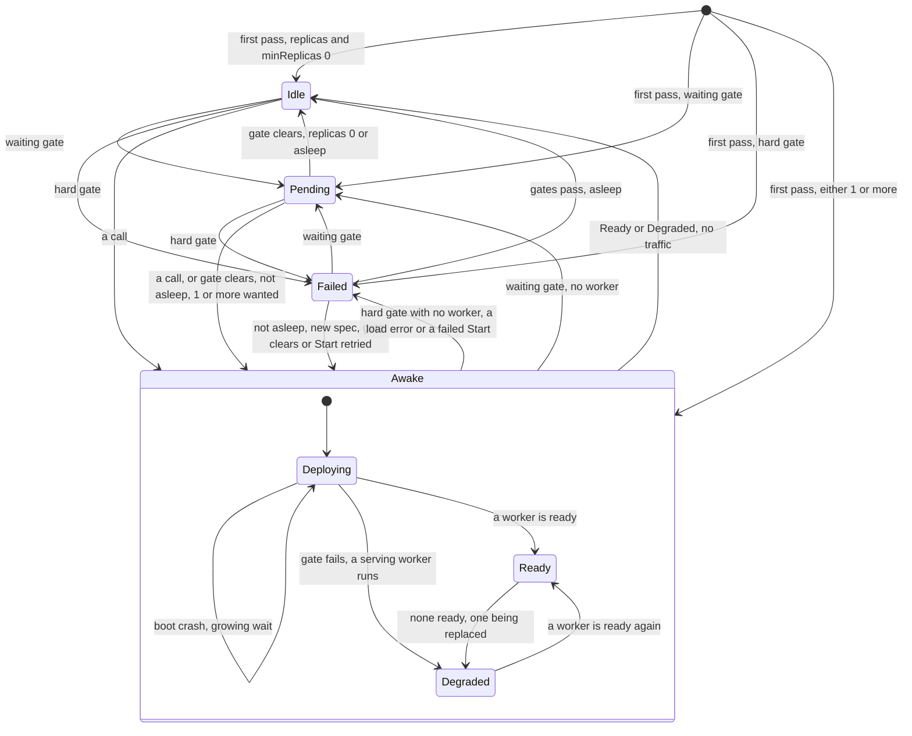

# Functions

Status words and how to read this: [the index](README.md).

Kinds: Function, Revision, ConfigMap.

A new Function has no phase until its first pass. `Deploying` has not served since its last deploy, `Degraded` has. A waiting gate
writes `Pending` and is read again, as `LakeNotReady`, `BucketNotFound`, `KVStoreNotFound`, `SecretNotFound`, `StoreNotOwned`,
`PoolFull`. A hard gate writes `Failed`, as `ConfigResolveFailed`, `SecretResolveFailed`, `ArtifactUnresolved`, `NoMatchingPlatform`,
`RuntimeUnavailable`, `ContractMissing`, `ShapeInvalid`. `Asleep=True` marks a gate holding a Function that had gone `Idle`: only a call
ends the sleep (ADR-0192). A `Revision` is read-only, one per spec change, and stays until its Function goes (ADR-0172). `Failed --> Awake` also holds ADR-0169's direct `Failed` to `Ready`. A worker's boot:
[Workers](workers.md). A call's path: [Calls](calls.md). Details: [scale-to-zero](../design/function/scale-to-zero.md),
[revision-drain](../design/function/revision-drain.md), [key-renewal](../design/function/key-renewal.md). New words: Awake.

| Where | What happens | Time | You see | Status | Source |
|---|---|---|---|---|---|
| Before the first pass | A new Function has no phase; the first pass writes `Idle`, `Deploying`, `Pending` or `Failed` | the first pass | an empty `status.phase` | **uncovered** | ADR-0169 Decision 3 names "the empty phase", ADR-0003 no first step; ran it on a scratch test |
| A gate fails, nothing serving | The gate's own phase is written from any phase, so `Deploying`, `Ready`, `Degraded` and `Failed` can go `Pending`, and `Pending` can go `Failed` | the next pass | `Pending` or `Failed`, with the gate's reason | decided | ADR-0161 Decision 2, ADR-0192 Decision 1 |
| A gate fails, a worker runs | `Deploying` goes `Degraded`; `Ready` stays while one listens, and `Degraded` is `Ready` while one passes its probe | the next pass | `Degraded`, or `Ready` | decided | ADR-0161 Decision 2, ADR-0221 Decision 1 |
| A call with no ready worker, in any phase but `Failed` | Held, and `Idle` or `Pending` wakes first. Calls share one wake and its clock, so a late one gets less time. Forwarded once `Ready` | `invoke.activationTimeout` 30 s | 503 `function <ns>/<name> did not become ready within 30s` | decided | ADR-0161 Decision 4, ADR-0016 Decision 3, `TestScenarioCallHeldWhileNotReady` |
| A held call whose reason cannot clear in time | Still held to the end: answering at once is not built | `invoke.activationTimeout` 30 s | the same 503 | accepted | ADR-0161 Decision 4, card "Answer calls fast while a Function cannot serve" |
| A call in `Failed` | Refused at once, and a wake already holding ends at its next poll | none | 503 `function <ns>/<name> is Failed (<reason>)` | decided | ADR-0169 Decision 5, `TestIssue142_FailedFunctionIsAnsweredWithItsState` |
| A worker that will not come up | A boot crash keeps `Deploying`, so calls are held. A handler that cannot load, or a failed `Start` with none running, is `Failed`, so calls are refused | see Workers | `CrashLoopBackOff`; `ShapeInvalid`, `StartFailed` | decided | ADR-0161 Decision 3, ADR-0169 Decision 4, `TestScenarioFirstBootNeverListeningIsRetried` |
| A waiting gate on a woken Function | The call's wake is turned back, `Deploying` to `Pending`, once per call | read again each `controller.referentPollInterval` 2 s, `PoolFull` each `runtime.supervisionPeriod` 10 s | `Pending`, `Ready=False`, `LakeNotReady` | accepted | ADR-0185 Scope, ADR-0192 Risks accepted, `TestScenarioPooledCallWhileGatedGoesPending` |
| A waiting gate clears, `replicas: 0` or asleep | `Idle`, and no worker until a call, whatever `spec.replicas` says once asleep | the next pass | `Idle`, `NoReplicas` | decided | ADR-0185 Decision 2, ADR-0192 Decision 3, `TestScenarioGateClearsToIdle`, `TestScenarioDependencyReturnsStaysAsleep` |
| The gate clears under a held call, `replicas: 0` | No worker starts: the turned-back wake is not asked again, so the call waits out the hold. The next call wakes it | up to `invoke.activationTimeout` 30 s | 503 `did not become ready within 30s` | deferred | #1397, ADR-0192 Risks accepted names only `replicas ≥ 1`, ADR-0185 Scope the turn-back; ran on a scratch test |
| A hard gate passes, not asleep | A worker boots with no call, even at `replicas: 0`, and goes only at idle reclaim | `controller.referentPollInterval` 2 s for a missing ConfigMap, `runtime.supervisionPeriod` 10 s for `ArtifactUnresolved`, else the next event | `Deploying`, then `Ready` | accepted | ADR-0169 Consequences, `TestIssue703_TransientResolveErrorIsRetried` |
| A binding goes while a worker serves | `Ready` stays, and a solo one shows a lost ConfigMap or Secret only at its next full pass. A worker that then dies is not replaced: with none left, the gate's phase | the next full pass | `RevisionReady=False`, `ConfigResolveFailed` | accepted | ADR-0221 Decision 3 and Scope, ADR-0143 Consequences, `TestScenarioReadyFunctionStaysReadyUnderGate` |
| No traffic | `Ready` or `Degraded` goes `Idle` and its workers stop; a call in flight spares it. Never with `minReplicas` above 0, no timeout, or from another phase | `spec.scaling.idleTimeout`, read every `invoke.reclaimInterval` 30 s | `Idle`, `NoReplicas` | decided | ADR-0016 Decision 4, ADR-0185 Decision 1, `TestScenarioIdleReclaim`, `TestScenarioIdleReclaimSkipsFailed` |
| `replicas` with `minReplicas: 0` | It counts only until the first sleep: `replicas: 1` boots with no call, then only a call wakes it. Given `replicas: 0`, a running Function keeps one worker until idle reclaim | none | `Idle` at `replicas: 1`, `Ready` at `replicas: 0` | decided | ADR-0192 Decision 3, ADR-0169 Decision 1, `TestAsleepDesiredReplicas` |
| `replicas` above 1 | Every call goes to the lowest listening replica, the others are spares, and nothing scales to `maxReplicas` | none | one busy worker | accepted | ADR-0161 Decision 2 and Scope, ADR-0016 Scope, `TestScenarioHungReplicaNeverHandedOut` |
| `spec.resources` left out | A solo worker gets the node's defaults; a pool worker has none, and `process` enforces none | `functions.defaultResources.cpu` 1, `functions.defaultResources.memory` 512 MiB | killed past the memory on `containerd` | decided | ADR-0291 Decisions 1 and 3, Scope, `TestScenarioFunctionDefaultLimits` |
| funcd restarts, the Function binds a Lake | `Ready` to `Pending`, until the Lake is `Ready` in this run | the Lake's engine boot | `Pending`, `LakeNotReady` | accepted | ADR-0162 Decision 3 and Consequences, `TestIssue662_ConsumerWaitsForTheLiveLakeProxy` |
| Any spec change while serving | A new Revision boots beside the serving one, for `replicas` or `scaling` too, and calls move once every new replica is ready | its boot | `RevisionReady=False`, `Progressing` | decided | ADR-0143 Decisions 4.3, 4.4 and 9, `TestScenarioRedeploySwitchesToNewRevision`, `TestScenarioReplicasChangeSwitchesWithoutDropping` |
| After the switch | The old workers stop once idle, or at the grace with their calls cut; one an open run pinned stays until the run ends | `runtime.handOutSettle` 2 s to `runtime.drainGrace` 30 s, from the switch | `status.drainingRevision` | decided | ADR-0143 Decision 4.1, ADR-0190 Decision 7, `TestScenarioInFlightCallFinishesOnOldRevision` |
| A new revision that fails | The old one keeps the calls and the phase, a solo Function's with no deadline | none | `RevisionReady=False`, `the current revision could not load its handler; the serving revision keeps the calls` | decided | ADR-0143 Decisions 4.5 and 5, ADR-0224 Decision 1, `TestScenarioFailedRevisionKeepsOldServing` |
| A new spec while asleep | No worker boots, so a bad artifact shows only at the first call: `ShapeInvalid`, `ContractMissing`, `ContractInvalid`. Only a new spec clears those | a cold start | `RevisionReady` `Unknown`, `NotStarted` | decided | ADR-0174 Decision 5, ADR-0303 Decision 3, `TestScenarioIdleFunctionStartsNewRevisionOnWake`, `TestIssue1084_OCIArtifactWithoutContractDoesNotStart` |
| A tag that moved | Nothing changes: a re-apply with no spec change stamps nothing, and a stamped Revision keeps its digest | none | `status.currentRevision` unchanged | decided | ADR-0035 Decision 3, ADR-0172 Decision 3, `TestScenarioTagMoveDoesNotDrift` |
| A worker's artifact not yet cached | Pulled inside the pass, on the controller's one worker, so other reconciles wait. A registry silent that long fails the pass, which retries | `registryResponseTimeout` 10 s per wait | `StartFailed`; at a silent first request, `ReconcileFailed` or `ArtifactUnresolved` | accepted | ADR-0161 Consequences, #697, `TestIssue697_StalledRegistryCallEnds` |
| A worker bound to a Bucket, at its key pair's age | Replaced after a drain, one replica at a time. A lone replica takes no call meanwhile, so calls are held | idle from half of `s3gateway.keyRotationPeriod` 24 h, else at 80% to 90% of it | `Degraded`, `Renewing`, `a replica is being replaced for a fresh S3 key pair` | decided | ADR-0270 Decision 6, `TestScenarioRenewalStatusSolo` |
| A ConfigMap's data changes | A bound one restarts nothing: workers keep the env they started with. One defined at the root gets a new hashed name, so a new revision | none | the old value until a worker is replaced | decided | ADR-0143 Consequences, ADR-0248 Decision 5, `TestScenarioFunctionConfigAndSecrets` |
| The pool's limit | The first by name are admitted, so an earlier name pushes the last member out; the rest wait with no worker and no route | `defaultPoolLimit` 16 | `Pending`, `PoolFull`, `pool <runtime>/<worker>/<access> is full (16); use another pooling.worker` | decided | ADR-0046 Decision 3, ADR-0193 Decision 4, `TestScenarioPoolFull` |
| A member changes, joins or leaves | A second pool worker boots, and all calls stay on the old one until every member that stays is ready. A slow member delays its siblings; one not loaded at the bound loses its old revision | `runtime.bootTimeout` 1 min, then the drain | `RevisionReady=False`, `Progressing` | accepted | ADR-0224 Decision 3 and Consequences, `TestScenarioSwitchAfterLoadTimeout` |
| A pool with an idle member | Any member that wants a worker, a `Failed` one too, keeps the pool and every sibling's memory up; it goes with the last | none | an idle member's memory stays | accepted | ADR-0046 Decision 6 and Consequences, ADR-0169 Consequences, `TestScenarioPoolWakeKeepsSiblings`, `TestScenarioPooledFailedMemberNeverIdle` |
| A delete | The object goes at once, with no phase. The next pass stops its workers with no drain, so calls in flight are cut, and drops its route and socket | the next pass | the object gone | decided | ADR-0020 Decision 2, `TestScenarioDeleteReclaims` |
| `Terminating` | No code writes this phase, though ADR-0003 names it: nothing holds a deleted object while its workers stop | none | never this phase | deferred | card "Two-phase delete: an object stays, marked deleting, until its controller has stopped its workers (#1231)", ADR-0169 Decision 3 |

<!-- generated values, do not edit: just behavior-values -->

Functions: values

| Value | Default | From |
|---|---|---|
| `functions.defaultResources.cpu` | 1 | config |
| `functions.defaultResources.memory` | 512Mi | config |
| `registryResponseTimeout` | 10s | `internal/artifact/artifact.go` |
| `maxIdle` | 32 | `internal/contract/bounds.go` |
| `maxInt32` | 2147483647 | `internal/contract/formats.go` |
| `maxSafeInteger` | 9007199254740991 | `internal/contract/formats.go` |
| `minInt32` | -2147483648 | `internal/contract/formats.go` |
| `defaultMatchTimeout` | 100ms | `internal/contract/rules.go` |
| `CallBudget` | 1s | `internal/contractcheck/contractcheck.go` |
| `MaxCheckedBytes` | 1MiB | `internal/contractcheck/contractcheck.go` |
| `MaxDigits` | 1000 | `internal/contractcheck/contractcheck.go` |
| `defaultBootBackoffInitial` | 10s | `internal/function/bootbackoff.go` |
| `defaultBootBackoffMax` | 5m | `internal/function/bootbackoff.go` |
| `defaultBootTimeout` | 1m | `internal/function/function.go` |
| `defaultDrainGrace` | 30s | `internal/function/function.go` |
| `defaultDrainPollInterval` | 1s | `internal/function/function.go` |
| `defaultHandOutSettle` | 2s | `internal/function/function.go` |
| `defaultPoolLimit` | 16 | `internal/function/function.go` |
| `defaultReferentPoll` | 2s | `internal/function/function.go` |
| `maxMembersReply` | 1MiB | `internal/function/function.go` |
| `maxRevisionName` | 63 | `internal/function/function.go` |
| `probeTimeout` | `readinessPoll / 2` | `internal/function/function.go` |
| `readinessPoll` | 200ms | `internal/function/function.go` |
| `defaultLivenessTimeout` | 30s | `internal/function/liveness.go` |
| `maxReadinessReply` | 64KiB | `internal/function/liveness.go` |
| `defaultReadinessTimeout` | 5s | `internal/function/readiness.go` |

<!-- end of generated values -->
