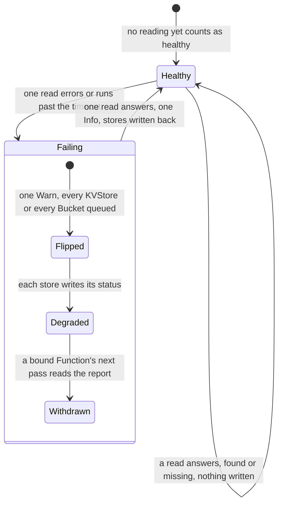

# Health

Status words and how to read this: [the index](README.md).

Kinds: none of its own.

The machine is one storage target, `kv` or `blob`, kept in memory: funcd has no health state of its own, and a restart reads
again. A store's `Degraded` refuses nothing by itself; a bound worker's check is what acts on the result. The metastore, the run
state and the event store have no probe. A worker's liveness: [Workers](workers.md). An engine's probe: [Services](services.md). The
floor: [Limits](limits.md). New words: Failing, Flipped, Withdrawn.

| Where | What happens | Time | You see | Status | Source |
|---|---|---|---|---|---|
| Is funcd well? | Nothing says: no health route on either port and no watchdog in the unit, so a hung funcd runs on unnoticed | none | `/healthz` 401 `missing bearer token or API key`, with a token 404; data plane 404 | **differs** | ADR-0018 Decision 3 says public health endpoints, `isPublic` has none; ADR-0215 Scope; issues, cards searched; ran it |
| A view of the whole | No `funcdctl status` and no `get all`: a state is read one kind and one namespace at a time, so nothing lists what is unwell | none | `unknown command "status" for "funcdctl"`; `kind "KVStore" is namespaced; a namespace is required` | deferred | ADR-0024 Open questions |
| The storage probes | The KV engine and the blob store are each read for `.funcd-health`, a key nobody writes: found or missing is healthy. On an S3 target each read is a request | `health.storageProbeInterval` 10 s, each bound by `health.storageProbeTimeout` 2 s | `.funcd-health` in the target's access log | decided | ADR-0215 Decision 6, `TestStorageProbesReadTheSentinelKey` |
| A probe errors or runs late | Every KVStore, or every Bucket, goes `Degraded` with the read's error; the other target's stay. One Warn per flip | `health.storageProbeInterval` 10 s + `health.storageProbeTimeout` 2 s | `StorageUnreachable`, `the probe did not answer within 2s`; logs `storage probe failing` | decided | ADR-0215 Decisions 6 and 7, `TestScenarioHealthStorageDown` |
| One late read | Misses are not counted: one read past the timeout flips the target, so a stall of a few seconds can take every bound Function out for a pass. A worker's late read has a window, this has none | `health.storageProbeTimeout` 2 s | `Degraded`, then `Ready` | accepted | ADR-0215 Decision 6, ADR-0259 Scope, #1156, `TestProberTimeout` |
| A call during the outage | A bound Function goes `Degraded` at its next pass and a cold one never readies, so every call is held, one that needs no store too, then fails | `runtime.supervisionPeriod` 10 s, then `invoke.activationTimeout` 30 s | 503 `function <ns>/<name> did not become ready within 30s` | accepted | ADR-0215 Decision 5 and Consequences, `TestScenarioHealthServingDependencyLost` |
| The store answers again | One good read and its stores go `Ready`, with no restart; a bound Function at its next pass, so a call held that long is served | `health.storageProbeInterval` 10 s + `runtime.supervisionPeriod` 10 s | logs `storage probe recovered` | decided | ADR-0215 Decisions 5 and 6, `TestScenarioHealthStorageDown`, `TestScenarioHealthDependencyRecovers` |
| A data directory moved away | The probes stay healthy: the KV engine answers from its open files and a missing blob key counts as healthy, so every store stays `Ready` and nothing is logged. A locked blob directory does flip | none | `Ready` | **uncovered** | ADR-0215 Decision 6 says missing is healthy, names no lost directory; ADRs and issues searched; ran both, 25 s each |
| Reads answer, writes fail | A full or read-only disk passes both probes, which only read: stores and Functions stay `Ready` while each write gets its own error | none | `Ready` | deferred | ADR-0215 Open questions and Risks accepted, `TestStorageProbesReadTheSentinelKey` |
| The metastore errors | No probe reads it, no status records it: the API and the data plane answer 500, every worker's check fails, and a pass logs and retries | none | 500 `Internal Server Error`; report `socket`, `Unreachable`; logs `reconcile failed, requeueing` | **uncovered** | ADR-0215 Decision 6 and Scope, ADR-0296 Decision 6, ADR-0015 Decision 4; issues searched; ran a failing store |
| A metastore read that hangs | Nothing bounds it: `funcdctl`, whose client sets no deadline, and the calls wait; only the public paths still answer. Ran on a store that hangs, not on a real disk | no end | no answer after 45 s | **uncovered** | ADR-0215 Decision 6 bounds only the probes, ADR-0024 Contracts `http.DefaultClient`; issues searched for a hung store or disk |
| A start with a store down | The probes run once before the reconcilers, a hung one costing its timeout, and the start goes on: its stores read `Degraded` at their first pass | `health.storageProbeTimeout` 2 s per target | logs `storage probe failing` | decided | ADR-0215 Decisions 6 and 7, `TestProberProbesBeforeStartReturns`, `TestProberTimeout` |
| A worker's dependency check | It stops at the first failure, so a second broken binding shows only once the first is fixed. It reads memory and the metastore, and wakes no target | `DependencyCheckBudget` 50 ms | `<kind> binding "<binding>": <message>`; reason `Timeout` past the budget | decided | ADR-0215 Decision 3, `TestCheckerStopsAtTheFirstFailureInOrder` |
| What passes the check | A link target passes unless `Failed`, so a `Degraded` or `Idle` one reads as fine; a Lake binding is not checked, its gate holds it | none | `link target <ns>/<name> is Failed` | accepted | ADR-0215 Decision 3 and Risks accepted, `TestCheckerLinks` |
| During a rollout | The serving revision's reports are not judged, since the check reads the new spec: a store lost meanwhile leaves it `Ready`, taking calls | until the switch | `Ready` | accepted | ADR-0215 Decision 5 and Risks accepted, `TestScenarioAppDependencyCheck` |
| While held | The probes and the store statuses go on, and a hung replica is still replaced: nothing here asks the hold | `health.storageProbeInterval` 10 s | a store's real phase before the release | decided | ADR-0215 Decision 10 |

<!-- generated values, do not edit: just behavior-values -->

Health: values

| Value | Default | From |
|---|---|---|
| `health.storageProbeInterval` | 10s | config |
| `health.storageProbeTimeout` | 2s | config |

<!-- end of generated values -->
