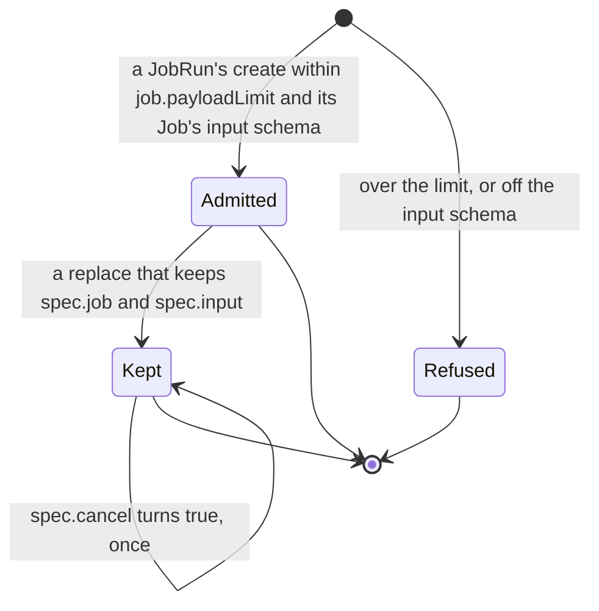

# Jobs

Status words and how to read this: [the index](README.md).

Kinds: Job, JobRun.

A Job is built as a Function is, from the fields it shares with one, and each of its executions is a JobRun, created
through the API as a WorkflowRun is (ADR-0347). This chapter holds what the API does with them: their checks, a run's
admission and who may act, the Job's pass, its revisions and its contract, then a run's start, its worker, its call and
its end, a restart, its logs and its retention. The job.* keys are in [Limits](limits.md), and a restore's end of the open runs in
[Disaster recovery](disaster-recovery.md). New words: Admitted, Refused, Kept.

| Where | What happens | Time | You see | Status | Source |
|---|---|---|---|---|---|
| A Job's spec | A Function's fields with their checks, then `timeout`, 0s to 168h, and `concurrency`, 1 to 15 and at most 1 with a local volume. It has no scaling, replicas, pooling, protocol or ingress | `MaxJobConcurrency` 15 | 400 `spec.concurrency 2 with spec.volumes[0], a local volume` | decided | ADR-0347 Decision 1, `TestJobValidate` |
| A Job's Revision name | `<job>-v<generation>`, cut and hashed past 63 characters with -v<generation> last, so it never meets a Function's `<name>-<generation>`. A Revision names one of spec.function and spec.job | `maxRevisionName` 63 | 400 `spec sets both function and job` | decided | ADR-0347 Decision 2, `TestJobRevisionName`, `TestJobRevisionNameNeverEqualsRevisionName` |
| A JobRun's input over the limit | The create is refused. The input is fixed once the run exists, so an update never meets a lowered limit | `job.payloadLimit` 262144 | 413 `run input <n> bytes exceeds job.payloadLimit <limit>` | decided | ADR-0347 Decision 3, ADR-0148, `TestJobRunPayloadAdmission` |
| A JobRun's input off its Job's contract | The create is refused, naming each value under body.spec.input. A Job that is missing, or has no status.contract, leaves the input unchecked at the create | none | 422 `run input does not match the input schema of Job <job> (InputSchemaMismatch)` | decided | ADR-0347 Decision 3, `TestJobRunContractAdmission`, `TestJobRunAdmissionAnswers` |
| A JobRun's update | spec.job and spec.input are fixed, and spec.cancel may only turn true; any other change of the spec is refused | none | 400 `spec.job and spec.input are fixed once it is created`, `spec.cancel may only turn true` | decided | ADR-0347 Decision 3, `TestJobRunSpecAdmission` |
| A JobRun's create | The API server sets status.startedBy to the caller's identity subject, a record that grants nothing, and status.jobUID to its Job's UID when the Job exists. A body's status is dropped, and a replace keeps both | none | the run's status.startedBy | decided | ADR-0347 Decision 3, `TestJobRunCreateRecordsWhoStartedIt`, `TestCLIApplyJobAndJobRun` |
| Who may act on Jobs | The built-in roles treat a Job as a Workflow and a JobRun as a WorkflowRun: a developer of the namespace writes both, a viewer only reads them | none | 403 `create JobRun in "team-a" denied: viewer is read-only (verb "create")` | decided | ADR-0347 Decision 10, `TestJobKindsActAsWorkflowKinds` |
| A Job's apply | Its links, bindings and local volumes pass a Function's admissions. A Function a Job links to is not deleted while the link stays, and a local volume is the Job's own, apart from a same-named Function's | none | 400 `does not declare`; 409 `is linked by Job` | decided | ADR-0347 Decision 1, `TestJobAnswersMatrix`, `TestJobLinks`, `TestJobVolumesLiveApartFromAFunctions` |
| A Job's pass | It stamps its generation's Revision, then is Ready once the checks a Function passes before its first worker pass, with its reasons: platform, shape, runtime, resources, the workload hooks and DataMissing | none | `NoMatchingPlatform`, `ShapeInvalid` | decided | ADR-0347 Decision 2, `TestJobGatesOnTheFunctionsChecks`, `TestJobPlatformGate`, `TestJobDataMissingAfterLoss` |
| A Job's lost volume | Its pass records DataMissing, as a Function's. No backup holds a Job's volume (ADR-0350 Scope) and no Restore member names a Job, so only deleting the Job clears it: removing the volume entry leaves it, as it leaves a Function's | none | `DataMissing=True`, `NoVolume` | accepted | ADR-0262 Decision 12, ADR-0350 Scope, `TestJobDataMissingAfterLoss` |
| A Job's contract | Read by the revision's digest into status.contract. An image with none holds the Job, as a cloudevent Function's, where artifacts carry contracts; funcdctl dev's leave input unchecked. One that does not compile holds it | none | `ContractMissing`, `ContractInvalid` | decided | ADR-0347 Decision 2 (amended), `TestJobWithoutContractIsHeld`, `TestJobReadsItsContractByDigest` |
| A Job's old revisions | Deleted once neither the current spec nor a run that has not ended pins them; a run's change brings its Job's pass | none | the Revision gone from funcdctl get revisions | decided | ADR-0347 Decision 2, `TestJobKeepsTheRevisionsItsOpenRunsPin` |
| A run's start | A Pending run starts once its Job is Ready at its generation and a slot is free. One write stores it Running with jobRevision, jobUID, imageDigest, startedAt and traceId, and only then does its executor start | `controller.referentPollInterval` 2 s between tries | `JobNotFound`, `JobNotReady`; phase Running | decided | ADR-0347 Decision 4, `TestJobRunStartsOnceItsJobIsReady` |
| A run's slot | Fewer of its Job's runs Running than the Job's concurrency, and fewer of the node's than job.maxRunning. A freed node slot goes to the oldest waiting run whose Job has one free, by creation time then name, so a Job at its limit holds no other back | `job.maxRunning` 4 | `Queued` | decided | ADR-0347 Decision 4, `TestJobRunSlots` |
| A run's input at its start | Off the contract of the revision it pins, the run ends Failed: it is never stored Running and its handler is never called | none | `InputSchemaMismatch` | decided | ADR-0347 Decision 4, `TestJobRunInputOffTheContractFailsAtStart` |
| A run's worker | One per run, named after it, of kind JobRun and the pinned revision, built as a solo Function worker, with FUNCD_JOB, FUNCD_JOB_RUN, FUNCD_JOB_REVISION, FUNCD_JOB_STARTED_BY, no FUNCD_FUNCTION. None starts while one of its name remains | none | the worker's env | decided | ADR-0347 Decisions 5 and 6, `TestJobRunExecutorCallsItsWorkerOnce`, `TestJobRunExecutorWaitsForItsName` |
| A run's worker that is not ready | It does not listen and become ready within runtime.bootTimeout, or it ends first, or a worker of the run's name still remains that long: the run ends Failed, with no worker left | `runtime.bootTimeout` | `StartFailed` | decided | ADR-0347 Decisions 5 and 6, `TestJobRunExecutorStartFailed`, `TestJobRunExecutorGivesUpOnItsName` |
| A run's call | Once, through the invoke chain as caller JobRun to the Job at its pinned revision, where only the contract plugins apply, on that revision's contract: a CloudEvent of the input with the run's traceparent, X-Funcd-Timeout-Ms only with a timeout | none | the run's traceId | decided | ADR-0347 Decision 5, `TestJobRunExecutorCallsItsWorkerOnce`, `TestContractOfAJobRevision` |
| A run's answer | A 2xx ends it Succeeded with the body as status.result, a 422 Failed, any other answer or a transport error Failed with its cause's first line, cut at 512 bytes | `job.payloadLimit` 262144 | `PayloadLimitExceeded`, `InputSchemaMismatch`, `HandlerFailed` | decided | ADR-0347 Decision 5, `TestJobRunExecutorAnswers`, `TestScenarioJobHandlerFails` |
| A 2xx whose body is not JSON | One more answer that is not a result, which is JSON: the run ends Failed | none | `HandlerFailed`, `the answer is not JSON` | decided | ADR-0347 Decision 5, `TestJobRunExecutorAnswers` |
| A Job's timeout | Counted from the worker's start: it cuts the call, stops the worker and ends the run Failed | `spec.timeout` | `RunTimedOut` | decided | ADR-0347 Decision 6, `TestJobRunExecutorTimeout`, `TestScenarioJobTimeout` |
| A run's end | Its worker is stopped with the driver's grace and removed at every end, at once on a cancel. A stop of funcd stops the executors after the controller, so no answer is written and the next start ends the run Interrupted | the driver's stop grace | no worker of the run | decided | ADR-0347 Decisions 5 to 7, `TestScenarioJobCancelStopsRun`, `TestScenarioJobRestartInterrupts` |
| A run's logs | Its worker's output and records go to funclog under the run, apart from a same-named Function's. funcdctl job logs reads them, raw output included, and by the run's traceId the lines of the calls it made | none | the handler's lines | decided | ADR-0347 Decision 8 with the decider's answer of 2026-11-23, `TestCLIJobVerbs`, `TestScenarioJobRunSucceeds` |
| A run's container | On containerd it is named `<run>.run`: two runs of one Job never share one, it meets no Function's, and it writes no engine report | none | the container ID | decided | ADR-0347 Decision 5, `TestContainerNamesOfARun` |
| A held platform or namespace | The run reconciler starts, ends and deletes none of its runs and leaves their status as it is. A run deleted meanwhile keeps its worker until the release, as a WorkflowRun | until the release | the run's status unchanged | decided | ADR-0347 Decisions 4 and 8, `TestJobRunHeldActsOnNoRun`, `TestEveryRunnerConsultsHold`, `TestEveryRunnerConsultsHoldInNamespace` |
| A run's spec.cancel | A Pending run ends at once. A Running one has its executor stopped, and its worker with it, then ends; a late answer changes nothing, and the handler may have done part of its work | the driver's stop grace | `Cancelled` | decided | ADR-0347 Decision 6, `TestJobRunCancel` |
| A run's Job deleted | A run whose Job is deleted, re-created under another UID, or whose pinned revision is gone ends Cancelled, a Running one once its executor stopped. A run created before its Job has no jobUID and waits | none | `JobDeleted` | decided | ADR-0347 Decision 6, `TestJobRunJobDeleted` |
| A deleted JobRun | Its executor stops, and with it the run's worker | none | the worker gone | decided | ADR-0347 Decision 6, `TestJobRunDeletedStopsItsExecutor` |
| funcd starts | Every run stored Running ends Failed, after the drivers' sweeps and before any run starts, held or not: its handler may have run, and no run starts again on its own | at boot | `Interrupted` | decided | ADR-0347 Decision 7, `TestJobRunBootInterrupts`, `TestEveryRunnerConsultsHold` |
| An ended run | Deleted job.retention after its endedAt by a sweep, at most an hour apart, that skips held runs | `job.retention` 720h | the JobRun gone | decided | ADR-0347 Decision 8, `TestJobRunRetention` |

<!-- generated values, do not edit: just behavior-values -->

Jobs: values

| Value | Default | From |
|---|---|---|

<!-- end of generated values -->
