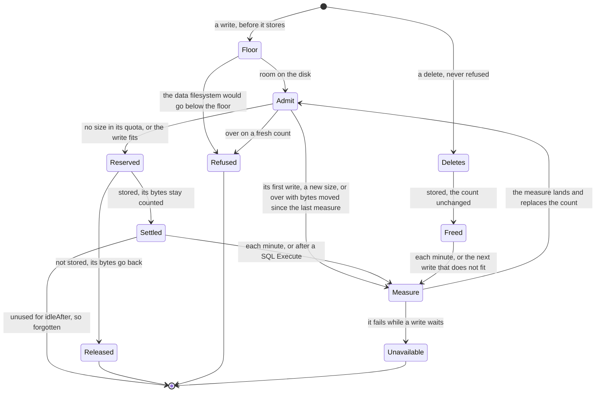

# Limits

Status words and how to read this: [the index](README.md).

Kinds: none of its own.

One check, `quota.Checker`, answers every capped write: the floor, then the store's quota (ADR-0292, ADR-0296). Reads never ask. The
count is the last measure plus the bytes settled and reserved since: a Bucket's or a prefix's listed sizes, a KVStore's keys and
values, a SQLDatabase's pages in use. A store with no size is never measured; near a cap each refusal can cost a whole measure, one at
a time (ADR-0292 Consequences). No status shows a store's usage (ADR-0292 Open questions). A Lake has no quota of its own: its prefix's
caps its files, `lake.catalogMaxSize` its catalog ([Services](services.md)). A presigned PUT under a cap gets 403. The floor is off at
`"0"` and in `storage.mode: memory`; a small disk needs a smaller setting (ADR-0296 Consequences).
In Time, a name with a dot is a config key and one without is fixed in the code. Other limits sit with their process:
[Calls](calls.md), [Eventing](eventing.md), [Workers](workers.md), [Functions](functions.md), [Admission](admission.md),
[Disaster recovery](disaster-recovery.md). New words: Refused, Reserved, Released, Settled, Freed.

| Where | What happens | Time | You see | Status | Source |
|---|---|---|---|---|---|
| A write past `spec.quota` | Refused before it stores; reads and deletes go on. A Bucket, a prefix, a KVStore and a SQLDatabase each take `maxSize` or `maxBytes`; neither is no cap | none | 507 `<subject> holds <n> of its <limit> bytes (spec.quota): a write of <m> bytes would pass it`; S3 `QuotaExceeded` | decided | ADR-0292 Decisions 4 and 6, `TestScenarioBucketTotalRefused` |
| A capped store's first write since a start, or after it idled | Waits for a whole measure, since no count exists yet; while that fails, each write fails | `idleAfter` 10 min, `measureTimeout` 2 min | a slow write; 503 `read the quota of <subject>` | decided | ADR-0292 Decision 3, `TestFirstRefreshFailureIs503`, `TestIdleSubjectDropped` |
| A write that does not fit | If bytes were stored or deleted since the last measure, it waits on one shared measure, the size it overwrites credited, and is refused only if still over. So a delete makes room at once | `measureTimeout` 2 min | a slow write; 503 `could not measure <subject>; retry` | decided | ADR-0292 Decision 4, `TestScenarioOverwriteNotRefused`, `TestDeleteMakesRoomAtOnce` |
| A change from outside a store's writes: `spec.quota`, a Restore's load, the purger | Counts from the next refresh, though a Bucket's cap added or removed applies at its next write. A Restore can leave a store past its cap, and then only deletes run | `refreshInterval` 1 min | 507 while the old count holds | accepted | ADR-0292 Consequences, `TestNewlyCappedSubjectMeasuredFirst` |
| A SQLDatabase's Execute | Its size is known only after it ran: it needs room left, then starts a measure. Executes admitted before that measure lands can pass the cap | one measure | a database over its cap, then 507 `<subject> holds <n> of its <limit> bytes (spec.quota): delete to make room` | accepted | ADR-0292 Consequences, `TestUnknownSizeWriteMeasuredSoon` |
| A SQLDatabase at its cap | Only one `DELETE` or `DROP` per statement text runs. A `WITH` before it, or an `INSERT` beside it in one call, is a write; the next measure counts the freed pages | none | 507 | decided | ADR-0292 Decision 4, `TestScenarioSQLDeleteAtCap` |
| A Lake at its prefix's cap | A commit that needs a Parquet file fails. Queries, drops and catalog saves go on, since the catalog lives outside the prefix | none | the commit's error holds 507 | decided | ADR-0292 Decision 6, `TestScenarioLakeTotalRefused`, `TestScenarioCatalogOutsideBucket`, duckdb `lake-at-cap-drops` |
| A Site's build refused for space | `Ready=False`, and no retry: freed room does nothing until the Site or its Bucket changes, or funcd restarts. The floor's refusal takes the same path | none | `QuotaExceeded`, with the refusal's message | accepted | ADR-0292 Decision 5, `TestSite_BucketAtQuotaIsNotReadyQuotaExceeded`; the floor is traced |
| A `spec.quota` refused at apply | A `maxSize` outside the byte-size grammar fails the schema check; `funcdctl apply` shows `Validate`'s message. Both forms, a zero or overflowing size answer 400 where ADR-0292 says 422 | none | 422 at `body.spec.quota.maxSize`; 400 for the rest | **differs** | ADR-0323 Decision 4, ADR-0292 Decision 6, ADR-0148 Decision 1; `TestScenarioByteSizeGrammarInSchema` |
| Below the floor | A workload write, or one that would take it there, is refused until space is freed, then admitted within a second. Reads, deletes and the platform's own stores go on | `storage.minFreeSize` 2 GiB, `floorReadEvery` 1 s | 507 `the data filesystem is below storage.minFreeSize, or this write would take it there` | decided | ADR-0296 Decisions 2 and 6, `TestScenarioFloorLifts` |
| A function's log below the floor | New records are dropped and lost; the first record admitted again logs how many | `floorReadEvery` 1 s | `funclog: dropped records while the data filesystem was below storage.minFreeSize`, with `records` | accepted | ADR-0296 Decision 5 and Consequences, `TestScenarioFunclogDropsBelowFloor` |
| What the floor reads | Only `storage.dataDir`'s filesystem: with `blob.target` set, Bucket writes and logs stop at a low local disk they do not use | none | a 507 for a remote write | **uncovered** | ADR-0296 Context says all lands there, Decision 6 names the S3 store only for presigned PUTs; ADR-0208; no issue or card; traced, not run |
| What a Function may ask | Any `cpu` from 0.01 up and any positive `memory` is accepted at apply | at least 0.01 (`MinCPU`) | 200 at apply | decided | ADR-0291 Decision 2 and Constraints, `TestScenarioInvalidResourcesRefused` |
| A Node pool member past its heap | Its thread dies and restarts after a growing wait; its calls in flight fail, siblings go on. A cap on the heap, not on all memory, with no CPU cap and no key | 64 MiB (the shim) | 503 `function <name> worker faulted` | decided | ADR-0044 scenario `pool-quota` and Temporary workarounds, ADR-0291 Scope |
| A worker's own writes, on `containerd` | The root is read-only and `HOME` is `/tmp`, a tmpfs of its memory limit whose pages count as its memory; it also has its volumes and a small boot directory | `tmpDefaultBytes` 512 MiB with no limit, `bootDirBytes` 1 MiB | `read-only file system`, `no space left on device` | decided | ADR-0294 Decisions 1 to 4, `TestScenarioTmpCountsInMemory` |
| A Lake engine's start | Its scratch is preallocated, so the floor is asked for its whole size first; refused, the Lake waits. Each running Lake holds that disk | `MinLakeScratchBytes` 1 GiB or `lake.scratchSize`; `lake.enginePollInterval` 2 s | `Pending`, `ScratchSpaceLacking` | decided | ADR-0294 Decision 6 and Consequences, `TestScenarioLakeScratchRefusedBelowFloor` |
| A volume past its size or its inodes | The kernel refuses the write or the create in the worker; other volumes go on. Inodes follow the size, so many small files can run out first: the remedy is a larger size | its `size` | `disk quota exceeded` | accepted | ADR-0295 Decision 1 and Consequences, `TestScenarioInodeLimitApplied` |
| Stores in a namespace | An API create at the cap is refused, an App's new parts counted together. In a key, 0 is the default and a negative value no cap | `kvstore.maxStoresPerNamespace` 100, `sql.maxDatabasesPerNamespace` 20, `defaultBucketsPerNamespace` 100 | 400 `namespace "<ns>" already holds the maximum 100 KVStores` | decided | ADR-0147 Decisions 1 and 4, `TestScenarioQuotaRaceRejected` |
| A namespace's budget | None for CPU, memory or store bytes; only volumes have one, `spec.volumeBudget` | none | nothing refuses it | deferred | ADR-0296 Open questions, ADR-0291 Scope, F208 |
| One value, key or object over its cap | Refused whole. `spec.quota` sets each cap, a key's up to `MaxKeyBytesLimit` 64000 | `DefaultMaxValueBytes` 1 MiB, `DefaultMaxKeyBytes` 1024, `s3gateway.maxUploadBytes` 1073741824 | 413 `value (<n> bytes) exceeds the store cap (<cap> bytes)`; S3 `EntityTooLarge`, status 400 | decided | ADR-0148 Decisions 2 and 5, `TestScenarioKVValueOverStoreCap` |
| A worker's `ctx` call | Each body is read whole under a cap no key changes, and so are `ctx.invoke`'s and `ctx.sql`'s answers | `maxBlobBytes` 64 MiB, `maxInvokeBytes` 1 MiB, `maxSQLBytes` 1 MiB, `MaxSQLStatements` 500, `maxEngineResponse` 8 MiB | 413 `request body exceeds <n> bytes` | decided | ADR-0148 Contracts, ADR-0233 Decisions 3 and 4, `TestIssue172_OverCapBodyIs413` |
| S3 multipart parts | They wait in funcd's memory. A principal past its share, or a node past its budget, is told to retry, so parallel large uploads fail in a client that does not | `s3gateway.maxUploadBytes` 1073741824 a principal; `multipartIdleExpiry` 1 h | 503 SlowDown | decided | ADR-0188 Decisions 3 and 4, Consequences, `TestScenarioMultipartSharePerPrincipal` |

<!-- generated values, do not edit: just behavior-values -->

Limits: values

| Value | Default | From |
|---|---|---|
| `floorReadEvery` | 1s | `internal/quota/floor.go` |
| `idleAfter` | 10m | `internal/quota/quota.go` |
| `measureTimeout` | 2m | `internal/quota/quota.go` |
| `refreshInterval` | 1m | `internal/quota/quota.go` |

<!-- end of generated values -->
