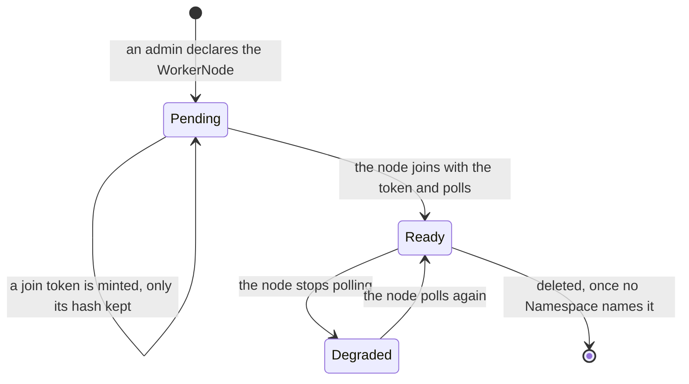

# Multi-node

Status words and how to read this: [the index](README.md).

Kinds: WorkerNode.

The machine is a WorkerNode's phase, which the control plane writes from its node's polls; the node never dials in the other
direction. A namespace's own objects follow their kinds' chapters, on the node that runs them. The protocol has no ADR yet: its rows
cite the decider's choices of 2026-11-16 and their feature issues. A node's workers: [Workers](workers.md). Its backups: [Disaster
recovery](disaster-recovery.md).

| Where | What happens | Time | You see | Status | Source |
|---|---|---|---|---|---|
| Declaring a node | An admin applies a WorkerNode by name before its machine exists; it reads Pending until a node joins under that name | none | `NotJoined` | decided | decider 2026-11-16, #1482 |
| A join token | `funcdctl node token` mints a token bound to the node's name, kept only as a hash; a new token ends an unused old one | `defaultTokenTTL` 1 h, at most `maxTokenTTL` 24 h | the token, shown once | decided | decider 2026-11-16, #1479, `TestAJoinTokenNeedsADeclaredNodeAndABoundedLife` |
| Joining | `funcd node join` checks the CA the token names before it sends the token, then swaps it for a node certificate; a used or expired token is refused | none | `joined as worker node <name>`; 403 | decided | decider 2026-11-16, #1479, `TestAJoinRefusesAControlPlaneWithAnotherCA` |
| A name a running node holds | A join under the name of a node that polls is refused, so no machine takes over another's name | none | 409 `a running node holds the name` | decided | decider 2026-11-16, #1479 |
| Placing a namespace | `spec.node` names a declared WorkerNode; the control plane's reconcilers and owner GC skip the namespace, and the node runs it whole | none | `spec.node names WorkerNode <n>, which is not declared` | decided | decider 2026-11-16, #1483, `TestPlacementSkipsWhatAnotherNodeRuns` |
| Moving a namespace | Refused while it holds objects, since its data stays on the node that ran it; an empty namespace may move | none | 409 `holds objects, so its spec.node cannot change` | uncovered | FEAT-0002 F246 says nothing of a move; refused on the build branch until one is designed |
| Following | The node takes a snapshot, then long-polls the change log, and keeps its revision on disk, so a restart of either side resumes with nothing lost | `defaultWait` 25 s per poll | `node agent: feed resumed` | decided | decider 2026-11-16, #1480, `TestANodeResumesFromItsSavedRevision` |
| An old revision | The log keeps the last `defaultChangeRetain` 100000 records; a node behind that gets 410 and takes a new snapshot | none | 410 | uncovered | FEAT-0002 F243 names no retention; chosen on the build branch |
| Status and children back | The node writes the status of each object it runs, validated, and the whole of each child it owns; a person's object is never overwritten | none | the node's status on the control plane | decided | decider 2026-11-16, #1481, `TestAWorkerNodeRunsTheNamespacePlacedOnIt` |
| Liveness | A WorkerNode reads Ready while its node polls, and Degraded once it has not for `defaultReadyFor` 40 s | `livenessTick` 5 s | `Polling`, `NotPolling` | decided | decider 2026-11-16, #1482, `TestANodeJoinsFollowsItsNamespaceAndReportsBack` |
| A log read of a node's namespace | It goes through the node's call queue; with no poll for `callOffline` 3 s the node is offline and the read fails at once | at most `callTimeout` 10 s | 503 `is offline` | decided | decider 2026-11-16, #1487, `TestCallsFailAtOnceForAnOfflineNode` |
| A node command | Dead letters (list, read, discard, replay), App retries and volume deletes of a node's namespace run on that node through its call queue; the answer keeps the kind of its error | at most `callTimeout` 10 s | the node's own answer; 503 `is offline` | decided | decider 2026-11-16, #1487, `TestTheNodeCommandsRunOnTheNodeThatRunsTheNamespace` |
| Other node commands | Holds and quarantine, backup status and the checks before a write (delete protection, volume booking, the in-place restore guard) still act on the control plane's own node | none | the control plane's own answer | deferred | #1487 |
| A host on two nodes | A claim on a host that a namespace on another node holds is refused; namespaces on one node share it, and a gateway in front shares a host across nodes | none | 409 `belongs to worker node <n>` | decided | decider 2026-11-17, #1484, `TestAHostBelongsToOneNode` |
| A node on another node API version | Every call carries the node's API version; one this control plane does not serve gets 426 | none | 426 | decided | decider 2026-11-16, #1489 |
| A node on a newer release | A node that runs a newer funcd release than the control plane is refused, at the join and at every call; an older one runs | none | 409 `newer than the control plane's` | decided | decider 2026-11-16, #1489, `TestANodeOnANewerReleaseThanTheControlPlaneIsRefused` |
| A field a node is too old for | A write that sets a spec field newer than the node API its namespace's node speaks is refused; no field is newer yet | none | 422 `upgrade the node first` | decided | decider 2026-11-16, #1489, `TestASpecFieldANodeIsTooOldForIsRefused` |
| The node's own API | It answers reads only: the control plane holds the node's namespaces, so a write there would be undone | none | 405 `this is a worker node` | accepted | `TestAWorkerNodeRunsTheNamespacePlacedOnIt` |
| A namespace's master | Derived from the control plane's master and the namespace's UID. A node keeps only its own namespaces' masters, under cluster.dataDir, and derives their S3 pairs, lake tokens and SQL passwords from them | none | `NamespaceKeyMissing` until it arrives | decided | decider 2026-11-16, #1486, `TestANodeKeepsTheMastersOfItsNamespacesOnly` |
| Secrets on a node | Kept encrypted at rest; with no `secrets.encryptionKeyFile` the node makes its own key under cluster.dataDir, and losing it loses nothing, since the control plane holds every Secret | none | none | decided | decider 2026-11-16, #1486, `TestAWorkerNodeKeepsItsSecretsEncryptedWithAKeyOfItsOwn` |
| A node's backups | A worker node backs up its own stores on backup.interval, under nodes/<name>/ of backup.target and kvstore.backup.target; its metastore copy goes without Secrets, which the control plane holds | none | none | decided | decider 2026-11-16, #1488, `TestAWorkerNodeBacksUpUnderItsOwnPrefix` |
| A restored control plane | Its metastore has a new timeline; a node whose saved revision is of another one gets 410 and takes a new snapshot | none | 410 | uncovered | FEAT-0002 F251 names no rule; chosen on the build branch, `TestANodeTakesASnapshotAfterTheControlPlaneIsRestored` |
| The control plane away | The node runs its namespaces from its own store; changes, status and node calls wait until the control plane answers | none | `node agent: feed` | decided | decider 2026-11-16, #1480 |

<!-- generated values, do not edit: just behavior-values -->

Multi-node: values

| Value | Default | From |
|---|---|---|
| `cluster.dataDir` | <storage.dataDir>/cluster | config |
| `cluster.hosts` | [], loopback only | config |
| `cluster.listenAddr` | "", no node joins | config |
| `pollWait` | 25s | `internal/multinode/agent/agent.go` |
| `resyncEvery` | 30s | `internal/multinode/agent/agent.go` |
| `retryMax` | 5s | `internal/multinode/agent/agent.go` |
| `retryMin` | 100ms | `internal/multinode/agent/agent.go` |
| `idleConnTimeout` | 1m30s | `internal/multinode/agent/join.go` |
| `joinRequestTimeout` | 30s | `internal/multinode/agent/join.go` |
| `maxJoinAnswer` | 1MiB | `internal/multinode/agent/join.go` |
| `caLifetime` | 87600h | `internal/multinode/ca.go` |
| `certBackdate` | 1h | `internal/multinode/ca.go` |
| `certLifetime` | 8760h | `internal/multinode/ca.go` |
| `callOffline` | 3s | `internal/multinode/calls.go` |
| `callTimeout` | 10s | `internal/multinode/calls.go` |
| `defaultTokenTTL` | 1h | `internal/multinode/cluster.go` |
| `maxTokenTTL` | 24h | `internal/multinode/cluster.go` |
| `defaultReadyFor` | 40s | `internal/multinode/liveness.go` |
| `defaultSeenEvery` | 30s | `internal/multinode/liveness.go` |
| `livenessTick` | 5s | `internal/multinode/liveness.go` |
| `defaultWait` | 25s | `internal/multinode/server.go` |
| `feedLimit` | 500 | `internal/multinode/server.go` |
| `maxJoinBody` | 64KiB | `internal/multinode/server.go` |
| `maxObjectBody` | 4MiB | `internal/multinode/server.go` |
| `maxStatusBody` | 1MiB | `internal/multinode/server.go` |
| `maxWait` | 1m | `internal/multinode/server.go` |
| `readHeaderTimeout` | 10s | `internal/multinode/server.go` |

<!-- end of generated values -->
