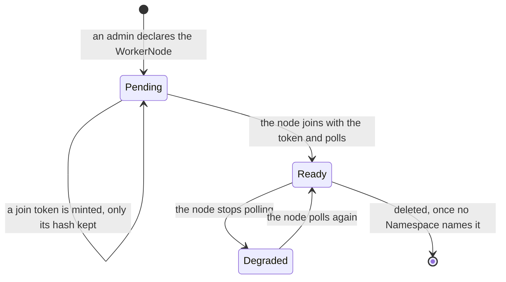

# Multi-node

Status words and how to read this: [the index](README.md).

Kinds: WorkerNode.

The machine is a WorkerNode's phase, which the control plane writes from its node's polls; the node never dials in the other
direction. A namespace's own objects follow their kinds' chapters, on the node that runs them. The protocol has no ADR yet: its rows
cite the decider's choices of 2026-11-16 and their feature issues. A node's workers: [Workers](workers.md). Its backups: [Disaster
recovery](disaster-recovery.md).

| Where | What happens | Time | You see | Status | Source |
|---|---|---|---|---|---|
| Declaring a node | An admin applies a WorkerNode by name before its machine exists; it reads Pending until a node joins under that name | none | `NotJoined` | decided | decider 2026-11-16, #1482 |
| A join token | `funcdctl node token` mints a token bound to the node's name, kept only as a hash; a new token ends an unused old one | `defaultTokenTTL` 1 h, at most `maxTokenTTL` 24 h | the token, shown once | decided | decider 2026-11-16, #1479, `TestAJoinTokenNeedsADeclaredNodeAndABoundedLife` |
| Joining | `funcd node join` checks the CA the token names before it sends the token, then swaps it for a node certificate; a used or expired token is refused | none | `joined as worker node <name>`; 403 | decided | decider 2026-11-16, #1479, `TestAJoinRefusesAControlPlaneWithAnotherCA` |
| A name a running node holds | A join under the name of a node that polls is refused, so no machine takes over another's name | none | 409 `a running node holds the name` | decided | decider 2026-11-16, #1479 |
| A certificate near its end | The node renews its certificate in the last third of its life, and its first call with the new one ends the old one; a node away past the end joins again. The node API signs its own again too | `certLifetime` 8760 h, `renewWithin` its last third, looked at every `renewEvery` 1 h | `node certificate renewed` | accepted | `TestANodeRenewsItsCertificateBeforeItEnds` |
| A node that joins again | It keeps its store: the runs it made go to the control plane, and it then takes its namespaces whole, before anything runs | none | `synced from a snapshot` | accepted | `TestANodeThatJoinsAgainKeepsTheRunsItMade` |
| Placing a namespace | `spec.node` names a declared WorkerNode; the control plane's reconcilers and owner GC skip the namespace, and the node runs it whole | none | `spec.node names WorkerNode <n>, which is not declared` | decided | decider 2026-11-16, #1483, `TestPlacementSkipsWhatAnotherNodeRuns` |
| A control plane alone | `funcd server` runs no namespace: it needs no container runtime, opens no data plane, and an unplaced namespace's objects wait | none | no phase on the objects | decided | decider 2026-11-16, #1478, `TestAControlPlaneAloneRunsNoNamespace` |
| Moving a namespace | Refused while it holds objects, since its data stays on the node that ran it; an empty namespace moves. Its data moves with workload backups, restored on the new node | none | 409 `holds objects, so its spec.node cannot change` | accepted | `TestANamespaceNamesADeclaredNodeAndKeepsItWhileItHoldsObjects` |
| Following | The node takes a snapshot, then long-polls the change log, and keeps its revision on disk, so a restart of either side resumes with nothing lost | `defaultWait` 25 s per poll | `node agent: feed resumed` | decided | decider 2026-11-16, #1480, `TestANodeResumesFromItsSavedRevision` |
| An old revision | The log keeps the last `defaultChangeRetain` 100000 records; a node behind that gets 410 and takes a new snapshot | none | 410 | accepted | `TestChangeLogCompactsAndRefusesARevisionBelowItsFloor` |
| A copy on a node | It is the control plane's object: the same uid, generation and creation time, as a child a node makes is on the control plane. One created again under its name replaces the node's, which goes first with its data | none | one uid on both | accepted | `TestANodesCopyIsTheControlPlanesObject` |
| Status and children back | The node writes back each object's status, validated, and whole the children it owns of the kinds its reconcilers make, plus the runs, Invocations and Backup records it makes; no Policy or role, never a person's object | none | its status on the control plane | decided | decider 2026-11-16, #1481, `TestTheObjectsANodeMakesReachTheControlPlaneAndNoOthers` |
| A node's late write | A status and a delete name their uid, so one of an object created again changes nothing. A run a node made under a name another run holds is refused, and the node takes the other | none | 409 `was created again since`, `another object holds the name` | accepted | `TestANodesLateWriteChangesNothingOfAnotherObject` |
| A delete the control plane did not take | Sent again at the next pass until it is taken; at its next start or snapshot the node also deletes there each child that it no longer holds | `resyncEvery` 30 s | `node agent: delete a child` | accepted | `TestADeleteTheControlPlaneDidNotTakeIsSentAgain`, `TestAChildTheNodeNoLongerHoldsGoesFromTheControlPlane` |
| A forced ResourceGroup delete in a node's namespace | It waits after each pass until the node collected the children of what it deleted | at most `nodeCollects` 10 s a pass | 409 while the node is away | accepted | `TestACollectionOfANodesNamespaceWaitsForTheNode` |
| A person's decision on a JobRun | Its approval, its rejection and who started it, which the control plane records in the run's status, reach its node, and a status reported without them keeps them; an approval is of one preview | none | `status.approvedBy` | decided | ADR-0348 Decision 3, `TestAPersonsDecisionOnARunReachesItsNode` |
| Add-ons on a node | Every node follows the Addons and their revisions, and stamps none. A retired revision's copy stays while an object of the node pins it or an AppRevision there records it | `runtime.supervisionPeriod` 10 s | `status.currentRevision` on the node | accepted | `TestARetiredRevisionsCopyStaysWhileTheNodeUsesIt` |
| A held deletion on a node | An engineless object held at its deletion reaches its node deleting, and its end there deletes the control plane's. One deleted before its mark came back is held on the node all the same | none | `Deleting` | decided | ADR-0345 Decision 6, `TestAnEnginelessObjectStaysUntilItsNodeDestroyedWhatItHolds` |
| A workload's Secret write on a node | After the node's checks, the control plane makes them again and writes the Secret; the call waits for the node's copy. Away, the write fails and reads go on | at most `secretEcho` 2 s more | 503 `secrets.control-plane-away` | decided | decider 2026-11-16, #1486, `TestAWorkloadsSecretWriteGoesToTheControlPlane` |
| Runs and Routes of a node's namespace | The control plane's boot, its JobRun slots, its retention sweeps and its edge leave them to the node: its restart interrupts no run there, and its edge serves none of the hosts | none | 404 at the control plane's edge | decided | decider 2026-11-16, #1483, `TestJobRunsOfAnotherNodesNamespaceAreLeftToIt`, `TestARouteOfAnotherNodesNamespaceIsNotServedHere` |
| Liveness | A WorkerNode reads Ready while its node polls, and Degraded once it has not for `defaultReadyFor` 40 s | `livenessTick` 5 s | `Polling`, `NotPolling` | decided | decider 2026-11-16, #1482, `TestANodeJoinsFollowsItsNamespaceAndReportsBack` |
| A log read of a node's namespace | It goes through the node's call queue; with no poll for `callOffline` 3 s the node is offline and the read fails at once | at most `callTimeout` 10 s | 503 `is offline` | decided | decider 2026-11-16, #1487, `TestCallsFailAtOnceForAnOfflineNode` |
| A node command | Dead letters (list, read, discard, replay), App retries and volume deletes of a node's namespace run on that node through its call queue; the answer keeps the kind of its error | at most `callTimeout` 10 s | the node's own answer; 503 `is offline` | decided | decider 2026-11-16, #1487, `TestTheNodeCommandsRunOnTheNodeThatRunsTheNamespace` |
| A check before a write | The deletion protection of a KVStore, a Bucket or a SQLDatabase, the booking of declared volumes and the in-place restore guard run on the node that holds the state; an offline node refuses the write | at most `callTimeout` 10 s | the node's own refusal; 503 `is offline` | decided | decider 2026-11-16, #1487, `TestTheChecksBeforeAWriteRunOnTheNodeThatHoldsTheState` |
| A BackupSchedule's target | Refused inside the blob store of the node that runs the namespace, whose address the node reports; one of a node that has not joined is not compared, since no address is known | none | `is inside the blob store it would copy` | decided | decider 2026-11-16, #1487, `TestABackupSchedulesTargetStaysOutsideItsNodesBlobStore` |
| A namespace's hold | Releasing a namespace's hold and returning its quarantined data run on the node that runs it | at most `callTimeout` 10 s | the node's own answer; 503 `is offline` | decided | decider 2026-11-16, #1487, `TestANamespacesHoldIsReleasedOnTheNodeThatRunsIt` |
| A node's own hold and backup | Each process holds and backs up its own stores: `--node <name>` reads and releases a node's hold, and reads its backup, through its queue; without it, the funcd that serves the API answers for itself | at most `callTimeout` 10 s | the node's own answer; 404; 503 `is offline` | decided | decider 2026-11-16, #1487, `TestANodesOwnHoldAndBackupAnswerByItsName` |
| A host on two nodes | A claim on a host that a namespace on another node holds is refused; namespaces on one node share it, and a gateway in front shares a host across nodes | none | 409 `belongs to worker node <n>` | decided | decider 2026-11-17, #1484, `TestAHostBelongsToOneNode` |
| A node on another node API version | Every call carries the node's API version; one this control plane does not serve gets 426 | none | 426 | decided | decider 2026-11-16, #1489 |
| A node on a newer release | A node that runs a newer funcd release than the control plane is refused, at the join and at every call; an older one runs | none | 409 `newer than the control plane's` | decided | decider 2026-11-16, #1489, `TestANodeOnANewerReleaseThanTheControlPlaneIsRefused` |
| A field a node is too old for | A write that sets a spec field newer than the node API its namespace's node speaks is refused; no field is newer yet, and a test refuses a new field that names no version | none | 400 `upgrade the node first` | decided | decider 2026-11-16, #1489, `TestASpecFieldANodeIsTooOldForIsRefused`, `TestANewSpecFieldNamesTheNodeAPIVersionItNeeds` |
| The node's own API | It answers reads, and the release of the node's own hold and quarantine: the control plane holds the node's namespaces, so another write there would be undone | none | 405 `this is a worker node` | accepted | `TestAWorkerNodeRunsTheNamespacePlacedOnIt` |
| A namespace's master | Derived from the control plane's master and the namespace's UID. A node keeps only its own namespaces' masters, under cluster.dataDir, and derives their S3 pairs, SQL passwords, lake and add-on tokens from them | none | `NamespaceKeyMissing` until it arrives | decided | decider 2026-11-16, #1486, `TestANodeKeepsTheMastersOfItsNamespacesOnly` |
| Secrets on a node | Kept encrypted at rest; with no `secrets.encryptionKeyFile` the node makes its own key under cluster.dataDir, and losing it loses nothing, since the control plane holds every Secret | none | none | decided | decider 2026-11-16, #1486, `TestAWorkerNodeKeepsItsSecretsEncryptedWithAKeyOfItsOwn` |
| A node's backups | A worker node backs up its own stores under nodes/<name>/ of backup.target and kvstore.backup.target, with no Secret and naming no key, as its `funcd upgrade` does; its restore asks for none | none | none | decided | decider 2026-11-16, #1488, `TestAWorkerNodeBacksUpUnderItsOwnPrefix`, `TestAWorkerNodesPreUpgradeGenerationHoldsNoSecret` |
| A node's backup status | A node reports its platform backup to its WorkerNode's status.backup at its start, then when it changes | checked every `selfEvery` 5m | the WorkerNode's `status.backup` | decided | decider 2026-11-16, #1488, `TestANodeReportsItsBackupInItsWorkerNode` |
| A node whose store is new or restored | Before anything runs, so before a boot reclaim, it takes its namespaces whole with the children it made, credentials' Secrets included, and waits for the control plane to answer | none | `waits for the control plane's snapshot` | decided | decider 2026-11-16, #1488, `TestAReplacedNodeComesBackFromItsBackup`, `TestANodeThatLostItsMetastoreKeepsItsData` |
| A restored node's runs | A run its restore paused shows paused on the control plane until a person resumes it; a run, a Backup or a Restore that ended there stays ended, whatever the node's older copy says | none | `spec.paused` | decided | ADR-0206 Decision 7, `TestARunTheRestoreOfItsNodePausedWaitsForAPerson`, `TestWhatEndedStaysEndedAfterItsNodesRestore` |
| A restored control plane | While it is held, its nodes run on and follow nothing. After the release each starts again on the restored state, with the runs it made since; the data of what the backup lacks goes into its quarantine | `retryMax` 5 s after the release | 503 `is held after its restore` | decided | ADR-0206, ADR-0288, `TestARestoredControlPlaneLosesNoDataOfItsNodes` |
| A snapshot on a running node | The runs and records it made go to the control plane first, so it loses none; it then reports every status and child again. A metastore's backup leaves the change log out | none | `synced from a snapshot` | accepted | `TestARunTheNodeMadeOutlivesASnapshot`, `TestANodeReportsEverythingAgainAfterASnapshot`, `TestASnapshotLeavesTheChangeLogOut` |
| The control plane away | The node runs its namespaces from its own store; changes, status and node calls wait until the control plane answers | none | `node agent: feed` | decided | decider 2026-11-16, #1480 |

<!-- generated values, do not edit: just behavior-values -->

Multi-node: values

| Value | Default | From |
|---|---|---|
| `cluster.dataDir` | <storage.dataDir>/cluster | config |
| `cluster.hosts` | [], loopback only | config |
| `cluster.listenAddr` | "", no node joins | config |
| `pollWait` | 25s | `internal/multinode/agent/agent.go` |
| `requestTimeout` | 1m | `internal/multinode/agent/agent.go` |
| `resyncEvery` | 30s | `internal/multinode/agent/agent.go` |
| `retryMax` | 5s | `internal/multinode/agent/agent.go` |
| `retryMin` | 100ms | `internal/multinode/agent/agent.go` |
| `selfEvery` | 5m | `internal/multinode/agent/agent.go` |
| `writeAttempts` | 5 | `internal/multinode/agent/copies.go` |
| `idleConnTimeout` | 1m30s | `internal/multinode/agent/join.go` |
| `joinRequestTimeout` | 30s | `internal/multinode/agent/join.go` |
| `maxJoinAnswer` | 1MiB | `internal/multinode/agent/join.go` |
| `renewEvery` | 1h | `internal/multinode/agent/renew.go` |
| `secretEcho` | 2s | `internal/multinode/agent/secrets.go` |
| `secretEchoPoll` | 5ms | `internal/multinode/agent/secrets.go` |
| `caLifetime` | 87600h | `internal/multinode/ca.go` |
| `certBackdate` | 1h | `internal/multinode/ca.go` |
| `certLifetime` | 8760h | `internal/multinode/ca.go` |
| `callOffline` | 3s | `internal/multinode/calls.go` |
| `callTimeout` | 10s | `internal/multinode/calls.go` |
| `defaultTokenTTL` | 1h | `internal/multinode/cluster.go` |
| `maxTokenTTL` | 24h | `internal/multinode/cluster.go` |
| `defaultReadyFor` | 40s | `internal/multinode/liveness.go` |
| `defaultSeenEvery` | 30s | `internal/multinode/liveness.go` |
| `livenessTick` | 5s | `internal/multinode/liveness.go` |
| `bodyReadTimeout` | 30s | `internal/multinode/server.go` |
| `defaultWait` | 25s | `internal/multinode/server.go` |
| `feedLimit` | 500 | `internal/multinode/server.go` |
| `maxJoinBody` | 64KiB | `internal/multinode/server.go` |
| `maxObjectBody` | 4MiB | `internal/multinode/server.go` |
| `maxStatusBody` | 1MiB | `internal/multinode/server.go` |
| `maxWait` | 1m | `internal/multinode/server.go` |
| `readHeaderTimeout` | 10s | `internal/multinode/server.go` |

<!-- end of generated values -->
