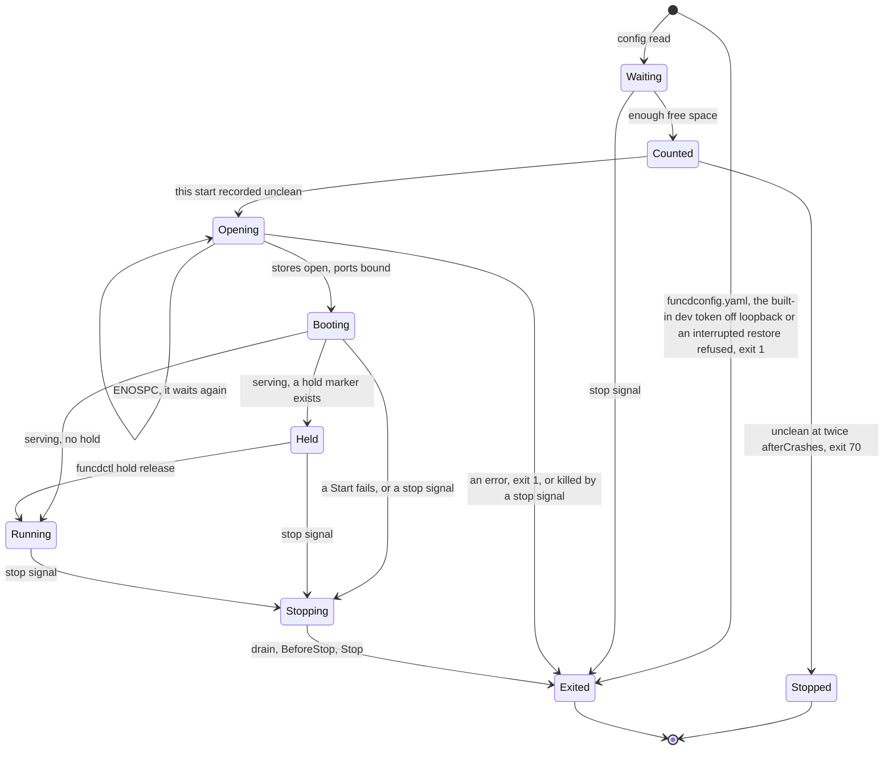

# Platform lifecycle

Status words and how to read this: [the index](README.md).

Kinds: none of its own.

Providers start in list order, the Executor first: Executor, KV, blob, SQL, Lake, eventing, secrets, config, invoke; they stop in
reverse. SIGINT, SIGTERM and a hangup stop funcd; under `nohup` a hangup stays ignored. `storage.mode: memory` skips the wait, the
count and the floor. `log` and `telemetry` have no process of their own, and `cmd/funcd-rqlite` is the rqlite engine's entrypoint:
[Services](services.md) holds it. [Workers](workers.md) has a worker's stop, [Disaster recovery](disaster-recovery.md) the hold after a
restore. Details: [start-stop](../design/platform/start-stop.md). New words: Waiting, Counted, Opening, Booting, Stopping.

| Where | What happens | Time | You see | Status | Source |
|---|---|---|---|---|---|
| The built-in dev token off loopback | Refused before the count and before anything opens, so it never leads to safe mode; the unit retries it as any failed start | 2 s (the unit) | `the built-in dev token works only on loopback`, naming the key | decided | ADR-0314 Decisions 2 and 3, `TestScenarioBuiltInTokenOffLoopbackRefused` |
| `funcd install` | Writes one unit, which sets the containerd runtime, and starts it with no config | none | `installed and started funcd.service` | decided | ADR-0054 scenario `runs-out-of-the-box`, `TestInstallUnitRunsContainerd` |
| An interrupted restore | Refused before the count, so it never reaches exit 70; the unit keeps restarting it | 2 s (the unit) | `restore <command>, begun <time>, was interrupted (<file>): a partial load must not start` | **differs** | ADR-0206 Decision 6 opens the hold after the count, `serve` in `cmd/funcd/main.go` before it; `TestScenarioRestoreCrashRefusesStart` |
| Less than 640 MiB free | The start waits before it counts and goes on by itself; a stop ends the wait and records no failed start | `spaceWait` 10 s between reads, until `storesOpenBytes` 640 MiB | `funcd: waiting for space on the data filesystem before opening the stores` | decided | ADR-0297 Decision 2, `TestScenarioStartWaitsForSpace` |
| A wait an earlier Lake engine holds up | Its scratch frees nothing until it stops, and the boot sweep comes after the wait, so an operator must free space or stop it | no end | the same line | accepted | ADR-0297 Consequences |
| Less than the floor free | The start still serves: reads and the control plane work, workload writes are refused until space is freed | `storage.minFreeSize` 2 GiB | 507 `the data filesystem is below storage.minFreeSize` | decided | ADR-0296 Decision 2, ADR-0297 Decision 2, `TestScenarioStartBelowFloor` |
| A store out of space | Badger's error reaches funcd as text until upstream releases its change: a write gets no 507, and a failed open is not retried, so the start fails and counts | until that release | the store's error | deferred | ADR-0297 Open questions and Temporary workarounds |
| A start that fails | Any failure after the count adds one, a taken port or a bad duration too; a config refused at load or the built-in dev token off loopback does not | 2 s between starts (the unit) | exit 1, the cause in the `funcd` log line's `error` | accepted | ADR-0207 Decision 3 and Consequences, `TestScenarioSafeModeStopsLoop` |
| Unclean starts in a row | After `afterCrashes` the next start is held; after twice that it exits 70, not restarted. `stableAfter`, or a clean stop, clears the count | `recovery.safeMode.afterCrashes` 3, `recovery.safeMode.stableAfter` 10 min | `safe mode: 6 unclean starts in a row, so funcd stops (exit status 70)` | decided | ADR-0207 Decisions 3 and 4, `TestBeginModes`, app-todo D15 |
| Exit 70's advice | It names a restore of the newest verified generation whatever the cause, which loses every write since; `funcd safe-mode reset` alone keeps them | none | `Restore the newest verified generation` | deferred | #1252 |
| Leaving exit 70 | `funcd safe-mode reset` sets the count to 0 and keeps the hold, so the next start is held until `funcdctl hold release` | until the release | `safe mode reset: the unclean-start count is 0; the platform stays held` | decided | ADR-0207 Decision 5, `TestScenarioLeaveSafeMode`, app-todo D15 |
| A stop signal while the stores open | No handler is set until `funcd.New` returns, so funcd dies at once: no clean-up, nothing logged, the start stays unclean | none | exit 143, `unclean` up by one | **uncovered** | ADR-0014 sets the handler after `funcd.New` with no word on a signal before it, ADR-0207 Decision 3 names a kill; ran it, 10 of 10 |
| A call during a start | Refused until `funcd.New` binds the ports; then it connects and gets no answer until `Run` serves | until the boot ends | connection refused, then a wait | decided | ADR-0033 Decision 6, ADR-0028 Decision 2, `TestE2EAddrAvailableAfterNew` |
| A provider's Start fails | funcd stops what started, then exits, and the failure counts | none | exit 1, `start <provider>: <cause>` | decided | ADR-0305 Decision 4, `TestRun_AFailedStartNamesItsProvider` |
| Data no object names, at a start not held | Moved into the quarantine before funcd serves: a KV store key by key, a Bucket on S3 object by object | kept `storage.quarantineRetention` 168 h | `moved the data of a <kind> with no object into the quarantine` | accepted | ADR-0288 Consequences, `TestScenarioOrphanQuarantined` |
| Held | No timer, blob source, Sensor, run, App rollout, retention sweep, backup or reclaim acts; the API, the controllers and the data plane serve | until `funcdctl hold release` | `platform held`, and `funcdctl hold status` with its reason | decided | ADR-0206 Decision 6, `TestEveryRunnerConsultsHold` |
| funcd restarts | No worker survives: the boot sweep or reap ends them and the reconcile brings back those wanted; each first call is a cold start, with one image import per namespace and runtime | `killWait` 10 s per task, `runtime.process.stopGrace` 3 s | a slow first answer | accepted | ADR-0167 Consequences, ADR-0186 Consequences, `TestScenarioCrashRestartLeavesDesiredWorkers` |
| A call at a stop | New connections are refused; an open call keeps the drain, a cold one is released at once; past the drain it runs until its worker stops | `server.shutdownTimeout` 15 s | 503 `activator stopped before <ns>/<name> became ready`, 503 `upstream call failed` | decided | ADR-0028 Decision 3, `TestIssue144_RunStopReleasesHeldColdRequest` |
| funcd stops | The HTTP drain, then each worker's SIGTERM and SIGKILL after its grace, the log flush, the private containerd | `server.shutdownTimeout` 15 s + `runtime.containerd.stopGrace` 10 s + `closeMargin` 2 s + `containerdStopGrace` 10 s, 37 s at worst | `platform stopping`; the installed unit allows 45 s | decided | ADR-0277 Decisions 3 and 4, `TestScenarioDaemonStopKeepsItsFlush` |
| A second stop signal | Ignored: the handler stays set until the stop ends, so Ctrl-C twice changes nothing; SIGQUIT still dumps and exits | the stop's budget | nothing | **uncovered** | `serve` in `cmd/funcd/main.go`, `internal/platform/stopsignal`; no word in ADR-0014, ADR-0207, ADR-0277 or ADR-0305; searched issues for a second signal and Ctrl-C |
| `funcd upgrade` | Stops the unit, writes a pre-upgrade generation, swaps the binary keeping `<self>.previous` and starts the unit; a failure before the swap starts the old binary | the stop, a cut and an upload | `upgraded <self> from funcd <a> to funcd <b>` | decided | ADR-0207 Decision 1, `TestScenarioUpgradePinsOldState`, `TestScenarioWriteFailureKeepsOldBinary` |
| An upgrade refused | No `backup.target`, a held platform or an older binary: nothing stops; `--no-snapshot` passes the first two, with no way back | none | `a pre-upgrade generation needs the platform backup on`, `the platform is held` | decided | ADR-0207 Decision 1, ADR-0227 Decision 4.1, `TestScenarioSnapshotUnavailableStopsUpgrade`, `TestUpgradeWhileHeld` |
| A rollback | Loses every write after the pre-upgrade generation, which holds only the metastore, the run state and the event store: KV and blob data stay as they are | none | `<self>.previous restore run <timeline>/<n>` | accepted | ADR-0207 Consequences, `TestScenarioRollbackToPreUpgrade` |

<!-- generated values, do not edit: just behavior-values -->

Platform lifecycle: values

| Value | Default | From |
|---|---|---|
| `log.format` | json | config |
| `log.level` | info | config |
| `recovery.safeMode.afterCrashes` | 3 | config |
| `recovery.safeMode.stableAfter` | 10m | config |
| `storage.dataDir` | /var/lib/funcd | config |
| `storage.metastoreDir` | <dataDir>/store | config |
| `storage.minFreeSize` | 2GiB | config |
| `storage.mode` | file | config |
| `storage.quarantineRetention` | 168h | config |
| `telemetry.endpoint` | "" ⇒ telemetry disabled | config |
| `telemetry.insecure` | false | config |
| `maxTokenFileBytes` | 4096 | `cmd/funcd/credentials.go` |
| `maxStopGrace` | 10s | `cmd/funcd/main.go` |
| `minAppUpgradeTimeout` | 5m | `cmd/funcd/main.go` |
| `minDeliveryBackoffMax` | 10s | `cmd/funcd/main.go` |
| `minKeyRotationPeriod` | 1h | `cmd/funcd/main.go` |
| `minPositive` | 1ms | `cmd/funcd/main.go` |
| `minRetryBackoffMax` | 5ms | `cmd/funcd/main.go` |
| `telemetryCloseTimeout` | 1s | `cmd/funcd/main.go` |
| `spaceWait` | 10s | `cmd/funcd/space.go` |
| `storesOpenBytes` | 640MiB | `cmd/funcd/space.go` |
| `defaultBackupInterval` | 1h | `internal/platform/config/backup.go` |
| `defaultBackupRPO` | 2h | `internal/platform/config/backup.go` |
| `defaultBackupRetryInterval` | 5m | `internal/platform/config/backup.go` |
| `oneDay` | 24h | `internal/platform/config/backup.go` |
| `defaultBlobBackupInterval` | 1h | `internal/platform/config/blob.go` |
| `defaultBlobRebaseline` | 720h | `internal/platform/config/blob.go` |
| `defaultBlobRetention` | 720h | `internal/platform/config/blob.go` |
| `defaultS3MaxUpload` | 1GiB | `internal/platform/config/config.go` |
| `defaultWorkflowPayloadLimit` | 256KiB | `internal/platform/config/config.go` |
| `DefaultFunctionCPU` | 1 | `internal/platform/config/functions.go` |
| `DefaultFunctionMemory` | 512Mi | `internal/platform/config/functions.go` |
| `defaultKVBackupInterval` | 30s | `internal/platform/config/kvbackup.go` |
| `defaultKVRebaseline` | 24h | `internal/platform/config/kvbackup.go` |
| `defaultKVRebaselineRetry` | 1h | `internal/platform/config/kvbackup.go` |
| `kvChunkBytesMax` | 8MiB | `internal/platform/config/kvbackup.go` |
| `DefaultKVSweepInterval` | 1s | `internal/platform/config/kvsweep.go` |
| `MinKVSweepInterval` | 100ms | `internal/platform/config/kvsweep.go` |
| `DefaultLakeCatalogMaxSize` | 256MiB | `internal/platform/config/lake.go` |
| `MaxLakeSaveInterval` | 1h | `internal/platform/config/lake.go` |
| `MinLakeSaveInterval` | 500ms | `internal/platform/config/lake.go` |
| `MinLakeScratchBytes` | 1GiB | `internal/platform/config/lake.go` |
| `lakeScratchMargin` | 512MiB | `internal/platform/config/lake.go` |
| `DefaultQuarantineRetention` | 168h | `internal/platform/config/quarantine.go` |
| `MinQuarantineRetention` | 1h | `internal/platform/config/quarantine.go` |
| `DefaultStorageMinFreeSize` | 2GiB | `internal/platform/config/storage.go` |
| `DefaultWorkloadBackupMaxCopyMembers` | 1024 | `internal/platform/config/workloadbackup.go` |
| `DefaultWorkloadBackupMaxListedKeySize` | 256MiB | `internal/platform/config/workloadbackup.go` |
| `DefaultWorkloadBackupMaxListedKeys` | 1MiB | `internal/platform/config/workloadbackup.go` |
| `DrainLimit` | 4KiB | `internal/platform/httpx/httpx.go` |
| `dialKeepAlive` | 30s | `internal/platform/httpx/httpx.go` |
| `dialTimeout` | 30s | `internal/platform/httpx/httpx.go` |
| `expectContinueTimeout` | 1s | `internal/platform/httpx/httpx.go` |
| `idleConnTimeout` | 1m30s | `internal/platform/httpx/httpx.go` |
| `tlsHandshakeTimeout` | 10s | `internal/platform/httpx/httpx.go` |
| `gibi` | 1GiB | `internal/platform/units/units.go` |
| `kibi` | 1KiB | `internal/platform/units/units.go` |
| `mebi` | 1MiB | `internal/platform/units/units.go` |
| `tebi` | 1TiB | `internal/platform/units/units.go` |
| `feedWaitPoll` | 50ms | `pkg/funcd/binding_providers.go` |
| `sensorDeliveryTimeout` | 30s | `pkg/funcd/binding_providers.go` |
| `sqlFeedBootWait` | 30s | `pkg/funcd/binding_providers.go` |
| `engineOutputBuf` | 64KiB | `pkg/funcd/engineoutput.go` |
| `closeMargin` | 2s | `pkg/funcd/funcd.go` |
| `defaultBucketsPerNamespace` | 100 | `pkg/funcd/funcd.go` |
| `defaultCloseGrace` | 3s | `pkg/funcd/funcd.go` |
| `defaultDeadletterMaxEntries` | 1000 | `pkg/funcd/funcd.go` |
| `defaultDeadletterRetention` | 720h | `pkg/funcd/funcd.go` |
| `defaultKVStoresPerNamespace` | 100 | `pkg/funcd/funcd.go` |
| `defaultNestedInFlightCap` | 10 | `pkg/funcd/funcd.go` |
| `defaultSQLDatabasesPerNamespace` | 20 | `pkg/funcd/funcd.go` |
| `defaultWorkflowMaxStepsInFlight` | 64 | `pkg/funcd/funcd.go` |
| `defaultWorkflowPayloadLimit` | 256KiB | `pkg/funcd/funcd.go` |
| `defaultWorkflowRetention` | 720h | `pkg/funcd/funcd.go` |
| `defaultWorkflowRetry` | 1 | `pkg/funcd/funcd.go` |
| `defaultWorkflowStepTimeout` | 5m | `pkg/funcd/funcd.go` |
| `maxRetentionSweep` | 1h | `pkg/funcd/funcd.go` |
| `minRecordBytes` | 1024 | `pkg/funcd/funcd.go` |
| `purgePage` | 1000 | `pkg/funcd/funcd.go` |
| `serverReadHeaderTimeout` | 10s | `pkg/funcd/funcd.go` |
| `serverReadTimeout` | 10s | `pkg/funcd/funcd.go` |
| `shutdownTimeout` | 15s | `pkg/funcd/funcd.go` |
| `defaultActivationTimeout` | 30s | `pkg/funcd/options.go` |
| `defaultBootTimeout` | 1m | `pkg/funcd/options.go` |
| `defaultDeliveryBackoffInitial` | 100ms | `pkg/funcd/options.go` |
| `defaultDeliveryBackoffMax` | 10s | `pkg/funcd/options.go` |
| `defaultDrainGrace` | 30s | `pkg/funcd/options.go` |
| `defaultHandOutSettle` | 2s | `pkg/funcd/options.go` |
| `defaultRetryBackoffMax` | 1s | `pkg/funcd/options.go` |
| `defaultStorageProbeInterval` | 10s | `pkg/funcd/options.go` |
| `defaultStorageProbeTimeout` | 2s | `pkg/funcd/options.go` |
| `defaultSupervisionPeriod` | 10s | `pkg/funcd/options.go` |
| `defaultWorkerSyncInterval` | 2s | `pkg/funcd/options.go` |
| `maxAppRevisionHistory` | 100 | `pkg/funcd/options.go` |
| `maxBaseDomain` | 189 | `pkg/funcd/options.go` |
| `maxDefaultRetryBackoff` | 1h | `pkg/funcd/options.go` |
| `minDefaultAppUpgradeTimeout` | 5m | `pkg/funcd/options.go` |
| `minDefaultLivenessTimeout` | 30s | `pkg/funcd/options.go` |
| `minRetryBackoffMax` | 5ms | `pkg/funcd/options.go` |
| `quarantineSweepEvery` | 1h | `pkg/funcd/quarantine.go` |
| `quarantineSweepFirst` | 5m | `pkg/funcd/quarantine.go` |
| `measurePage` | 1000 | `pkg/funcd/quota.go` |

<!-- end of generated values -->
