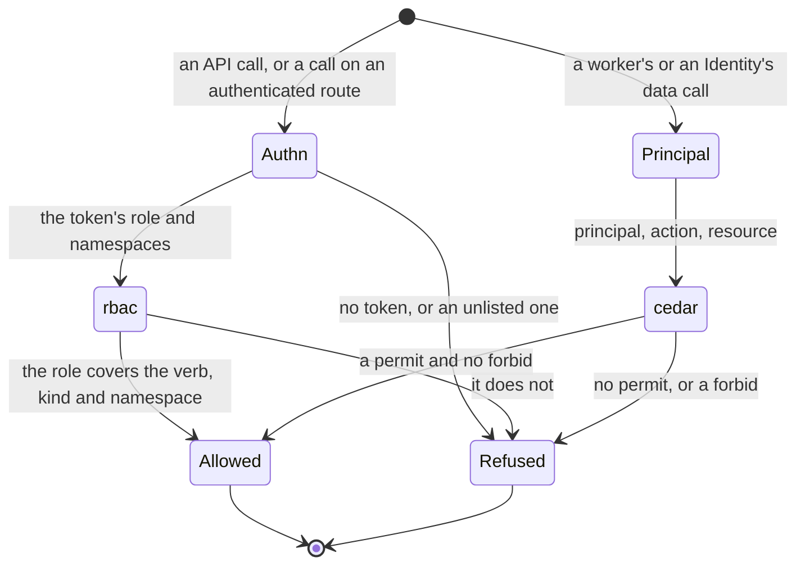

# Security

Status words and how to read this: [the index](README.md).

Kinds: Identity, Role, RolesAssignment, Policy, Grant, OIDCProvider.

The API and the edge read one token list; `/openapi`, `/docs` and `/schemas/` need no token. A binding grants read, the owner or a
writer role grants write, and the built-in `Owner` covers KV and blob data only, not managing assignments (ADR-0136). An
Identity's credential authenticates and grants nothing until a RolesAssignment does. A Policy naming another namespace in its
scope is refused at apply (ADR-0177 Decision 3). A worker's outbound traffic and lookups: [Egress](egress.md); a workload's Secret reads and writes: [Secrets](secrets.md). An `oidc`
stance signs a caller in with an OIDCProvider instead of a funcd token, and funcd registers and keeps the provider's client
(ADR-0335, ADR-0336); the path of such a call: [Calls](calls.md). New words: Refused.

| Where | What happens | Time | You see | Status | Source |
|---|---|---|---|---|---|
| An API call | A missing or unlisted token is refused; then the token's role decides, and a viewer never reads a Secret | none | 401 `missing bearer token or API key`, 401 `invalid credential`, 403 `get Secret in "<ns>" denied: viewer may not act on kind "Secret"` | decided | ADR-0018 Decisions 2 and 3, ADR-0171 Decision 9, `TestScenarioViewerCannotReadSecrets` |
| The built-in dev token on loopback | Works in each of its forms, with one warning at the start | none | `using the built-in dev token` | decided | ADR-0314 Decisions 2 and 4, `TestScenarioBuiltInTokenOnLoopbackWarns` |
| A real token or `auth.credentials` | Starts on any address; the built-in dev token and the dev admin token then get 401 | none | 401 `invalid credential` | decided | ADR-0314 Decision 2, ADR-0334 Decision 5, `TestScenarioRealCredentialBindsAnywhere`, `TestScenarioDevAdminTokenLoopbackOnly` |
| `funcd.New` with `DevToken` or `DevAdminToken` off loopback, or edge auth with it and a data plane off loopback | Refused, as the daemon refuses a start | none | `is off loopback` | decided | ADR-0314 Decisions 5 and 6, ADR-0334 Decision 5, `TestScenarioLibraryFollowsTheRule`, `TestScenarioEdgeAuthFollowsTheRule`, `TestScenarioDevAdminTokenLoopbackOnly` |
| The dev admin token | Only `funcdctl dev` answers `funcd-dev-admin-token`, as an admin, on loopback: `funcd.New` refuses it off loopback, and `WithCredentials`, a token file and `auth.token` refuse it, naming no token | none | 401 `invalid credential` from any other server | decided | ADR-0334 Decision 5, `TestScenarioDevAdminTokenLoopbackOnly` |
| A change to `auth.credentials` or a token file | Files are read once at startup, so a change takes effect at the next start | a restart | a new token gets 401 `invalid credential` until then | decided | ADR-0171 Decision 6 and Temporary workarounds |
| A token file that group or others can open, or that another user owns | funcd does not start | none | `token file "<path>" has mode 0644, open to group or others: chmod 0600 (or 0400)`, or its owner's uid | decided | ADR-0171 Decision 2, `TestScenarioExposedTokenFileRefusesStart` |
| A secret file other than a token file that group or others can open, or that another user owns | funcd starts, with one warning per set key | none | `secret file open to other users`, with the key, the path and the rule's text | decided | ADR-0326 Decisions 1 to 3, `TestScenarioExposedSecretFileWarns` |
| A key whose feature is off, or a group-readable mount such as `root:funcd` at 0640 or a Kubernetes secret volume under `fsGroup` | Warns at each start like any other open file | none | `secret file open to other users` | accepted | ADR-0326 Consequences |
| A call allowed on an `authenticated` route | The Function receives neither `Authorization` nor `X-Api-Key`; an `open` route forwards every header | none | the headers are absent in the handler | decided | ADR-0171 Decision 5, `TestScenarioEdgeDropsTheCredential` |
| What an `oidc` route forwards | A signed-in call reaches the code with the four principal headers, the provider's `Authorization` and the caller's cookies but funcd's | none | `X-Funcd-Principal`, `X-Funcd-Principal-Id`, `X-Funcd-Principal-Name`, `X-Funcd-Id-Token` (a session only) | decided | ADR-0335 Decision 8, `TestScenarioOidcSignin` |
| Principal headers a caller sends | Dropped on every way in, public, internal, `/fetch/` and both add-on paths, which drop the proxy's token too; only the sign-in sets them | none | the edge's value, or none | decided | ADR-0335 Decision 8, ADR-0338 Decision 3, `TestScenarioOidcForgedHeaders`, `TestScenarioOidcFetchForged`, `TestScenarioAddonCallHeaders` |
| A call on an `oidc` route with no session | A navigation goes to the provider, any other call gets 401; `allow` passes every method with no principal; nothing wakes | none | 302 to the provider; 401 with `WWW-Authenticate: Bearer` | decided | ADR-0335 Decision 2, `TestScenarioOidcRedirect`, `TestScenarioOidcUnauthenticated` |
| A sign-in | The callback checks the state, PKCE, the nonce and the ID token, sets the session until its `exp` and returns to the first path; else 401 naming the cause, no session | `stateTTL` 10 min for the state | `__Host-funcd_session.<ns>.<provider>`; 401 `the sign-in's state expired: sign in again` | decided | ADR-0335 Decisions 4 and 5, `TestScenarioOidcCallbackRefused` |
| A Bearer token on an `oidc` route | Signs the call in only with `audiences` set and one of them in `aud`; a session wins over it | none | 401 with `WWW-Authenticate: Bearer error="invalid_token"` | decided | ADR-0335 Decision 6, `TestScenarioOidcBearer` |
| An unsafe call with a session from another origin | Refused unless `Sec-Fetch-Site: same-origin`, or no `Origin` or the host's; `GET`, `HEAD` and `OPTIONS` pass | none | 403 `a POST with a session must come from the host's own origin` | decided | ADR-0335 Decision 5, `TestScenarioOidcCrossOrigin` |
| A provider's signing keys | Kept a day at most; a token with an unknown `kid` fetches them, once a minute at most, one fetch for every waiting call | `keyMaxAge` 24 h, `keyRefetchInterval` 1 min | 401 until the next fetch | decided | ADR-0335 Decision 7, `TestKeySetPassesANewKeyWithinAMinute` |
| An OIDCProvider that cannot serve | `Ready=False` with the first that holds: `SessionSecretMissing`, `SessionKeyInvalid`, `ClientSecretMissing`, `AddonBehindProvider`, `DiscoveryFailed`, `IssuerMismatch`; the edge answers 503 while it has no usable client | none | `Pending`; 503 `sign-in is unavailable` | decided | ADR-0335 Decision 10, `TestScenarioOidcProviderNotReady` |
| A second provider on a host | The later entry, or one using two, is refused and keeps its claims, which answer 503; a rule with no stance uses its Namespace's provider, but on an upstream row | none | `Ready=False`, `ProviderConflict` | decided | ADR-0335 Decisions 3 and 10 (amended 2026-11-21), `TestScenarioOidcOtherProviderSession`, `TestScenarioOidcInheritedProvider` |
| A by-name navigation through `X-Funcd-Namespace` | A page load that the sign-in would redirect gets 401 instead, since the callback of the host it used may be registered nowhere; on the namespace host it is redirected | none | 401, `WWW-Authenticate: Bearer` | decided | ADR-0335 Decision 2 (amended 2026-11-21), `TestScenarioOidcByNameOtherHost` |
| `/.auth/logout` | Clears every funcd session cookie of the host; the provider's own session stays, so the next redirect signs the user in again | none | 302 to `/` | accepted | ADR-0335 Consequences, `TestScenarioOidcLogout` |
| A session past the ID token's expiry | No refresh: a navigation signs in again, and a `POST` sent after it gets 401, so the page loses its input | the ID token's `exp` | 401 `sign in first` | accepted | ADR-0335 Consequences, `TestASessionPastItsExpirySignsInAgain` |
| A session cookie over 4096 bytes | The callback refuses it, so a provider with such ID tokens signs nobody in | `maxCookieBytes` 4096 | 401 naming the size | accepted | ADR-0335 Consequences, `TestScenarioOidcCallbackRefused` |
| A data call by a Function or an Identity | Denied unless a binding or a grant permits it and no forbid matches; a write takes the owner or a writer role | none | 403 ending `cedar default-deny: no permitting policy`, or `cedar: forbidden by policy <id>` such as `builtin/kv-single-writer` | decided | ADR-0136 Decision, ADR-0177 Decision 4, `TestIssue675_BuiltinDenyNamesStableID` |
| A request across namespaces | Only the built-in policies decide: no Policy, RolesAssignment or EgressPolicy reaches it | none | the reason ends `(cross-namespace request: built-in policies only)` | decided | ADR-0177 Decisions 1 and 2, `TestScenario_cross_namespace_built_ins_only` |
| A write to a Policy, Role, RolesAssignment or EgressPolicy | Applies at the next decision, with no restart | none | the next call's answer | decided | ADR-0177 Decision 2, ADR-0117 Decision 4a, `TestScenarioPolicyCacheAtomicSwap` |
| A grant, or a Secret's owner, changes what a pooled Function may do | It moves to a pool of its own access: its calls get 404, then 503 while the new pool loads it | a pool's cold start | `status.pool` changes | decided | ADR-0158 Decision 5, ADR-0327 Decision 6, `TestScenarioPoolSplitsByGrant` |
| A RolesAssignment naming a missing Role or an unknown built-in | Applies with no complaint and grants nothing; nothing shows it | none | a normal apply, then the denial | **differs** | ADR-0136 wants it observable and built-in names checked; `rolesassignment.go` checks non-empty only; `TestScenarioNamespaceScopeAndMissingRole` |
| A Grant | Stored and listed; nothing reads it: a reserved placeholder | none | a normal apply, no effect | decided | ADR-0073 Decision 1 |
| `spec.rotate` raised on an Identity | A new secret replaces the old under the same access key id; the old one stops authenticating, with no overlap | the next pass | `status.observedRotate` follows | decided | ADR-0135 scenario `identity-credential-rotated`, `TestScenarioIdentityCredentialRotated` |
| An OIDCProvider registers its client | With the callbacks of every host that names it, into a Secret funcd owns | `runtime.supervisionPeriod` 10 s | `ClientReady`; else `Pending`: `SecretNotOwned`, `Unused`, `RegistrationFailed` with the HTTP status only, `SecretIssueFailed` | decided | ADR-0336 Decisions 2 and 7, `TestScenarioOidcRegister`, `TestScenarioOidcRegistrationFailed` |
| Its upkeep fails | A usable client stays `Ready`, and sign-ins go on; a refused rotation is sent again, no faster | `runtime.supervisionPeriod` 10 s | `ClientSynced=False`: `RegistrationFailed`, `SecretIssueFailed`, `RotationRefused`, `Unused` | decided | ADR-0336 Decisions 3 and 7, `TestScenarioOidcUpkeepFailsSignInsGoOn`, `TestScenarioOidcRotationRefused` |
| `rotate` raised on an OIDCProvider | The Secret holds a new secret and the provider refuses the old; a sign-in that read the old one retries once with the new | the next pass | `status.observedRotate` follows | decided | ADR-0336 Decisions 3 and 4, `TestScenarioOidcRotate` |
| The provider lost the client, or answered a lost PUT | The next pass registers a new client, or sends the PUT again for a read whose secret is not the stored one | `runtime.supervisionPeriod` 10 s | sign-ins work again | decided | ADR-0336 Decision 3, `TestScenarioOidcClientGone`, `TestScenarioOidcAnswerLost` |
| A Restore of the add-on object | No call while the namespace is held; after the release the restored secret is rotated away | `runtime.supervisionPeriod` 10 s after the release | new sign-ins fail until then | decided | ADR-0336 Decision 3 and Consequences, `TestScenarioOidcAfterRestore` |
| Deleting an OIDCProvider | Its client Secret is collected; the client stays at the provider until its idle purge, and outside rauthy nothing removes it | rauthy's purge, 90 days by default | none | accepted | ADR-0336 Scope and Consequences, `TestPairsCoverEveryControllerRef` |
| An http callback through rauthy | rauthy takes http callbacks on loopback hosts only, so with http callbacks only `localhost` and `127.0.0.1` sign in | none | rauthy refuses the redirect URI | accepted | ADR-0336 Consequences, `TestScenarioOidcDev` |

<!-- generated values, do not edit: just behavior-values -->

Security: values

| Value | Default | From |
|---|---|---|
| `auth.credentials` | none | config |
| `auth.namespaces` | [default] | config |
| `auth.token` | a built-in dev token | config |

<!-- end of generated values -->
