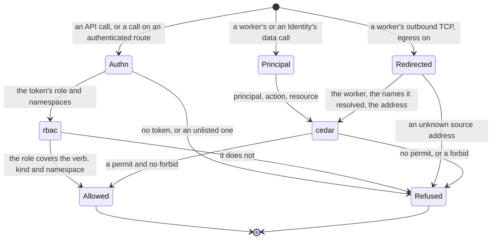

# Security

Status words and how to read this: [the index](README.md).

Kinds: Identity, Role, RolesAssignment, Policy, Grant, EgressPolicy, Secret.

The API and the edge read one token list; `/openapi`, `/docs` and `/schemas/` need no token. A binding grants read, the owner or a
writer role grants write, and the built-in `Owner` covers KV and blob data only, not managing assignments (ADR-0136). An Identity's
credential authenticates and grants nothing until a RolesAssignment does. A Policy naming another namespace in its scope is refused at
apply (ADR-0177 Decision 3). With egress on, workers cannot reach each other and UDP other than DNS is dropped (ADR-0115 Decision,
ADR-0117 Consequences). New words: Redirected, Refused.

| Where | What happens | Time | You see | Status | Source |
|---|---|---|---|---|---|
| An API call | A missing or unlisted token is refused; then the token's role decides, and a viewer never reads a Secret | none | 401 `missing bearer token or API key`, 401 `invalid credential`, 403 `get Secret in "<ns>" denied: viewer may not act on kind "Secret"` | decided | ADR-0018 Decisions 2 and 3, ADR-0171 Decision 9, `TestScenarioViewerCannotReadSecrets` |
| A change to `auth.credentials` or a token file | Files are read once at startup, so a change takes effect at the next start | a restart | a new token gets 401 `invalid credential` until then | decided | ADR-0171 Decision 6 and Temporary workarounds |
| A call allowed on an `authenticated` route | The Function receives neither `Authorization` nor `X-Api-Key`; an `open` route forwards every header | none | the headers are absent in the handler | decided | ADR-0171 Decision 5, `TestScenarioEdgeDropsTheCredential` |
| A data call by a Function or an Identity | Denied unless a binding or a grant permits it and no forbid matches; a write takes the owner or a writer role | none | 403 ending `cedar default-deny: no permitting policy`, or `cedar: forbidden by policy <id>` such as `builtin/kv-single-writer` | decided | ADR-0136 Decision, ADR-0177 Decision 4, `TestIssue675_BuiltinDenyNamesStableID` |
| A request across namespaces | Only the built-in policies decide: no Policy, RolesAssignment or EgressPolicy reaches it | none | the reason ends `(cross-namespace request: built-in policies only)` | decided | ADR-0177 Decisions 1 and 2, `TestScenario_cross_namespace_built_ins_only` |
| A write to a Policy, Role, RolesAssignment or EgressPolicy | Applies at the next decision, with no restart | none | the next call's answer | decided | ADR-0177 Decision 2, ADR-0117 Decision 4a, `TestScenarioPolicyCacheAtomicSwap` |
| A grant changes what a pooled Function may do | It moves to a pool of its own access: its calls get 404, then 503 while the new pool loads it | a pool's cold start | `status.pool` changes | decided | ADR-0158 Decision 5, `TestScenarioPoolSplitsByGrant` |
| A RolesAssignment naming a missing Role or an unknown built-in | Applies with no complaint and grants nothing; nothing shows it | none | a normal apply, then the denial | **differs** | ADR-0136 wants it observable and built-in names checked; `rolesassignment.go` checks non-empty only; `TestScenarioNamespaceScopeAndMissingRole` |
| A Grant | Stored and listed; nothing reads it: a reserved placeholder | none | a normal apply, no effect | decided | ADR-0073 Decision 1 |
| `spec.rotate` raised on an Identity | A new secret replaces the old under the same access key id; the old one stops authenticating, with no overlap | the next pass | `status.observedRotate` follows | decided | ADR-0135 scenario `identity-credential-rotated`, `TestScenarioIdentityCredentialRotated` |
| `ctx.secret.get` or `list` | Asks funcd on each read, with no cache: a changed Secret shows at the next read, at a round trip per read | none | the new value, no restart | decided | ADR-0249 Decision 2 and Consequences, `TestScenarioSecretReadLive` |
| A bound Secret is missing | No worker starts; one already serving goes on, and `ctx.secret.get` reads nothing; a Secret applied later is found at the re-check | `controller.referentPollInterval` 2 s | `Failed` or `RevisionReady=False`, `SecretResolveFailed` | decided | ADR-0249 Decisions 2 to 4, ADR-0221 Decision 3, `TestIssue77_MissingBindingRecoversWhenApplied` |
| A bound Secret value that is not UTF-8 or holds a NUL | No worker starts; a corrected Secret does not clear it until the Function changes or funcd restarts | none | `Failed`, `SecretResolveFailed`, `is not valid UTF-8; env delivery cannot carry binary data` | **uncovered** | ADR-0306 Contracts requeue this gate on NotFound only; ADR-0057 Scope leaves rotation out; a probe |
| A Secret a Lake's engine binds changes | The engine holds it in its environment, so it is replaced with the new value | within `runtime.supervisionPeriod` 10 s | the engine restarts | accepted | ADR-0249 Scope, #1195, `TestIssue1195_ConvergeReplacesAnEngineOfAnotherSpec`; no lane rotates it |
| A `secrets.encryptionKeyFile` that does not match the stored Secrets | funcd does not start | none | `stored Secrets do not decrypt with secrets.encryptionKeyFile: they were written with a different key or with none` | accepted | #93, `TestIssue93_KeyMismatchFailsAtStartup` |
| `server.network.egress`, off by default | Off, or not Linux with containerd: workers reach anything and an EgressPolicy does nothing. On: a Function no EgressPolicy covers reaches nothing external | none | on, a refused connection | decided | ADR-0117 Decisions 3 and 6, `TestScenarioDisabledPassthrough`, egress `no-egresspolicy-denies-all` |
| A refused connection | It opens, then ends once the gateway has decided: an HTTP 403 on ports 80 and 8080, a plain close on any other | up to `peekTimeout` 500 ms | 403 `egress denied by funcd EgressPolicy`, or a closed socket | decided | ADR-0117 Decision 1, `TestScenarioDecideFlow`, egress `cidr-denies-unlisted-ip` |
| A domain rule | Counts only for a name this worker resolved through funcd, until that answer's TTL: a hard-coded address or a cache kept longer is refused | the answer's TTL, at least `minRecordTTL` 1 s | a refused connection | decided | ADR-0117 Decisions 1 and 2, `TestScenarioDomainsForCorrelationAndWildcard`, `TestScenarioEgressSNISpoofDenied` |
| A worker that just started | Its outbound connection is refused until the next sync finds the worker | up to `server.network.workerSyncInterval` 2 s | a refused connection; `unknown source worker <ip>` in the audit record | decided | ADR-0163 scenario `server-keys-pace-shutdown-and-egress-sync`, ADR-0117 Decision 1, `TestScenarioServerKeysPaceShutdownAndEgressSync` |
| A connection's decision | Logged in funcd's own log, not yet in the function log channel the ADR names | none | `egress decision`, with `allowed=false` and the reason | deferred | ADR-0117 Open questions, egress `blocked-connection-audited` |
| A Lake or SQL engine's outbound TCP, on containerd | Reaches only its one internal endpoint, with `server.network.egress` on or off | none | a failed query; `GatewayEndpointNotAnAddress` if that endpoint is a hostname | decided | ADR-0269 Decisions 1 to 4, `TestScenarioLakeSetsEgressOnly` |
| A start, stop or crash, egress on | The rules go in before any worker runs and stay until the runtime closes; after a crash they stay, so external connections fail until the next start | none | `apply worker egress isolation` if they cannot go in | decided | ADR-0115 Decision, ADR-0117 Constraints, `TestRun_AppliesTheEgressFenceBeforeAnyLoop`, `TestShutdown_KeepsEgressFenceUntilRuntimeClosed` |

<!-- generated values, do not edit: just behavior-values -->

Security: values

| Value | Default | From |
|---|---|---|
| `auth.credentials` | none | config |
| `auth.namespaces` | [default] | config |
| `auth.token` | a built-in dev token | config |
| `secrets.encryptionKeyFile` | "" ⇒ Secret values | config |
| `dnsTimeout` | 5s | `internal/network/egress/forwarder.go` |
| `maxPairsPerSource` | 1024 | `internal/network/egress/forwarder.go` |
| `minRecordTTL` | 1s | `internal/network/egress/forwarder.go` |
| `minSweep` | 1024 | `internal/network/egress/forwarder.go` |
| `peekTimeout` | 500ms | `internal/network/egress/gateway_linux.go` |

<!-- end of generated values -->
