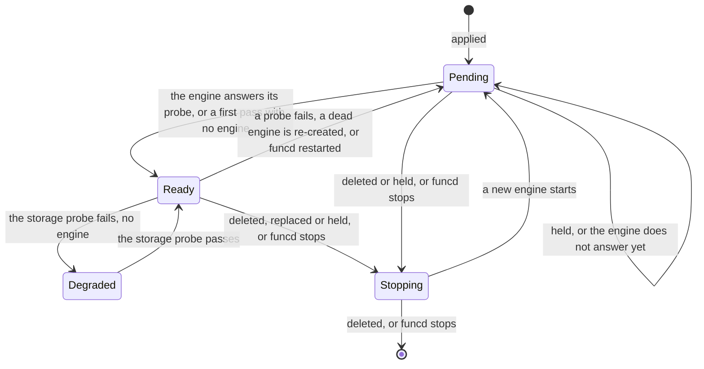

# Services

Status words and how to read this: [the index](README.md).

Kinds: KVStore, Bucket, SQLDatabase, Lake.

A KVStore or a Bucket runs no engine: the platform's KV or blob store serves it, and a table removed from a KVStore's spec loses its
data at its next pass. A Lake and a SQLDatabase each run one pinned engine, never scaled to zero. `Stopping` is no phase: a status keeps
its last one until the pass ends. New words: Stopping. A held Lake also shows `BindingResolveFailed`, `StoreNotOwned`, `SecretNotFound`,
`ScratchSpaceLacking` or `GatewayEndpointNotAnAddress`. An exposed Lake that is not Ready has no edge entry: `IngressReady=False`,
`LakeNotReady`. The S3 gateway opens with the blob provider, a taken `s3gateway.listenAddr` fails funcd's start (#497), and it closes after
the workers (#1232).
Details: [stop](../design/lake/stop.md), [commit-save](../design/lake/commit-save.md), [quarantine](../design/storage/quarantine.md),
[kv-claims](../design/storage/kv-claims.md).

| Where | What happens | Time | You see | Status | Source |
|---|---|---|---|---|---|
| A Lake or a SQLDatabase applied | Its engine starts, and the object stays `Pending` until the engine answers its probe | `lake.enginePollInterval` 2 s, `enginePoll` 2 s, per try | `Pending`, `EngineNotReady` | decided | ADR-0087 Decision, ADR-0232 Decision 2, `TestReconcileStartingThenReady` |
| A Lake's Bucket, prefix or binding is missing, or another owns its prefix | It is held: no engine starts, and a running one stops | `controller.referentPollInterval` 2 s | `Pending`, `BucketNotFound`, `PrefixNotOwned` | decided | ADR-0121 Decision 2, ADR-0312 Decision 7, `TestScenarioLakeOffItsOwnPrefixIsHeld` |
| A Policy forbids a Lake's read of a bound Secret | The Lake is held and its engine stopped, or never started with the key; once the forbid goes, the engine starts with it | `runtime.supervisionPeriod` 10 s; lifted, `controller.referentPollInterval` 2 s | `Pending`, `BindingResolveFailed`, `forbidden by policy <id>` | decided | ADR-0321 Decision 5, `TestScenarioLakeSecretForbidWhileRunning` |
| A forbid applied between a Lake pass's check and its Converge | The engine starts once with the key, and the next pass stops it | until that pass, `runtime.supervisionPeriod` 10 s | the engine runs, then `BindingResolveFailed` | accepted | ADR-0321 Consequences (Risks accepted), left to the Risks line by `secret-forbid.fizz` |
| A Lake with `s3gateway.enabled` false, the default | Its engine gets no S3 endpoint or key pair and exits at start; nothing refuses the Lake | `lake.enginePollInterval` 2 s, per try | `Pending`, `EngineNotReady`; the log's `AWS_ENDPOINT_URL is required` | **uncovered** | read ADR-0080, ADR-0085 Scenarios, ADR-0087, ADR-0088: none says; no issue or card; traced, not run |
| An engine that exits at start, on a refused `DUCKDB_*` key say | Re-created at every pass, with no growing wait | `lake.enginePollInterval` 2 s | `Pending`, `EngineNotReady`; the cause only in the daemon log, `engine output` | accepted | ADR-0265 Consequences, ADR-0276 Decision 4, `TestConverge_supervision_recreates_and_adopts` |
| A worker's query while the Lake is not Ready or is deleted | Its proxy refuses it on the URL the worker holds; a deleted Lake's URL closes once no Function binds it | until the Lake is Ready | 503 `lake not ready` | decided | ADR-0162 Decisions 1 and 4, `TestScenarioMissingLakeShowsNotReady` |
| A SQLDatabase's engine is not Ready | Unlike a Lake it gates no Function: the worker runs, its readiness fails, and a `context.sql` call is refused | none | 503 `the engine of SQLDatabase "<name>" is not Ready`; `DependencyNotReady` | decided | ADR-0233 Decisions 1, 4 and 8, `TestScenarioEngineNotReadyUnavailable` |
| An answer after a commit, `lake.saveInterval` unset | Held until a save covers the commit: a copy and upload of the whole catalog, shared by the commits that wait together; a read waits behind them too | one save, which grows with the catalog | a slow commit | accepted | ADR-0279 Consequences, `TestBarrierHoldsTheLastBytes` |
| A save fails | The answer fails, and so does every request after the unsaved commit; the next good save keeps the commit unless the engine dies first | none | 503 `lake catalog not saved`, or a broken connection once headers went out | decided | ADR-0279 Decisions 3 and 4, `TestScenarioRefusedSaveIsAnError` |
| The catalog store hangs | Every answer waits out the S3 client, or the caller's own deadline | up to 60 s to connect and to read (botocore), with retries | a late failure | accepted | ADR-0279 Consequences |
| Saves keep failing, as past `lake.catalogMaxSize` 256 MiB | The phase stays `Ready`, the engine retries unasked, and a condition shows it | 1 s (the shim); seen by `runtime.supervisionPeriod` 10 s | `CatalogSaved=False`, `SavesFailing` | decided | ADR-0276 Decision 3, ADR-0289 Decision 1, ADR-0293 Decision 3, `TestScenarioFailingSavesShowOnTheLake` |
| `lake.saveInterval` set | Answers go out at once, and a crash loses at most what was answered in one interval and the two saves around it | that interval | a lost commit | accepted | ADR-0274 Decision 5, ADR-0279 Decision 1, `TestScenarioIntervalIsTheOptIn` |
| A derived S3 key pair past two periods, or from before a restart | The gateway refuses it | `s3gateway.keyRotationPeriod` 24 h | 403 InvalidAccessKeyId | decided | ADR-0270 Decisions 2 and 4, `TestScenarioPairExpires`, `TestScenarioRestartRotates` |
| A Bucket's lookup read fails in an S3 request | The request answers 500, which S3 clients retry, and the gateway logs the store error; a Bucket that does not exist stays `NoSuchBucket` | none | S3 `InternalError`; logs `s3 bucket lookup error` | decided | decider 2026-11-07, #1411, `TestIssue1411_AFailedBucketLookupAnswersInternalErrorAndIsLogged` |
| A Ready engine fails a probe, or hangs | `Ready` to `Pending` at once, and only a good probe brings it back: a failed probe replaces nothing | a probe each `runtime.supervisionPeriod` 10 s, bound `lake.engineProbeTimeout` 2 s | `EngineNotReady`; 503 `lake not ready` | accepted | ADR-0087 Decision, ADR-0215 Scope, `TestIssue716_NotReadyEngineStopsServing` |
| An engine dies | Seen at the next pass, then re-created; until then calls fail | `runtime.supervisionPeriod` 10 s, then its boot | 503 `lake engine unavailable`, `the database's engine does not answer` | accepted | ADR-0142 Decisions 8 and 9, Consequences, `TestScenarioCrashedLakeEngineRestarts` |
| An engine is replaced: a changed spec, a Lake's bound Secret, or its key pair at 80% to 90% of `s3gateway.keyRotationPeriod` 24 h | It stops, then `Pending` for a few seconds; connections drop | the next pass | `Pending`, `EngineNotReady`; 503 `lake not ready` | accepted | ADR-0270 Decision 6, Consequences, #1195, `TestScenarioEngineReplacedAtMaxAge` |
| A Lake engine stops | Queries drain while saves go on, then what still runs is cancelled and the catalog is saved a last time | 5 s (the shim), inside `runtime.containerd.stopGrace` 10 s | the client's `INTERRUPT Error: Interrupted: query was cancelled` | decided | ADR-0273 Decision 3, `test_a_commit_acknowledged_during_the_wait_survives_and_the_long_query_is_cancelled` |
| funcd restarts | Each engine comes back on its data; a Lake rebinds its recorded port, or a new one if taken, which its consumers get | until its probe passes | `Pending`, `EngineNotReady`; logs `lake proxy port is taken; bound a new one, so its consumers' URL changes` | decided | ADR-0162 Decisions 2 and 3, `TestScenarioRestartKeepsLakePort`, `TestScenarioTakenPortMovesConsumers` |
| A SQLDatabase that was Ready comes back with no directory | It starts empty and `Ready`, and says so until a Restore into it succeeds | none | `DataMissing=True`, `NoDirectory` | decided | ADR-0234 Decision 6, `TestScenarioMissingDataReported` |
| A Lake that was Ready finds no catalog | Its engine starts an empty catalog beside its files, and no condition says so | none | `Ready`, no `DataMissing` | **uncovered** | ADR-0276 Decision 2 names the fresh start, ADR-0234 Decision 6 only a SQLDatabase, ADR-0293 Decision 7 only an old catalog; no issue or card; `test_a_fresh_catalog_is_not_saved` |
| funcd restarts, `kvstore.engine` memory, the default | Every key is gone, and the KVStore stays `Ready` | none | empty reads | decided | ADR-0066 Decision |
| A delete of a bound or non-empty KVStore, Bucket or SQLDatabase | Refused, also while a database's engine cannot answer; a Lake has no such check | none | 409 `still holds keys; drain it first`, `retry once its engine is Ready` | decided | ADR-0073 Decision 6, ADR-0232 Decision 7, ADR-0233 Decision 7, `TestScenarioDeleteRefusedWhileHoldingData` |
| A delete that a crash cut | At the next start its data moves aside, so a new store of that name starts empty; it goes after the retention | `storage.quarantineRetention` 168 h | `moved the data of a KVStore with no object into the quarantine`, `funcdctl hold status` | decided | ADR-0288 Decisions 1, 4 and 5, `TestScenarioOrphanQuarantined` |
| Two create-only PUTs for one key at once | `If-None-Match: *` checks, then writes, so more than one can get 200 and the later write replaces the earlier | none | 200 to both | deferred | #1179, ADR-0159 Open questions |
| A put-if-absent or compare-and-set raced by writers | One stores and gets the key's new version; each other writes nothing and gets 412 with the current version | none | 201 or 204 with an `ETag`; 412 `precondition-failed` | decided | ADR-0320 Decisions 3 and 6, `TestConditionalContract`, `TestScenarioE2EKVClaimRace` |
| A key written with a TTL | It lives at least its TTL from when funcd takes the write, and less than a second more; each write sets its own expiry, so a write without a TTL leaves none and a compare-and-set with one renews it | the TTL, whole seconds | `?ttl=<s>` on a PUT | decided | ADR-0320 Decision 4, `TestScenarioKVTTLOverLocalAPI` |
| A key that expired | Absent at once to reads, lists, quotas and conditions; the sweep deletes it through the gateway, even after compaction, so CDC publishes a delete, the quota frees it and the DR chain records it | `kvstore.sweepInterval` 1 s | 404; a CDC delete | decided | ADR-0320 Decision 5, `TestKVProviderSweepsExpiredKeys`, `TestSweepDeletesWhatCompactionRemoved` |
| A version from before a restore | A restore mints a new timeline, so every version changes and an old one names nothing: a compare-and-set with it loses, and the holder reads the key again | none | 412 | decided | ADR-0320 Decision 2, ADR-0202, `TestRestoreTakesANewTimeline` |
| A KVStore backup and a key's expiry | The copy keeps each key's expiry (workload format 3), and a restore skips a key whose expiry passed | none | the key back with its expiry | decided | ADR-0320 Decision 8, `TestKVStores_CarryEachKeysExpiry` |
| A quarantined key's expiry | The quarantine keeps each key's expiry, and the key leaves it when it expires | none | nothing | decided | ADR-0320 Decision 9, `TestQuarantineKeepsAnExpiry` |
| An expired key in a held namespace | The sweep leaves it until the release; reads already miss it | until the release | nothing | decided | ADR-0320 Decision 5, ADR-0222 Decision 8, `TestSweepWaitsForAHeldNamespace` |
| A Workflow's SQL database owned by its declared lake | The Lake gets no write on it | none | a refused write | deferred | #1235 |

<!-- generated values, do not edit: just behavior-values -->

Services: values

| Value | Default | From |
|---|---|---|
| `blob.allowUnversioned` | false | config |
| `blob.backup.interval` | 1h | config |
| `blob.backup.rebaseline` | 720h | config |
| `blob.backup.retention` | 720h | config |
| `blob.credentialsFile` | "" | config |
| `blob.dir` | <dataDir>/blob | config |
| `blob.target` | "" | config |
| `blob.versionRetention` | "" | config |
| `kvstore.backup.chunkBytes` | 8388608 | config |
| `kvstore.backup.credentialsFile` | "" | config |
| `kvstore.backup.enabled` | false | config |
| `kvstore.backup.encryption.none` | false | config |
| `kvstore.backup.encryption.recipients` | none | config |
| `kvstore.backup.interval` | 30s | config |
| `kvstore.backup.rebaseline` | 24h | config |
| `kvstore.backup.rebaselineRetry` | 1h | config |
| `kvstore.backup.retention.daily` | 30 | config |
| `kvstore.backup.retention.hourly` | 48 | config |
| `kvstore.backup.retention.weekly` | 12 | config |
| `kvstore.backup.singleWriter` | false | config |
| `kvstore.backup.target` | "" | config |
| `kvstore.cdc.enabled` | false | config |
| `kvstore.cdc.retention` | 24h | config |
| `kvstore.cdc.sink` | "" | config |
| `kvstore.dataDir` | <dataDir>/kv | config |
| `kvstore.engine` | memory | config |
| `kvstore.maxStoresPerNamespace` | 100 | config |
| `kvstore.sweepInterval` | 1s | config |
| `lake.catalogMaxSize` | 256MiB | config |
| `lake.enginePollInterval` | 2s | config |
| `lake.engineProbeTimeout` | 2s | config |
| `lake.saveInterval` | unset ⇒ every answer waits for a save that covers it | config |
| `lake.scratchSize` | 1GiB, or that when larger | config |
| `s3gateway.enabled` | false | config |
| `s3gateway.endpoint` | "" ⇒ http://<bridge address>:<port> under containerd when listenAddr binds the bridge or all hosts, else http://<listenAddr> | config |
| `s3gateway.keyRotationPeriod` | 24h | config |
| `s3gateway.listenAddr` | 127.0.0.1:9000 | config |
| `s3gateway.masterSecretFile` | "" ⇒ generated under <dataDir>/s3gateway | config |
| `s3gateway.maxUploadBytes` | 1073741824 | config |
| `sql.callTimeout` | 30s | config |
| `sql.changeFeedPort` | 7075 on the bridge address, a free port on loopback | config |
| `sql.maxDatabasesPerNamespace` | 20 | config |
| `listPageCharge` | 4KiB | `internal/blob/gocloud/answers.go` |
| `maxAnswerBytes` | 64KiB | `internal/blob/gocloud/answers.go` |
| `maxListBytes` | 16MiB | `internal/blob/gocloud/answers.go` |
| `passSetSize` | 65536 | `internal/blob/gocloud/file.go` |
| `conflictRetries` | 3 | `internal/blob/gocloud/gocloud.go` |
| `defaultExpiry` | 15m | `internal/blob/gocloud/gocloud.go` |
| `movePageSize` | 1000 | `internal/blob/gocloud/move.go` |
| `maxCopyBytes` | 5GiB | `internal/blob/gocloud/versioned.go` |
| `maxListXML` | 4032KiB | `internal/blob/s3gateway/backend.go` |
| `budgetMultipartFactor` | 3 | `internal/blob/s3gateway/multipart.go` |
| `multipartIdleExpiry` | 1h | `internal/blob/s3gateway/multipart.go` |
| `defaultMaxUpload` | 1GiB | `internal/blob/s3gateway/s3gateway.go` |
| `maxInFlightRequests` | 4096 | `internal/blob/s3gateway/s3gateway.go` |
| `maxMultipartParts` | 10000 | `internal/blob/s3gateway/s3gateway.go` |
| `shutdownRetry` | 10ms | `internal/blob/s3gateway/s3gateway.go` |
| `defaultBackupInterval` | 30s | `internal/kvstore/badger/backup.go` |
| `defaultBackupRebaseline` | 24h | `internal/kvstore/badger/backup.go` |
| `defaultChunkBytes` | 8MiB | `internal/kvstore/badger/backup.go` |
| `defaultRebaselineRetry` | 1h | `internal/kvstore/badger/backup.go` |
| `delChunkBytes` | 1MiB | `internal/kvstore/badger/backup.go` |
| `delEntryBytes` | 128 | `internal/kvstore/badger/backup.go` |
| `exportConcurrency` | 1 | `internal/kvstore/badger/backup.go` |
| `pruneRetries` | 3 | `internal/kvstore/badger/backup.go` |
| `baseTableSize` | 8MiB | `internal/kvstore/badger/badger.go` |
| `blockCacheSize` | 32MiB | `internal/kvstore/badger/badger.go` |
| `defaultGCInterval` | 5m | `internal/kvstore/badger/badger.go` |
| `dropConcurrency` | 64 | `internal/kvstore/badger/badger.go` |
| `indexCacheSize` | 32MiB | `internal/kvstore/badger/badger.go` |
| `memTableSize` | 16MiB | `internal/kvstore/badger/badger.go` |
| `valueLogFileSize` | 64MiB | `internal/kvstore/badger/badger.go` |
| `cdcPollInterval` | 200ms | `internal/kvstore/badger/cdc.go` |
| `cdcRetryDelay` | 1s | `internal/kvstore/badger/cdc.go` |
| `cdcSeqBatch` | 100 | `internal/kvstore/badger/cdc.go` |
| `defaultCDCRetention` | 24h | `internal/kvstore/badger/cdc.go` |
| `maxLine` | 4096 | `internal/lake/devengine/devengine.go` |
| `reapGrace` | 3s | `internal/lake/devengine/devengine.go` |
| `serveTimeout` | 20s | `internal/lake/devengine/devengine.go` |
| `placeholderMaxBytes` | 4096 | `internal/lake/embedengine/embedengine.go` |
| `maxBarrierReply` | 4KiB | `internal/lake/gateway/barrier.go` |
| `proxyIdleTimeout` | 2m | `internal/lake/gateway/manager.go` |
| `proxyReadHeaderTimeout` | 10s | `internal/lake/gateway/manager.go` |
| `proxyReadTimeout` | 10s | `internal/lake/gateway/manager.go` |
| `handshakeHeadMax` | `preambleLen + tokenHdrLen + binary.MaxVarintLen64 + 4<<10` | `internal/lake/gateway/proxy.go` |
| `defaultProbeTimeout` | 2s | `internal/provider/runtime.go` |
| `minSweepLen` | 64 | `internal/services/bindcache.go` |
| `defaultResolverTTL` | 5s | `internal/services/blob/resolver.go` |
| `defaultResolverTTL` | 5s | `internal/services/kv/resolver.go` |
| `sweepBatch` | 1024 | `internal/services/kv/sweep.go` |
| `defaultPollInterval` | 2s | `internal/services/lake/lake.go` |
| `maxRestoringWrites` | 3 | `internal/services/lake/reconcile.go` |
| `hasTablesTimeout` | 30s | `internal/services/sql/backup.go` |
| `feedHeaderTimeout` | 5s | `internal/services/sql/changefeed.go` |
| `feedListenRetry` | 1s | `internal/services/sql/changefeed.go` |
| `maxChangeData` | 256KiB | `internal/services/sql/changefeed.go` |
| `maxEngineResponse` | 8MiB | `internal/services/sql/client.go` |
| `cdcMaxBatch` | 100 | `internal/services/sql/engineargs/engineargs.go` |
| `cdcTransmitTimeout` | 10s | `internal/services/sql/engineargs/engineargs.go` |
| `DefaultCallTimeout` | 30s | `internal/services/sql/facade.go` |
| `defaultMemory` | 256Mi | `internal/services/sql/reconcile.go` |
| `enginePoll` | 2s | `internal/services/sql/reconcile.go` |
| `engineProbeTimeout` | 5s | `internal/services/sql/reconcile.go` |
| `resolverTTL` | 5s | `internal/services/sql/resolver.go` |
| `maxEngineStarts` | 3 | `internal/sql/devengine/devengine.go` |
| `readyPollInterval` | 100ms | `internal/sql/devengine/devengine.go` |
| `readyProbeTimeout` | 1s | `internal/sql/devengine/devengine.go` |
| `readyTimeout` | 30s | `internal/sql/devengine/devengine.go` |
| `reapGrace` | 3s | `internal/sql/devengine/devengine.go` |
| `placeholderMaxBytes` | 4096 | `internal/sql/embedengine/embedengine.go` |

<!-- end of generated values -->
