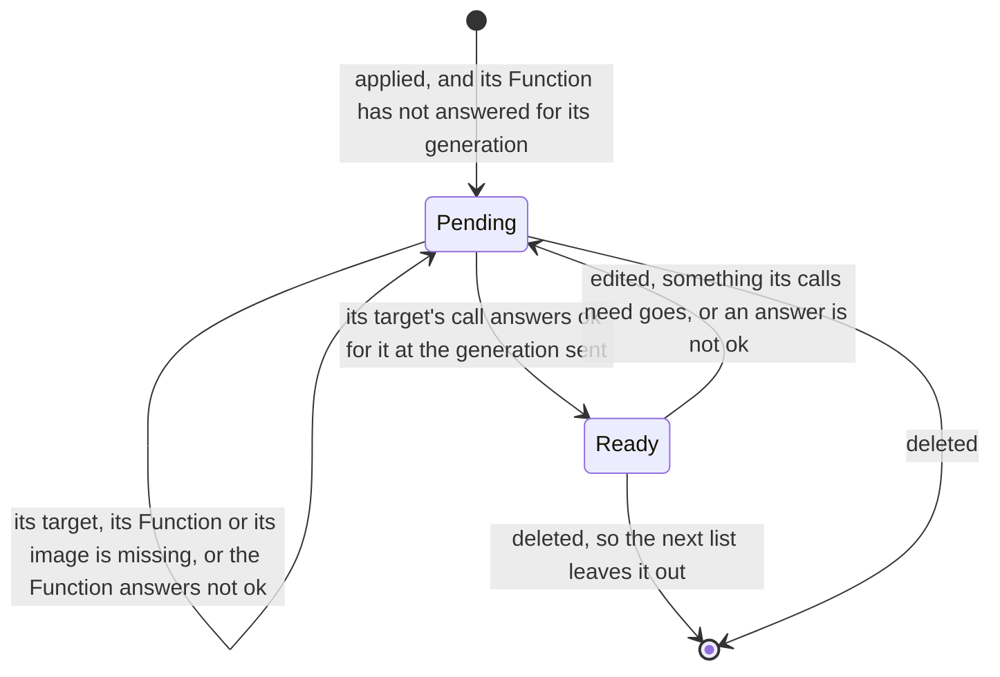

# Settings kinds

Status words and how to read this: [the index](README.md).

Kinds: none of its own.

An Addon's engine entry may add settings kinds, whose objects run no engine: each names a target, an object of the Addon's kind in
its namespace, and the kind's Function applies the target's full list to its engine (ADR-0340, ADR-0341). The Function comes from an
image that the Addon names, whose contract is the kind's schema, or is a `ref` (ADR-0358). Such an object is an AddonObject, served at
its kind's plural as any add-on object is ([Addons](addons.md)). The calls' design model: [settings](../design/addon/settings.md).

| Where | What happens | Time | You see | Status | Source |
|---|---|---|---|---|---|
| A settings kind | An Addon's `settings` kind is served at its plural; its objects run no engine and name a target of the Addon's kind | none | the object stored, no engine | decided | ADR-0340 Decisions 1 and 3, `TestScenarioSettingsKindServed`, `TestScenarioSettingsObjectNoEngine` |
| A settings object's write | Checked against the contract, then under the namespace's lock against the constraints and rules, of the revision its target pins, else the current one; an engine field is refused | none | 422; 400 naming the field, the constraint and the objects, or the rule's message | decided | ADR-0340 Decisions 3 to 5, ADR-0358 Decision 5, `TestScenarioAddonContractOfThePin` |
| A write that no contract judges | One of a kind with a `ref` or of a target's own Function, or before the image is read: it meets the contract at its call | none | 201, then `ReconcileFailed` naming the path | decided | ADR-0358 Decisions 4 and 5, `TestScenarioAddonFunctionRef` |
| A kind's Function from an image | funcd creates `<object>-<kind>` for a target once an object names it: it binds the target as `self` and the target's Secrets, and has no address. What differs is put back | the next pass | the Function, controlled by the target | decided | ADR-0358 Decision 2, `TestScenarioAddonFunctionImage`, `TestScenarioAddonFunctionRepaired` |
| A target that no object ever named | No Function and no call: what its engine's own API set stays | none | nothing | decided | ADR-0358 Decision 2, `TestScenarioAddonFunctionOnDemand` |
| A Function from an image goes | With its owner, once `spec.functions` or the pinned revision names another, or once the call with the empty list ended well; a failed call keeps it | that call's end | no Function | decided | ADR-0358 Decision 2, `TestScenarioAddonFunctionOnDemand`, `TestScenarioAddonFunctionOwn` |
| A settings call | One per target and kind at a time, on a goroutine of its own, with the target's full list; no pass waits on it, and its end requeues the target | `addons.settingsTimeout` 30 s | a CloudEvent `funcd.addon.settings` with cause `start`, `change`, `retry` or `resync` | decided | ADR-0341 Decisions 1 and 2, `TestScenarioSettingsHungFunction`, `TestAddonSettingsCallerSendsTheCall` |
| A settings call after a new Function revision | Sent once that revision takes the calls, or at its stamp while the Function sleeps, so the new code answers | the revision's boot | a call with cause `change` | decided | ADR-0341 Decision 1, ADR-0143, `TestSettingsCallFollowsTheRevisionThatAnswers` |
| A list off its Function's contract | Refused before the Function runs, as any call: the target's other objects of the kind wait too, and the engine keeps what it has, until an edit fits | as a failed call | `ReconcileFailed` naming the path | decided | ADR-0303 Decision 2, ADR-0358 Decision 5, `TestScenarioAddonConfigNoLongerFits` |
| A settings object's status | Written from its target's call at the uid and generation sent: `ok` is Ready, else the result's reason, `NoResult` if left out; a new or edited one is `Progressing` until then | none | `Ready`; `Pending` with `Progressing`, `ReconcileFailed`, `NoResult` or the Function's | decided | ADR-0341 Decision 4, `TestScenarioSettingsFunctionRefuses` |
| A settings object that cannot be applied | Pending while no Addon declares its kind, its target is missing or not Ready, or its Function is missing or does not bind the target, even after a Ready; nothing is called for it | none | `AddonNotFound`, `TargetNotFound`, `TargetNotReady`, `FunctionNotFound`, `FunctionNotBound` | decided | ADR-0341 Decision 4, `TestScenarioSettingsWaits` |
| A settings object whose image's Function is not there | Pending while the image is not read, or while another Function has its name, which is left as it is | none | `ArtifactNotReady`, `FunctionNotOwned` | decided | ADR-0358 Decisions 2 and 4, `TestScenarioAddonImageUnread`, `TestScenarioAddonFunctionRepaired` |
| A settings kind added to a live Addon | An object of it waits while its target pins a revision without the kind, and nothing is called, until an edit of the target moves its pin | the target's move | `FunctionNotFound` | decided | ADR-0358 Decision 5, `TestScenarioAddonKindNotInThePin` |
| A settings object in an App | Its pass records the App's latest applied revision, which the App waits for, as a part with an engine does | the next pass | `status.appRevision` | decided | ADR-0339 Decision 3, `TestSettingsPartFollowsItsApp` |
| A target's settings after funcd starts | The calls' state lives in memory: each Ready target's first pass sends its list, and a call that funcd's stop cut writes nothing | the first pass | a call with cause `start` | decided | ADR-0341 Decision 7, `TestScenarioSettingsRestart` |
| A settings object deleted | Left out of the next list, which may be empty, and the Function puts back what the engine holds without it | the target's next pass | a call with cause `change` | decided | ADR-0341 Decision 6, `TestScenarioSettingsDelete` |
| A setting changed at the engine's own API | Put back at the kind's next resync, which sends the list again with no change | the kind's resync, `DefaultAddonResync` 10 min | a call with cause `resync` | decided | ADR-0341 Decisions 1 and 2, `TestScenarioSettingsDrift` |
| A failed settings call | Due again after 1 s, then twice as long after each failure, at most the resync; a change of the list sends at once. A call past the timeout fails | `maxSettingsBackoff` 5 min, `addons.settingsTimeout` 30 s | `ReconcileFailed`; a call with cause `retry` | decided | ADR-0341 Decision 5, `TestScenarioSettingsHungFunction`, `TestSettingsBackoff` |
| A target's own Function for a settings kind | `spec.functions` names it per kind, in place of the kind's, and no contract judges its objects' writes; an unknown or repeated kind, one on a settings object, or in an App a ref it does not declare, is refused | none | 400 naming the entry | decided | ADR-0341 Decision 3, ADR-0358 Decision 5, `TestScenarioSettingsFunctionsRefused` |

<!-- generated values, do not edit: just behavior-values -->

Settings kinds: values

| Value | Default | From |
|---|---|---|

<!-- end of generated values -->
