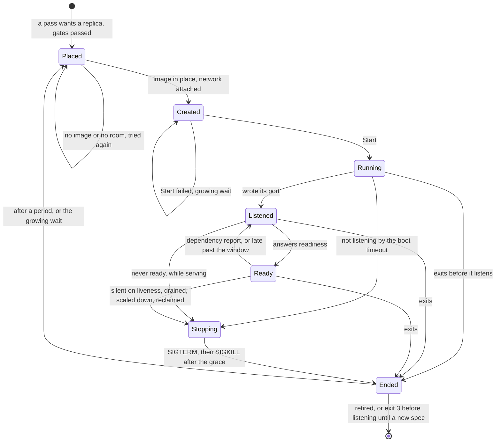

# Workers

Status words and how to read this: [the index](README.md).

Kinds: WorkerNode, RuntimeClass.

A worker is one replica of a Function's revision, or a pool worker, on one of two drivers. `process`, the default, runs it as a host
process with no isolation, no enforced limits and no volumes, and funcd says so at each start. `containerd` (Linux, root) runs it in
a crun sandbox with its own network. Pools run only on `process`, and a pool worker shares the boot-crash count. The count lives in
memory, so a funcd restart starts it at zero. Exit 3 before listening, in a pass not serving, is a handler that cannot load:
`Failed`, `ShapeInvalid`, never retried. Phases: [Functions](functions.md). A held call: [Calls](calls.md). Details:
[start-stop](../design/platform/start-stop.md), [booking](../design/volume/booking.md), [one-writer](../design/volume/one-writer.md).
New words: Placed, Stopping, Ended.

| Where | What happens | Time | You see | Status | Source |
|---|---|---|---|---|---|
| Placement | Every replica goes to the one configured node, unless the artifact lists platforms and not the node's: then no worker is created | none | `Failed`, `NoMatchingPlatform`, `artifact provides [<list>]; node <name> runs <platform>` | decided | ADR-0145 Decisions 4 and 5, `TestScenarioFunctionNoMatchingPlatform` |
| A `WorkerNode` or `RuntimeClass` object | Stored and listed, and no reconciler reads it: placement knows one configured node, and `spec.runtime` picks the image | none | the object as you applied it | deferred | ADR-0017 Open questions, ADR-0149 Scope |
| A runtime with no image | On `containerd`, learned at the first `Create`, so a scale-to-zero Function learns it at its first wake. An image that appears recovers it | `runtime.supervisionPeriod` 10 s | `Failed`, `RuntimeUnavailable`, `is not embedded; set runtime.containerd.imageOverride` | decided | ADR-0149 Decisions 2 to 5, `TestADR0149_MissingImageScaleToZero` |
| The first worker of a runtime in a namespace | Imports and unpacks the image inside its reconcile, on the controller's one worker, so every other reconcile waits. Each start of a private containerd begins with no image | seconds per image (#1292) | a slower first call | deferred | #1292, ADR-0186 Decision 6 and Consequences |
| A worker that cannot start | A failed `Start` or worker spec, none running: `Failed`, retried after the growing wait. A failed `Create`: phase kept or `Degraded`, retried at the controller's backoff | `runtime.bootBackoffMax` 5 min; `controller.retryBackoffMax` 1 s | `StartFailed` | decided | ADR-0169 Decision 4, ADR-0161 Decision 1, `TestScenarioStartFailureRetriedWithGrowingWait` |
| A worker ends before it listens | Retried for ever after a growing wait, never `Failed` | `runtime.bootBackoffInitial` 10 s, doubling to `runtime.bootBackoffMax` 5 min | `CrashLoopBackOff`, `replica 0 exited with code 1 before it listened; boot crash 2 in a row, retried 20s after its last start` | decided | ADR-0160 Decision 3, ADR-0183 Decision 2, `TestScenarioExitZeroBeforeListeningBacksOff` |
| A worker does not listen in time | Stopped and counted as a boot crash; created again no sooner than the timeout after its last start | `runtime.bootTimeout` 1 min | `CrashLoopBackOff`, `replica 0 did not listen within 1m0s; boot crash 1 in a row, retried 1m0s after its last start` | decided | ADR-0161 Decision 3, ADR-0183 Decision 2, `TestScenarioFirstBootNeverListeningIsRetried` |
| A worker listens, never ready | First boot: `Failed`, no retry, and the worker runs on until a new spec. While serving: stopped once `Degraded` that long, then replaced | `runtime.bootTimeout` 1 min | `ShapeInvalid`, `the handler did not become ready within 1m0s` | decided | ADR-0161 Decision 2, ADR-0169 Decision 1, `TestScenarioLateStartUnreadyFailsAfterBootTimeout` |
| A binding check fails | The worker runs on, not ready, and is never restarted for it. Beside a ready replica the Function stays `Ready` | read again each `runtime.supervisionPeriod` 10 s | `DependencyNotReady`, `<kind> binding "<binding>": <message>` | decided | ADR-0215 Decision 5, `TestScenarioHealthServingDependencyLost` |
| A worker late on readiness | A late read, or a pool's late `/health/members`, counts by the last answer for the window, so a call can still reach it. Past it, with every worker late, the Function is `Degraded` | `runtime.readinessTimeout` 5 s | `NotAnswering`, `a replica has not answered /health/readiness for 5s` | decided | ADR-0259 Decisions 1 to 3, `TestScenarioUnansweredPastWindow` |
| A worker exits after it listened | Any code or signal: replaced a period after its last start, with no growing wait however often it repeats | `runtime.supervisionPeriod` 10 s | `Degraded`, `Restarting`, `a replica exited and is being replaced`; before it served, `Deploying`, `ShimNotReady` | decided | ADR-0160 Decision 3, ADR-0183 Decision 4, `TestScenarioExitAfterServingIsReplaced` |
| A worker silent on its liveness | Stopped and created again at the same index, outside the boot backoff. Beside a ready replica the Function stays `Ready` | `runtime.livenessTimeout` 30 s + `runtime.supervisionPeriod` 10 s | `Restarting`, `a replica stopped answering /health/liveness and is being replaced` | decided | ADR-0215 Decisions 1 and 2, `TestHungReplicaIsReplacedAtTheSameIndex` |
| A worker killed for its memory | Reads as any SIGKILL. A boot crash names the signal; after it listened, no status or log of funcd names a cause | none | `was killed by signal 9`; `a replica exited and is being replaced` | deferred | card "Tell an out-of-memory kill from another SIGKILL in a worker's exit message (containerd OOM event)", ADR-0160 Constraints |
| A worker stops | SIGTERM, then SIGKILL after the grace, one value for every worker | `runtime.containerd.stopGrace` 10 s, `runtime.process.stopGrace` 3 s | a key out of range refuses the start | decided | ADR-0277 Decisions 1 and 2, ADR-0167 Decision 6, `TestScenarioOneGraceForBothStops`, `TestScenarioStopGraceFromConfig` |
| A stop that waits out the grace | The shims exit on SIGTERM, unless a call blocks a Node shim's event loop. Such a worker holds the controller's one worker, so every other reconcile waits | `runtime.containerd.stopGrace` 10 s per stop | other Functions' passes and wakes run late | accepted | ADR-0143 Consequences, `TestScenarioDefaultGrace`, `exitOnSigterm` in the Node shim |
| funcd is killed | Its workers run on, unwatched, until the next start, and what they print is lost | until the next start | a worker with no funcd | accepted | ADR-0167 Risks accepted, ADR-0168 Risks accepted, card "Worker lifeline" |
| funcd starts | Leftovers go before any controller: `process` SIGTERM then SIGKILL, `containerd` SIGKILL. A private one also drops its images | `runtime.process.stopGrace` 3 s; `killWait` 10 s per task | a warning only: `could not clear everything an earlier run left in containerd` | decided | ADR-0167 Decisions 5 and 8, ADR-0186 Decision 3, `TestScenarioContainerdImagesClearedAtBoot` |
| The private containerd dies mid-run | Nothing restarts it. Workers read as ended though they may still run; each replacement fails until funcd restarts | 2 ms to 10 s a call (#961) | `Degraded`, `StartFailed`, `stop exited worker` | **differs** | `blueprint.md` says restarts, ADR-0054 Decision 3 supervises, ADR-0161 `runtime-outage-keeps-routes` expects a failed `List`; `ctrmanager` only reaps |
| A volume that cannot be had | Apply refuses it when volumes are off, or a `local` one over capacity or budget. An `emptyDir` that does not fit leaves its worker uncreated | `volumes.capacity` 0 is off | `VolumesOff: spec.volumes: volumes are off on this daemon`; `VolumeCapacity`, `VolumeBudget` | decided | ADR-0262 Decisions 5 and 10, `TestScenarioVolumesOff` |
| A worker ends, with volumes | Its `emptyDir` goes with it, and a funcd start removes them all, at the release when held. A `local` volume keeps its files through a crash, a redeploy and a scale to zero | none | an empty `FUNCD_VOLUME_<NAME>` for the next worker | decided | ADR-0262 Decisions 5 and 8, `TestScenarioEmptyDirGoesWithWorker`, `TestScenarioLocalSurvives` |
| A redeploy with a `local` volume | The old and the new worker hold it at once until the old one stops, so the code must lock its files | until the old worker drains, `runtime.drainGrace` 30 s | nothing, unless writes collide | accepted | ADR-0262 Decision 6 and Consequences, `TestLocalVolumeSwitchEndsWithOneWriter` |
| A line a worker writes | `funcdctl logs` shows it once its segment is sealed, and a funcd crash loses the open segment | `funclog.segmentMaxAge` 10 s | no line yet | accepted | ADR-0081 Decision and Consequences, `TestScenarioPersistedViaBlob` |
| Output faster than funcd reads it | The worker never waits: a line its stream's half of the queue cannot hold is dropped and counted | `DefaultQueueBytes` 256 KiB | logs `worker output dropped: funclog did not keep up`, with `dropped` | accepted | ADR-0168 Decision 1 and Consequences, `TestWriteNeverBlocksAndCountsDrops` |

<!-- generated values, do not edit: just behavior-values -->

Workers: values

| Value | Default | From |
|---|---|---|
| `funclog.bucket` | funcd-system | config |
| `funclog.enabled` | true | config |
| `funclog.maxRecordBytes` | 65536 | config |
| `funclog.segmentMaxAge` | 10s | config |
| `funclog.segmentMaxBytes` | 8388608 | config |
| `funclog.traces` | true | config |
| `runtime.bootBackoffInitial` | 10s | config |
| `runtime.bootBackoffMax` | 5m | config |
| `runtime.bootTimeout` | 1m | config |
| `runtime.containerd.bridgeAddress` | "" ⇒ the subnet's network address + 1 | config |
| `runtime.containerd.cniBinDir` | /opt/cni/bin | config |
| `runtime.containerd.cniConfDir` | <dataDir>/cni | config |
| `runtime.containerd.imageOverride` | none | config |
| `runtime.containerd.imagePrefix` | funcd/runtime- | config |
| `runtime.containerd.root` | <dataDir>/containerd | config |
| `runtime.containerd.snapshotter` | overlayfs | config |
| `runtime.containerd.socket` | "" | config |
| `runtime.containerd.stateDir` | <dataDir>/run | config |
| `runtime.containerd.stopGrace` | 10s | config |
| `runtime.containerd.subnetCIDR` | 10.63.0.0/16 | config |
| `runtime.drainGrace` | 30s | config |
| `runtime.drainPollInterval` | 1s | config |
| `runtime.handOutSettle` | 2s | config |
| `runtime.livenessTimeout` | 30s, or three supervisionPeriod when larger | config |
| `runtime.mode` | process | config |
| `runtime.process.stopGrace` | 3s | config |
| `runtime.readinessTimeout` | 5s | config |
| `runtime.supervisionPeriod` | 10s | config |
| `volumes.capacity` | 0, volumes off | config |
| `volumes.capacityBytes` | 0 | config |
| `DefaultInterval` | 5m | `internal/funclog/compact/compact.go` |
| `DefaultRetention` | 720h | `internal/funclog/compact/compact.go` |
| `DefaultWindow` | 1h | `internal/funclog/compact/compact.go` |
| `DefaultLimit` | 1000 | `internal/funclog/logread/logread.go` |
| `MaxLimit` | 10000 | `internal/funclog/logread/logread.go` |
| `DefaultMaxRecordBytes` | 64KiB | `internal/funclog/reader.go` |
| `MaxLineBytes` | 1MiB | `internal/funclog/reader.go` |
| `lineReadBuf` | 64KiB | `internal/funclog/reader.go` |
| `dropWarnEvery` | 1m | `internal/funclog/route.go` |
| `defaultSegmentMaxAge` | 10s | `internal/funclog/sink.go` |
| `defaultSegmentMaxBytes` | 8MiB | `internal/funclog/sink.go` |
| `maxKeyReplica` | 63 | `internal/funclog/sink.go` |
| `minFlushInterval` | 100ms | `internal/funclog/sink.go` |
| `DefaultStopGrace` | 10s | `internal/runtime/containerd/containerd_linux.go` |
| `bootDirBytes` | 1MiB | `internal/runtime/containerd/containerd_linux.go` |
| `killWait` | 10s | `internal/runtime/containerd/containerd_linux.go` |
| `logAcceptBackoffMax` | 1s | `internal/runtime/containerd/containerd_linux.go` |
| `logAcceptBackoffMin` | 5ms | `internal/runtime/containerd/containerd_linux.go` |
| `outputWait` | 1s | `internal/runtime/containerd/containerd_linux.go` |
| `soloLogConns` | 4 | `internal/runtime/containerd/containerd_linux.go` |
| `tmpDefaultBytes` | 512MiB | `internal/runtime/containerd/containerd_linux.go` |
| `DefaultStopGrace` | 10s | `internal/runtime/containerd/containerd_other.go` |
| `containerdStopGrace` | 10s | `internal/runtime/ctrmanager/manager_linux.go` |
| `socketPollInterval` | 100ms | `internal/runtime/ctrmanager/manager_linux.go` |
| `startTimeout` | 30s | `internal/runtime/ctrmanager/manager_linux.go` |
| `DefaultStopGrace` | 3s | `internal/runtime/process/process.go` |
| `outputWait` | 1s | `internal/runtime/process/process.go` |
| `pollInterval` | 20ms | `internal/runtime/procreg/procreg.go` |
| `maxAssetBytes` | 256MiB | `internal/runtime/provision/provision.go` |
| `MaxReportBytes` | 1024 | `internal/runtime/runtime.go` |
| `DefaultLineBytes` | 64KiB | `internal/runtime/workerpipe/workerpipe.go` |
| `DefaultQueueBytes` | 256KiB | `internal/runtime/workerpipe/workerpipe.go` |
| `DefaultTailBytes` | 64KiB | `internal/runtime/workerpipe/workerpipe.go` |
| `drainBuf` | 32KiB | `internal/runtime/workerpipe/workerpipe.go` |
| `dropWarnEvery` | 1m | `internal/runtime/workerpipe/workerpipe.go` |
| `qifBlockSize` | 1024 | `internal/volume/quotafs/quotafs_linux.go` |
| `defaultBookingTTL` | 1m | `internal/volume/volume.go` |
| `defaultMeasureInterval` | 30s | `internal/volume/volume.go` |
| `volumeOverhead` | 16KiB | `internal/volume/volume.go` |
| `maxBlobBytes` | 64MiB | `internal/workernode/local/blob.go` |
| `maxSignExpiry` | 168h | `internal/workernode/local/blob.go` |
| `minSignExpiry` | 1s | `internal/workernode/local/blob.go` |
| `maxKVBytes` | `v1.MaxValueBytesLimit` | `internal/workernode/local/kv.go` |
| `DependencyCheckBudget` | 50ms | `internal/workernode/local/local.go` |
| `maxInvokeBytes` | 1MiB | `internal/workernode/local/local.go` |
| `serverHeaderTimeout` | 5s | `internal/workernode/local/local.go` |
| `serverIdleTimeout` | 30s | `internal/workernode/local/local.go` |
| `defaultTimeout` | 30s | `internal/workernode/local/resolver.go` |
| `MaxSQLStatements` | 500 | `internal/workernode/local/sql.go` |
| `maxSQLBytes` | 1MiB | `internal/workernode/local/sql.go` |

<!-- end of generated values -->
