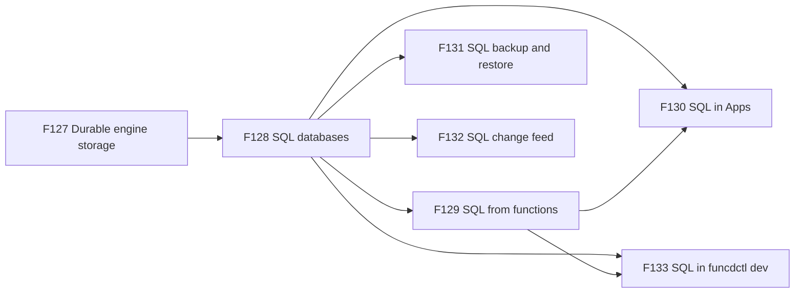
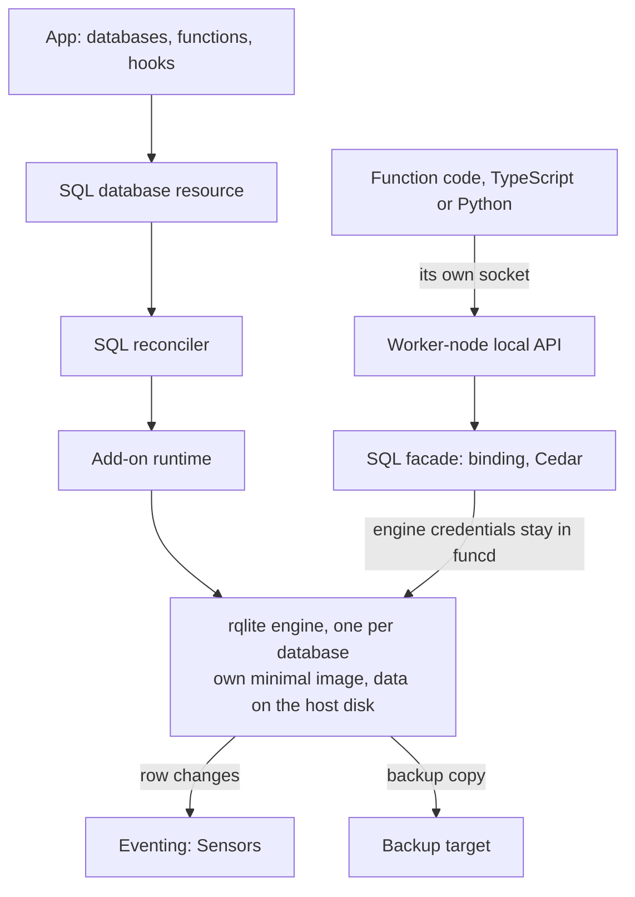

# FEAT-0011: SQL databases, a dedicated rqlite engine for each app

- **Status**: Active: a living document; the tracking table updates as ADRs progress
- **Date**: 2026-10-12
- **Deciders**: green-0-rabbit
- **Defines**: a **SQL epoch**: apps on funcd get relational databases. Each database runs on its own rqlite engine,
  which the platform deploys, protects, backs up and restores, and functions use it with no credential in their
  sandbox. Positioned alongside the other additive epochs (FEAT-0003 to FEAT-0010).

## Initial need

funcd gives functions a key-value store, object storage and an analytical catalog. Apps that keep records need more:
tables, indexes, joins, constraints, and changes that succeed or fail together. Today:

- the KV store has no query language: a filter or a join means reading every key and doing the work in the function;
- the catalog serves analytics over Parquet with one writer ([ADR-0086](../adr/0086-catalog-query-provider-ducklake-duckdb-quack.md));
  it is not meant for an app's records;
- no resource kind, binding, authorization action or backup member names a SQL database;
- an app that needs SQL has to run a database server outside funcd, with its own credentials, backups and access
  rules, out of reach of funcd's bindings, policies and restore.

PostgreSQL is ruled out: it is too heavy for the target box and goes against funcd's design. The engine is rqlite:
SQLite with Raft, served over HTTP and JSON, under MIT.

## How this document works

This file captures **what** this capability set must contain and **why**. The **how** lives in ADRs (`docs/adr/`,
process in [ADR-0000](../adr/0000-adr-process.md)): every feature maps to one or more ADRs, and no implementation
detail is decided here. The design was refined with the decider on 2026-10-12. Its source is the
[design report](../reports/sql-provider-design.md), which holds the study of funcd's providers, the rqlite facts, the
cost measured on the target box, the decisions and illustrative shapes. The build order is computed in the
[delivery plan](../roadmap/sql-delivery-plan.md). The sections after the feature table summarise the report. They are
illustrative and non-normative: when an Accepted ADR disagrees with them, the ADR wins and this document is updated to
match. Feature status: `idea → adr → accepted → reviewing → implemented`.

## Features

F127 comes first: a SQL engine keeps its data on disk, and the add-on runtime keeps none today. F128 builds on it.
F129, F131 and F132 build on F128. F130 and F133 build on F128 and F129, because a migration hook and the dev loop
both run SQL from functions. F134 and F135 are ideas, not built in this epoch.

| # | Feature | Builds on | ADR(s) | Status |
|---|---|---|---|---|
| F127 | **Durable engine storage**: an add-on engine keeps its data on the host's disk across its own restarts, its re-creation and daemon restarts, in a directory the platform owns, and the platform reclaims that directory when the resource that owns the engine is deleted. **Why**: the add-on runtime runs only engines that keep nothing locally, which suits DuckDB because its state lives in blob. A SQL engine keeps its log and its database file on disk; without this, every restart would lose the data. | [ADR-0087](../adr/0087-add-on-provider-runtime.md) (the add-on runtime) · [ADR-0032](../adr/0032-curated-runtime-images-container-execution.md) (container execution) · [ADR-0142](../adr/0142-supervision-by-periodic-re-convergence.md) (supervision) | [ADR-0231](../adr/0231-durable-storage-for-add-on-engines.md) | accepted |
| F128 | **SQL databases**: a namespace declares a SQL database as a resource. The platform runs one rqlite engine for it from its own minimal, pinned image, keeps it running, reports when it is ready, bounds its memory and CPU, and refuses to delete it while a function binds it or it holds data, as for a KV store. Each database is its own engine, so one app's load, data and failures never reach another app. **Why**: apps need tables, indexes, joins and changes that succeed or fail together, which a KV store cannot give. A dedicated engine measured about 5 MB at rest on the target box, so isolating every database costs less than checking each statement on a shared server. | F127 · [ADR-0082](../adr/0082-provider-model-catalog.md) (the provider model) · [ADR-0073](../adr/0073-kv-bindings-and-subdomains.md) (the KV store's binding and delete rules) · [ADR-0054](../adr/0054-self-contained-runtime-embedded-images-managed-containerd.md) (embedded images) | [ADR-0232](../adr/0232-sql-database-resource-and-rqlite-engine.md) | accepted |
| F129 | **SQL from functions**: a function binds a database by name and runs SQL on it from its code, in both the TypeScript and the Python runtime: reads, writes, and several writes that succeed or fail together. A binding grants reads; a write needs a grant from the database's side, as for a KV table, and roles grant reads and writes to other functions. The function never holds a database credential, every request is authorized, and Workflow steps bind databases the same way. SQL text and parameters from a query builder that only generates SQL work as they are. **Why**: one access model for KV, blob and SQL means one way to grant, revoke and audit data access, and it keeps secrets out of the sandbox. | F128 · [ADR-0069](../adr/0069-kv-data-plane.md) (the worker-node local API) · [ADR-0074](../adr/0074-cedar-authorization-resource-access.md)/[ADR-0116](../adr/0116-capability-authorization-framework.md) (Cedar and its capability registry) · [ADR-0136](../adr/0136-roles-and-role-assignments.md) (roles) | [ADR-0233](../adr/0233-sql-access-from-functions.md) | accepted |
| F130 | **SQL in Apps**: an App declares its databases next to its KV stores and buckets, with the same deletion policy, and runs its schema migrations in its lifecycle hooks before a new revision serves. Migrations can be SQL generated from the app's schema code at build time. **Why**: an App is the unit an owner installs, upgrades and removes; its schema must move with its code, in order, once. | F128 · F129 · [ADR-0199](../adr/0199-app-resource.md) (the App) · [ADR-0214](../adr/0214-app-hooks.md) (hooks) | [ADR-0236](../adr/0236-sql-in-apps.md) | accepted |
| F131 | **SQL backup and restore**: an app owner's backups copy its databases with its other stores, on its own schedule and encrypted, and a restore brings a database back into a new name or in place, under the same rules as a KV store. **Why**: a database without a backup is lost with the disk, and rqlite's own backups carry no encryption, so funcd's backup rules apply. | F128 · [ADR-0222](../adr/0222-workload-backup-resources-and-catalog-scope.md) (workload backups) · [ADR-0209](../adr/0209-kv-backup-on-the-common-format.md) (the common format) · [ADR-0206](../adr/0206-restore-and-held-boot.md) (restore and held boot) | [ADR-0234](../adr/0234-sql-backup-and-restore.md) | accepted |
| F132 | **SQL change feed**: a change to a database's rows becomes an event that Sensors react to, so a function or a workflow runs when data changes, without polling. **Why**: apps react to new and changed records, for notifications, projections and sync, and polling wastes both the engine and the function. | F128 · [ADR-0108](../adr/0108-eventsource-v2-named-events.md) (named events) · [ADR-0068](../adr/0068-kv-opt-in-cdc.md) (the KV change feed) | [ADR-0235](../adr/0235-sql-change-feed.md) | accepted |
| F133 | **SQL in funcdctl dev**: `funcdctl dev` gives a function or a workflow that binds a database a local database on the same engine, as a process, so a developer runs the same SQL and migrations before deploying. **Why**: the dev loop must match production, as it does for KV, blob and the catalog. | F128 · F129 · [ADR-0125](../adr/0125-funcdctl-dev-local-run.md) (funcdctl dev) | [ADR-0237](../adr/0237-sql-in-funcdctl-dev.md) | accepted |
| F134 | **External SQL access**: a client outside the platform, such as a reporting tool, reads a database with an Identity, as the catalog allows. The decider kept this as an idea on 2026-10-12, so it is not built in this epoch. **Why**: not needed yet. | F129 · [ADR-0137](../adr/0137-per-caller-catalog-query-rbac.md)/[ADR-0138](../adr/0138-external-catalog-ingress-and-route-aggregation.md) (the catalog's external path) | — | idea |
| F135 | **Shared SQL server**: many apps' databases on one engine, with funcd checking the tables and the action of every statement in the daemon before it runs. Recorded as an idea when dedicated engines were chosen on 2026-10-12, so it is not built in this epoch. **Why**: dedicated engines cost about 5 MB each at rest; a shared server would save that, at the price of statement checks and one write log for every app. | F128 · F129 | — | idea |

## How it lands on funcd (high level)

Each SQL database is an add-on engine: the SQL reconciler asks the add-on runtime for one rqlite container per
database, built from funcd's own minimal image and given a directory on the host's disk. Functions reach a database
the way they reach KV: the handler calls the SQL helper of its runtime, which talks to funcd over the function's own
socket; funcd resolves the binding, asks Cedar, and forwards the request with the engine's credentials, which never
leave the daemon. Reads go to rqlite's read-only endpoint. Backups, the change feed and the dev loop reuse the workload
backup layer, eventing and `funcdctl dev`.

## Capability map — reuse vs. new

| Component | Role for SQL | Status | Feature |
|---|---|---|---|
| Add-on runtime ([ADR-0087](../adr/0087-add-on-provider-runtime.md)) | runs one engine per database; gains durable storage | exists; storage new | F127, F128 |
| Embedded engine images ([ADR-0054](../adr/0054-self-contained-runtime-embedded-images-managed-containerd.md)) | carry funcd's own minimal rqlite image in the binary | exist; rqlite image new | F128 |
| Provider catalog ([ADR-0082](../adr/0082-provider-model-catalog.md)) | lists the `sql` add-on | exists; one row new | F128 |
| KV store rules ([ADR-0073](../adr/0073-kv-bindings-and-subdomains.md)) | the model for bindings, writers and delete protection | exist; mirrored | F128, F129 |
| Worker-node local API ([ADR-0069](../adr/0069-kv-data-plane.md)) | carries a function's SQL calls over its socket | exists; SQL routes new | F129 |
| The shims, funcd-typescript and funcd-python | give handlers a SQL helper next to the KV helper | exist; helper new | F129 |
| Cedar and its capability registry ([ADR-0074](../adr/0074-cedar-authorization-resource-access.md), [ADR-0116](../adr/0116-capability-authorization-framework.md)) | authorize reads and writes on a database | exist; SQL capability new | F129 |
| Roles ([ADR-0136](../adr/0136-roles-and-role-assignments.md)) | grant reads and writes on a database to other principals | exist; SQL roles new | F129 |
| The App and its hooks ([ADR-0199](../adr/0199-app-resource.md), [ADR-0214](../adr/0214-app-hooks.md)) | declare databases and run migrations | exist; SQL section new | F130 |
| Workload backups ([ADR-0222](../adr/0222-workload-backup-resources-and-catalog-scope.md)) | copy and restore databases | exist; SQL member new | F131 |
| Eventing ([ADR-0108](../adr/0108-eventsource-v2-named-events.md)) | turns row changes into events | exists; SQL source new | F132 |
| `funcdctl dev` ([ADR-0125](../adr/0125-funcdctl-dev-local-run.md)) | runs the engine locally | exists; SQL engine new | F133 |

## Rules at a glance (illustrative, non-normative)

| Topic | Rule | Feature |
|---|---|---|
| Engine | rqlite, one engine per database, from funcd's own minimal image | F128 |
| Isolation | one app's load, data and failures stay in its own engine | F128 |
| Storage | the engine's data on the host's disk, owned and reclaimed by the platform | F127 |
| Access | through the function's own socket; no database credential in the sandbox | F129 |
| Grants | a binding grants reads; writes need the database's grant; roles add readers and writers | F129 |
| Reads | rqlite's default read consistency, with no setting in V1 | F129 |
| Atomic writes | several statements in one call succeed or fail together; no transaction spans two calls | F129 |
| Query builders | SQL text and parameters from a builder that only generates SQL work as they are; ORMs are optional | F129 |
| Delete | refused while bound or holding data; the App's deletion policy decides whether the database outlives the App | F128, F130 |
| Schema | migrations run in the App's hooks, in order, once | F130 |
| Backup | workload backups copy each database; a restore goes into a new name by default | F131 |
| Changes | a row change becomes an event Sensors react to | F132 |
| Dev | `funcdctl dev` runs the same engine as a local process | F133 |

## Exit criterion

The epoch is complete when an App declares a SQL database, its functions read and write it from both runtimes with no
credential in their sandbox, its migrations run in a hook, the data survives an engine restart and a daemon restart,
a backup restores it into a new name, a row change starts a Sensor's action, and `funcdctl dev` runs one of its functions with its database, and
each feature passes its checks:

- **F127**: an engine's data survives a crash of the engine, its re-creation and a daemon restart; deleting the
  resource that owns the engine reclaims its directory.
- **F128**: applying a database starts its engine and reports Ready; a second database is a second engine; a delete is
  refused while a function binds the database or it holds data; the engine stays within its memory and CPU bounds.
- **F129**: a bound function reads; it writes only with the database's grant or a role; an unbound function is
  refused; nothing in the sandbox reaches the engine except through funcd; a query built by a SQL builder runs as it
  is; several writes in one call succeed or fail together; both runtimes pass the same checks.
- **F130**: an App installs a database and its migration hook creates the schema before the new revision serves; an
  upgrade applies only the new migrations; the deletion policy keeps or removes the database with the App.
- **F131**: a scheduled backup copies a database, encrypted; a restore into a new name gives the same rows; an
  in-place restore follows the workload rules.
- **F132**: an insert, an update and a delete each start the Sensor's action, also after an engine restart, and a
  change the engine delivers twice starts it once.
- **F133**: `funcdctl dev` runs a function that binds a database, its migrations and its queries, as in production.

## Out of scope (tracked elsewhere)

- **PostgreSQL**: ruled out on 2026-10-12, as too heavy for the target box.
- **A shared SQL server and external SQL access**: kept as ideas, F135 and F134.
- **High availability and multi-node rqlite clusters**: a V2 topic (FEAT-0002), with the rest of multi-node.
- **ORM adapters**: optional; a function can use any library that only generates SQL. An ORM that needs its own
  driver can get an adapter later.
- **Transactions across several calls**: rqlite runs a transaction within one request only.
- **Recovery to any moment between two backups**: copies are snapshots, as in FEAT-0009.
- **Databases across namespaces**: a binding names a database of its own namespace, as for KV.

## Open questions

| Question | Decided in |
|---|---|
| The kind's name, around the `sql` vocabulary | the SQL database ADR |
| Who holds a write grant: an owner plus roles, as for KV, or a writers list on the database | the SQL access ADR |
| Whether a Workflow step may bind an App's database, or only one its Workflow owns, as for KV stores ([ADR-0178](../adr/0178-a-workflow-adopts-only-its-own-kv-stores.md)) | the SQL access ADR |
| Result size and statement limits per call; how dates and bytes are passed; which call returns `RETURNING` rows | the SQL access ADR |
| The engine's default memory and CPU bounds, and a per-namespace database quota | the SQL database ADR |
| The engine image: a static build from source, or the glibc build on a distroless base | the SQL database ADR |
| How an engine moves to a new rqlite version | the SQL database ADR |
| Whether the platform backup also copies every database | no, for now: [ADR-0234](../adr/0234-sql-backup-and-restore.md) Decision 6 |
| The shape of a change event, and how a duplicate delivery is dropped | the SQL change-feed ADR |
| The containerd shim cost per engine | the SQL database ADR, measured |
