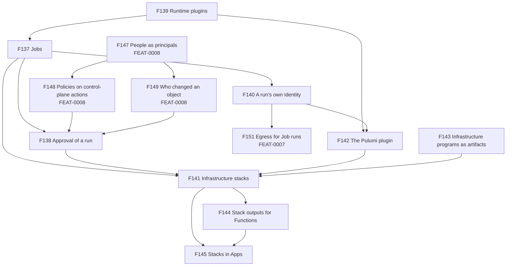
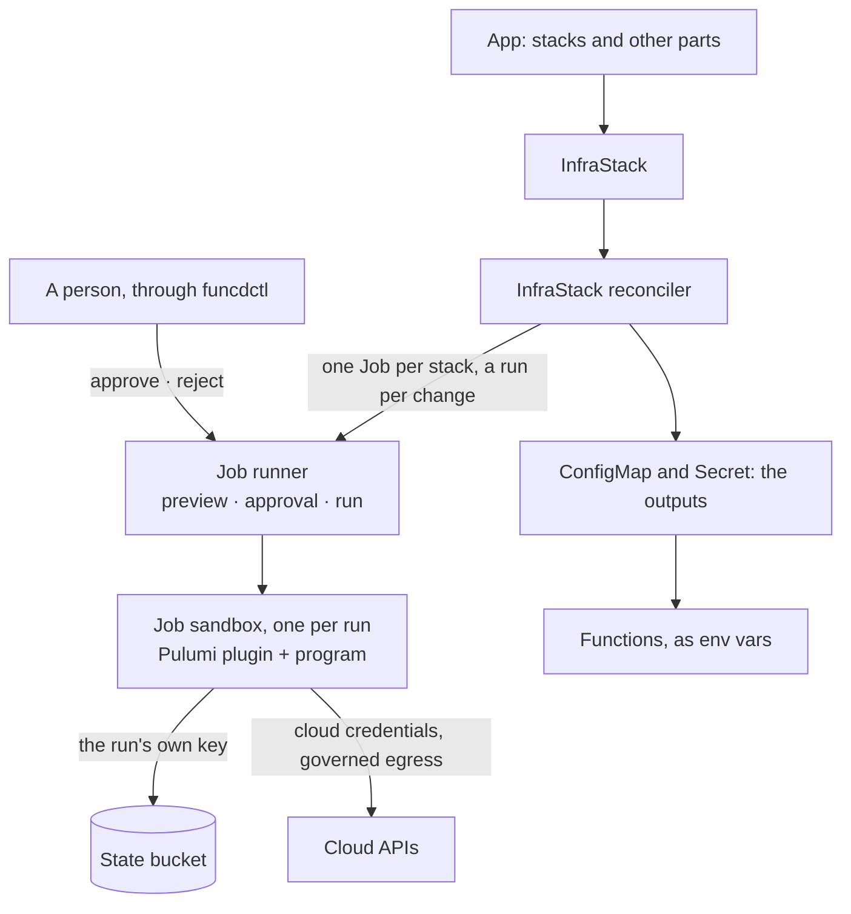

# FEAT-0012: Infrastructure stacks, kept applied by funcd from existing Pulumi programs

- **Status**: Active: a living document; the tracking table updates as ADRs progress
- **Date**: 2026-10-14
- **Deciders**: green-0-rabbit
- **Defines**: an **infrastructure epoch**: funcd keeps the infrastructure an app uses outside the machine applied, as
  Crossplane does on Kubernetes, but the unit is a whole existing program rather than one cloud resource. Each change
  is previewed and waits for a person's approval. The epoch also brings the platform's first kind for work that runs to
  completion, the generic `Job`. Positioned alongside the other additive epochs (FEAT-0003 to FEAT-0011).

## Initial need

An app on funcd often needs infrastructure that funcd does not run: a cloud queue, a bucket, an access key, a DNS
record. Today that infrastructure is applied outside funcd, so:

- the platform keeps no record of who approved which change, and nothing previews a change before it runs;
- nobody is told when the infrastructure drifts from its program;
- the outputs, such as a queue's URL or an access key, are copied into ConfigMaps and Secrets by hand;
- an App cannot declare its infrastructure, so installing, upgrading or removing the App leaves it behind.

funcd also has no kind for work that runs to completion. A Function serves calls, each bounded by a deadline
([ADR-0151](../adr/0151-external-invoke-deadline.md)), and a Workflow step is such a call. A stack update, a backfill
or a long migration runs for minutes or hours, in its own sandbox, and must never run twice by accident.

## How this document works

This file captures **what** this capability set must contain and **why**. The **how** lives in ADRs (`docs/adr/`,
process in [ADR-0000](../adr/0000-adr-process.md)): every feature maps to one or more ADRs, and no implementation
detail is decided here. Its source is the [design report](../reports/infrastack-design.md), which holds the study of
the code, the Pulumi facts and the illustrative shapes. One decision is refined with the decider so far (2026-10-14):
the `Job` kind is generic from v1. The build order will be computed in a delivery plan. Every name below is a
placeholder until its ADR. Feature status: `idea → adr → accepted → reviewing → implemented`.

Some features this epoch needs belong to other epochs, because they serve more than infrastructure: four to IAM
(FEAT-0008) and one to egress control (FEAT-0007). They are listed with the features of this epoch, so this
document shows every part of the design.

## Features

F139 comes first: a Job needs a runtime, and its runtimes are plugins. F137 builds on it, and F138 and F140 build on
F137. F143 is independent of the Jobs. F142 builds on F139 and F140, and F141 on F137, F138, F142 and F143. F144
builds on F141, and F145 on F141 and F144. F138 also needs F147, F148 and F149 from FEAT-0008, and F151 from
FEAT-0007 builds on F140. F146 and F150 are ideas, not built in this epoch.

### This epoch

| # | Feature | Builds on | ADR(s) | Status |
|---|---|---|---|---|
| F137 | **Jobs: work that runs to completion**: a namespace declares a `Job`, a reusable definition of work that runs to completion in its own sandbox: the runtime, the image, the Secrets, ConfigMaps and buckets it binds, its memory and CPU, a timeout, how many of its runs may run at once, and default params that the runtime defines. Each execution is a `JobRun`: its input is merged over the defaults, checked against the runtime's schema and frozen when the run is created. Runs wait their turn under the Job's limit and a node-wide one, and their phase, logs and result are kept. A run cut by a daemon restart ends failed and never runs again on its own. `funcdctl job` starts, lists, follows and cancels runs. The kind is generic from v1, decided on 2026-10-14, so a later runtime is a plugin, not a new kind. **Why**: a stack update, a backfill or a long migration runs for minutes or hours, and no kind runs one piece of work to completion today. Running such work twice after a crash can apply a change nobody approved. | F139 · [ADR-0011](../adr/0011-runtime-sandbox-port.md) (the runtime port) · [ADR-0094](../adr/0094-workflow-engine-core.md) (WorkflowRun phases and cancel) · [ADR-0217](../adr/0217-app-templates-values-and-rendering.md) (how values merge) | — | idea |
| F138 | **Approval of a run**: a run shows what it would change and waits for a person's approval, unless its Job says `bypass`. An approval names the preview it approves, so exactly what was previewed runs, and a newer preview must be approved again. A person can reject a run, which ends it, or cancel it, which stops it without judging the change. A preview older than the Job's expiry is previewed again when someone approves it, not on a timer. Policies decide who may start a run, override its params, approve, reject or cancel it, and set `bypass`, inside what RBAC allows; the run records who started and who approved it. **Why**: an infrastructure change or a backfill can destroy data, so a person must see the change before it runs and the platform must keep the record. Workflow governance gates (FEAT-0005/F66) need the same verbs. | F137 · F147 · F148 · F149 | — | idea |
| F139 | **Runtime plugins**: an admin registers a runtime for Jobs as an OCI image pinned by digest. The platform pulls it from the registry the admin chose, a private one included, records its architectures and the params schema it ships, and finds it through the same runtime-to-image mapping as the curated runtimes. A plugin and the platform speak one versioned protocol: the phase to run, the bindings, the result and the secret outputs. **Why**: an engine such as Pulumi is a CLI with its language hosts, too large to embed in the binary as the curated runtimes and engines are ([ADR-0054](../adr/0054-self-contained-runtime-embedded-images-managed-containerd.md)), and a new engine should be a new image, not a change to the daemon. | [ADR-0149](../adr/0149-runtime-availability.md) (runtime availability and the pull rule) · [ADR-0054](../adr/0054-self-contained-runtime-embedded-images-managed-containerd.md) (embedded images) · [ADR-0145](../adr/0145-multi-arch-function-bundles-and-arch-aware-placement.md) (multi-arch) | — | idea |
| F140 | **A run's own identity**: a run reaches the platform's services as itself, never as a Function: its bucket bindings authorize as the run, and policies can name it. **Why**: a Pulumi run holds cloud credentials and writes its stack's state, so it must reach that state and nothing else, and every access must be decided for that run. | F137 · [ADR-0085](../adr/0085-s3-in-platform-identity-funcd-keypair.md) (S3 keys derived per Function) · [ADR-0175](../adr/0175-engine-is-its-own-principal.md) (a key that carries its kind) | — | idea |
| F141 | **Infrastructure stacks (`InfraStack`)**: a namespace declares a stack: its engine, a program pinned by digest, the stack's name and config, the cloud credentials as a Secret, where its state is kept, where its outputs go, its approval mode, a drift schedule and a deletion policy. The platform owns one Job for the stack and starts a run for every change. It checks the config against the program's schema before any run, refreshes the stack on its schedule and reports drift. On delete it keeps the cloud resources and the state, or destroys them through an approved run. **Why**: infrastructure applied outside funcd has no approval record, no drift report and outputs copied by hand. Crossplane manages one cloud resource per object; a stack keeps the whole program as the unit, so teams reuse their Pulumi programs unchanged. | F137 · F138 · F142 · F143 · [ADR-0211](../adr/0211-cron-schedules.md) (cron schedules) · [ADR-0170](../adr/0170-owner-garbage-collector.md) (owner garbage collection) | — | idea |
| F142 | **The Pulumi plugin**: the first runtime plugin runs Pulumi programs written in YAML or TypeScript, on amd64 and arm64, with Pulumi and Node pinned. It previews a change and applies only the previewed plan. It keeps the stack's state in a funcd bucket, keeps the state's credentials apart from the cloud's, and brings back a stack that an interrupted run left locked. **Why**: Pulumi programs run as they are, and a pinned engine keeps a preview and its run in agreement. | F139 · F140 · [ADR-0080](../adr/0080-s3-protocol-frontend-blob-substrate.md) (the S3 gateway) | — | idea |
| F143 | **Infrastructure programs as artifacts**: a developer pushes a Pulumi program as an OCI artifact, with its provider plugins pinned in a lock file. funcdctl builds a YAML program, and the funcd-typescript toolchain builds a TypeScript one. The artifact carries its config schema, readable without pulling the program, so `funcdctl apply` and the platform refuse a wrong config before any run starts. **Why**: a run must download nothing, every input must be pinned so a run can be reproduced, and a typo must fail before it reaches the cloud. | [ADR-0031](../adr/0031-oci-artifact-distribution-oras.md) (OCI artifacts) · [ADR-0059](../adr/0059-contract-as-oci-metadata.md) (a contract readable from the manifest) · [ADR-0144](../adr/0144-bundling-in-the-language-toolchains.md) (bundling in the language toolchains) · [ADR-0218](../adr/0218-app-template-images-lock-and-push.md) (pinned images and `app.lock`) | — | idea |
| F144 | **Stack outputs for Functions**: a stack's outputs reach Functions as a ConfigMap and a Secret that the stack owns, and a secret output never appears in a status or a log. `funcdctl infra outputs` shows them. **Why**: an app uses what its infrastructure created, such as a queue's URL or an access key, and nobody should copy those values by hand. | F141 · [ADR-0093](../adr/0093-function-configmap-consumption.md) (ConfigMap consumption) · [ADR-0057](../adr/0057-secret-injection-last-mile.md) (secret injection) | — | idea |
| F145 | **Stacks in Apps**: an App declares its stacks next to its other parts. It counts a stack by what is applied, so a waiting approval never holds or fails its rollout, and a part that needs a stack's outputs waits for them. Its post-hooks run once its stacks are applied; its pre-hooks never wait for a stack. A dropped stack is destroyed only through an approved run, when its entry says so. **Why**: an App is the unit an owner installs, upgrades and removes, so its infrastructure must move with it, and a person's approval must never become an upgrade timeout. As for SQL (FEAT-0011/F130), the App section lives with the capability it declares. | F141 · F144 · [ADR-0199](../adr/0199-app-resource.md) (the App) · [ADR-0200](../adr/0200-app-revisions.md) (revisions) · [ADR-0213](../adr/0213-app-config-and-secret-declarations.md) (declared Secrets) · [ADR-0214](../adr/0214-app-hooks.md) (hooks) | — | idea |
| F146 | **OpenTofu engine**: a second plugin runs OpenTofu programs on the same `InfraStack` kind. The design keeps it for later, so it is not built in this epoch; OpenTofu is under MPL-2.0, which needs the decider's approval. **Why**: teams with Terraform code would reuse it, as Pulumi teams reuse theirs. | F139 · F141 | — | idea |

### In other epochs, needed here

These rows are tracked, with their status and ADRs, in their own epoch's table; this list only points at them.

| # | Feature | Tracked in | Needed by |
|---|---|---|---|
| F147 | **People as principals**: a person calling the API with a token is a principal that policies can name, with the role the token gives, and a decision can use facts about the request, such as the params a run overrides | [FEAT-0008](0008-feat-iam.md) | F138 |
| F148 | **Policies on control-plane actions**: an action on a control-plane object can be decided by policies once RBAC allows it, including the policies of the object's namespace | [FEAT-0008](0008-feat-iam.md) | F138 |
| F149 | **Who changed an object**: the platform records which person wrote each generation of an object | [FEAT-0008](0008-feat-iam.md) | F138 |
| F150 | **Cluster-scoped Policies**: rules an admin writes for every namespace, which developers cannot edit | [FEAT-0008](0008-feat-iam.md) | an idea, not needed by any feature here |
| F151 | **Egress for Job runs**: a Job run's outbound connections are governed by its namespace's `EgressPolicy`, as a Function's are | [FEAT-0007](0007-feat-egress-control.md) | F141, once worker isolation is on ([ADR-0115](../adr/0115-worker-network-isolation.md) makes it opt-in); it builds on F140 |

## How it lands on funcd (high level)

An `InfraStack` owns a `Job`, and every change to the stack starts a `JobRun`. The Job runner starts one sandbox per
run from the plugin's image and the program's artifact, both pinned by digest, and talks to the plugin over one
protocol. The Pulumi plugin previews the change, waits for the approval, then applies exactly that plan, with the
state in a funcd bucket and the cloud credentials from a Secret. The plain outputs reach a ConfigMap, the secret ones
a Secret, and Functions read both as env vars.

## Every part of the design, and where it lives

| Part | Role | Status | Feature |
|---|---|---|---|
| `Job` and `JobRun` kinds | a definition of run-to-completion work and one execution of it | new | F137 |
| Job runner | runs JobRuns: sandbox, bindings, queue, deadline, cancel, history, a run cut by a restart | new, over the existing runtime port ([ADR-0011](../adr/0011-runtime-sandbox-port.md)) | F137 |
| `funcdctl job` | `run`, `get`, `list`, `logs`, `cancel` | new | F137 |
| The approval gate | preview, then wait; approve with the preview's digest; reject; expiry; `bypass` | new | F138 |
| `job` Cedar capability | six `job::*` actions and the built-in rules | new | F138 |
| `RuntimeClass` | registers a plugin: image, protocol, params schema | exists as a stub; gains fields and its first reader | F139 |
| Image and program pull | the plugin image through the containerd driver; the program through `internal/artifact` | exist; gain registry credentials and a program artifact type | F139, F143 |
| The plugin protocol | phase, bindings, result and secret outputs between the runner and a plugin | new | F139 |
| A run's principal | the run's own key for the S3 gateway and its own identity for policies | new | F140 |
| `InfraStack` kind and its reconciler | config check, the stack's Job and runs, drift schedule, deletion | new | F141 |
| Pulumi plugin image | pinned Pulumi CLI with its YAML and Node hosts, pinned Node, the shim; amd64 and arm64 | new | F142 |
| Pulumi shim | maps the preview and run phases to Pulumi; keeps the plan; state on the S3 gateway | new | F142 |
| Program build | YAML in funcdctl, TypeScript in the funcd-typescript toolchain ([ADR-0144](../adr/0144-bundling-in-the-language-toolchains.md)) | new | F143 |
| `infra.lock` and `funcdctl push --program` | pin each provider plugin's version and digest per architecture; push the program | new | F143 |
| The config check on `funcdctl apply` | refuses a config that breaks the program's schema, offline | new | F143 |
| Outputs ConfigMap and Secret, `funcdctl infra outputs` | hand the outputs to Functions | new; ConfigMap and Secret exist | F144 |
| App `infra` section and `InfraApplied` | an App declares its stacks | new; the App exists ([ADR-0199](../adr/0199-app-resource.md)) | F145 |
| OpenTofu plugin | a second engine on the same kind | idea | F146 |
| `User` principal and request context | people in Cedar | new | F147 (FEAT-0008) |
| Cedar at control-plane handlers and admission | policies after RBAC | new | F148 (FEAT-0008) |
| The writer of each generation | who changed an object | new | F149 (FEAT-0008) |
| Cluster-scoped Policies | admin rules for every namespace | idea, open since [ADR-0074](../adr/0074-cedar-authorization-resource-access.md) | F150 (FEAT-0008) |
| EgressPolicy for a run's principal | governed outbound for runs | exists for Functions; extended | F151 (FEAT-0007) |
| Examples and a Lima lane | `infra-random` (YAML, the random provider, no cloud account) in a lane with a Venom suite; `infra-todo` (TypeScript, AWS) | new, in funcd-functions and funcd `e2e/` | the exit criterion |
| The blueprint's purpose and its IaC section | name infrastructure outside the machine | changed with this document | — |

## Exit criterion

The epoch is complete when a team applies an `InfraStack` for a Pulumi program, sees what it would change, another
person approves it, the run applies exactly that preview, a Function reads the stack's outputs, a scheduled refresh
reports a change made outside funcd, an App declares the stack and keeps serving while an approval waits, and a daemon
restart during a run ends the run without applying anything twice. The `infra-random` example runs these checks on
real containerd in a Lima lane, and each feature passes its checks:

- **F137**: a run starts with its input merged over the Job's defaults; an input the runtime's schema refuses is
  refused when the run is created, naming the path; runs beyond the limits wait; a run's params do not change when its
  Job does; a run cut by a daemon restart ends failed and is not started again; a cancel stops a run.
- **F138**: a run that needs approval waits after its preview; an approval of an older preview is refused; a reject
  ends the run; a `bypass` run runs at once; a policy can forbid approving one's own run, and only an admin can set
  `bypass` by default.
- **F139**: an admin registers a plugin pinned by digest and a developer cannot; a plugin in a private registry is
  pulled with its credentials; a Job whose runtime is not registered is refused or reported.
- **F140**: a run reads and writes its stack's state and nothing else, and each of its accesses is decided for the run.
- **F141**: a wrong config is refused before any run; an approved run applies the stack, which reports Ready on that
  generation; a change made in the cloud shows as drift at the next scheduled refresh; `retain` keeps the cloud
  resources on delete, and `delete` destroys them after an approval.
- **F142**: a YAML and a TypeScript program preview and apply on amd64 and arm64; a run whose changes differ from its
  plan stops; the state stays in the funcd bucket, and the cloud credentials never reach it; a stack left locked by
  an interrupted run runs again.
- **F143**: a YAML program pushed by funcdctl and a TypeScript one built by the toolchain run with pinned plugins and
  download nothing; `funcdctl apply` refuses a wrong config offline.
- **F144**: a Function reads a plain output and a secret output as env vars; no secret output appears in a status or
  a log.
- **F145**: an App with a stack installs; while a change waits for approval, the App stays Ready on the applied state;
  a part that needs the outputs waits for the first apply; a post-hook runs after the stack is applied; a dropped
  stack with `deletion: delete` is destroyed after an approval.
- **F147 to F149 and F151**, in their epochs, pass the checks their ADRs set, and F138's checks pass on top of them.

## Out of scope (tracked elsewhere)

- **OpenTofu**: kept as an idea, F146.
- **Cluster-scoped Policies**: an idea in FEAT-0008, F150.
- **Pulumi programs in Python**, and YAML stacks that use TypeScript components.
- **Pulumi Cloud** (ESC, Deployments) and **workload identity federation** for cloud credentials.
- **Re-rendering every stack when an App template changes**.
- **Roles for people** (a `RolesAssignment` naming a person).
- **Jobs in `funcdctl dev`** (process mode): a Job runs in containerd mode only.
- **A UI** for approvals.
- **Multi-node**: a V2 topic (FEAT-0002), with the rest of multi-node.

## Open questions

| Question | Decided in |
|---|---|
| Plugin trust: a digest only, or signatures too | the plugin ADR |
| Clearing a stale lock and pending operations after an interrupted run | the Pulumi plugin ADR, tested on the S3 gateway |
| What a cancelled `up` leaves in the state, and how to recover | the Pulumi plugin ADR |
| Output names that are not env-var names: an automatic mapping or an explicit map | the outputs ADR |
| Whether a changed output rolls the Functions that read it, as an App's configuration does (FEAT-0010/F116) | the outputs ADR |
| How many finished runs to keep per Job | the Jobs ADR |
| How approvers learn that a run waits | the approval ADR |
| Whether a paused App also holds its stacks' scheduled runs | the Apps ADR |
| The repository of the Pulumi shim and its image: funcd, or its own | the Pulumi plugin ADR |
| Pulumi's S3 backend against the S3 gateway ([ADR-0159](../adr/0159-blob-content-digest-and-metadata.md), [ADR-0184](../adr/0184-stateless-listing-pushdown.md)) | a spike before the Pulumi plugin ADR |
| Whether a YAML stack can use a TypeScript component | a spike |
| The memory and size defaults for runs and artifacts | measured on the target box |
