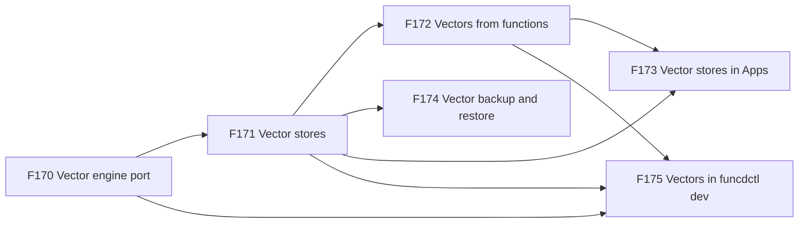
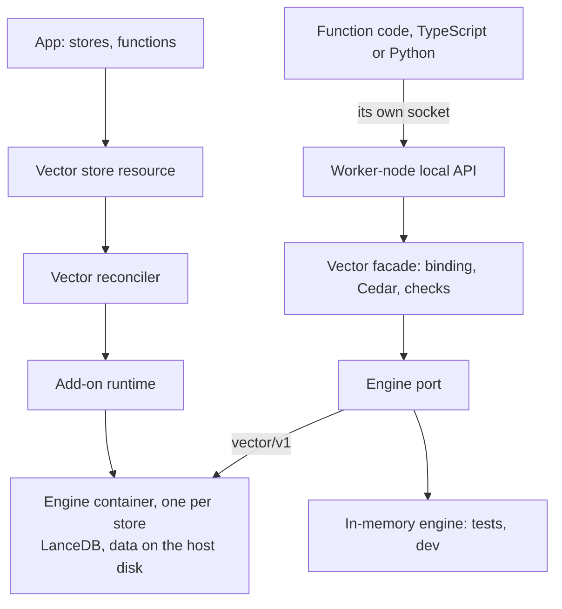

# FEAT-0013: Vector stores, a fixed API over a swappable engine

- **Status**: Active: a living document; the tracking table updates as ADRs progress
- **Date**: 2026-10-22
- **Deciders**: green-0-rabbit
- **Defines**: a **vector epoch**: apps on funcd get vector stores for similarity search, full-text and hybrid
  search. Functions use them through one fixed API, `context.vector`, with no engine in their sandbox and no
  credential, and the engine underneath can change without any change to a function. Positioned alongside the other
  additive epochs (FEAT-0003 to FEAT-0012).

## Initial need

funcd targets agents and MCP servers, and agents need memory and retrieval: store embeddings, find the nearest ones
under a filter, mix them with keyword search. The blueprint plans a vector service (blueprint.md, *Vector database*)
and FEAT-0003 set LanceDB aside "when RAG is picked up". Today:

- no resource kind, binding, authorization action or helper names a vector store;
- a function can load LanceDB itself and keep its tables on a Bucket, but each warm worker then carries LanceDB's
  memory and start time, cannot join a Python pool, cannot do it from TypeScript at all, and two concurrent writers
  can lose a commit on the S3 gateway;
- LanceDB has no open-source server, so nothing runs it as a shared service yet.

## How this document works

This file captures **what** this capability set must contain and **why**. The **how** lives in ADRs (`docs/adr/`,
process in [ADR-0000](../adr/0000-adr-process.md)): every feature maps to one or more ADRs, and no implementation
detail is decided here. The design was refined with the decider on 2026-10-22. Its source is the
[design report](../reports/vector-store-design.md), which holds the options, the LanceDB facts, what the experiments
showed, the decisions and illustrative shapes. The build order is computed in the
[delivery plan](../roadmap/vector-delivery-plan.md). The sections after the feature table summarise the report. They
are illustrative and non-normative: when an Accepted ADR disagrees with them, the ADR wins and this document is updated
to match. Feature status: `idea → adr → accepted → reviewing → implemented`.

## Features

F170 comes first: the stores, the access and the dev loop all call engines through its port. F171 builds on it, F172
and F174 build on F171, and F173 and F175 build on F171 and F172. F176 to F179 are ideas, not built in this epoch.

| # | Feature | Builds on | ADR(s) | Status |
|---|---|---|---|---|
| F170 | **A swappable vector engine**: funcd talks to every vector engine through one port of its own, with one protocol for engines that run in a container, and an engine that keeps everything in memory for tests and the dev loop. Each engine says what it can do beyond the common core and which settings it takes, and one conformance suite checks every engine against the same rules. **Why**: the decider wants to swap LanceDB for another engine, such as zvec or Cloudflare Vectorize, without changing a function; funcd's ports have a real driver and an in-memory one. | [ADR-0087](../adr/0087-add-on-provider-runtime.md) (the add-on runtime) · [ADR-0007](../adr/0007-blob-storage-layer-port.md) (a port with a conformance suite) | — | idea |
| F171 | **Vector stores**: a namespace declares a vector store as a resource, with its engine, its tables, their fields and indexes. The platform runs one engine for it, LanceDB unless the store or the platform says otherwise, keeps its tables in the store's own directory, creates the tables and indexes, keeps the engine running, reports when it is ready, bounds its memory and CPU, and refuses to delete it while a function binds it or it holds rows. **Why**: one engine per store pays LanceDB's memory once for every function that uses the store, and keeps one app's data and load away from another's. | F170 · [ADR-0231](../adr/0231-durable-storage-for-add-on-engines.md) (an engine's directory) · [ADR-0082](../adr/0082-provider-model-catalog.md) (the provider model) · [ADR-0232](../adr/0232-sql-database-resource-and-rqlite-engine.md) (a resource deployed as an engine) | — | idea |
| F172 | **Vectors from functions**: a function binds a store by name and, from TypeScript and Python, searches it by vector, by text or both, counts, upserts and deletes rows, with a filter that every engine understands. A binding grants reads; a write needs the store's owner or a role, and every call is authorized. The function holds no engine and no credential, and Workflow steps bind stores the same way. **Why**: one access model for KV, blob, SQL and vectors, and a function that stays a plain, small worker. | F171 · [ADR-0069](../adr/0069-kv-data-plane.md) (the worker-node local API) · [ADR-0074](../adr/0074-cedar-authorization-resource-access.md)/[ADR-0116](../adr/0116-capability-authorization-framework.md) (Cedar) · [ADR-0136](../adr/0136-roles-and-role-assignments.md) (roles) · [ADR-0233](../adr/0233-sql-access-from-functions.md) (SQL from functions) | — | idea |
| F173 | **Vector stores in Apps**: an App declares its vector stores next to its other stores, with the same deletion policy. **Why**: an App is the unit an owner installs, upgrades and removes. | F171 · F172 · [ADR-0199](../adr/0199-app-resource.md) (the App) · [ADR-0248](../adr/0248-stores-at-the-root.md) (stores at the root) | — | idea |
| F174 | **Vector backup and restore**: an app owner's backups copy its vector stores with its other stores, on its own schedule and encrypted, and a restore brings a store back into a new name or in place. **Why**: a store on one disk is lost with the disk. | F171 · [ADR-0222](../adr/0222-workload-backup-resources-and-catalog-scope.md) (workload backups) · [ADR-0234](../adr/0234-sql-backup-and-restore.md) (SQL backups) | — | idea |
| F175 | **Vectors in funcdctl dev**: `funcdctl dev` gives a function that binds a store a local store, so a developer runs the same calls before deploying. **Why**: the dev loop must match production, as it does for KV, blob, the catalog and SQL. | F170 · F171 · F172 · [ADR-0125](../adr/0125-funcdctl-dev-local-run.md) (funcdctl dev) | — | idea |
| F176 | **The zvec engine**: a second engine in a container, Alibaba's embedded library under Apache-2.0, whose writes are single-process as one engine per store needs. A reference for later, so it is not built in this epoch. **Why**: it shows the port holds a second embedded engine. | F170 · F171 | — | idea |
| F177 | **The Cloudflare Vectorize engine**: an engine that calls Cloudflare's API, with its own settings and credentials. A reference for later, so it is not built in this epoch. **Why**: a team on Cloudflare keeps its vectors there. | F170 · F171 | — | idea |
| F178 | **LanceDB extras as capabilities**: versions with tags and restore, multivector and binary vectors, behind capabilities that only some engines declare. Not built in this epoch. **Why**: LanceDB offers them, but no other engine of this epoch does, and the core stays portable without them. | F171 · F172 | — | idea |
| F179 | **Arrow answers**: large answers travel as Arrow instead of JSON. Not built in this epoch. **Why**: a JSON answer with vectors is several times its Arrow size; bulk reads would gain. | F172 | — | idea |

## How it lands on funcd (high level)

Each vector store is an add-on engine: the vector reconciler asks the add-on runtime for one engine container per
store, built from funcd's own image and given a directory on the host's disk, and applies the store's tables. Functions
reach a store the way they reach SQL: the handler calls the vector helper of its runtime, which talks to funcd over the
function's own socket; funcd resolves the binding, asks Cedar, checks the request against the table and the engine, and
calls the engine through the engine port. The engine's address and credential never leave the daemon.

## Capability map: reuse vs. new

| Component | Role for vectors | Status | Feature |
|---|---|---|---|
| Add-on runtime ([ADR-0087](../adr/0087-add-on-provider-runtime.md)) and durable storage ([ADR-0231](../adr/0231-durable-storage-for-add-on-engines.md)) | run one engine per store, with its directory | exist | F171 |
| Engine port and `vector/v1` | let the facade call any engine | new | F170 |
| Provider catalog ([ADR-0082](../adr/0082-provider-model-catalog.md)) | lists the vector add-on | exists; one row new | F171 |
| Worker-node local API ([ADR-0069](../adr/0069-kv-data-plane.md)) | carries a function's vector calls over its socket | exists; vector routes new | F172 |
| The shims, funcd-typescript and funcd-python | give handlers a vector helper next to the SQL helper | exist; helper new | F172 |
| Cedar and roles ([ADR-0116](../adr/0116-capability-authorization-framework.md), [ADR-0136](../adr/0136-roles-and-role-assignments.md)) | authorize reads and writes on a store | exist; vector capability and roles new | F172 |
| The App ([ADR-0199](../adr/0199-app-resource.md)) | declares stores | exists; vector entry new | F173 |
| Workload backups ([ADR-0222](../adr/0222-workload-backup-resources-and-catalog-scope.md)) | copy and restore stores | exist; vector member new | F174 |
| `funcdctl dev` ([ADR-0125](../adr/0125-funcdctl-dev-local-run.md)) | runs a store locally | exists; vector store new | F175 |

## Rules at a glance (illustrative, non-normative)

| Topic | Rule | Feature |
|---|---|---|
| Engine | funcd's own engines, picked by name on the store; LanceDB is the default and the only one now | F170, F171 |
| Isolation | one engine per store; stores and namespaces never share an engine | F171 |
| Storage | the engine's tables in the store's own directory, owned and reclaimed by the platform | F171 |
| Tables | declared on the store: fields, the key, filterable and full-text fields, vector fields | F171 |
| Access | through the function's own socket; no engine and no credential in the sandbox | F172 |
| Calls | search (vector, text or both), count, upsert, delete | F172 |
| Filters | a portable filter of field conditions; no SQL | F172 |
| Grants | a binding grants reads; writes need the store's owner or a role | F172 |
| Admin | indexes, optimization and schema come from the spec, never from a function | F171 |
| Engine code | the function's own embedding and reranking stay in the function | F172 |

## Exit criterion

The epoch is complete when an App declares a vector store, its functions upsert rows and search them by vector, by
text and both, with a filter, from both runtimes with no engine and no credential in their sandbox, the data survives
an engine restart and a daemon restart, a backup restores it into a new name, `funcdctl dev` runs one of its functions
with its store, and each feature passes its checks:

- **F170**: the LanceDB engine and the in-memory engine pass the same conformance suite; a request that needs a
  capability its engine lacks is refused.
- **F171**: applying a store starts its engine, creates its tables and reports Ready; a second store is a second
  engine; a delete is refused while a function binds the store or it holds rows; the engine stays within its bounds.
- **F172**: a bound function searches; it writes only as the owner or with a role; an unbound function is refused;
  a filter on a field that is not filterable is refused; both runtimes pass the same checks.
- **F173**: an App installs a store and its deletion policy keeps or removes it with the App.
- **F174**: a scheduled backup copies a store, encrypted; a restore into a new name gives the same rows.
- **F175**: `funcdctl dev` runs a function that binds a store, as in production.

## Out of scope (tracked elsewhere)

- **Embedding models in the platform**: a function embeds its text itself, or calls a model elsewhere; heavy compute
  is offloaded.
- **Engines other than LanceDB**: kept as references, F176 and F177.
- **A store on a Bucket**: the engine keeps its tables in its own directory.
- **Stores across namespaces**: a binding names a store of its own namespace, as for KV and SQL.
- **High availability and multi-node engines**: a V2 topic (FEAT-0002).

## Open questions

| Question | Decided in |
|---|---|
| How the LanceDB engine image ships: embedded in the binary, as rqlite's, or pulled from a registry | the F171 ADR, with the decider |
| The capability names, and how a request that needs a missing capability is refused | the F170 ADR |
| The in-memory engine's algorithm and limits | the F170 ADR |
| The kind's name, around the `vector` vocabulary | the F171 ADR |
| Size caps per call, rows per call and the call timeout | the F172 ADR |
