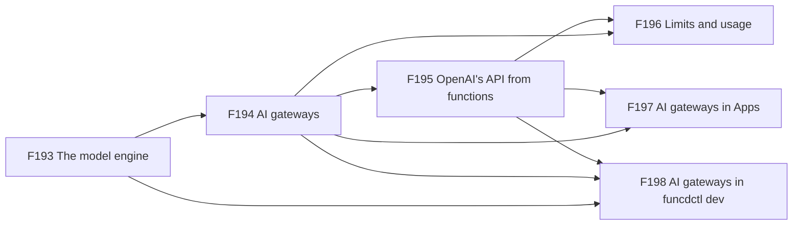
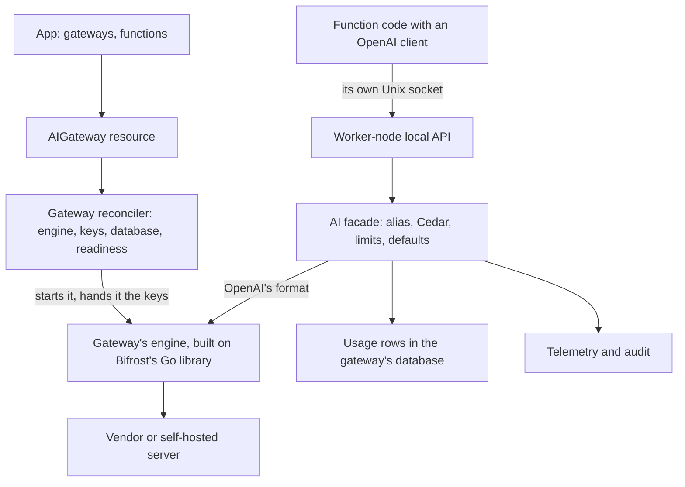

# FEAT-0015: AI gateway, models behind OpenAI's API over an engine of funcd's own

- **Status**: Active: a living document; the tracking table updates as ADRs progress
- **Date**: 2026-10-24
- **Deciders**: green-0-rabbit
- **Defines**: an **AI gateway epoch**: functions on funcd call language and embedding models through OpenAI's API,
  with any OpenAI client, with no vendor key in their sandbox, under limits, with their usage recorded. An AIGateway
  resource declares the models and starts its own engine, built on Bifrost's Go library. The vendor or the model
  underneath can change without any change to a function. Positioned alongside the other additive epochs (FEAT-0003
  to FEAT-0014).

## Initial need

funcd targets agents and MCP servers ([FEAT-0013](0013-feat-vector.md)), and agents call language models: to read a
request, to write an answer token by token, and to embed text for the vector stores of FEAT-0013, which leaves
embedding to the function. Today:

- no resource kind, binding, authorization action or helper names a model or a model vendor;
- a function that calls a vendor carries the vendor's SDK and reads its key from a bound Secret
  ([ADR-0249](../adr/0249-ctx-secret-reads-from-funcd.md)), so every such function holds the credential, and nothing
  caps or counts the calls in common;
- with egress control on, each namespace must allow each vendor's domain
  ([ADR-0117](../adr/0117-egress-policy-enforcement.md));
- the blueprint names token streaming as an agent need (blueprint, *Runtime*), but the local API answers whole bodies.

## How this document works

This file captures **what** this capability set must contain and **why**. The **how** lives in ADRs (`docs/adr/`,
process in [ADR-0000](../adr/0000-adr-process.md)): every feature maps to one or more ADRs, and no implementation
detail is decided here. The design was proposed and refined with the decider on 2026-10-24 and 2026-10-25: the placement, the
engine, the resource, the access, the limits, the usage and the dev loop are decided, and the open questions below
are not. Its source is the [design report](../reports/ai-gateway-design.md), which holds the options, the measured
facts, the decisions and the shapes. The build order is computed in the
[delivery plan](../roadmap/ai-gateway-delivery-plan.md). The sections after the feature table summarise the report.
They are illustrative and non-normative: when an Accepted ADR disagrees with them, the ADR wins and this document is
updated to match. Feature status: `idea → adr → accepted → reviewing → implemented`.

## Features

F193 comes first: the gateways, the access and the dev loop all run on its engine. F194 builds on it, F195 builds on
F194, F196 and F197 build on F194 and F195, and F198 builds on F193 to F195. F199 is an idea, not built in this
epoch.

| # | Feature | Builds on | ADR(s) | Status |
|---|---|---|---|---|
| F193 | **The model engine**: funcd talks to model vendors through an engine of its own, built on Bifrost's Go library and built apart from the daemon. It reaches the vendors that library supports, such as OpenRouter, OpenAI, Anthropic, Gemini, Bedrock and self-hosted servers such as Ollama and vLLM, each through its own API, and it speaks OpenAI's API to the daemon. Bifrost's own server, stores and plugins are not used. One conformance suite checks the engine against a local OpenAI-compatible server. **Why**: the decider chose a Go SDK on 2026-10-24, so that funcd builds a gateway shaped to the platform on its own Secrets, rqlite and Unix sockets; a vendor client that fails ends one engine, not the daemon; and a namespace changes vendor or model without changing a function. | [ADR-0007](../adr/0007-blob-storage-layer-port.md) (a port with a conformance suite) · [ADR-0082](../adr/0082-provider-model-catalog.md) (the provider model) | — | idea |
| F194 | **AI gateways**: a namespace declares an AIGateway resource: its models, each a short name for a vendor's model, for chat or for embeddings, with its vendor, the address of a self-hosted server, the Secret entry that holds its key, a default system prompt and default settings; and the gateway's limits, timeout and retries, each with a default. Applying it starts the gateway's own engine, as applying a Lake or a SQL database starts theirs, and a namespace declares as many as it needs. The platform hands the keys to that engine only, recreates the engine when a key changes, reports when the gateway is ready, and refuses to delete it while a function binds it. With egress control on, the engine reaches only the hosts its models name. **Why**: one place per namespace for vendor keys, model choices and their limits; a change of model is an edit of the gateway, not of the code. | F193 · [ADR-0057](../adr/0057-secret-injection-last-mile.md) (secret injection) · [ADR-0065](../adr/0065-metastore-badger-engine.md) (the metastore) · [ADR-0087](../adr/0087-add-on-provider-runtime.md) (the add-on runtime) · [ADR-0117](../adr/0117-egress-policy-enforcement.md)/[ADR-0175](../adr/0175-engine-is-its-own-principal.md) (egress, the engine as its own principal) · [ADR-0248](../adr/0248-stores-at-the-root.md) (store entries at the root) | — | idea |
| F195 | **OpenAI's API from functions**: a function binds a model of a gateway under an alias and calls it with any OpenAI client, from TypeScript and Python: chat, whole or streamed, and embeddings, over its own Unix socket, with the alias as the model name. The runtime's helper hands the client its settings, and the function holds no key and no vendor SDK beyond an OpenAI-format client. Every call is authorized, a stream that the function abandons stops at the vendor, and Workflow steps bind models the same way. **Why**: agent code and its frameworks already speak OpenAI's API; one access model for KV, blob, SQL, vectors and models; and embeddings feed the vector stores of FEAT-0013. | F194 · [ADR-0069](../adr/0069-kv-data-plane.md) (the worker-node local API) · [ADR-0074](../adr/0074-cedar-authorization-resource-access.md)/[ADR-0116](../adr/0116-capability-authorization-framework.md) (Cedar) · [ADR-0226](../adr/0226-stuck-calls-deadline-and-stop-ladder.md) (the call's deadline) · [ADR-0246](../adr/0246-bindings-under-spec.md) (bindings) | — | idea |
| F196 | **Limits and usage**: a gateway and each binding can cap tokens and requests over a fixed window, from a minute to a month. Once a cap is spent, the next call is refused before it reaches the engine, and a running call stops at the cap plus a tolerance. Every call records its usage in the gateway's own database: namespace, function, gateway, model, tokens in and out, duration, outcome, and the cost when the vendor reports it. The caps count from those rows, so they survive a restart and rewind with a restore. **Why**: an internal caller in a loop must not run up an unbounded bill, and an owner needs the cost of each function. | F194 · F195 · [ADR-0232](../adr/0232-sql-database-resource-and-rqlite-engine.md) (rqlite) · [ADR-0010](../adr/0010-observability-telemetry-and-audit.md) (telemetry and audit) | — | idea |
| F197 | **AI gateways in Apps**: an App declares its gateways next to its stores, with their keys as declared Secrets and their usage in one of the App's databases, and they are applied and removed with the App. **Why**: an App is the unit an owner installs, upgrades and removes. | F194 · F195 · [ADR-0199](../adr/0199-app-resource.md) (the App) · [ADR-0213](../adr/0213-app-config-and-secret-declarations.md) (declared Secrets) · [ADR-0236](../adr/0236-sql-in-apps.md) (SQL in Apps) · [ADR-0248](../adr/0248-stores-at-the-root.md) (stores at the root) | — | idea |
| F198 | **AI gateways in funcdctl dev**: `funcdctl dev` runs a function that binds a model against the real engine, with keys from the developer's environment, as it runs the real engines of SQL and the lake. **Why**: the dev loop must match production, and no gateway is mocked. | F193 · F194 · F195 · [ADR-0125](../adr/0125-funcdctl-dev-local-run.md) (funcdctl dev) · [ADR-0254](../adr/0254-funcdctl-dev-config-file.md) (the dev config file) | — | idea |
| F199 | **Models served by funcd**: an add-on engine that serves open-weight models on the box. Not built in this epoch. **Why**: a model with no vendor at all; [ADR-0087](../adr/0087-add-on-provider-runtime.md) already names an inference server as a future add-on. | F193 · F194 · ADR-0087 | — | idea |

## How it lands on funcd (high level)

The AI gateway is an add-on provider that is reached like a built-in, as SQL is: applying an AIGateway starts its own
engine through the add-on provider runtime, and functions reach it only through the daemon. A function builds an
OpenAI client from the settings its runtime's helper hands it, and the client talks to funcd over the function's own
Unix socket. funcd resolves the alias, asks Cedar, checks the limits, adds the model's defaults and passes the call to
the gateway's engine in OpenAI's format. The engine calls the vendor through Bifrost and streams the answer back, and
the daemon records the usage in the gateway's own database. The vendor keys reach only the engine.

## Capability map: reuse vs. new

| Component | Role for models | Status | Feature |
|---|---|---|---|
| Engine built on Bifrost's Go library | calls the vendors and speaks OpenAI's API to the daemon | new; a new dependency of its own module | F193 |
| Add-on provider runtime ([ADR-0087](../adr/0087-add-on-provider-runtime.md)) | runs one engine per gateway, with its keys | exists; the engine and its image new | F194 |
| Egress control ([ADR-0117](../adr/0117-egress-policy-enforcement.md)) and engine principals ([ADR-0175](../adr/0175-engine-is-its-own-principal.md)) | let an engine reach only the hosts its models name | exist; the gateway's engine and its generated grant new | F194 |
| Provider catalog ([ADR-0082](../adr/0082-provider-model-catalog.md)) | lists the AI gateway as a provider | exists; one row new | F194 |
| Secrets, ConfigMaps and Buckets | hold the keys, the short system prompts and the long ones | exist | F194 |
| SQL databases on rqlite ([ADR-0232](../adr/0232-sql-database-resource-and-rqlite-engine.md)) | hold the usage rows | exist; the gateway's root entry new | F196 |
| Worker-node local API ([ADR-0069](../adr/0069-kv-data-plane.md)) | carries OpenAI's API over the function's socket | exists; the AI route and streaming new | F195 |
| The shims, funcd-typescript and funcd-python | hand an OpenAI client its settings | exist; helper new | F195 |
| Cedar ([ADR-0116](../adr/0116-capability-authorization-framework.md)) | authorizes each call on a gateway | exists; the `ai::call` action new | F195 |
| Telemetry and audit ([ADR-0010](../adr/0010-observability-telemetry-and-audit.md)) | carry each call's usage, never its prompt | exist; usage records new | F196 |
| The App ([ADR-0199](../adr/0199-app-resource.md)), declared Secrets ([ADR-0213](../adr/0213-app-config-and-secret-declarations.md)) and SQL in Apps ([ADR-0236](../adr/0236-sql-in-apps.md)) | declare gateways, keys and the usage database | exist; gateway entry new | F197 |
| `funcdctl dev` ([ADR-0125](../adr/0125-funcdctl-dev-local-run.md), [ADR-0254](../adr/0254-funcdctl-dev-config-file.md)) | runs the real engine with the developer's keys | exists; the engine new | F198 |

## Rules at a glance (illustrative, non-normative)

| Topic | Rule | Feature |
|---|---|---|
| Placement | an add-on engine per AIGateway, started when the gateway is applied; reached only through the daemon | F193, F194 |
| Engine | funcd's own, built on Bifrost's Go library (decided 2026-10-24) | F193 |
| API | OpenAI's API, with any OpenAI client; the binding's alias is the model name | F195 |
| Keys | a Secret entry per model, bound to the gateway and handed to its engine; never in a function's sandbox, a status, a log or an answer | F194 |
| Models | declared on the gateway: a short name, a type (chat or embedding), a vendor and the vendor's model id, with default settings and a default system prompt | F194 |
| Settings | a timeout of 300 s, a stream idle limit of 120 s and 3 attempts by default, each set on the gateway; retries happen only in the gateway | F194 |
| Grants | a binding grants calls to its gateway; an operator Policy may forbid a function, a gateway or a model | F195 |
| Cancellation | a stream that the function abandons stops at the vendor | F195 |
| Limits | tokens and requests per fixed window; a spent cap refuses the next call with a 429; a running call stops at the cap plus its tolerance | F196 |
| Usage | one row per call in the gateway's database; the cost when the vendor reports it | F196 |
| Logs | prompts and answers never enter logs, telemetry or audit | F195, F196 |
| State | resources in the metastore, keys in Secrets, usage in the gateway's SQL database; an engine keeps no state | F194, F196 |

## Exit criterion

The epoch is complete when an App declares an AIGateway whose keys are declared Secrets, its functions chat with a
bound model, whole and streamed, and embed text through an OpenAI client from both runtimes with no key in their
sandbox, a call is refused without reaching the engine once its cap is spent, each call's usage is recorded against
its function, `funcdctl dev` runs one of its functions against the real engine, and each feature passes its checks:

- **F193**: the engine passes the conformance suite against a local OpenAI-compatible server; a panic in it ends that
  engine only.
- **F194**: applying a gateway starts its engine; a gateway whose keys resolve reports Ready, and a missing key holds
  it not Ready; a changed key recreates the engine; a crashed engine stops no other gateway and no worker; a delete is
  refused while a function binds the gateway; with egress control on, the engine reaches its models' hosts and nothing
  else; the keys appear in no status, log or function sandbox.
- **F195**: an OpenAI client in a bound function chats, streams and embeds, from both runtimes; an unbound alias is
  refused; a stream that the function abandons stops at the vendor.
- **F196**: once a cap is spent, the next call is refused before any engine call; a running call stops at the cap plus
  its tolerance; the database holds one row per call, naming the namespace, function, gateway, model and tokens; the
  caps survive a daemon restart.
- **F197**: an App installs a gateway with its declared Secrets and its database, and removing the App removes the
  gateway and its engine.
- **F198**: `funcdctl dev` runs a function that binds a model against the real engine, with the developer's keys.

## Out of scope (tracked elsewhere)

- **Models served by funcd**: an inference engine on the box is F199, an idea.
- **MCP and A2A gateways**: this epoch carries model calls only.
- **Bifrost's own server, stores, plugins and web UI**: the engine uses the core library only.
- **Guardrails, response caches and prompt management**: not in this epoch; a model's default system prompt is one
  text, with no templates and no versions.
- **Model types other than chat and embedding**, such as rerank, speech, transcription, images and OCR: later, each as
  a new type.
- **A cap in money and a price table**: there is no dollar cap, and the cost column holds only what the vendor reports.
- **Callers outside funcd**: gateways serve funcd's own functions; an App that exposes a model writes an HTTP
  function ([ADR-0243](../adr/0243-http-functions.md)).
- **Gateways across namespaces**: a binding names a gateway of its own namespace, as for KV and SQL.
- **Backups**: a gateway and its engine hold no data. The gateway is a resource, backed up with the platform's own
  state ([FEAT-0009](0009-feat-disaster-recovery.md)/F109), and its usage rows are a SQL database, backed up and
  restored like any other ([ADR-0222](../adr/0222-workload-backup-resources-and-catalog-scope.md)).
- **High availability and multi-node**: a V2 topic (FEAT-0002).

## Open questions

| Question | Decided in |
|---|---|
| How agents' skills are stored and loaded | later, with the decider |
| The AI gateway's monitoring: what the engine reports to funcd's telemetry; Bifrost offers a tracer interface and plugins | later, with the decider |
| The licenses of the modules Bifrost brings; Bifrost's own module is Apache-2.0 | the F193 ADR |
