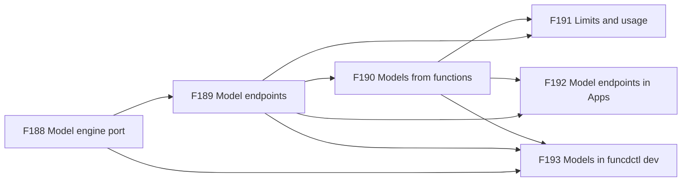
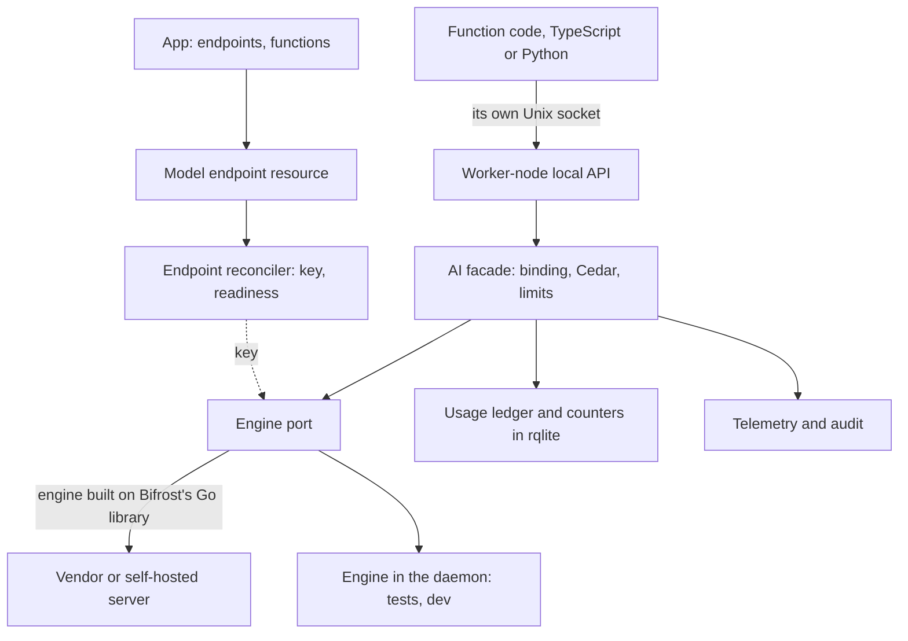

# FEAT-0015: AI gateway, models behind a fixed API over a swappable engine

- **Status**: Active: a living document; the tracking table updates as ADRs progress
- **Date**: 2026-10-24
- **Deciders**: green-0-rabbit
- **Defines**: an **AI gateway epoch**: functions on funcd call language and embedding models through one fixed API,
  `ctx.ai`, with no vendor key and no vendor SDK in their sandbox, under limits, with their usage recorded. The
  vendor or the model underneath can change without any change to a function. Positioned alongside the other additive
  epochs (FEAT-0003 to FEAT-0014).

## Initial need

funcd targets agents and MCP servers ([FEAT-0013](0013-feat-vector.md)), and agents call language models: to read a
request, to write an answer token by token, and to embed text for the vector stores of FEAT-0013, which leaves
embedding to the function. Today:

- no resource kind, binding, authorization action or helper names a model or a model vendor;
- a function that calls a vendor carries the vendor's SDK and reads its key from a bound Secret
  ([ADR-0249](../adr/0249-ctx-secret-reads-from-funcd.md)), so every such function holds the credential, and nothing
  caps or counts the calls in common;
- with egress control on, each namespace must allow each vendor's domain
  ([ADR-0117](../adr/0117-egress-policy-enforcement.md));
- the blueprint names token streaming as an agent need (blueprint, *Runtime*), but the local API answers whole bodies.

## How this document works

This file captures **what** this capability set must contain and **why**. The **how** lives in ADRs (`docs/adr/`,
process in [ADR-0000](../adr/0000-adr-process.md)): every feature maps to one or more ADRs, and no implementation
detail is decided here. The design was proposed on 2026-10-24; the engine and its building blocks were refined with
the decider the same day, and the rest is not yet. Its source is the [design report](../reports/ai-gateway-design.md),
which holds the options, the measured facts, the decisions, the proposals and illustrative shapes. The build order is
computed in the [delivery plan](../roadmap/ai-gateway-delivery-plan.md). The sections after the feature table
summarise the report. They are illustrative and non-normative: when an Accepted ADR disagrees with them, the ADR wins
and this document is updated to match. Feature status: `idea → adr → accepted → reviewing → implemented`.

## Features

F188 comes first: the endpoints, the access and the dev loop all call models through its port. F189 builds on it, F190
builds on F189, F191 and F192 build on F189 and F190, and F193 builds on F188 to F190. F194 and F195 are ideas, not
built in this epoch.

| # | Feature | Builds on | ADR(s) | Status |
|---|---|---|---|---|
| F188 | **A swappable model engine**: funcd talks to model vendors through one port of its own. An engine is funcd's code, picked by name. The first is built on Bifrost's Go library and reaches the vendors that library supports, such as OpenRouter, OpenAI, Anthropic, Gemini, Bedrock and self-hosted servers such as Ollama and vLLM, each through its own API. A second answers in the daemon, the same way every time, for tests and the dev loop. Each engine says what it can do beyond the common core, such as streaming, tools, structured output and image input, and which settings it takes, and one conformance suite checks every engine against the same rules. **Why**: the decider chose a Go SDK on 2026-10-24, so that funcd builds a gateway shaped to the platform on its own Secrets, rqlite and Unix sockets; a namespace changes vendor or model without changing a function; tests run with no network and no bill; and funcd's ports have a real driver and an in-memory one. | [ADR-0007](../adr/0007-blob-storage-layer-port.md) (a port with a conformance suite) · [ADR-0082](../adr/0082-provider-model-catalog.md) (the provider model: a built-in provider) | — | idea |
| F189 | **Model endpoints**: a namespace declares a model endpoint as a resource: its vendor, the address of a self-hosted server, the Secret that holds its key, and the models it offers, each a short name for a vendor's model, for chat or for embeddings. The platform reads the key in the daemon, reports when the endpoint is ready, and refuses to delete it while a function binds it. **Why**: one place per namespace for a vendor key, the model choices and their limits; a change of model is an edit of the endpoint, not of the code. | F188 · [ADR-0057](../adr/0057-secret-injection-last-mile.md)/[ADR-0249](../adr/0249-ctx-secret-reads-from-funcd.md) (secrets the daemon resolves) · [ADR-0065](../adr/0065-metastore-badger-engine.md) (the metastore) | — | idea |
| F190 | **Models from functions**: a function binds one model of an endpoint under an alias and, from TypeScript and Python, sends it chat messages and receives the answer whole or as a stream of tokens, or embeds text, over its own Unix socket. Every call is authorized, a stream that the function abandons stops at the vendor, and the function holds no key and no vendor SDK. Workflow steps bind models the same way. **Why**: one access model for KV, blob, SQL, vectors and models; agents stream tokens; and embeddings feed the vector stores of FEAT-0013. | F189 · [ADR-0069](../adr/0069-kv-data-plane.md) (the worker-node local API) · [ADR-0074](../adr/0074-cedar-authorization-resource-access.md)/[ADR-0116](../adr/0116-capability-authorization-framework.md) (Cedar) · [ADR-0233](../adr/0233-sql-access-from-functions.md) (SQL from functions) · [ADR-0243](../adr/0243-http-functions.md) (the local API's `fetch`) | — | idea |
| F191 | **Limits and usage**: an endpoint and each binding can cap requests and tokens over a window. Once a window's cap is spent, the next call is refused before it reaches the vendor, and the counters survive a daemon restart. Every call records its usage against its namespace, function, endpoint and model, in a ledger kept in rqlite and in telemetry and audit: tokens in and out, duration, outcome, and the cost when the vendor reports it. **Why**: an internal caller in a loop must not run up an unbounded bill, and an owner needs the cost of each function. | F189 · F190 · [ADR-0232](../adr/0232-sql-database-resource-and-rqlite-engine.md) (rqlite) · [ADR-0010](../adr/0010-observability-telemetry-and-audit.md) (telemetry and audit) · [ADR-0164](../adr/0164-rate-limit-per-target.md) (token buckets at the edge) | — | idea |
| F192 | **Model endpoints in Apps**: an App declares its model endpoints next to its stores, with the key as a declared Secret, and they are applied and removed with the App. **Why**: an App is the unit an owner installs, upgrades and removes. | F189 · F190 · [ADR-0199](../adr/0199-app-resource.md) (the App) · [ADR-0213](../adr/0213-app-config-and-secret-declarations.md) (declared Secrets) · [ADR-0248](../adr/0248-stores-at-the-root.md) (stores at the root) | — | idea |
| F193 | **Models in funcdctl dev**: `funcdctl dev` gives a function that binds a model the engine that answers in the process, or the real endpoint with a key from the developer's environment. **Why**: the dev loop must match production, as it does for KV, blob, the lake and SQL, with no bill by default. | F188 · F189 · F190 · [ADR-0125](../adr/0125-funcdctl-dev-local-run.md) (funcdctl dev) | — | idea |
| F194 | **OpenAI's wire format for SDKs**: the same calls in OpenAI's request and answer shapes, so OpenAI's SDKs and the agent frameworks built on them work in a function, through a transport the helper hands out. Not built in this epoch unless the decider adds it. **Why**: much agent code already speaks that format. | F190 | — | idea |
| F195 | **Models served by funcd**: an add-on engine that serves open-weight models on the box. Not built in this epoch. **Why**: a model with no vendor at all; [ADR-0087](../adr/0087-add-on-provider-runtime.md) already names an inference server as a future add-on. | F188 · F189 · ADR-0087 | — | idea |

## How it lands on funcd (high level)

The AI gateway is a built-in provider: it runs in the daemon, beside the ingress and egress gateways, and starts no
container. The endpoint reconciler checks each endpoint and resolves its key into the daemon. Functions reach a model
the way they reach SQL: the handler calls the AI helper of its runtime, which talks to funcd over the function's own
Unix socket; funcd resolves the binding, asks Cedar, checks the limits, calls the vendor through the engine port and
records the usage. The engine is built on Bifrost's Go library, whose `Account` reads funcd's endpoints and Secrets;
Bifrost's own server and stores are not used. The key never leaves the daemon.

## Capability map: reuse vs. new

| Component | Role for models | Status | Feature |
|---|---|---|---|
| Engine port and its engines | let the facade call any vendor | new | F188 |
| Bifrost's Go library | reaches each vendor's own API under the engine | a new dependency | F188 |
| Provider catalog ([ADR-0082](../adr/0082-provider-model-catalog.md)) | lists the AI gateway as a built-in provider | exists; one row new | F189 |
| Secrets ([ADR-0057](../adr/0057-secret-injection-last-mile.md), [ADR-0249](../adr/0249-ctx-secret-reads-from-funcd.md)) | hold the vendor key that the daemon reads | exist | F189 |
| Worker-node local API ([ADR-0069](../adr/0069-kv-data-plane.md)) | carries a function's model calls over its Unix socket | exists; AI routes and streaming new | F190 |
| The shims, funcd-typescript and funcd-python | give handlers an AI helper next to the SQL helper | exist; helper new | F190 |
| Cedar ([ADR-0116](../adr/0116-capability-authorization-framework.md)) | authorizes each call on an endpoint | exists; AI capability new | F190 |
| SQL databases on rqlite ([ADR-0232](../adr/0232-sql-database-resource-and-rqlite-engine.md)) | hold the usage ledger and the durable counters | exist; ledger new | F191 |
| Telemetry and audit ([ADR-0010](../adr/0010-observability-telemetry-and-audit.md)) | carry each call's usage | exist; usage records new | F191 |
| The App ([ADR-0199](../adr/0199-app-resource.md)) and declared Secrets ([ADR-0213](../adr/0213-app-config-and-secret-declarations.md)) | declare endpoints and their keys | exist; endpoint entry new | F192 |
| `funcdctl dev` ([ADR-0125](../adr/0125-funcdctl-dev-local-run.md)) | runs a function with a model | exists; model binding new | F193 |
| Egress control ([ADR-0117](../adr/0117-egress-policy-enforcement.md)) | keeps a function from dialing a vendor that its namespace does not allow | exists, unchanged | — |

## Rules at a glance (illustrative, non-normative)

| Topic | Rule | Feature |
|---|---|---|
| Placement | a built-in provider in the daemon; no container per endpoint | F188, F189 |
| Engine | funcd's own engines, picked by name; the first is built on Bifrost's Go library (decided 2026-10-24) | F188 |
| Key | read by the daemon from a Secret; never in a sandbox, a status, a log or an answer | F189 |
| Models | declared on the endpoint: a short name, the vendor's model id, chat or embedding | F189 |
| Access | through the function's own Unix socket; no key and no vendor SDK in the sandbox | F190 |
| Calls | chat, whole or streamed, and embed | F190 |
| Grants | a binding grants calls to its model; an operator Policy may forbid them | F190 |
| Cancellation | a stream that the function abandons stops at the vendor | F190 |
| Limits | requests and tokens per window, per endpoint and per binding; a spent cap refuses the next call before the vendor sees it | F191 |
| Usage | one row per call in the ledger, against its namespace, function, endpoint and model | F191 |
| State | no foreign store: resources in the metastore, keys in Secrets, the ledger and the counters in rqlite | F189, F191 |

## Exit criterion

The epoch is complete when an App declares a model endpoint whose key is a declared Secret, its functions chat with a
bound model, whole and streamed, and embed text, from both runtimes with no key and no vendor SDK in their sandbox, a
call is refused without reaching the vendor once its cap is spent, each call's usage is recorded against its function,
`funcdctl dev` runs one of its functions with no network, and each feature passes its checks:

- **F188**: the engine built on Bifrost's Go library, against a recorded or local server, and the engine in the daemon
  pass the same conformance suite; a request that needs a capability its engine lacks is refused.
- **F189**: an endpoint whose key resolves reports Ready; a missing key holds it not Ready; a delete is refused while
  a function binds it; the key appears in no status, log or sandbox.
- **F190**: a bound function chats, streams and embeds; an unbound alias and a model that the endpoint does not offer
  are refused; a stream that the function abandons stops at the vendor; both runtimes pass the same checks.
- **F191**: once a binding's cap is spent, the next call is refused before any vendor call; the ledger holds one row
  per call, naming the namespace, function, endpoint, model and tokens, and the counters and the ledger survive a
  daemon restart.
- **F192**: an App installs an endpoint with its declared Secret, and removing the App removes the endpoint.
- **F193**: `funcdctl dev` runs a function that binds a model, with no network by default.

## Out of scope (tracked elsewhere)

- **Models served by funcd**: an inference engine on the box is F195, an idea.
- **MCP and A2A gateways**: this epoch carries model calls only.
- **Bifrost's own server, stores and web UI**: the engine uses the library only.
- **Guardrails, response caches and prompt management**: not in this epoch.
- **Callers outside funcd**: endpoints serve funcd's own functions; an App that exposes a model writes an HTTP
  function ([ADR-0243](../adr/0243-http-functions.md)).
- **Endpoints across namespaces**: a binding names an endpoint of its own namespace, as for KV and SQL.
- **Backups**: an endpoint holds no data of its own; it is a resource, backed up with the platform's own state
  ([FEAT-0009](0009-feat-disaster-recovery.md)/F109). Whether the ledger's database is backed up follows the limits
  ADR's choice of database.
- **High availability and multi-node**: a V2 topic (FEAT-0002).

## Open questions

| Question | Decided in |
|---|---|
| One Bifrost client per endpoint or one per daemon, the Go bump to 1.27, the license review of the modules Bifrost brings, and the daemon's binary size and idle memory with them | the F188 ADR |
| How a panic on the engine's own goroutines is kept from stopping the daemon | the F188 ADR |
| The kind's name, the `ai` vocabulary and the binding's fields | the F189 ADR |
| Who may set an endpoint's address, and which addresses the daemon refuses to dial for it | the F189 ADR |
| Whether an endpoint's readiness calls the vendor | the F189 ADR |
| How a stream crosses the function's socket, the size caps and the timeouts | the F190 ADR |
| How a token cap holds when a call's tokens are known only from its answer, so that calls in flight can overshoot it | the F191 ADR |
| How a stream that the function abandons is counted, when the vendor reports usage only at the end of a stream | the F191 ADR |
| The ledger's database, one for the platform or one per namespace, and how often the counters are flushed | the F191 ADR |
| What a call does while the ledger's database is not up, at boot or in an upgrade, and what a crash loses of the counters | the F191 ADR |
| Whether F194 joins this epoch | the decider |
