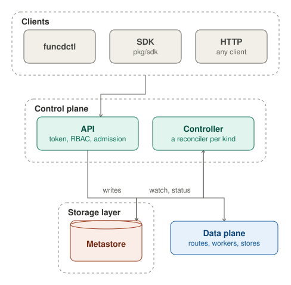

funcd's control plane keeps the declared state and makes the platform match it. Its API checks each write from funcdctl,
the SDK or any HTTP client and stores it in the metastore. The controller watches the metastore and runs a reconciler
for each kind. A reconciler sets the data plane's routes, workers and stores, and writes the resource's status back.

## API

The API is funcd's resource API. funcdctl, the SDK and any HTTP client call it under `/apis/funcd.io/v1alpha1/`, with
a bearer token or an `X-Api-Key` header. Only its OpenAPI spec, schemas and docs, at `/openapi`, `/schemas` and
`/docs`, need no token. A missing or unknown token gets 401 Unauthorized.

Each operation then asks RBAC whether the caller's role may use its verb on its kind in its namespace, and answers 403
Forbidden when it may not. An admin may do anything. A developer may use every verb on the namespaced kinds in its
namespaces. A viewer may only get and list them, and may never read a Secret.

The API has four groups of operations:

- **Resources**: get, list, create, replace and delete for every kind, served from the metastore. Revisions are
  read-only. After a write is stored, the metastore sends a watch event, and the controller reconciles the resource.
- **Logs**: a Function's logs, or a WorkflowRun's (its steps' logs, found by the run's trace), read from the function
  log files in Blob.
- **Dead letters**: list, replay and delete the events that a Sensor could not deliver, which the event store keeps.
- **Other operations**: retry an App's failed hook, hand a kept KVStore over to a Workflow, delete a retained local
  volume, read the platform backup's status, read or release the hold that a restored platform boots in, and return
  quarantined data to its object.

Each operation asks RBAC about its own verb and kind. Reading a Function's logs needs get on the Function. Reading the
backup status needs get on the cluster-scoped WorkerNode, so only an admin can read it.

### Writes

A create, a replace and a delete take this path after the two checks. `funcdctl apply` validates each document offline
first, then sends a PUT to the resource's path, and a POST to create it when the PUT answers 404.

Some admissions read the rest of the namespace, such as the quota on KVStores or the check that a Link's target
exists. When one of them handles the write, the API holds the namespace's lock from reading the stored object until
the write is stored. Two concurrent writes therefore cannot reach a state that neither order of them allows. Writes in
other namespaces never wait for this lock.

A replace or a delete can name the version it read, in an `If-Match` header or in `metadata.resourceVersion`. It
applies only while the stored object still has that version, and answers 409 Conflict otherwise. Without a version, a
write that loses to a concurrent one starts again from the read, up to five times, and then answers 409. A create
whose name is taken also answers 409.

The admission pipeline runs the mutating admissions, which may change the object, and then the validating ones, which
check the final object. The first refusal ends the write. An invalid object or a reached quota gets 400. A resource
that is still in use, such as a KVStore that a Function binds or that still holds keys, gets 409. An in-place Restore
by a caller who may not update its Namespace gets 403, and a WorkflowRun input over the payload limit gets 413. The API
never takes a resource's status, owner references or deletion timestamp from the client. It keeps the stored values,
which funcd's controllers set through the store.

With `--dry-run` (`?dryRun=true` on the API), the write passes every check and answers with the object as it would be
stored, including an App's rollout plan, but stores nothing. Any other write goes to the metastore, conditional on the
version that the API read, so the admissions' verdict holds for what is stored. The metastore sets a new
resourceVersion and, on a create, the uid, generation 1 and the creation time. A replace raises the generation only
when the spec changed. A replace that changes nothing stores nothing and sends no event.

## Controller

The controller makes the platform match the metastore. It opens a watch on each kind that it reconciles, and each
change queues the object's key. A change to one kind can also queue other objects whose state depends on it. A changed
ConfigMap queues the Sites that render it, and a changed Secret queues the Apps that declare it. The work queue lives
in memory and holds each key once. A key that changes during its pass runs once more.

One worker takes the keys in order and calls the reconciler of the key's kind. Only one pass therefore runs at a time,
and a slow pass delays every other kind. funcd has a reconciler for 17 kinds: App, Backup, BackupSchedule, Bucket,
EventSource, Function, Identity, KVStore, Lake, Restore, Route, SQLDatabase, Sensor, Service, Site, Workflow and
WorkflowRun. A pass acts on the platform: it sets the edge's routes, has the Executor start or stop workers, or creates
a store. It then writes the object's status itself, through the store, at the version it read.

The controller retries a failed pass for ever, first after 5 ms, then doubling the wait up to 1 s
(`controller.retryBackoffMax`). A kind that owns running instances, such as workers, asks to run again every 10 s
(`runtime.supervisionPeriod`), so that its reconciler replaces an instance that died. Otherwise, a pass runs again
only on the next change, because the controller has no periodic resync. When funcd restarts, each watch lists its
kind again, so every object gets one pass.

Beside the controller, the owner collector deletes the objects whose owner is gone, such as an App's parts after the
App, or a Function's Revisions after the Function. It watches the owner kinds. It also checks every child kind at
start and then every 5 minutes (`controller.gcSweepInterval`), to find what a crash or a dropped watch missed.
