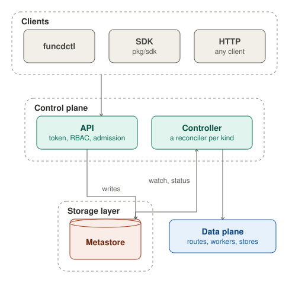

funcd's control plane keeps what you declare and makes the platform match it. Its API checks each write from funcdctl,
the SDK or any HTTP client and stores it in the metastore. The controller watches the metastore and runs a reconciler
per kind, which sets the data plane's routes, workers and stores, and writes each resource's status back.

## API

The API is funcd's resource API. funcdctl, the SDK and any HTTP client call it under
`/apis/funcd.io/v1alpha1/`, with a bearer token or an `X-Api-Key` header; only its OpenAPI spec, schemas and docs, at
`/openapi`, `/schemas` and `/docs`, need none. A missing or unknown token gets 401 Unauthorized.

Each operation then asks RBAC whether the caller's role may use its verb on its kind in its namespace, and answers 403
Forbidden when it may not. An admin may do anything, a developer may use every verb on the namespaced kinds in its
namespaces, and a viewer may only get and list them, and never a Secret.

The operations:

- **Resources**: get, list, create, replace and delete for every kind, served from the metastore; Revisions are
  read-only. After a write is stored, the metastore sends a watch event, and the controller reconciles the resource.
- **Logs**: a Function's logs, or a WorkflowRun's (its steps' logs, found by the run's trace), read from the function
  log files in Blob.
- **Dead letters**: list, replay and delete the events a Sensor could not deliver, which the event store keeps.
- **Other operations**: retry an App's failed hook, hand a kept KVStore over to a Workflow, delete a retained local
  volume, read the platform backup's status, read or release the hold a restored platform boots in, and return
  quarantined data to its object.

Each operation asks RBAC for its own verb and kind: reading a Function's logs needs get on the Function, and the
backup status needs get on the cluster-scoped WorkerNode, so only an admin reads it.

### Writes

A create, a replace and a delete take this path after the two checks. `funcdctl apply` validates each document offline
first, then sends a PUT to the resource's path, and a POST to create it when the PUT answers 404.

Some admissions read the rest of the namespace, such as the quota on KVStores or the check that a Link's target
exists. When one of them handles the write, the API holds the namespace's lock from reading the stored object until
the write is stored, so two concurrent writes cannot reach a state that neither order of them allows. Writes in other
namespaces never wait for it.

A replace or a delete can name the version it read, in an `If-Match` header or in `metadata.resourceVersion`. It
applies only while the stored object still has that version, and answers 409 Conflict otherwise. Without a version, a
write that loses to a concurrent one starts again from the read, up to five times, and then answers 409. A create
whose name is taken answers 409 too.

The admission pipeline runs the mutating admissions, which may change the object, and then the validating ones, which
check the final object. The first refusal ends the write: 400 for an invalid object or a quota reached, 409 for a
resource still in use, such as a KVStore that a Function binds or that still holds keys, 403 for an in-place Restore by
a caller who may not update its Namespace, and 413 for a WorkflowRun input over the payload limit. The API never takes
a resource's status, owner references or deletion timestamp from the client: it keeps the stored ones, which funcd's
controllers set through the store.

With `--dry-run` (`?dryRun=true` on the API), the write passes every check and answers the object as it would be
stored, with an App's rollout plan, but stores nothing. Any other write goes to the metastore, conditional on the
version the API read, so the admissions' verdict holds for what is stored. The metastore stamps a new resourceVersion,
and on a create the uid, generation 1 and the creation time. A replace raises the generation only when the spec
changed, and a replace that changes nothing stores nothing and sends no event.

## Controller

The controller makes the platform match the metastore. It opens a watch on each kind it reconciles, and each change
queues the object's key. A change to one kind can also queue others whose state depends on it: a changed ConfigMap
queues the Sites that render it, and a changed Secret the Apps that declare it. The work queue lives in memory and
holds each key once, and a key that changes during its pass runs once more.

One worker takes the keys in order and calls the reconciler of the key's kind, so one pass runs at a time and a slow
pass holds up every other kind. funcd has a reconciler for 17 kinds: App, Backup, BackupSchedule, Bucket,
EventSource, Function, Identity, KVStore, Lake, Restore, Route, SQLDatabase, Sensor, Service, Site, Workflow and
WorkflowRun. A pass acts on the platform, such as setting the edge's routes, having the Executor start or stop
workers, or creating a store, and then writes the object's status itself, through the store, at the version it read.

A failed pass is retried for ever, after 5 ms, doubling up to 1 s (`controller.retryBackoffMax`). A kind that owns
running instances, such as workers, asks to run again every 10 s (`runtime.supervisionPeriod`), so it replaces one
that died. Nothing else runs a pass again until the next change: the controller has no periodic resync. When funcd
restarts, each watch lists its kind again, so every object gets one pass.

Beside the controller, the owner collector deletes the objects whose owner is gone, such as an App's parts after the
App or a Function's Revisions after the Function. It watches the owner kinds, and sweeps every child kind at start and
then every 5 minutes (`controller.gcSweepInterval`), to catch what a crash or a dropped watch missed.
