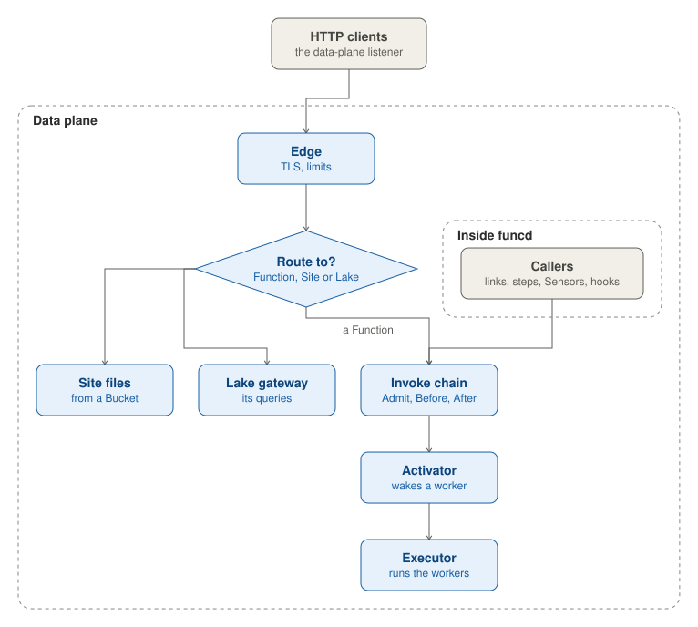
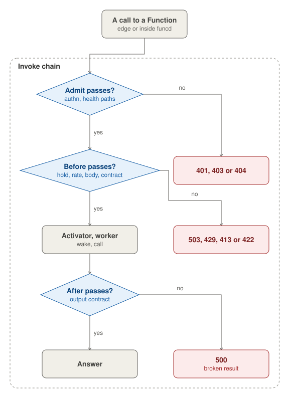

The data plane serves the calls. An HTTP client's call reaches the edge, which has a listener of its own and routes
the call to a Site's files, a Lake's gateway or a Function. A call to a Function runs the invoke chain, whether it
comes from the edge or from inside funcd. The calls from inside funcd are a Function's call over a link, a workflow
step, a Sensor's action and an App's hook. The activator then hands the call to a ready worker, and starts one when
the Function has none. The Executor runs the workers.

## Edge

The edge listens on `server.dataPlaneAddr`, apart from the API. By default, it uses a free port on loopback. It
terminates TLS when `server.tls.enabled` is set, with a self-signed certificate by default, with a certificate that the
operator provides (`provided`), or with one from Let's Encrypt (`acme`). Its limits are off by default.
`server.limits` sets a rate per minute for each client IP, a cap on the calls in flight and a body size. The edge
refuses a call over these limits with 429, 503 and 413 respectively, before any worker starts. It can also log each call, record metrics and traces
(`server.observability`), and set CORS, compression and headers (`server.shaping`).

The edge then matches the call against the rules of the Ready Routes. The longest path wins, and a host breaks a tie.
A rule with no host answers on `<namespace>.<baseDomain>`, or on any host when its namespace is `default`. When no rule
matches, `/function/<name>` calls the Function by name, unless its namespace's `defaultExposure` is `explicit`. Any
other call gets 404. The edge passes a Function's call to the invoke chain, serves a Site's files from its Bucket
prefix, and passes a Lake's queries to the Lake's gateway.

## Invoke chain

Every call to a Function's worker runs the invoke chain, which checks the call at three points. Admit runs before
funcd reads anything about the Function. When the call's auth stance is `authenticated`, as set by its Route or by its
namespace's default, the caller needs a token that lets it get the Function under RBAC. Otherwise, the call gets 401
or 403. A path under `/health/` gets 404, so no worker starts.

Before runs before the worker is called or started. A namespace that is held for its data refuses the call with 503,
and a rate per Function refuses it with 429. The body becomes the CloudEvent that the worker receives, and a body over
1 MiB gets 413. The call then gets its deadline: the Function's `spec.timeout`, else `invoke.defaultTimeout`, 60 s. A
call past its deadline gets 504. Last, Before checks the input against the Function's contract, and an input that
breaks it gets 422. After runs once the worker has answered: a result that breaks the output contract becomes a 500.

A call from inside funcd skips the edge. A Function's call over a link meets only the hold and the contract. It keeps
its own timeout, 30 s or the link's `timeout`, and gets 429 when 10 such calls to one Function are already in flight
(`invoke.maxNestedInFlight`).

## Activator

The activator hands a call to a ready worker. When the Function has none, the activator holds the call and starts a
worker. One start serves all the calls that arrive in the meantime, and they share its timeout, so a call that arrives
later waits less. When the worker is ready, the activator passes the held calls on. A call gets 503 at once when the
Function is `Failed`, and 503 when no worker is ready within `invoke.activationTimeout`, 30 s.

Every 30 s (`invoke.reclaimInterval`), the activator stops the workers of a Function that has served no call for its
`spec.scaling.idleTimeout`. The Function then reads `Idle`. This does not happen when its `minReplicas` is above 0.
With `replicas` above 1, every call goes to the lowest listening replica, and the other replicas wait as spares.

## Executor

The Executor runs the workers that the controller's pass of a Function asks for. `runtime.mode` picks its driver. The
default, `process`, runs each worker as a host process, without isolation, enforced limits or volumes. `containerd`,
on Linux as root, runs each worker in its own container with crun, on its own network. Several Functions can share
one pooled worker, but only on `process`.

Around each worker, the Executor opens its local API socket under `<dataDir>/invoke`. When `server.network.egress` is
on, it applies the worker's egress through the fence, the egress gateway and the DNS forwarder. It mounts the worker's
volumes, `emptyDir` or `local`, and captures its logs to the `funcd-system` bucket in Blob, where `funcdctl logs`
reads them.

A worker must listen within `runtime.bootTimeout`, 1 min, and answer its readiness check before it takes calls. A
worker that exits after it listened is replaced after `runtime.supervisionPeriod`, 10 s. A worker that keeps crashing
at boot is started again after a wait that doubles from 10 s to 5 min. A stop sends SIGTERM, then SIGKILL after the
grace period, which is 10 s on containerd and 3 s on process.
