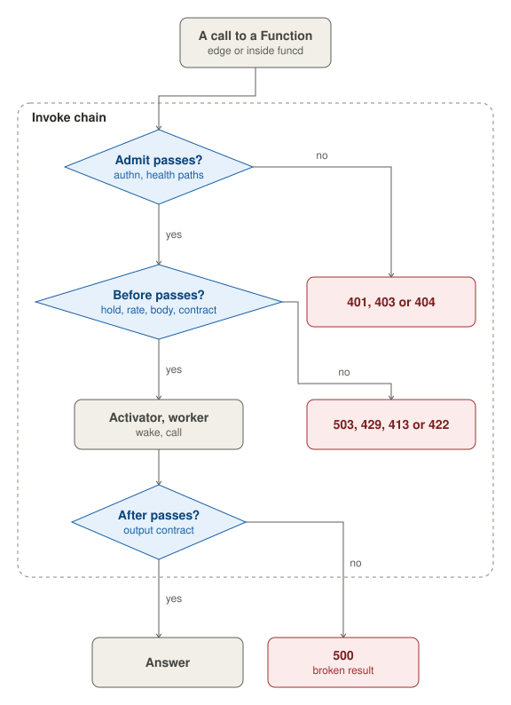

The data plane serves the calls. An HTTP client's call reaches the edge, on a listener of its own, which routes it to
a Site's files, a Lake's gateway or a Function. A call to a Function runs the invoke chain, whether it comes from the
edge or from inside funcd: a Function's call over a link, a workflow step, a Sensor's action or an App's hook. The
activator then hands it to a ready worker, waking one when the Function has none, and the Executor runs the workers.

## Edge

The edge listens on `server.dataPlaneAddr`, apart from the API, on a free port on loopback by default. It terminates
TLS when `server.tls.enabled` is set, with a self-signed certificate by default, your own (`provided`) or one from
Let's Encrypt (`acme`). Its limits are off by default: `server.limits` sets a rate per minute for each client IP, a
cap on the calls in flight and a body size, refused with 429, 503 and 413 before anything wakes. It can also log each
call and record metrics and traces (`server.observability`), and set CORS, compression and headers
(`server.shaping`).

It then matches the call against the rules of the Ready Routes: the longest path wins, and a host breaks a tie. A rule
with no host answers on `<namespace>.<baseDomain>`, and in `default` on any host. With no rule, `/function/<name>`
calls the Function by name, unless its namespace's `defaultExposure` is `explicit`; any other call gets 404. A
Function's call goes on to the invoke chain, a Site's files are served from its Bucket prefix, and a Lake's queries go
to the Lake's gateway.

## Invoke chain

Every call to a Function's worker runs the invoke chain, at three points. Admit runs before anything about the
Function is read. When the call's auth stance is `authenticated`, set by its Route or as its namespace's default, the
caller needs a token that lets it get the Function under RBAC, else 401 or 403. A path under `/health/` gets 404, so
nothing wakes.

Before runs before the worker is called or woken. A namespace held for its data refuses the call with 503, a rate per
Function refuses it with 429, the body becomes the CloudEvent the worker gets, refused with 413 over 1 MiB, and the
call gets its deadline: the Function's `spec.timeout`, else `invoke.defaultTimeout`, 60 s, past which it gets 504.
Last, its input is checked against the Function's contract, else 422. After runs once the worker answered: a result
that breaks the output contract becomes a 500.

A call from inside funcd skips the edge. A Function's call over a link meets only the hold and the contract, keeps its
own timeout, 30 s or the link's `timeout`, and gets 429 when 10 such calls to one Function are already in flight
(`invoke.maxNestedInFlight`).

## Activator

The activator hands a call to a ready worker. When the Function has none, it holds the call and wakes the Function,
once for all the calls that arrive meanwhile, which share the wake's clock; when a worker is ready, it passes the held
calls on. A call gets 503 at once when the Function is `Failed`, and 503 when no worker is ready within
`invoke.activationTimeout`, 30 s.

Every 30 s (`invoke.reclaimInterval`), it stops the workers of a Function that served no call for its
`spec.scaling.idleTimeout`, which then reads `Idle`, unless its `minReplicas` is above 0. With `replicas` above 1,
every call goes to the lowest listening replica, and the others wait as spares.

## Executor

The Executor runs the workers that the controller's pass of a Function asks for. `runtime.mode` picks its driver:
`process`, the default, runs each worker as a host process, without isolation, enforced limits or volumes, while
`containerd`, on Linux as root, runs it in its own container with crun, on its own network. Several Functions can
share one pooled worker, on `process` only.

Around each worker, the Executor opens its local API socket under `<dataDir>/invoke`, applies its egress through the
fence, the egress gateway and the DNS forwarder when `server.network.egress` is on, mounts its volumes, `emptyDir` or
`local`, and captures its logs to the `funcd-system` bucket in Blob, where `funcdctl logs` reads them.

A worker must listen within `runtime.bootTimeout`, 1 min, and answer its readiness check before it takes calls. One
that exits after it listened is replaced after `runtime.supervisionPeriod`, 10 s; one that keeps crashing at boot is
retried after a wait that doubles from 10 s to 5 min. A stop sends SIGTERM, then SIGKILL after the grace, 10 s on
containerd and 3 s on process.
