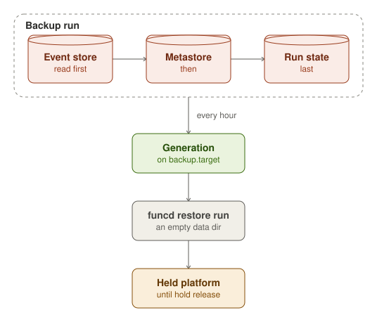

The storage layer is funcd's own state, in three platform stores, each a Badger database of its own under
`storage.dataDir`. The metastore holds every resource, the event store holds what eventing must not lose, and the run
state holds each workflow run's progress. Your Functions' data is not here: it lives in the
[services](../services/index.mdx), KV, Blob, SQL and Lake. With `storage.mode` set to `memory`, the three stores live in
memory and are gone when funcd stops.

## Metastore

The metastore holds every resource the API accepted, keyed by kind, namespace and name, under `<dataDir>/store`. A
write commits whole or not at all, one at a time, with one fsync. The store stamps each object's uid, its generation,
raised only when the spec changes, and its resourceVersion, and refuses a write whose version is no longer current.

After each commit it sends a watch event to its watchers inside funcd, such as the controller, and keeps the recent
events in a ring, so a watcher that fell behind resumes where it was; one it had to drop lists everything again. With
`secrets.encryptionKeyFile` set, it encrypts each Secret's value at rest.

## Event store

The event store is eventing's durable store, under `<dataDir>/eventstore`. It keeps three things, each under its own
key prefix: the events a Sensor could not deliver (`dl/`), which the API lists, replays and deletes; the keys each blob
EventSource has seen (`seen/`); and the SQL change feed's watermarks (`cdc/`). The events themselves are not stored:
they pass through funcd in memory.

## Run state

The run state is the workflow engine's record of each WorkflowRun, under `<dataDir>/workflow`, and the engine is its
only writer. A record pins the run's input and its Workflow's spec when the run starts, and keeps each step's state and
the run's phase. A run resumes from its pinned spec, so a Workflow edited, or an artifact pushed again, mid-run leaves
it on the graph it started with.

## Backup

With `backup.target` set and `storage.mode` set to `file`, funcd copies the storage layer to the target every
`backup.interval`, 1 h, and tries a failed run again after 5 min. A run reads the three stores back to back, the event
store first, then the metastore, then the run state: a WorkflowRun in the copy then has its run record, and an event
fired between the reads is delivered again rather than lost. When Blob keeps its files on the node, its mirror goes to
the same target.

Each copy is a generation under `gen/` on the target, and a second funcd writing to the same target is fenced off.
funcd deletes nothing there: the target's own lifecycle rules expire the old generations. `funcdctl backup status`
reads the newest generation, and `funcdctl backup verify` checks one.

`funcd restore run` loads a generation into an empty data directory. The restored platform starts held: its timers,
blob sources, Sensors, runs, rollouts, backups and sweeps wait until `funcdctl hold release`.
