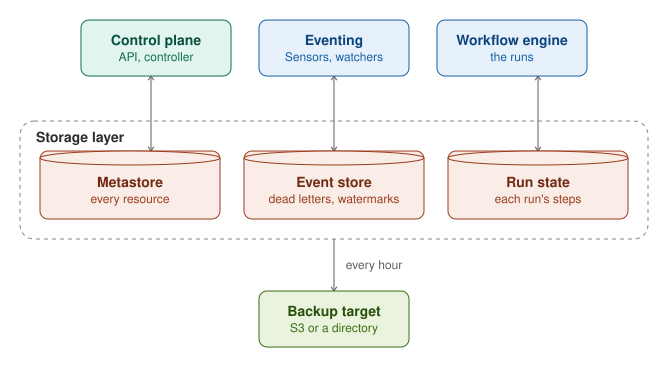

The storage layer holds funcd's own state in three platform stores. Each store is a Badger database of its own under
`storage.dataDir`. The metastore holds every resource. The event store holds what eventing must not lose. The run
state holds each workflow run's progress. The Functions' data is not in the storage layer: it lives in the
[services](../services/index.mdx), KV, Blob, SQL and Lake. With `storage.mode` set to `memory`, the three stores live
in memory and are gone when funcd stops.

## Metastore

The metastore holds every resource that the API accepted, keyed by kind, namespace and name, under `<dataDir>/store`.
Each write commits whole or not at all. Writes commit one at a time, each with one fsync. The store sets each object's
uid, its generation and its resourceVersion. It raises the generation only when the spec changes, and it refuses a
write whose version is no longer current.

After each commit, the metastore sends a watch event to its watchers inside funcd, such as the controller. It keeps
the recent events in a ring, so a watcher that fell behind resumes where it stopped. A watcher that the store had to
drop lists everything again. With `secrets.encryptionKeyFile` set, the metastore encrypts each Secret's value at rest.

## Event store

The event store is eventing's durable store, under `<dataDir>/eventstore`. It keeps three things, each under its own
key prefix. The first is the events that a Sensor could not deliver (`dl/`), which the API lists, replays and deletes.
The second is the keys that each blob EventSource has seen (`seen/`). The third is the SQL change feed's watermarks
(`cdc/`). funcd does not store the events themselves: they pass through funcd in memory.

## Run state

The run state is the workflow engine's record of each WorkflowRun, under `<dataDir>/workflow`. The engine is its only
writer. A record keeps the run's input and its Workflow's spec as they were when the run started, and it keeps each
step's state and the run's phase. A run resumes from that saved spec. Editing the Workflow, or pushing an artifact
again, during a run therefore leaves the run on the graph that it started with.

## Backup

A platform backup copies the three stores together. It reads the event store first, then the metastore, then the run
state, so a WorkflowRun in the copy has its run record. The [Disaster recovery](../disaster-recovery.md) page describes
the backups and how to restore them.
