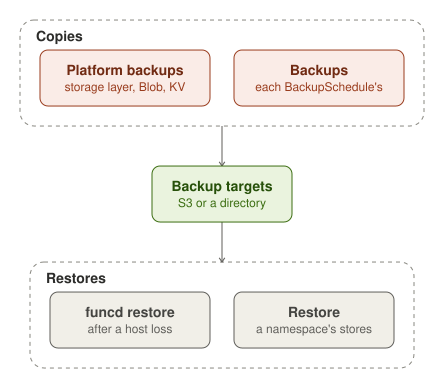
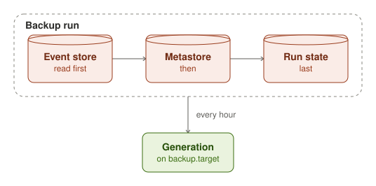
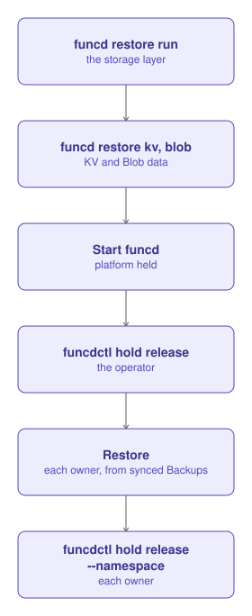

funcd keeps two kinds of copies, each on a backup target, which is an S3 bucket or a directory. The operator runs the
platform backups, which copy the storage layer, Blob's files and KV's stores. A namespace's owner schedules Backups of
its own stores with a BackupSchedule. After a host loss, `funcd restore` brings the platform back. A Restore brings back a
namespace's stores.

## Platform backup

With `backup.target` set and `storage.mode` set to `file`, funcd copies the
[storage layer](architecture/storage-layer.md) to the target every `backup.interval`, 1 h, and tries a failed run
again after 5 min. A run reads the three stores
back to back: the event store first, then the metastore, then the run state. In this order, a WorkflowRun in the copy
has its run record, and an event fired between the reads is delivered again rather than lost. When Blob keeps its
files on the node, its mirror goes to the same target. With `kvstore.backup.enabled`, KV also exports its stores
there, unless `kvstore.backup.target` names another target.

Each copy is a generation under `gen/` on the target. A run that finds another funcd's copies on the same target
writes nothing. funcd deletes nothing on the target: the target's own lifecycle rules expire the old generations.
`funcdctl backup status` reads the newest generation, and `funcdctl backup verify` checks one. When the newest
verified generation is older than `backup.objectives.rpo`, 2 h, funcd logs `backup rpo at risk`. To clear it, verify
the copies with `funcdctl backup verify` from another machine.

## Backups and Restores

A BackupSchedule copies a namespace's stores on a cron `schedule`, in a `timeZone`. It copies the KVStores, Buckets,
Lakes, SQL databases and volumes that its `scope` names, or those of an App or a ResourceGroup. Each slot makes a
Backup: a copy on the schedule's own `target`, encrypted for its `encryption.recipients`. A Backup's record is deleted
after its `ttl`, 720 h by default. funcd does not retry a failed Backup: the next slot is the next attempt.

A Restore loads members of a Succeeded Backup. Each member goes into an empty store that `as` names, or back into its
own store (`inPlace`). An in-place Restore needs `update` on the Namespace, so an admin applies it, and only one runs
at a time in each namespace. It first takes a Backup named `<restore>-before`, then reads the whole copy and checks
every member. Only then does it hold the namespace: its Functions refuse calls, its Sites keep serving their files,
and its engines and workers stop. It loads each member in order, and it lifts the hold when every member is loaded.
When a load fails, the hold stays until `funcdctl hold release --namespace`.

## After a host loss

On a new host, `funcd restore run` loads a platform generation into the empty data directories. `funcd restore kv`
and `funcd restore blob` bring back KV's stores and Blob's files, and `funcd restore list` shows the generations.
funcd then starts held: its timers, blob sources, Sensors, runs, rollouts, backups and sweeps wait until the operator
runs `funcdctl hold release`.

Each namespace with a BackupSchedule stays held for its data. Its schedule first records the copies on its target as
Backups. The owner then applies a Restore from the newest Backup and runs `funcdctl hold release --namespace`. A
namespace with no BackupSchedule answers calls from the first start, with the data that `funcd restore kv` and
`funcd restore blob` brought back.
