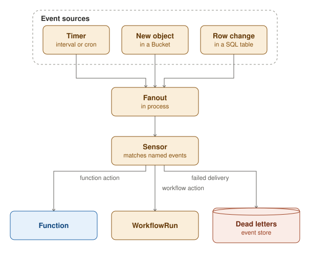

An EventSource fires named events: on a timer, on a new object in a Bucket or on a row change in a SQL table. Each
event is a CloudEvent, published into an in-process fanout that keeps nothing: an event fired while its Sensor is down
is lost.

A Sensor subscribes to named events and runs an action when one fires: it calls a Function, which the activator wakes
when it has no worker running, or it starts a WorkflowRun. A delivery the Sensor could not make, after its retries or
because it had to stop, is parked as a dead letter in the event store.
