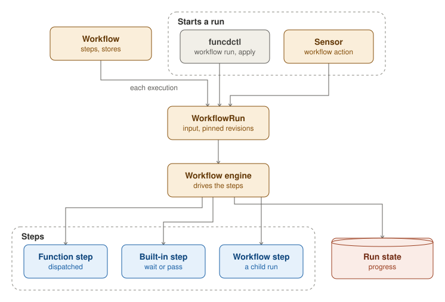

A Workflow declares its steps and the stores they bind. Steps run in list order unless a step names its parents with
`dependsOn`; a step can wait for all of its parents or for any one of them, and a `when` condition can skip it. A step
is a Function, a built-in step (`wait` or `pass`) that the engine runs itself, or another Workflow, run as a child.

A WorkflowRun is one execution of a Workflow, with its input. `funcdctl workflow run`, an applied manifest or a Sensor
starts one, and the run is pinned to the revisions of the step Functions it started with. The workflow engine drives
the run through its steps: it calls each Function step through the activator, hands each step's output to the steps
that follow, retries a failed step as its retry policy says, and keeps the run's progress in the run-state store. A
run is Pending, Running, Paused, Succeeded, Failed or Cancelled, and `funcdctl workflow replay` runs a finished run
again from a chosen step.
