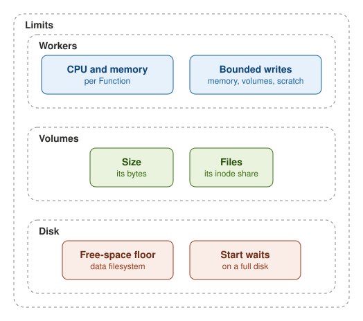

Each Function has a CPU and a memory limit, and a node default applies to a Function that sets none. A worker writes
only into its memory, its volumes or a scratch space of a fixed size.

A volume holds at most its size in bytes and its share of files. The amount that a store may hold is set by its
[quota](quotas.md).

On the data filesystem, workload writes stop at a free-space floor, while reads, deletes and the platform's own writes
go on. When the disk is full at start, funcd waits for space instead of exiting.
