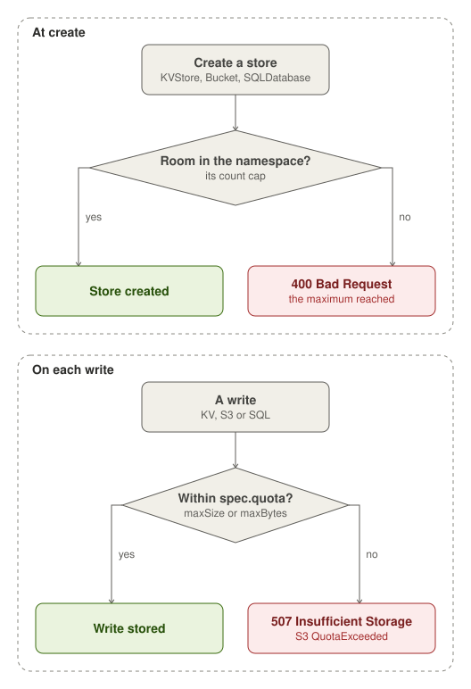

A namespace holds at most 100 KVStores (`kvstore.maxStoresPerNamespace`), 100 Buckets and 20 SQL databases
(`sql.maxDatabasesPerNamespace`). The API refuses a create past the cap with 400, and it counts an App's new parts
together.

A store's `spec.quota` caps its size, with `maxSize`, such as `10Gi`, or `maxBytes`. A Bucket and each of its prefixes
take one, and so do a KVStore and a SQLDatabase. A Lake's files count against the Bucket prefix that holds them. Every
capped write asks one checker before it stores. A write that would pass the cap is refused whole with 507 Insufficient
Storage, or `QuotaExceeded` on S3, while reads and deletes go on.

A quota can also cap one item: a Bucket's object (`maxObjectBytes`, else `s3gateway.maxUploadBytes`, 1 GiB, refused
with 413), a KVStore's value (`maxValueBytes`, up to 1 MiB) and its key (`maxKeyBytes`, up to 64000 bytes).

The checker counts each store's size from a measure that it refreshes every minute. A store's first write after a
start, or after 10 minutes idle, waits for a whole measure, at most 2 minutes. A change made outside the store's
writes, such as a Restore's load, counts from the next refresh. A Restore can therefore leave a store past its cap,
and then only deletes run.
