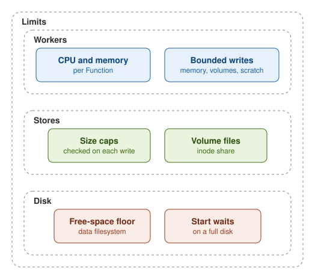

Each Function has a CPU and a memory limit, and a node default sizes a Function that sets none. A worker writes only
into its memory, its volumes or a scratch space of a fixed size.

An owner can cap the size of a Bucket, a Lake, a KVStore or a SQLDatabase: a write that would pass the cap is refused,
while reads still work. A volume holds at most its share of files, as it holds at most its size in bytes.

On the data filesystem, workload writes stop at a free-space floor, while reads, deletes and the platform's own writes
go on. A start on a full disk waits for space instead of exiting.
