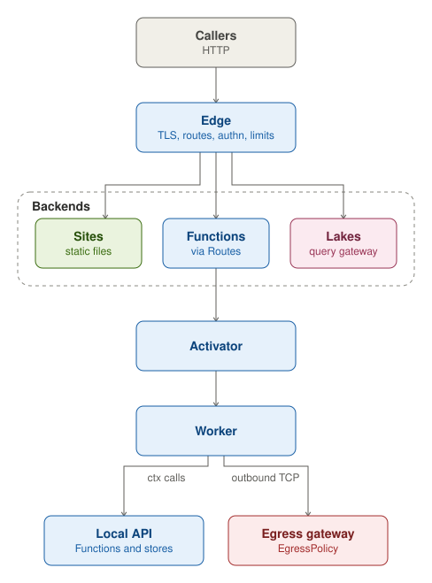
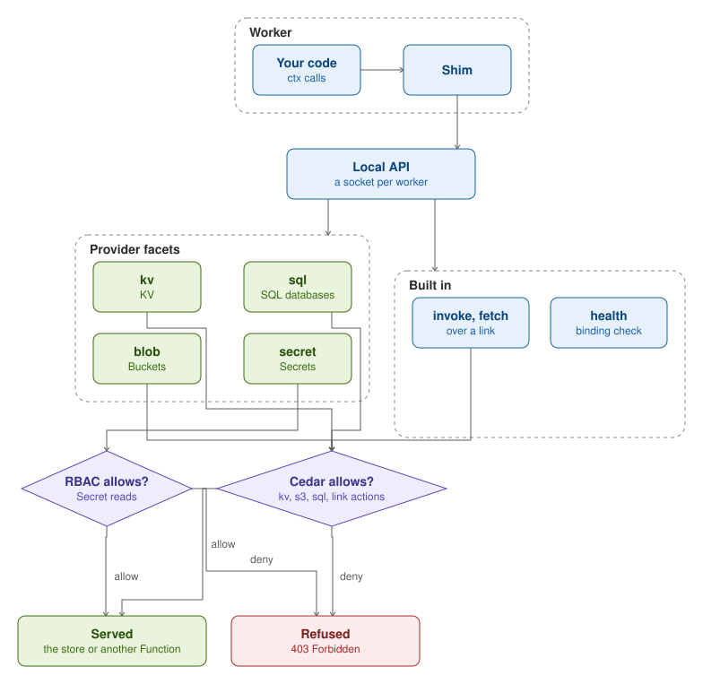
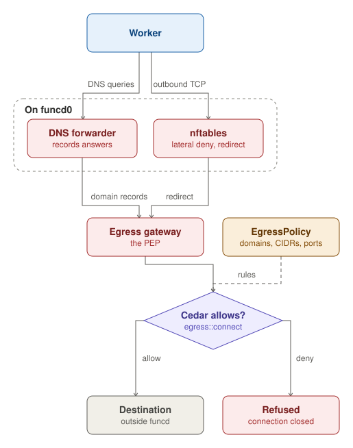

A call reaches funcd's edge, which terminates TLS, matches the call to a Route, authenticates it when the Route asks
for it, and applies the rate and size limits. A Route serves a Site's static files or calls a Function, and a Function
can also be called at `/function/<name>`. The edge also passes a Lake's queries to the Lake's gateway. When the
Function has no worker running, the activator holds the call, starts a worker and passes the call on once the worker
is ready. An idle Function scales back to zero.

A worker reaches other Functions and its stores through its local API. When egress control is on, its outbound
connections go through the egress gateway, which applies the namespace's EgressPolicy.

## Local API

Each worker has its own local API, an HTTP socket that funcd opens for it under `<dataDir>/invoke` and that only the
shim calls. funcd fixes the caller when it provisions the worker, so a request can never speak for another Function; a
pooled worker's socket serves each Function in the pool as the member the request names.

The providers serve their facets of it, each under its own path: `kv`, `blob` and `sql` ask Cedar before each call,
and `secret` asks RBAC. The local API also serves `invoke` and `fetch`, which call another Function over a link the
caller declares, through the data plane once Cedar allows it, and `health`, which checks the worker's bindings.

## Egress

Egress control is opt-in (`server.network.egress`) and works on Linux with containerd; when it is off, a worker's
outbound connections stay open. When it is on, nftables rules on the worker bridge, `funcd0`, block traffic between
workers, redirect a worker's outbound TCP to the egress gateway and drop the rest, and a worker's DNS queries are
redirected to funcd's DNS forwarder, which records the domain behind each answer.

For each connection, the egress gateway recovers the address the worker dialled, identifies the worker by its source
address, and takes the domain from the forwarder's records, never from what the client sends. It then asks Cedar
whether the worker's Function, or Lake, may `egress::connect` there. Cedar decides from the namespace's
EgressPolicies, whose rules name domains, exact or wildcard, CIDRs and ports, for the Functions they apply to. An
allowed connection is spliced through to its destination and a refused one is closed; every connection is audited.
