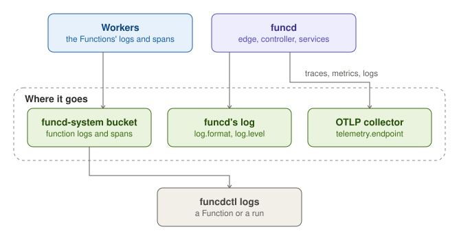

funcd records what the Functions do and what it does itself. A Function's logs and spans go to a bucket in Blob,
where `funcdctl logs` reads them. funcd writes its own log and, when `telemetry.endpoint` is set, exports its traces,
metrics and logs over OTLP.

## Function logs and traces

funcd captures each worker's output over a channel of its own, so the worker never waits for it. It stores the output
as OpenTelemetry records in the `funcd-system` bucket, under `logs/<namespace>/<function>/`. It writes a segment every
10 s or every 8 MiB, and later compacts the segments into Parquet files. When funcd cannot keep up with a worker's
output, it drops the lines that do not fit and logs `worker output dropped`.

`funcdctl logs <function>` prints a Function's logs, filtered with `--since`, `--severity` and `--limit`, which is 1000
by default. `funcdctl workflow logs <run>` prints the logs of every step of a WorkflowRun.

Each call to a Function also records a span in the same bucket. The edge starts a trace for each call, or adopts the
caller's `traceparent` header, and a Function that calls another Function over a link passes the trace on. One trace
therefore follows a call from the edge through every Function that it reaches, and a WorkflowRun's logs are found by
its run's trace. `funclog.enabled` and `funclog.traces` turn the logs and the spans off.

## funcd's own telemetry

funcd writes its own log in JSON by default (`log.format`, or `text`), at the `info` level by default (`log.level`).
Each record carries the trace and span ids of the work that it belongs to.

With `telemetry.endpoint` set, such as `localhost:4317`, funcd exports its traces, metrics and logs over OTLP gRPC to
that collector, and `telemetry.insecure` drops TLS for a local collector. Without an endpoint, funcd exports nothing,
and it serves no metrics endpoint of its own.

The edge records the calls that it serves when `server.observability` asks for it. `metrics` counts the calls
(`funcd.edge.requests`) and times them (`funcd.edge.duration_ms`), `accessLog` writes a log line for each call, and
`trace` records a span for each call. A call from inside funcd records none of them. Security-relevant events, such as
each egress connection, go to a separate audit log, whose records carry `source=audit`.

## Monitoring

Each resource reports its state in its `status`: a phase, such as `Ready` or `Failed`, and conditions that give the
reason. `funcdctl get <kind>` lists the resources, and `funcdctl describe <kind> <name>` shows one with its status.

`funcdctl backup status` shows the platform backup's restore points, failures and `rpoRisk`, and funcd logs
`backup rpo at risk` when the newest verified copy is too old. After a restore, `funcdctl hold status` shows the hold
and what it holds back. The [Disaster recovery](disaster-recovery.md) page describes both.
