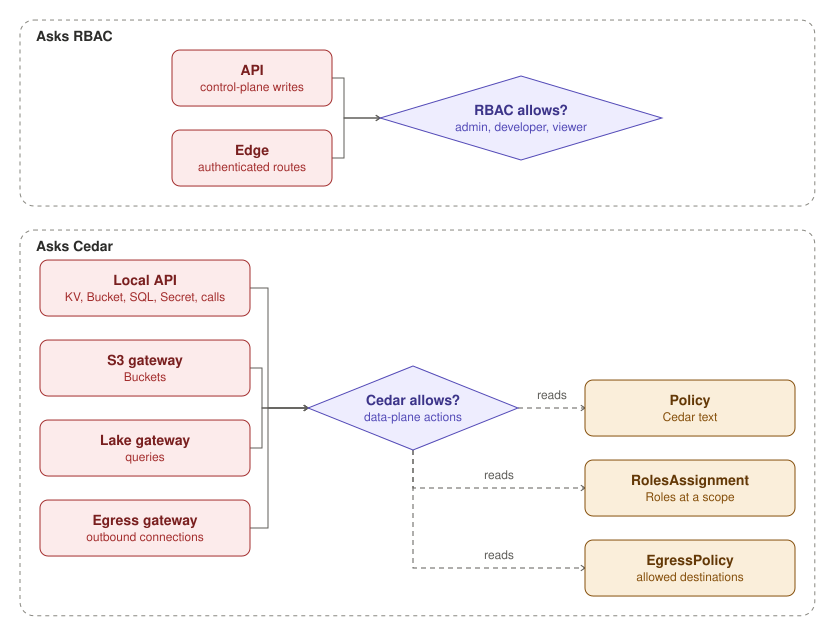

funcd checks a request where it enters, and each check asks one of two authorizers. The API and the edge's
authenticated Routes ask RBAC, which has the built-in admin, developer and viewer roles.

The other checks ask Cedar. The local API asks Cedar before a Function reads or writes KV, a Bucket or a SQL database,
reads a Secret, or calls another Function. A Lake also asks Cedar before its engine reads a Secret. The S3 gateway asks it before each Bucket request, the Lake gateway before each query, and
the egress gateway before each outbound connection. Cedar compiles Policies, which are Cedar text, RolesAssignments,
which grant Roles at a scope, and EgressPolicies. Both authorizers deny a request that no rule allows.
