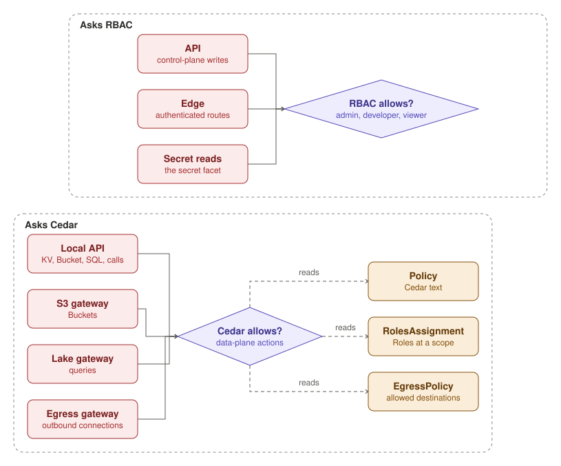

funcd checks a request where it enters, and each check asks one of two authorizers. The API, the edge's authenticated
Routes and a Function's Secret reads ask RBAC, which has the built-in admin, developer and viewer roles.

The other checks ask Cedar: the local API before a Function reads or writes KV, a Bucket or a SQL database, or calls
another Function; the S3 gateway before each Bucket request; the Lake gateway before each query; and the egress
gateway before each outbound connection. Cedar compiles Policies, which are Cedar text, RolesAssignments, which grant
Roles at a scope, and EgressPolicies. Both authorizers deny a request that no rule allows.
