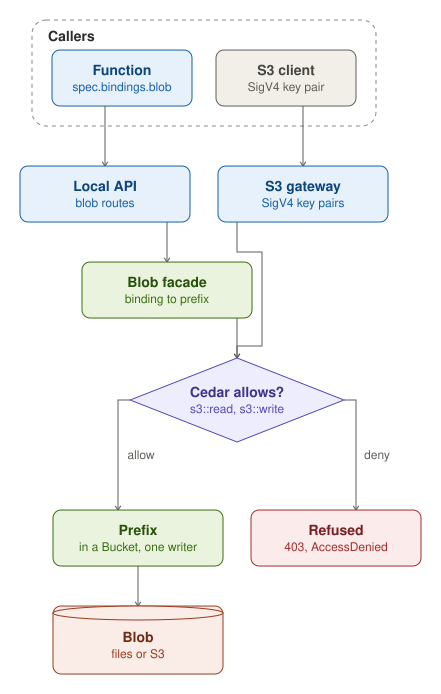

A Bucket holds objects under prefixes, its medallion layers, and each prefix has one writer, its owner. A Function
reaches a prefix through a binding in `spec.bindings.blob`: its calls go to its local API, where the blob facade asks
Cedar for `s3::read` or `s3::write`.

S3 clients reach a Bucket through funcd's S3 gateway with a SigV4 key pair. funcd issues a key pair to each Function
and Lake, and to each Identity, for a caller outside funcd. The gateway asks Cedar the same question for that
principal. The objects are files under `<dataDir>/blob`, or objects in an S3 store when `blob.target` points to one. A
new object can trigger an event of an EventSource.
